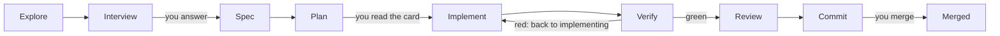

<p align="center">
  
</p>

# Monotrope

**Let AI agents do the work. Keep the decisions and the evidence.**

Monotrope is a file-based workflow for AI coding agents. Agents research,
specify, plan, implement and review a change; you decide what the change is
for and what must not happen. Everything in between — the research, your
answers, the agent's own choices, the contract, the review findings and where
the next session resumes — is written to versioned files in the repository.

Nothing to install, no server and no database of its own: Markdown and YAML in
git, a handful of Python scripts, and one instruction file that Claude Code,
Codex and Cline all read. A change started in one agent harness can be
finished in another, tomorrow, by a different model.

This repository holds the workflow rules, the phase prompts, the templates and
the tools, and it develops itself with the same workflow.

> **Status:** early and moving fast. [What works today](#what-works-today)
> separates what a tool enforces from what is a written rule and from what is
> not built yet. The repository and its tracker still carry the working name
> `coding-harness` in places.

## What it does

A change runs through seven phases. Each phase leaves one file, and the next
phase reads that file instead of a chat.



| # | Phase | What it leaves | The question it answers |
| --- | --- | --- | --- |
| 1 | Explore | `research.md` | What is the situation? |
| 1a | Interview | `decisions.md` | What must a person decide? |
| 2 | Spec | `spec.md` | What exactly should change? |
| 3 | Plan | `plan.md` | In which steps, and when is it done? |
| 4 | Implement | code and tests | Does it work? |
| 5 | Verify | test output | Can we show it? |
| 6 | Review | `findings.md` | Does it match the spec? |
| 7 | Commit | a pull request | Does CI agree? |

A spec review (2a), a design (2b) and a review loop between implementing and
verifying (4b) join when a change needs them. A session that ends leaves a
dated handover file: the objective, the evidence, what is open, and the one
action to resume with.

What a change asks of you is short:

1. **Answer a few questions** — only the ones that are yours to answer.
2. **Read the plan card** — what changes for you, when it is done, the time
   limit, what is left out. The work starts unless you say stop.
3. **Merge the pull request.**

## How it differs

Most ways of working with coding agents keep the state in the conversation:
the plan, the reasons and the open ends live in a chat window and are gone
when it closes. Agent frameworks and orchestrators add more agents and more
automation, but rarely a record a person can audit afterwards.
Spec-first tools write the spec down, then stop recording once the code runs.

Monotrope treats **the repository as the only memory** and the **merge as the
only approval**:

- **The chat is never the state.** Every phase, every decision and every
  handover is a file. Close the window, switch the harness, change the model —
  the next session reads where things stand.
- **Decisions have authors.** Open points come in three kinds. `[DECISION]`
  goes to a person: intent, anything irreversible or risky. `[GAP]` is
  explored, not asked. `[DETAIL]` is decided by the agent, with its reason
  written into the artefact. Afterwards you can see who decided what, and
  where the work departed from the plan.
- **A decision takes effect when its pull request is merged** — not when
  someone typed "yes" into a chat.
- **Evidence over summaries.** At the merge you judge a change by its tests,
  its findings table and green checks, not by an agent's account of itself.
- **It says what is not enforced.** Every rule is labelled: enforced by a
  tool, a written rule agents follow, or not built yet.

## What is special

**Model-agnostic by construction.** One instruction file (`AGENTS.md`) serves
every harness, and a test fails if a harness-specific file would silently
replace it. Models are assigned per phase and per job: one drafts, another
reviews, a third implements.

**A second vendor reviews, under guard.** Calls to models from other vendors
go through one runner. It checks that the endpoint is allowed to see the data
(`model-endpoints.yaml`), and it runs a leak check before every call. A leak
stops the call; there is no silent fallback to another model.

**Process rules are machine checks.** 22 gates live in one file
(`decisions/gates.yaml`); 18 block, 3 report, 1 advises (as of 2026-10-20).
Next to tests and lint they check the process itself: that a change answered
its minimum number of interview questions, that every recorded question
carries its context, that every acceptance criterion names the test that
proves it, and that document headers say when their content last changed.

**It travels.** The mechanism moves to another repository as a kit, and a
probe installs it into a throwaway repository and runs it there, to prove it
still works outside its home.

**Built for focus.** Every question comes with its context: the topic, why it
comes up now, how things stand today, and what would change. Every session
opens with where things stand, the next step and what is needed from you.
Messages lead with the result and ask one question at a time. Attention is the
scarcest resource in the loop — for people and for models.

## The clever parts

- **Red first, proven by the runner.** When a model repairs a finding, its
  claim that a test shows the defect is not taken on trust: the runner runs
  that test alone against the code *before* the repair, in a temporary
  checkout, and accepts it only if it fails there.
- **The reviewer never repairs.** Each review round is a fresh, read-only
  session. The model that fixes a finding is never the one that judges the
  fix, and a reviewer's own session never edits code.
- **A finding needs backing.** A review finding is acted on only when a test
  demonstrates it or the spec supports it. When two reviewers disagree, both
  views stay in the table, and the disagreement blocks like a defect.
- **Review until clean, cheapest first.** The review loop starts with a swarm
  of free models, then a swarm of fast paid ones, then one stronger model per
  round, ordered by cost — and stops at the first round with nothing to fix.
- **A brake on repair loops.** If two rounds in a row find only defects that
  earlier repairs introduced, the loop stops and a person decides how to go
  on.
- **One list, generated everywhere.** The CI workflow is generated from the
  gate file, and a gate fails when the two differ by a single byte. There is
  no second hand-kept list to drift.
- **Appetite, not estimates.** A plan card names a time limit as a stop, and a
  pre-mortem: "suppose it failed — most likely because …".
- **Numbers carry their cut-off.** Every count in a handover names its commit
  or date, and what could not be read is written as "not read", never as
  "none".

## What works today

Checked on 2026-10-20 against `main` at `59630b7`.

### Enforced by tooling

- `make verify` and CI run the gate list: tests, lint and the process checks
  above. Every gate declares whether it blocks or only reports.
- The stage-2 runner (`scripts/stage2.py`) checks the endpoint and runs the
  leak check before every call to another vendor. Drafting, implementing,
  repairing and reviewing by other models all go through it.
- The review loop runs until a round is clean (ADR 0021).

### Written rules agents follow, not enforced by a tool

- The three kinds of open points, the plan card as a contract, the
  communication form (a gate checks that the context is there, not its
  wording), and one writer per tracker.

### Not built yet

- The artefact validator, the stop hook that blocks a session end on a red
  tree, the slash commands and the gate catalogue that the doctrine names.
  Where the doctrine describes them, it describes the target.
- The research swarm for larger changes: an open decision (ADR 0020, draft).
- Keeping the work of a failed model call instead of discarding it.
- Orchestration of many agents in parallel: evaluated, not built.

## Try it

```bash
git clone https://github.com/bicycle-brakes/monotrope.git
cd monotrope
tools/beads/install.sh && tools/bd bootstrap --yes  # fresh clone: load the tracker
make venv                  # local .venv from the pinned lock (Python 3.12+)
bash tools/pi/install.sh   # pinned Pi; the real-Pi tests in make verify need it
make verify                # all gates
tools/bd ready             # open, unblocked work
```

To start a change, create its bead first, then
`python3 scripts/new_change.py <name> --bead <id>`, and read
[`docs/WORKFLOW.md`](docs/WORKFLOW.md) from phase 1.

## Go deeper

- [How the workflow works](docs/how-it-works.md): the phases, which model does
  which job, the change and data classes, and the swarms.
- [The doctrine](docs/WORKFLOW.md): every rule, gate and route in full.
- [Architecture decisions](docs/adr/): why it is built this way.
- [Session handovers](docs/journal/handover/): what each session left for the
  next one.
- [`model-endpoints.yaml`](model-endpoints.yaml): which model may see which
  data.
- [`AGENTS.md`](AGENTS.md): the instructions every agent harness reads.

## Contributing

- **Tracker.** Work is tracked in Beads, read and written only through
  `tools/bd`. A pull request names every bead it opens, changes or closes.
- **Decisions** take effect when the maintainer merges their pull request.
- **One change, one worktree,** under `.claude/worktrees/`.
- **Language.** Repository artefacts are in English.
