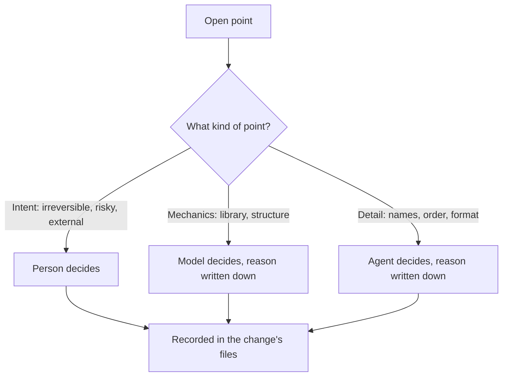
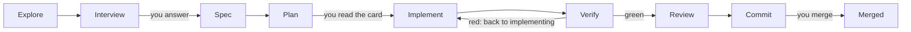
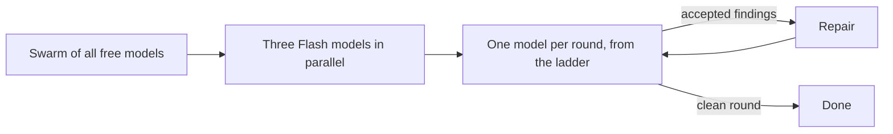
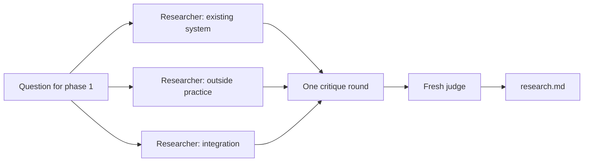
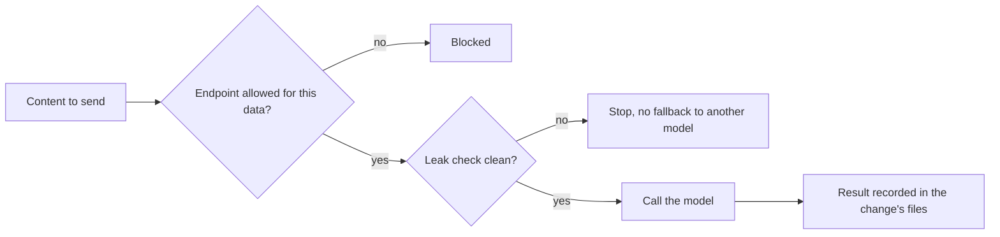

# coding-harness

**A workflow for building software with AI agents that you can check afterwards.**
Every step leaves a file. Every check gives a verdict. Every decision has an owner.

This repository holds the process itself: the rules, the phase prompts, the
templates, the model routing and the research behind them. It is used on its
own changes, one pull request at a time.

## Why look at it

AI agents write code quickly. Three things usually go wrong afterwards:

- **The reasoning disappears.** It lived in a chat, and the chat is gone tomorrow.
- **Decisions happen quietly.** Something chose a design, and nobody noticed.
- **Nobody can say what was checked.** The model reviewed its own output, and
  that was the only review.

This repository is a set of rules, files and checks against those three
problems.

## What is different about it

**1. A person decides only what is theirs.**
Decisions come in three levels. *Intent* (what should happen, what cannot be
undone, what carries a risk) belongs to the person. *Mechanics* (which library,
which structure) belongs to the model, and the reason is written down. *Details*
(names, order, format) belong to the agent, with the reason written down too.
You are asked only about what is really open. Every reversible choice stands
until you veto it.



**2. Every question comes with its context.**
Before the options, a question says what the topic is, why it comes up now, how
things stand today, and what would change in the repository and in the
architecture. The question itself comes last. The rule covers every question
from every agent, and it is recorded as architecture decision 0018 (ADR 0018).

**3. Files, not chats.**
Each phase leaves a versioned file: the research, the interview answers, the
spec, the plan, the code and its tests, the findings, the handover. Tomorrow's
session, a colleague, or an agent that has never seen the change starts from
those files. A chat is not a record.

**4. The plan is a contract, and it starts unless you stop it.**
Every plan opens with a card: *For you* (what changes for you), *Done when* (the
evidence that it holds), *Appetite* (the time limit), *Not now* (what is left
out) and a *Pre-mortem* (the most likely reason it would fail). Then the card
ends with "Starts unless you say stop." If the work departs from the plan, the
plan is revised in writing. It is never silently overwritten.

**5. Checks decide, and disagreement stays visible.**
A phase passes on a verdict: a test run, a CI run, a review with no open
blocker. A red result stops the work. When two reviewers see the same change
differently, both views stay in the findings table. They are not averaged into
one verdict. A finding is acted on only with evidence: a failing test, or the
spec.

**6. Data goes only where it is allowed.**
Every model endpoint is listed with the kind of data it may see. Calls to models
from other vendors go through one runner, which checks for leaks before every
call. An endpoint that is not listed is blocked. A leak stops the call, and the
work does not move silently to another model.

## Who it is for

- **Teams and people who let agents write real changes** and must later answer:
  who decided this, and what was checked?
- **Anyone who must control which data a second model sees** before it sees it.
- **Not for one-line fixes.** The method says so itself: never plan what one
  sentence describes. A typo gets fixed, not planned.

## What a change asks of you

Three moments need a person:

1. **Answer the questions.** A few, each with its context, only where the
   answer is yours to give.
2. **Read the plan card.** The work starts unless you say stop.
3. **Merge the pull request.** A person merges, or explicitly asks an agent to.
   Agents do not merge their own work on their own.



## The phases

| # | Phase | What it leaves | The question it answers |
|---|---|---|---|
| 1 | Explore | `research.md` | What is the situation? |
| 1a | Interview | `decisions.md` | What must a person decide? |
| 2 | Spec | `spec.md` | What exactly should change? |
| 2a | Spec review (optional) | rows in `findings.md` | Does the spec hold up? |
| 2b | Design (when the change needs one) | `design.md` | How is it built? |
| 3 | Plan | `plan.md` | In which steps, and when is it done? |
| 4 | Implement | code and tests | Does it work? |
| 5 | Verify | test output | Can we show it? |
| 6 | Review | `findings.md` | Does it match the spec? |
| 7 | Commit | a pull request | Does CI agree? |

At the end of any session, a handover file records where the work stands. The
gate for each phase is in `docs/WORKFLOW.md`, section 2.

## Who does what

**Claude is the orchestrator.** The Claude Code session runs each phase, calls
the runner, reads every result, decides on each finding, and writes the
handover. Other models do work inside a phase. They do not decide what happens
next.

Stage 2 hands some jobs to other models, and only framework content goes to
them:

| Job | Who does it | On main? |
|---|---|---|
| Orchestrate: run phases, decide findings, write the handover | Claude Code session | yes |
| Explore (phase 1) | GLM 5.3 Flash (Z.ai) | yes |
| Draft spec, design and plan (2, 2b, 3) | Codex, OpenAI | yes |
| Review the spec (2a) | Opus 5.5 (Anthropic) | yes |
| Review loop (4b) | Pi, running models from OpenCode Go, one model per round | yes, at most three rounds |
| Implement (4) | GLM 5.3 Flash | yes |
| Repair the findings the orchestrator takes | Codex; Sonnet 5.5 after two failed checks | yes |
| Final review (6) | Codex, in a fresh read-only session | yes |

- **Codex** is OpenAI's coding model. The runner calls it.
- **Pi** is the agent program the repository pins for the review loop
  (ADR 0019). It sends the calls to **OpenCode Go**, which offers several open
  models, so no single model reviews the change alone.

The models behind each job are listed in `model-endpoints.yaml` and in
`docs/WORKFLOW.md`, section 4. This table can lag behind them.

Each provider needs your own access, set up on your machine. The repository
tracks no credentials.

## Swarms (in progress, not merged)

Two swarms are being built. Neither is on main yet, so the table above does
not list them.

### Review swarm — bead `coding-harness-4fk`

Today the review loop calls one model per round. The planned change works in
stages, until a round leaves no accepted finding:

1. a swarm of all free models, in parallel;
2. three Flash models, in parallel;
3. then one model per round, from the ladder in `model-endpoints.yaml`.



The design waits for a decision pull request (ADR 0021). Only the maintainer
merges that.

### Research swarm — bead `coding-harness-icw`

Phase 1 would run three independent researchers: one on the existing system,
one on outside practice, one on how the change fits the rest. Then one round
of critique, and a fresh judge settles the result, which becomes
`research.md`. All calls go through the runner, behind the leak check. The proposal is a draft on main
(`docs/research/2026-10-08-explore-swarm-proposal.md`). Its implementation is
a draft branch, not merged.



## Two kinds of class

**Change classes** say how big a change is and what kind it is. Every spec
declares one, and the class sets how much process it gets:

| Class | What it is | Interview | Design phase | Stage-2 review |
|---|---|---|---|---|
| `spike` | answers a question; the output is a recommendation | three topics, or a reasoned skip | no | none |
| `bounded` | changes an existing, readable flow without deciding anything new | one answered question, or a reasoned skip | no | review loop and final review; spec review where held |
| `feature` | a self-contained deliverable | at least three substantive questions | yes, or a sentence why not | spec review, review loop and final review |
| `architectural` | a new subsystem or a break of an interface; it comes with its decision record | none, or five if it changes its ADR | always | spec review, review loop and final review |

Only a `feature` answers the question whether it needs an architecture decision
record (ADR). An ADR file is edited by the one change that claims it in its
spec header.

**Data classes** say what a model may see:

- **Framework content:** this repository's rules, prompts, templates and tests.
  Calls to other vendors in stage 2 cover this class only.
- **Customer code:** source code and database structure from a customer project.
  Only endpoints that declare where they process data may see it.
- **Customer data:** rows from source or target systems. No model endpoint may
  see it; checks between systems run where the data already lives, not in a
  model.

## Three stages

- **Stage 1 — Claude Code only.** All seven phases run with Anthropic models.
  This is the binding baseline, and the place to start.
- **Stage 2 — a second vendor as an extra check.** Models from other vendors
  draft, review and repair this repository's own content. The calls go only
  through `scripts/stage2.py`, and the scope is framework content (ADR 0007,
  amended since). Whether the second check finds more errors is being measured,
  not assumed.
- **Stage 3 — orchestration.** Agents as YAML files, parallel worktrees and
  automatic routing. This stage is evaluative and not in production.

How a call to a second vendor is allowed to happen in stage 2:



## Status

**Bootstrapping.** The mechanism is moved over from
`portfolio-agentic-engineering` in measured steps.

Checked on 2026-10-16 against `origin/main` at `6029bbf`, these pieces that the
doctrine names are **not in this repository yet**:

- `scripts/validate_change_artefacts.py`, the artefact validator
- the sub-agent definitions `.claude/agents/explorer.md` and `reviewer.md`
- the stop hook `.claude/hooks/session-stop/check-tests-green.sh`
- `.claude/commands/`, the slash commands
- the `make change` and `make index` targets. Start a change with
  `python3 scripts/new_change.py <name> --bead <id>` instead.
- `docs/governance/gate-catalog.md`

Where the doctrine describes one of them, it describes the target, not the
current tree. The status note at the top of `docs/WORKFLOW.md` has the details.

The review swarm and the research swarm are in progress or proposed, not
merged. See "Swarms" above.

History: the bootstrap handover is
`docs/journal/handover/2026-09-16-coding-harness-bootstrap.md`; the 2026-09-17
targets are in `docs/architecture/`.

## For contributors

### Quick start

```bash
git clone https://github.com/MPAdesso/coding-harness.git
cd coding-harness
tools/beads/install.sh && tools/bd bootstrap --yes  # fresh clone only: load the tracker
make venv                  # local .venv, built from the pinned lock
bash tools/pi/install.sh   # pinned Pi; the real-Pi tests in make verify need it
make verify                # all gates
tools/bd ready             # open, unblocked work
```

To start a change, the bead must already exist:
`python3 scripts/new_change.py <name> --bead <id>`. Then read
`docs/WORKFLOW.md` and work at phase 1.

### Repository map

| Path | What it holds |
|---|---|
| `AGENTS.md` | Instructions that every agent harness reads |
| `docs/WORKFLOW.md` | The doctrine: phases, routing, rules |
| `prompts/` | One prompt per phase |
| `templates/` | Artefact templates, for example findings and handover |
| `plans/` | Changes in flight, archived changes and living specs |
| `decisions/` | The gate list (`gates.yaml`), the adoption record and recorded answers |
| `docs/adr/` | Architecture decision records (append-only) |
| `docs/journal/handover/` | Session handovers |
| `docs/research/` | Research notes |
| `model-endpoints.yaml` | Allowed model endpoints and the data they may see |
| `scripts/` | Gates, the stage-2 runner (`stage2.py`) and kit tooling |
| `tools/` | Tracker wrapper (`bd`), the pinned Pi install and the Claude Code display |
| `tests/` | The test suite |

### Working rules

- **Tracker.** Beads with the `coding-harness-` prefix. Read and write them
  only through `tools/bd`. The tracker moves through `refs/dolt/data` on
  origin; no rendered copy is committed.
- **Pull requests** name every bead they open, change or close, because the
  diff does not show tracker changes.
- **Decisions** take effect when the maintainer merges their pull request
  (ADR 0008).
- **One change, one worktree.** Worktrees live under `.claude/worktrees/`.
- **Language.** Repository artefacts are in English.

### Related repositories

| Repository | Role |
|---|---|
| `coding-harness` (this one) | process source of truth: doctrine, prompts, templates, model routing, research |
| `portfolio-agentic-engineering` | framework governance: rule set, gates, ADRs, lessons; the origin this repository migrates from |
| `lakeswitch-ai` | product repository that runs a clean-room instance of the workflow |
