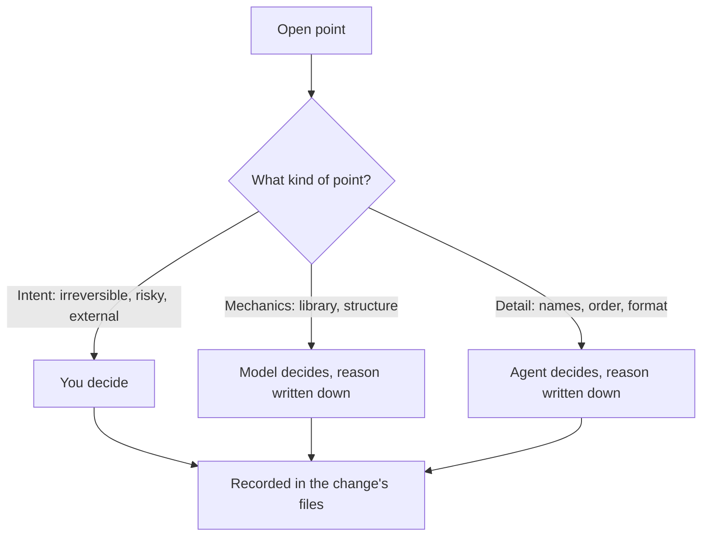
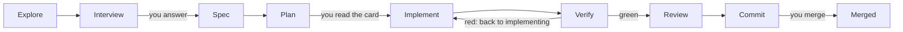

# coding-harness

**Let AI agents do the work. Keep the decisions and the evidence.**

A file-based workflow for Claude Code that makes AI-assisted software changes
easier to resume, inspect and hand over.

Agents research, plan, implement and review changes. You own the intent and
the consequential decisions. Versioned files keep the working context, the
reasons behind decisions, the review findings and the handover, so the next
session continues from a recorded state instead of a chat that is gone.

This repository holds the workflow rules, the phase prompts, the templates and
the supporting tools. It uses the workflow for its own development.

**Status:** actively bootstrapping. Some enforcement tooling is still being
migrated, and calls to models from other vendors cover this repository's own
framework content only. [What works today](#what-works-today-and-what-is-still-coming)
says exactly which parts are enforced.

## What you get

**Work survives the session.**
Research, decisions, spec, plan, findings and handover are files in the
repository. A new session, a colleague or another agent picks up a change
without reconstructing it from chats. You do not have to keep the state of the
project in your head.

**Agents act; you own the decisions that matter.**
Decisions come in three levels. You decide intent: what should happen, what
cannot be undone, what carries a risk. The model and the agent decide
mechanics and details, and write down why. So the agent keeps working without
asking you about every small thing, and you can see afterwards where it
decided and where it departed from the plan.



**Checks leave evidence.**
Tests and CI run during the work, not only at the end: a red run stops it.
Reviewers write their findings into a table, a finding is acted on only when
a test or the spec backs it, and when two reviewers disagree, both views stay.
At the merge you judge a change by its evidence, not by a summary.

**Model access has explicit boundaries.**
Calls to models from other vendors go through one runner. It checks that the
endpoint is allowed for the data, and it runs a leak check before every call.
A leak stops the call; there is no silent fallback to another model. Whether a
second vendor finds more errors is being measured, not assumed.

### Built for focus

Every question to you comes with its context: the topic, why it comes up now,
how things stand, and what would change. Every session opens with where we
stand, the next step, and what is needed from you. Messages lead with the
result and ask one question at a time. This form is written for readers with
ADHD, and it holds for every reader: nobody should get lost in the work.

## Follow one completed change

The change "attempt diagnostics" (pull request
[#127](https://github.com/MPAdesso/coding-harness/pull/127), merged
2026-10-12) shows each step with real files:

| Question | Where to see it |
|---|---|
| What was the task? | A failed implement attempt left no trace of why it failed or what it wrote. [`research.md`](plans/changes/attempt-diagnostics/research.md) |
| What did a person decide? | To record the diagnostics *and* a list of the files each attempt changed. [`decisions.md`](plans/changes/attempt-diagnostics/decisions.md) |
| What did the agent decide itself? | Format details, each marked `[DETAIL]` with its reason, for example "files first, diagnostics second". [`spec.md`](plans/changes/attempt-diagnostics/spec.md) |
| What was the contract? | The plan card: what changes for the maintainer, and when it counts as done. [`plan.md`](plans/changes/attempt-diagnostics/plan.md) |
| Which check found a defect? | Review finding F-1 (MAJOR): a fallback attempt could store a fragment of a credential before the credential scan. It was reproduced. [`findings.md`](plans/changes/attempt-diagnostics/findings.md) |
| How was it fixed? | Scan with the known key before the snapshot; the row reads `fixed`, with the test that now holds it. |
| What evidence stood at the merge? | The findings table with every row decided, the tests named per criterion, and green CI. |

## What a change asks of you

1. **Answer the questions.** A few, each with its context, only where the
   answer is yours to give.
2. **Read the plan card.** It says what changes for you, when it is done, the
   time limit and what is left out. The work starts unless you say stop.
3. **Merge the pull request.** A person merges, or explicitly asks an agent to.



## What works today and what is still coming

Checked on 2026-10-16 against `origin/main` at `6029bbf`.

**Enforced by tooling**

- `make verify` and CI run the gate list in `decisions/gates.yaml`: tests,
  lint, document links, and process checks such as the interview minimums,
  the context on every recorded answer and a named proof for every
  acceptance criterion.
- The stage-2 runner (`scripts/stage2.py`) checks the endpoint and runs the
  leak check before every call to another vendor.

**Written rules that agents follow, not enforced by a tool**

- The three decision levels, the plan as a contract, the communication form
  (the gate checks only that the context is there, not its wording), and one
  writer per tracker.

**Not built yet**

- The artefact validator, the stop hook that blocks on a red tree, the slash
  commands, the `make change` target and the gate catalogue that the doctrine
  names. Where the doctrine describes them, it describes the target.
- The review swarm and the research swarm: designed, in progress, not merged.
- Keeping the work of a failed model call instead of deleting it: in
  progress.
- Stage 3, orchestration of parallel agents: evaluative only.

## Try it

```bash
git clone https://github.com/MPAdesso/coding-harness.git
cd coding-harness
tools/beads/install.sh && tools/bd bootstrap --yes  # fresh clone only: load the tracker
make venv                  # local .venv, built from the pinned lock
bash tools/pi/install.sh   # pinned Pi; the real-Pi tests in make verify need it
make verify                # all gates
tools/bd ready             # open, unblocked work
```

To start a change, the bead must already exist:
`python3 scripts/new_change.py <name> --bead <id>`. Then read
`docs/WORKFLOW.md` and work at phase 1.

## Go deeper

- [How the workflow works](docs/how-it-works.md): the phases, who does which
  job (Claude as orchestrator; Codex, Pi with OpenCode Go, GLM), the change and
  data classes, the swarms and the three stages.
- [The doctrine](docs/WORKFLOW.md): every rule, gate and route in full.
- [Architecture decisions](docs/adr/): why it is built this way.
- [`model-endpoints.yaml`](model-endpoints.yaml): which model may see which data.
- [`AGENTS.md`](AGENTS.md): the instructions every agent harness reads.

## Contributing

- **Tracker.** Beads with the `coding-harness-` prefix, read and written only
  through `tools/bd`. Pull requests name every bead they open, change or close.
- **Decisions** take effect when the maintainer merges their pull request.
- **One change, one worktree,** under `.claude/worktrees/`.
- **Language.** Repository artefacts are in English.

| Related repository | Role |
|---|---|
| `portfolio-agentic-engineering` | framework governance; the origin this repository migrates from |
| `lakeswitch-ai` | a product repository that runs a clean-room instance of the workflow |
