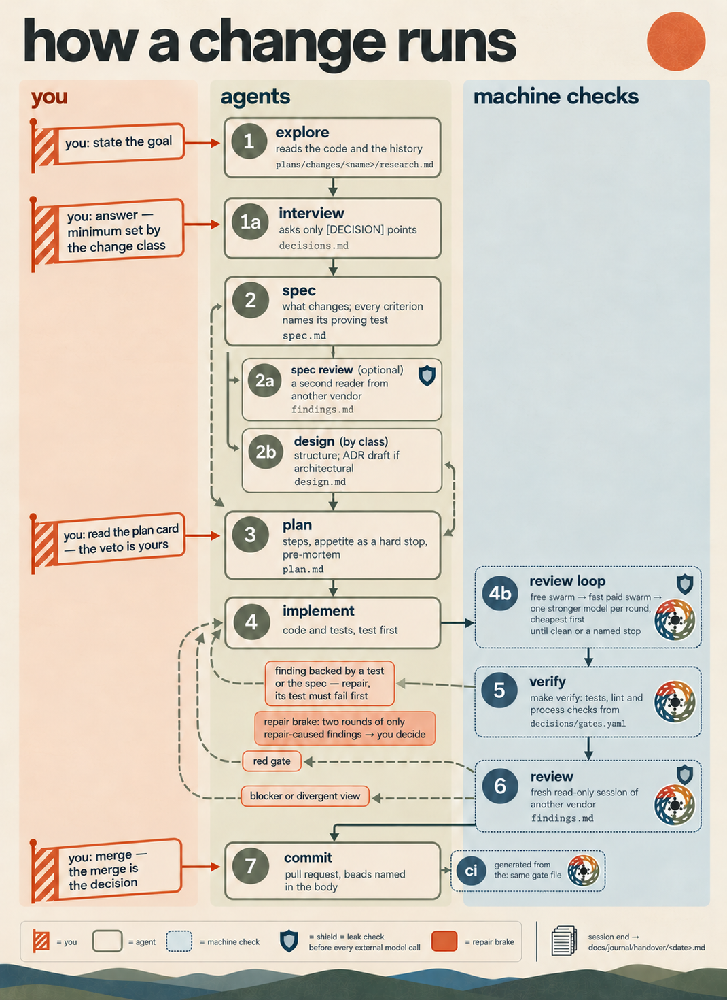

<p align="center">
  
</p>

# Monotrope

**A step-by-step workflow for AI coding agents. Every step leaves a file, and
scripts check the agent's claims.**

Monotrope is for developers who already let a coding agent such as Claude Code
change their code and want two things from it: changes they can review, and
work that a later session can pick up again. It does not replace the agent.
The agent reads Monotrope's instructions (`AGENTS.md` and the phase prompts in
`prompts/`) and runs one change through fixed phases: research, questions to
you, specification, plan, implementation, review and pull request. A Python
script, the *runner*, starts models from other vendors for some of these
phases and checks what they send back. Claude Code is the only fully supported
orchestrating agent today.

Monotrope is young: the first commit is from 2026-09-16, and it is used mainly
to develop this repository. Using it in another repository is still a manual
job; there is no installer. The repository and its tracker still carry the
working name `coding-harness` in places.

**What it is not.** Not an agent program, a server, a model gateway or a
one-line install for any repository.

> **License:** source-available under the PolyForm Noncommercial License
> 1.0.0; commercial use needs a separate written license ([License](#license)).

## What it checks

Four problems that come up when an agent writes code, and what Monotrope does
about each. The checks below describe what the tools do; none of them has
been measured to produce better software (see
[Current status and limits](#current-status-and-limits)).

### Context gets lost between sessions

A chat ends, and with it the reasons behind the work. In Monotrope each change
has its own folder, `plans/changes/<name>/`, with one file per phase: the
research, your answers, the spec, the plan and the review findings. Each
answer you give is recorded with its question, its date and who decided. A
session ends with a dated *handover* file under `docs/journal/handover/`,
checked against a schema and delivered as a pull request. Task status lives in
*Beads*, a tracker stored in the repository's own git refs; one item in it is
a *bead*. Another session, model or person can resume from these files
instead of from the chat.

### "Fixed" without proof

When an agent repairs a bug, it must name a test that fails on the code before
the repair and passes after it ("red first"). A test that passes on both
proves nothing: it may not detect the defect at all.

The runner checks this itself instead of trusting the agent. It runs each
named test on the code before the repair and accepts only a real assertion
failure; a crash, a skip or a setup error counts as "could not run", not as
red. Then it runs `make verify` on the repaired code. If either check fails,
the repair is refused.

A refusal can be wrong in the safe direction. In one night run the "before"
code already contained a fix, so the new tests passed there and the runner
refused repairs that were in fact correct. It could not check the claim, so it
did not accept it. A false refusal costs a rerun; a false acceptance leaves a
test that guards nothing.

### Reviews without evidence

An agent that reviews its own work shares its own blind spots. Monotrope adds
reviews by other models, each in a fresh session, and keeps the evidence:

- **Gates.** A *gate* is an automated check. One list,
  `decisions/gates.yaml`, drives both the local `make verify` and CI; each gate
  blocks, reports or is only advisory.
- **Review swarms.** A *swarm* is several models reviewing the same change in
  parallel. After implementation, the review loop runs round after round,
  cheapest models first, until a round has no accepted findings or a named stop
  is reached. "Clean" means that round found nothing accepted, not that the
  software is free of defects.
- **Findings need a basis.** A finding must point to a test or to the spec.
  The model that reviewed never repairs; a final review in a fresh session
  checks the change against the spec.

### Data sent to other models

The runner is the only way this repository starts a model from another vendor.
Before each call it checks the model and endpoint against an allowlist by data
class (`model-endpoints.yaml`) and scans everything it will send with the leak
check (`scripts/leakcheck.py`). A block stops the call, with no fallback to
another model. This boundary covers only calls made through the runner, not
what the orchestrating agent does itself. Reviewers are told to read only;
that is an instruction, not an operating-system sandbox.

## How a change runs

A *change* is one unit of work: a bug fix, a feature, a decision. It runs
through seven phases; each leaves a file the next one reads. You appear in four
places; agents do the rest, and scripts check it.

<p align="center">
  
</p>

| # | Phase | Leaves |
| --- | --- | --- |
| 1 | Explore, then interview | `research.md`, `decisions.md` |
| 2 | Spec (optional spec review, design by class) | `spec.md`, `design.md` |
| 3 | Plan | `plan.md` |
| 4 | Implement, then the review loop | code and tests |
| 5 | Verify | test output |
| 6 | Review | `findings.md` |
| 7 | Commit | a pull request |

**What a change asks of you:**

1. **State the goal**: what it is for, and what must not happen.
2. **Answer the questions that are yours.** Open points come in three kinds:
   a `[DECISION]` goes to you, a `[GAP]` is explored by the agent, a
   `[DETAIL]` is decided by the agent with its reason written down. Every
   question to you arrives with its context: the topic, why now, the situation
   today, and what would change.
3. **Read the plan card**: what changes for you, when it is done, the
   *appetite* (the time budget for the change) and what is left out. The work
   starts unless you say stop.
4. **Merge the pull request.** Nothing is merged for you.

**Not every change gets the same process.** Each change declares a class at
the start, from `spike` (answers a question) through `bounded` and `feature`
to `architectural` (a new subsystem or a broken interface). The class decides
how many interview answers are owed, whether a design document is needed, and
whether models from other vendors review it. A gate counts the answers against
the class. Nothing checks yet that the class itself is right.

**Decisions that outlive a change** are written as an *ADR* (architecture
decision record) under `docs/adr/`. A decision takes effect when you merge its
pull request; files that only a person may change are declared in
`provenance.yaml`.

### Who checks what after a model call

The runner starts other models for named phases
(`python3 scripts/stage2.py <verb> <change>`) and checks the result before it
commits anything. The check depends on the phase:

- **Draft** (spec, design, plan): the document gates,
  `bash scripts/verify_all.sh --job docs`.
- **Implement**: `make verify`.
- **Repair**: the red-first proof of each named test, then `make verify`.
- **Reviews** (spec review, review loop, final review): the model only reads;
  the runner records its findings.

A failed attempt goes to the next route with its diagnostics. The runner never
merges, never decides which finding is taken and never asks you anything.
Those stay with the orchestrating agent and with you; so do the phase order,
the class, and the parallel-work rules below. Those rules are followed by the
agent; no tool enforces them.

## Getting started

There are two different starting points.

### Explore this repository and run its checks

You need Python 3.12 or later, Node 26 with npm, git and curl, on macOS or
Linux.

```bash
git clone https://github.com/bicycle-brakes/monotrope.git
cd monotrope
tools/beads/install.sh && tools/bd bootstrap --yes  # fresh clone: load the tracker
make venv                  # local .venv from the pinned lock (Python 3.12+)
bash tools/pi/install.sh   # pinned Pi; the real-Pi tests in make verify need it
make verify                # all gates, cheap ones first; a red run stops early
tools/bd ready             # open, unblocked work
```

`tools/bd` is the pinned wrapper around the Beads tracker; use it instead of a
bare `bd`.

To run a change here: create its bead with the class in its description, then
`make change NAME=<name> BEAD=<id>` (in Claude Code:
`/workflow-start <name> --bead <id>`), and follow
[`docs/WORKFLOW.md`](docs/WORKFLOW.md) from phase 1.

### Use the workflow in another repository

This is manual today, and a step-by-step onboarding page does not exist yet.
What exists:

- `scripts/kit/manifest.yaml` lists which files carry the workflow and which
  describe only this repository.
- `python3 scripts/kit/probe.py --list` shows what would be copied;
  `python3 scripts/kit/probe.py` runs the copied set in a throwaway repository
  and reports which tests fail there.

The sibling product repository `lakeswitch-ai` runs its own instance of the
workflow.

### Model access

- **Claude Code alone** can run all seven phases with Anthropic models, by
  hand in the session ("stage 1", [`docs/WORKFLOW.md`](docs/WORKFLOW.md) §3).
  This is the baseline and the place to start.
- **The runner's routes to other vendors** need your own accounts, set up on
  your machine: OpenAI Codex (drafts, repairs, final review), GLM through Z.ai
  (exploring small changes, implementing) and OpenCode Go (the review swarms,
  through the pinned Pi agent). For `explore`, `implement` and `repair`,
  `--stage2-off [REASON]` runs the verb on Anthropic models instead and
  records why; the other runner verbs have no such route.
- The repository tracks no credentials. Which model may see which data is
  declared in [`model-endpoints.yaml`](model-endpoints.yaml); whether a given
  route is reachable on a given day is checked at run time, not promised here.

## Current status and limits

Status as stated on 2026-11-01 against `main` at `ac11da5d`; gate counts
re-read on 2026-11-03 at `b424be3a`.

### Checked by tools

- One gate list drives `make verify` and CI: 23 gates, of which 19 block,
  3 report and 1 is advisory (`b424be3a`, 2026-11-03). Every gate has a
  mutation test, a run that turns it red, or a stated reason in a list that
  may only shrink.
- The runner checks the endpoint and runs the leak check before every call to
  another vendor, and runs the phase checks above after it.
- A repair counts only when its test failed on the code before the repair.
- The review loop runs until a clean round or a named stop, after an
  availability probe; a cut diff never counts as clean.
- A paid model whose terms reading has expired gets no calls.
- The interview minimums per class, an open `[DECISION]` in a spec, the
  presence of a question's context and the handover schema are gates.
- `main` takes a pull request only on a green `verify` of the merge
  candidate.

### Working rules, followed by the agent

- One writer per tracker; one change, one bead, one branch, one worktree, one
  session.
- The plan card as a contract, and the wording of questions (a gate checks
  that the context is there, not how it reads).
- The appetite: `make report CHANGE=<name>` shows the time used against it;
  nothing stops a run at the limit.
- Keeping pull requests mergeable, the daily decision block, night runs.
- Worktrees share git's refs, hooks and configuration: they separate files,
  not execution.

### Not built yet

- A validator for the change files, and a stop hook that blocks the end of a
  turn on a red tree.
- A sandbox around reviewers.
- One command to save a run stopped from outside (a killed job, a full disk)
  on a side ref: today done by hand. The runner already saves its own failed
  attempts on a side ref.
- Lanes that run themselves; starting the next change in an idle lane is
  done by hand.

### Not measured

- **Whether Monotrope makes agents produce better software than a prompt-only
  workflow.** There is no comparison run.
- Whether reviewers from a second vendor find more errors than one vendor
  alone.
- How much of the maintainer's attention a change takes.
- How good the tests are, as opposed to how many there are.

## Learn more

- [How it works](docs/how-it-works.md): who does what, which model runs which
  phase, how the swarms work, the change and data classes, and one completed
  change followed file by file.
- [The doctrine, `docs/WORKFLOW.md`](docs/WORKFLOW.md): every rule, gate and
  runner route in full. Where another page disagrees, this one holds.
- [Runner details](docs/how-it-works.md#runner-details): diff limits,
  availability probes, admission per machine.
- [How the workflow tests](docs/testing.md): the six test layers, and what
  they do not prove.
- [Lanes](docs/orchestration.md): how one session runs several changes in
  parallel.
- [Claude Code hooks and status line](tools/claude-code/README.md): what
  appears at session start, the parallel-session warning, the handover safety
  net. These hooks show and remind; none of them is a gate.
- Diagrams: [who steers a change](docs/assets/readme-who-steers-a-change.png)
  and [the four classes of change](docs/assets/readme-four-classes-of-change.png).
- [Architecture decisions](docs/adr/) and
  [session handovers](docs/journal/handover/): why things are as they are,
  and where each session stopped.
- [`AGENTS.md`](AGENTS.md): the instruction file the agents read.

## Contributing

Work is tracked in Beads through `tools/bd`; a pull request names every bead
it opens, changes or closes. One change, one branch, one worktree, one
session. Per checkout run `make venv` and `bash tools/pi/install.sh` once,
then `make verify`; a text-only change is gated by CI. Decision pull requests
take effect when the maintainer merges them. Repository artefacts are in
English. By opening a pull request you agree that your contribution may be
distributed under the project's license and, if needed, under a commercial
license ([`COMMERCIAL.md`](COMMERCIAL.md)).

## License

Monotrope is **source-available** under the **PolyForm Noncommercial License
1.0.0**. Noncommercial use is free; commercial use needs a separate written
license. See [`LICENSE`](LICENSE) and [`COMMERCIAL.md`](COMMERCIAL.md).

Releases published before 2026-10-20 were under Apache 2.0. That grant remains
for those releases.

---
