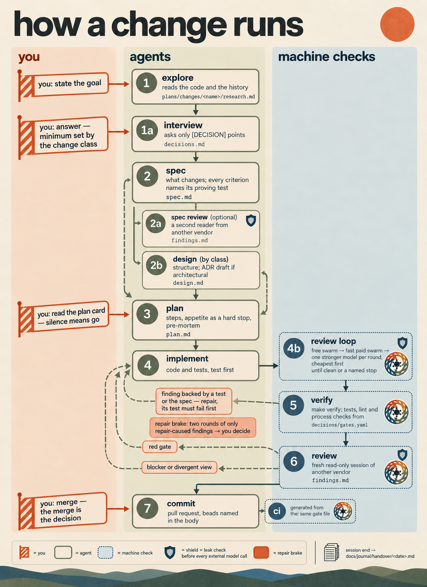

<p align="center">
  
</p>

# Monotrope

**Let AI agents do the work. Keep the decisions and the evidence.**

Monotrope is a file-based workflow for AI coding agents. Agents research,
specify, plan, implement and review a change; you decide what the change is
for and what must not happen. Everything in between — the research, your
answers, the agent's own choices, the contract, the review findings and where
the next session resumes — is written to versioned files in the repository.

No server of its own: Markdown and YAML in git, a small Python toolchain, and
a tracker that travels in the repository's git refs. One instruction file
(`AGENTS.md`) is the only instruction entry; Claude Code and Codex read it
today. The files are designed to outlive the harness (the agent program), so
a change can be finished in another session by a different model; the full
orchestration path is Claude Code for now.

This repository holds the workflow rules, the phase prompts, the templates and
the tools, and it develops itself with the same workflow.

> **Status:** early and moving fast. [What works today](#what-works-today)
> separates what a tool enforces from what is a written rule and from what is
> not built yet. The repository and its tracker still carry the working name
> `coding-harness` in places.

> **License:** source-available under the PolyForm Noncommercial License 1.0.0.
> Noncommercial use is free; commercial use needs a separate written license.
> See [License](#license).

## The problem it answers

Three things go wrong when an agent does the work and nothing records it:

- **The chat is the state.** A session ends and the context goes with it. The
  next session starts from scratch, or from a summary nobody can check.
- **The decisions are invisible.** The agent chose a format, a name, an
  order — and nobody wrote down why, so nobody can review it afterwards.
- **Nothing stops a red tree.** Tests run at the end, if at all, and a defect
  ships behind a green summary.

Monotrope turns all three into files and checks.

## What it does

A change runs through seven phases. Each phase leaves its result in the
repository, and the next phase reads that instead of a chat.

The highlighted moments are yours; everything else is done by agents and
checked by machines.

<p align="center">
  
</p>

The diagram shows who acts in each lane; the table below lists every phase
and what it leaves behind.

| # | Phase | What it leaves | The question it answers |
| --- | --- | --- | --- |
| 1 | Explore | `research.md` | What is the situation? |
| 1a | Interview | `decisions.md` | What must a person decide? |
| 2 | Spec | `spec.md` | What exactly should change? |
| 3 | Plan | `plan.md` | In which steps, and when is it done? |
| 4 | Implement | code and tests | Does it work? |
| 5 | Verify | test output | Can we show it? |
| 6 | Review | `findings.md` | Does it match the spec? |
| 7 | Commit | a pull request | Does CI agree? |

A spec review (2a), a design (2b) and a review loop between implementing and
verifying (4b) join when a change needs them. A session that ends leaves a
dated handover file: the objective, the evidence, what is open, and the one
action to resume with.

What a change asks of you is short:

1. **State the goal** — what the change is for, and what must not happen.
2. **Answer a few questions** — only the ones that are yours to answer.
3. **Read the plan card** — what changes for you, when it is done, the time
   limit, what is left out. The work starts unless you say stop.
4. **Merge the pull request.**

## Not every change is the same size

Every change names its class in the head of its spec. The class sets how much
process the change gets; the kind of an open point (below) sets who decides
it.

| | `spike` | `bounded` | `feature` | `architectural` |
| --- | --- | --- | --- | --- |
| What it is | answers a question; the output is a recommendation | changes an existing, readable flow without deciding anything new | a self-contained deliverable that changes what the system must do or how it is checked | a new subsystem or a broken interface |
| Questions you must answer | three topics, or a reasoned skip | one, or a reasoned skip | at least three | five when it creates or changes an ADR |
| Design phase (2b) | never | never | yes, or one sentence why not | always, with an ADR draft |
| Review by another vendor | no | yes | yes | yes |

A gate counts the answered questions against the class's minimum. Nothing yet
checks that the class itself is right: a `feature` declared as a `spike` would
skip the other-vendor reviews, and only the review before the merge catches
it.

## How it differs

Many ways of working with coding agents keep the state in the conversation:
the plan, the reasons and the open ends live in a chat window and are gone
when it closes. Agent frameworks and orchestrators add more agents and more
automation, but often without a record a person can audit afterwards.
Spec-first tools write the spec down, then often stop recording once the code
runs.

Monotrope treats **the repository as the memory** and the **merge as the
approval for decisions**:

- **The chat is not the state.** Every phase, every decision and every
  handover is a file. Close the window, start a new session, change the model —
  the next session reads where things stand.
- **Decisions have authors.** Open points come in three kinds:

  | Kind | Who decides | What happens |
  | --- | --- | --- |
  | `[DECISION]` | you | intent, anything irreversible or risky; your answer goes into `decisions.md` |
  | `[GAP]` | the agent | a missing fact; the agent looks it up and does not ask |
  | `[DETAIL]` | the agent | a name, an order, a format; the agent decides and writes down why |

  Afterwards you can see who decided what, and where the work departed from
  the plan.

- **A rule, or a file reserved for a person, changes only when its pull
  request is merged** — not when someone typed "yes" into a chat.
- **Evidence over summaries.** At the merge you judge a change by its tests,
  its findings table and green checks, not by an agent's account of itself.
- **It says what is not enforced.** The status section separates what a tool
  enforces, what is a written rule agents follow, and what is not built yet.

## Where decisions live

Every decision is a file, and each kind has one place:

| Decision | Where it is recorded |
| --- | --- |
| Your answers in a change's interview — the `[DECISION]` points | `plans/changes/<name>/decisions.md`, in your words where you gave them, with the date and the question asked |
| The agent's own choices — the `[DETAIL]` points — and departures from the plan | marked lines with their reason in the same change's `spec.md`, `design.md` or `plan.md` |
| Your answer to "does this change need an architecture decision record?" | `decisions/answers/<change>/adr.yaml`: the answer, the reason, the proposal you were shown, who answered and when; a gate checks it |
| Architecture decisions | `docs/adr/`; a record takes effect when its pull request is merged |

Which files only a person may change is declared in `provenance.yaml`; a pull
request that touches one is a decision pull request. A finished change leaves
its lasting parts in `plans/specs/` or `docs/adr/`; the rest is archived under
`plans/changes/archive/` with its decisions. Session handovers repeat the
decisions of a session, but they are a summary, not the record.

## What is special

**One instruction file.** `AGENTS.md` is the only instruction entry, and a
test fails if a harness-specific file would silently replace it. Models are
assigned per phase and per job: one drafts, another reviews, a third
implements.

**A second vendor reviews, under guard.** Work handed to a model from another
vendor goes through one runner. It checks that the endpoint is allowed to see
the data (`model-endpoints.yaml`), and it runs a leak check before every call.
A leak stops the call; there is no silent fallback to another model. A single
reviewer's blind spot is invisible to them; whether a second vendor finds
more errors is being measured, not assumed.

**Process rules are machine checks.** 22 gates live in one file
(`decisions/gates.yaml`); 18 block, 3 report, 1 advises (as of 2026-10-20).
Next to tests and lint they check the process itself: that a change answered
its minimum number of interview questions, that every recorded question
carries its context, that every acceptance criterion names the test that
proves it, and that document headers say when their content last changed.

**It travels.** The mechanism moves to another repository as a kit; a probe
copies it into a throwaway tree and runs its tests there, to prove it still
works outside its home.

**Built for focus.** Every question comes with its context: the topic, why it
comes up now, how things stand today, and what would change. Every session
opens with where things stand, the next step and what is needed from you.
Messages lead with the result and ask one question at a time. Attention is the
scarcest resource in the loop — for people and for models.

## The clever parts

- **Red first, proven by the runner.** When a model repairs a finding, its
  claim that a test shows the defect is not taken on trust: the runner runs
  that test alone against the code *before* the repair, in a temporary
  checkout, and accepts it only if it fails there.
- **The reviewer never repairs.** Each review round is a fresh, read-only
  session. The model that fixes a finding is never the one that judges the
  fix, and a reviewer's own session never edits code.
- **A finding needs backing.** A review finding is acted on only when a test
  demonstrates it or the spec supports it. When two reviewers disagree, both
  views stay in the table, and the disagreement blocks like a defect.
- **Review until clean, cheapest first.** The review loop starts with a swarm
  of free models, then a swarm of fast paid ones, then one stronger model per
  round, ordered by cost — and stops at the first round with nothing to fix,
  or at a named stop: the paid ladder is exhausted, or two consecutive rounds
  only found defects introduced by earlier repairs.
- **A brake on repair loops.** If two rounds in a row find only defects that
  earlier repairs introduced, the loop stops and a person decides how to go
  on.
- **One list, generated everywhere.** The CI workflow is generated from the
  gate file, and a gate fails when the two differ by a single byte. There is
  no second hand-kept list to drift.
- **Appetite, not estimates.** A plan card names a time limit as a stop, and a
  pre-mortem: "suppose it failed — most likely because …".
- **Numbers carry their cut-off.** Every count in a handover names its commit
  or date, and what could not be read is written as "not read", never as
  "none".

## Why it is built this way

- **Files, because a change must outlive the session, the machine and the
  harness.** A state kept inside a tool dies with the tool.
- **One list, because two lists drift.** The gate file is read by the local
  runner and by the CI generator, and a gate holds the generated workflow to
  it byte for byte.
- **A merge, because a decision that lives in a chat is not a decision.**
- **Block, report or advisory, because a gate whose red means nothing is
  noise.** Every gate says which of the three it is, so a red run always
  means something specific.

## How testing works, and what it does not prove

**One command, the same checks as CI.** `make verify` runs
`scripts/verify_all.sh`, which holds no commands of its own: it reads the
gate list in `decisions/gates.yaml`, the same list the CI workflow is
generated from. The pytest suite is one of those gates and runs in parallel
(`pytest -n auto`). The others check documents and process rules, not code.

**A locked environment.** Each checkout builds its own `.venv` with
`make venv` from `requirements-ci.txt`, where every package is pinned with
its hash. Results then depend on the lock, not on what happens to be
installed on a machine, and a local green means what a CI green means.

**Red first.** A repair counts only when its test fails on the code before
the repair; the runner checks this itself (see "The clever parts"). A test
that would have passed anyway proves nothing, and models readily write such
tests.

**What the numbers say, and what they do not.** On 2026-10-20 at `5c7db34`,
`tests/` held 2306 tests in 40 files: about 29,800 lines of test code
against about 13,900 lines in `scripts/`. That count measures how much is
checked, not how well. On the same day, reviewers in the review loop kept
finding new defects round after round in a change whose suite was green.
How many injected faults the tests catch has not been measured yet; a
mutation-testing run on one or two scripts is planned (bead
coding-harness-bvy).

## Follow one completed change

The change "frontmatter-current" (archived 2026-09-29) shows each step with
real files:

| Question | Where to see it |
| --- | --- |
| What was the task? | A document's header said when it was last *reviewed*, not when its content last changed — and nothing failed on a stale one. [`research.md`](plans/changes/archive/2026-09-29-frontmatter-current/research.md) |
| What did a person decide? | In the maintainer's words: "The frontmatter headers in the files must always be maintained and current. This must be a basic mechanism." [`decisions.md`](plans/changes/archive/2026-09-29-frontmatter-current/decisions.md) |
| What did the agent decide itself? | Mechanics, each marked `[DETAIL]` with its reason — for example which of the two key lists owns the held prefixes. [`spec.md`](plans/changes/archive/2026-09-29-frontmatter-current/spec.md) |
| What was the contract? | The plan card: written for one option of a `[DECISION]`, with the one step the other option would change. [`plan.md`](plans/changes/archive/2026-09-29-frontmatter-current/plan.md) |
| Which check found a defect? | Review finding F-1 (MAJOR): the ADR headers said `status: accepted` where the body recorded the ADR as superseded — a reader of the header alone would believe ADR 0001 is in force. The row reads `fixed in 0f4101f`. [`findings.md`](plans/changes/archive/2026-09-29-frontmatter-current/findings.md) |
| What evidence stood at the merge? | The findings table with every row decided, and green CI — and the gate that came out of it, `frontmatter-current`, still runs on every pull request. |

## What works today

Checked on 2026-10-20 against `main` at `d35df66`.

### Enforced by tooling

- `make verify` and CI run the gate list: tests, lint and the process checks
  above. Every gate declares whether it blocks, reports or advises.
- The stage-2 runner (`scripts/stage2.py`) checks the endpoint and runs the
  leak check before every call to another vendor. Exploring, drafting,
  implementing, repairing and reviewing by other models all go through it.
- The review loop runs until a round is clean or a named stop (ADR 0021).

### Written rules agents follow, not enforced by a tool

- The three kinds of open points, the plan card as a contract, the
  communication form (a gate checks that the context is there, not its
  wording), and one writer per tracker.

### Not built yet

- The artefact validator, the stop hook that blocks a session end on a red
  tree, the slash commands, the `make change` target (the script
  `scripts/new_change.py` exists; the target does not) and the gate catalogue
  that the doctrine names. Where the doctrine describes them, it describes
  the target.
- The research swarm for larger changes: an open decision (ADR 0020, draft).
- Keeping the work of a failed model call: partly built. `scripts/stage2.py`
  saves failed implement and draft attempts; the rest is in progress.
- Orchestration of many agents in parallel: evaluated, not built.

## Try it

You need Python 3.12 or newer, Node 26 with npm, git and curl on macOS or
Linux. `make venv` picks `python3.12` or `python3`; name another interpreter
with `make venv PYTHON=/path/to/python3.12`.

```bash
git clone https://github.com/bicycle-brakes/monotrope.git
cd monotrope
tools/beads/install.sh && tools/bd bootstrap --yes  # fresh clone: load the tracker
make venv                  # local .venv from the pinned lock (Python 3.12+)
bash tools/pi/install.sh   # pinned Pi; the real-Pi tests in make verify need it
make verify                # all gates
tools/bd ready             # open, unblocked work
```

These commands run this repository itself. A step-by-step onboarding page for
other repositories is still being built; until then,
[`docs/WORKFLOW.md`](docs/WORKFLOW.md) is the reference.

To start a change, create its bead (the tracker item) first, then
`python3 scripts/new_change.py <name> --bead <id>`, and read
[`docs/WORKFLOW.md`](docs/WORKFLOW.md) from phase 1.

## Go deeper

- [How the workflow works](docs/how-it-works.md): the phases, which model does
  which job, the change and data classes, and the swarms.
- [The doctrine](docs/WORKFLOW.md): every rule, gate and route in full.
- [Architecture decisions](docs/adr/): why it is built this way.
- [Session handovers](docs/journal/handover/): what each session left for the
  next one.
- [`model-endpoints.yaml`](model-endpoints.yaml): which model may see which
  data.
- [`AGENTS.md`](AGENTS.md): the instruction file the agents read.

## Contributing

- **Tracker.** Work is tracked in Beads, read and written only through
  `tools/bd`. A pull request names every bead it opens, changes or closes.
- **Decision pull requests** take effect when the maintainer merges them.
- **One change, one branch, one worktree, one session.**
- **Before a pull request.** `make venv` once, then `make verify`; a text-only
  change is gated by CI.
- **Contributions.** By opening a pull request you agree that your
  contribution may be distributed under the project's license and, if needed,
  under a commercial license. See [`COMMERCIAL.md`](COMMERCIAL.md).
- **Language.** Repository artefacts are in English.

## License

Monotrope is **source-available** under the **PolyForm Noncommercial License
1.0.0**. Noncommercial use is free; commercial use needs a separate written
license. See [`LICENSE`](LICENSE) and [`COMMERCIAL.md`](COMMERCIAL.md).

Releases published before 2026-10-20 were under Apache 2.0. That grant remains
for those releases.
