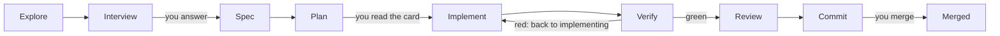

# coding-harness

**Let AI agents do the work. Keep the decisions and the evidence.**

A file-based workflow for AI coding agents. Claude Code, Codex and Cline all
read the same instruction file, so a change survives the harness it was
started in.

Agents research, plan, implement and review changes. You own the intent and
the consequential decisions. Versioned files keep the working context, the
reasons behind decisions, the review findings and the handover, so the next
session continues from a recorded state instead of a chat that is gone.

This repository holds the workflow rules, the phase prompts, the templates and
the supporting tools. It uses the workflow for its own development.

**Status:** actively bootstrapping. Some enforcement tooling is still being
migrated, and calls to models from other vendors cover this repository's own
framework content only. [What works today](#what-works-today-and-what-is-still-coming)
says exactly which parts are enforced.

## The problem it answers

Three things go wrong when an agent does the work and nothing records it:

- **The chat is the state.** A session ends and the context goes with it. The
  next session starts from scratch, or from a summary nobody can check.
- **The decisions are invisible.** The agent chose a format, a name, an
  order — and nobody wrote down why, so nobody can review it afterwards.
- **Nothing stops a red tree.** Tests run at the end, if at all, and a defect
  ships behind a green summary.

This workflow turns all three into files: what was asked, what a person
decided, what the agent decided, what the contract was, which check found a
defect, and where the next session resumes.

## What you gain

| You gain | Because |
|---|---|
| A session resumes in minutes | every phase leaves a file, and every session leaves a dated handover |
| Every decision has an author | you decide intent; the model decides mechanics and writes down why |
| A red blocking gate stops the work | 22 machine gates in one file — 18 block, 3 report, 1 advises |
| A second opinion you can audit | other vendors review framework content through one runner, with a leak check before every call and no silent fallback |
| Work you can inspect afterwards | research, decisions, spec, plan, findings and handover are Markdown in git |
| A process that travels | the mechanism moves to another repository as a kit, and a probe drives it in a throwaway repository to prove it still runs |

## What makes it what it is

- **Files, not a tool.** No database, no server, nothing to install. The state
  is Markdown and YAML in the repository, and git is the history.
- **One list per question.** The gates live in one file
  (`decisions/gates.yaml`), the tracker is read through one access point, and
  the CI workflow is generated from the gate list instead of hand-edited — a
  second hand-kept list is the drift this exists against.
- **A decision takes effect when it merges**, not when someone says yes in a
  chat (ADR 0008).
- **Evidence over summary.** A review finding is acted on only when a test or
  the spec backs it, and when two reviewers disagree, both views stay.
- **Honest about what is not enforced.** Three tiers, named: enforced by
  tooling, a written rule agents follow, and not built yet.

## Features

| Feature | What it does |
|---|---|
| Seven phases, one artefact each | explore, interview, spec, plan, implement, verify, review, commit — each leaves a file the next phase reads |
| Two conditional phases | a spec review (2a) when the spec needs a second reader, a design (2b) when the change needs one |
| Gate list | tests, lint and process checks; every gate declares whether it blocks, reports or only advises |
| Three decision levels | intent is yours; mechanics and details carry a written reason, so a departure from the plan stays visible |
| Interview minimums | a change answers a set number of questions before it is specified, and a gate counts them |
| Stage 2 | a foreign model is started only through one runner, which checks that the endpoint is allowed for the data and runs a leak check before every call |
| Review loop | rounds until a round is clean: a free swarm, then a Flash swarm, then one paid model per round, cheapest first (ADR 0021) |
| Beads tracker | work state in a Dolt database, one writer at a time, read through one render |
| Handover | a dated file per session: objective, evidence, what is open, and where to resume |
| Kit | the mechanism travels to another repository, and `probe.py` drives it in a throwaway repository |
| ADRs | 20 decision records in MADR form; the merge is the decision |

## How a change runs



Two phases are conditional and left out of the picture: the spec review (2a)
and the design (2b). Between implement and verify, a review loop (4b) can add
rounds until one round is clean.

| # | Phase | What it leaves | The question it answers |
|---|---|---|---|
| 1 | Explore | `research.md` | What is the situation? |
| 1a | Interview | `decisions.md` | What must a person decide? |
| 2 | Spec | `spec.md` | What exactly should change? |
| 2a | Spec review (optional) | rows in `findings.md` | Does the spec hold up? |
| 2b | Design (when needed) | `design.md` | How is it built? |
| 3 | Plan | `plan.md` | In which steps, and when is it done? |
| 4 | Implement | code and tests | Does it work? |
| 5 | Verify | test output | Can we show it? |
| 6 | Review | `findings.md` | Does it match the spec? |
| 7 | Commit | a pull request | Does CI agree? |

Who runs which phase, and which model does which job, is in
[How the workflow works](docs/how-it-works.md).

## Why it is built this way

- **Files, because a change must outlive the session, the machine and the
  harness.** A tool-based state dies with the tool.
- **One list, because two lists drift.** The gate file is read by the local
  runner and by the CI generator, and a gate holds the generated workflow to
  it byte for byte.
- **A merge, because a decision that lives in a chat is not a decision.**
- **Block, report or advisory, because a gate whose red means nothing is
  noise.** Every gate says which of the three it is, so a red run always means
  something specific.
- **A second vendor, because a single reviewer's blind spot is invisible to
  them.** Whether a second vendor finds more errors is being measured, not
  assumed.

## Follow one completed change

The change "frontmatter-current" (bead coding-harness-qd7, archived
2026-09-29) shows each step with real files:

| Question | Where to see it |
|---|---|
| What was the task? | A document's header said when it was last *reviewed*, not when its content last changed — and nothing failed on a stale one. [`research.md`](plans/changes/archive/2026-09-29-frontmatter-current/research.md) |
| What did a person decide? | In the maintainer's words: "The frontmatter headers in the files must always be maintained and current. This must be a basic mechanism." [`decisions.md`](plans/changes/archive/2026-09-29-frontmatter-current/decisions.md) |
| What did the agent decide itself? | Mechanics, each marked `[DETAIL]` with its reason — for example which of the two key lists owns the held prefixes. [`spec.md`](plans/changes/archive/2026-09-29-frontmatter-current/spec.md) |
| What was the contract? | The plan card: written for one option of a `[DECISION]`, with the one step the other option would change. [`plan.md`](plans/changes/archive/2026-09-29-frontmatter-current/plan.md) |
| Which check found a defect? | Review finding F-1 (MAJOR): the ADR headers said `status: accepted` where the body recorded the ADR as superseded — a reader of the header alone would believe ADR 0001 is in force. The row reads `fixed in 0f4101f`. [`findings.md`](plans/changes/archive/2026-09-29-frontmatter-current/findings.md) |
| What evidence stood at the merge? | The findings table with every row decided, and green CI — and the gate that came out of it, `frontmatter-current`, still runs on every pull request. |

## What a change asks of you

1. **Answer the questions.** A few, each with its context, only where the
   answer is yours to give.
2. **Read the plan card.** It says what changes for you, when it is done, the
   time limit and what is left out. The work starts unless you say stop.
3. **Merge the pull request.** A person merges, or explicitly asks an agent to.

### Built for focus

Every question to you comes with its context: the topic, why it comes up now,
how things stand, and what would change. Every session opens with where we
stand, the next step, and what is needed from you. Messages lead with the
result and ask one question at a time. This form is written for readers with
ADHD, and it holds for every reader: nobody should get lost in the work.

## What works today and what is still coming

Checked on 2026-10-19 against `origin/main` at `59630b7`.

**Enforced by tooling**

- `make verify` and CI run the gate list in `decisions/gates.yaml`: tests,
  lint, and process checks such as the interview minimums, the context on
  every recorded answer and a named proof for every acceptance criterion.
  Every gate declares whether it blocks or only reports; the document-link
  check still reports (35 known corpus findings), the others block.
- The stage-2 runner (`scripts/stage2.py`) checks the endpoint and runs the
  leak check before every call to another vendor.

**Written rules that agents follow, not enforced by a tool**

- The three decision levels, the plan as a contract, the communication form
  (the gate checks only that the context is there, not its wording), and one
  writer per tracker.

**Not built yet**

- The artefact validator, the stop hook that blocks on a red tree, the slash
  commands, the `make change` target (the script `scripts/new_change.py`
  exists; the target does not) and the gate catalogue that the doctrine
  names. Where the doctrine describes them, it describes the target.
- The research swarm: an open decision pull request (ADR 0020). The review
  swarm is merged (ADR 0021) and its loop runs until a round is clean.
- Keeping the work of a failed model call instead of deleting it: in
  progress.
- Stage 3, orchestration of parallel agents: evaluative only.

## Try it

```bash
git clone https://github.com/MPAdesso/coding-harness.git
cd coding-harness
tools/beads/install.sh && tools/bd bootstrap --yes  # fresh clone only: load the tracker
make venv                  # local .venv, built from the pinned lock
bash tools/pi/install.sh   # pinned Pi; the real-Pi tests in make verify need it
make verify                # all gates
tools/bd ready             # open, unblocked work
```

To start a change, the bead must already exist:
`python3 scripts/new_change.py <name> --bead <id>`. Then read
`docs/WORKFLOW.md` and work at phase 1.

## Go deeper

- [How the workflow works](docs/how-it-works.md): the phases, who does which
  job (Claude as orchestrator; Codex, Pi with OpenCode Go, GLM), the change and
  data classes, the swarms and the three stages.
- [The doctrine](docs/WORKFLOW.md): every rule, gate and route in full.
- [Architecture decisions](docs/adr/): why it is built this way — 20 records.
- [The session handovers](docs/journal/handover/): the file a session leaves
  for the next one — objective, evidence, what is open, and where to resume.
- [`model-endpoints.yaml`](model-endpoints.yaml): which model may see which
  data.
- [`AGENTS.md`](AGENTS.md): the instructions every agent harness reads.

## Contributing

- **Tracker.** Beads with the `coding-harness-` prefix, read and written only
  through `tools/bd`. Pull requests name every bead they open, change or close.
- **Decisions** take effect when the maintainer merges their pull request.
- **One change, one worktree,** under `.claude/worktrees/`.
- **Language.** Repository artefacts are in English.

| Related repository | Role |
|---|---|
| `portfolio-agentic-engineering` | framework governance; the origin this repository migrates from |
| `lakeswitch-ai` | a product repository that runs a clean-room instance of the workflow |
