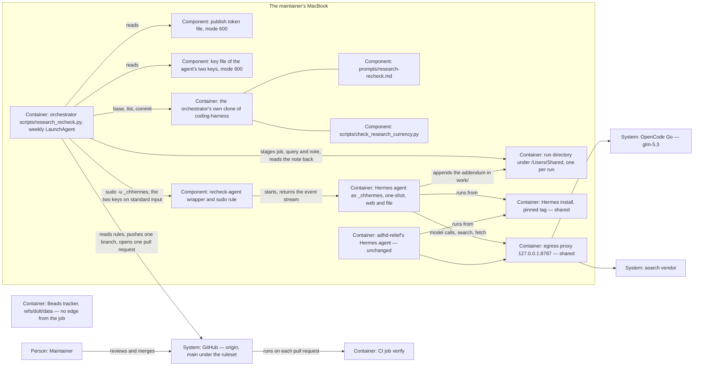

# ADR 0010 — Hermes is the first unattended writing agent: it writes one file, and a script the maintainer owns publishes it

* Status: accepted by the merge of the pull request that carries this file.
  Until that merge, the pull request's state is the decision's state: open
  is proposed, closed is rejected. Amends decision D-7 (Omnigent adoption)
  of the 2026-09-16 interview in its M3 clause; supersedes no ADR.
* Review: direction chosen by the maintainer on 2026-10-05 ("Ich würde
  gerne Hermes forcieren, lege die Grundlage dafür" — "I want to push
  Hermes; lay the groundwork"), with the six answers of the same day in
  `plans/changes/hermes-runner/decisions.md`; the key barrier chosen by
  the maintainer on 2026-10-06 (the addendum of that day in the same
  file); research, spec and design of the change sit beside it (pull
  request #76 for slice 1; the key-barrier addendum and spec criteria
  60–70 on branch `feat/hermes-runner-2`, in no pull request yet) · the
  acceptance is the merge commit and is written nowhere
  else, so the header's `review` stays empty (ADR 0008) · Decider:
  maintainer · prepared by a Claude Code session
* Date: 2026-10-06 · takes effect on merge

## Context

* **Research ages unnoticed.** Notes under `docs/research/` cite tools
  that change monthly. An age list exists since 2026-10-05
  (`scripts/check_research_currency.py`, pull request #73); nothing
  re-checks a note's dated facts (bead coding-harness-pu9).
* **The maintainer chose Hermes Agent** as the runner for this
  repository's recurring jobs on 2026-10-05, against the assessment's "Not
  Hermes, not now" (`docs/research/2026-10-05-hermes-agent-runner.md`).
  The first job is the weekly re-check of one research note.
* **Hermes can run with only web and file tools** (tag `v2026.9.21`, read
  2026-10-05): a one-shot run takes `--toolsets web,file`;
  `--ignore-rules` keeps `AGENTS.md`, `SOUL.md`, memory and skills out;
  `HERMES_WRITE_SAFE_ROOT` refuses writes outside one directory; memory,
  background review, curator and title generation switch off by
  configuration. What the agent can read is bounded by the operating
  system, not by Hermes.
* **A credential that can push a branch can merge.** A fine-grained token
  needs `contents: write` to push, and the same permission merges a pull
  request through the API; it can also push `refs/dolt/data` (GitHub's
  permission data, read 2026-10-05).
* **`main` had no protection until 2026-10-05,** while the target says
  "Branch protection is the security boundary …; harness policies, hooks
  and sandboxes reduce blast radius and are never the boundary"
  (`docs/architecture/target-architecture.md`, section 7). That evening
  the maintainer created the ruleset `main` (decisions Q4); read on
  2026-10-06, it is active on the default branch with four rules and no
  bypass actor. Agents and the maintainer act as one GitHub account (ADR
  0008), so no rule can tell them apart.
* **M3 is not reached.** D-7's path says "M3 qualifies unattended
  operation", and the implementation plan asks M3 to "prove total budgets,
  process-group cancellation, approval timeout, restart, remote checkpoint
  recovery and complete tracker restore" and to rehearse a night run
  before routine use (`docs/architecture/2026-09-17-implementation-plan.md`,
  "W2 and M3"). Those proofs are written for unattended runs of changes,
  with code and tracker writes.
* **The leak check exists only on pull request #60's branch** (open on
  2026-10-06), needs a change folder the job does not have, and reads a
  denylist that lives on the laptop. The maintainer decided on 2026-10-05
  that the scheduled job may run before it, without a check, against the
  recommendation to wait (decisions Q5).
* **Two Hermes agents will share this laptop:** adhd-relief's personal
  agent, which holds the maintainer's journal and messaging, and this job,
  which reads the open web. Under one operating-system user each could
  read the other's keys and files (derived from Hermes's documentation,
  not tried). The maintainer chose two service users (decisions Q3).
* **The agent could read its own keys.** As the profile was first built,
  `$HERMES_HOME/.env` held the OpenCode Go and Firecrawl keys, readable by
  the service user so that Hermes can load them; only Hermes's own file
  guard, which Hermes itself calls "not a security boundary", stood
  between a fetched page and those keys (the change's findings F-14 and
  F-26). On 2026-10-06 the maintainer chose a barrier of the operating
  system instead of accepting that.

## Decision Drivers

* The agent that reads the open web holds no shell and no credential that
  can write the repository.
* No file the agent can read holds its own keys.
* The job never writes the tracker, never merges, approves or
  force-pushes, and never pushes `main`.
* GitHub, not the harness, is the boundary around `main`.
* The prompt stays runner-neutral: the same job runs by hand in Claude
  Code.
* A run is bounded, and a failed run is visible and leaves nothing to
  clean up.
* Nothing of adhd-relief's agent is shared beyond the install and the
  proxy.

## Considered Options

* **(a) Hermes with a trust split.** The agent writes one file; a script
  the maintainer owns checks it and publishes; the ruleset on `main` is
  the backstop. Builds a script, a profile and a sudo rule; needs one
  afternoon at the laptop to prove the guards.
* **(b) Not now.** The prompt runs by hand in Claude Code; no runner.
  Nothing to install or secure; the job runs only when someone remembers.
* **(c) Hermes publishes itself** with a token and its bundled GitHub
  skill. The fewest parts; but an agent steered by any page it reads
  would hold a credential that merges and pushes the tracker ref.
* **(d) Wait for M3.** Safe by the plan's measure; the job waits for
  proofs designed for overnight change runs, months away.

## Decision

Chosen option: "(a) Hermes with a trust split", because it is the only
option in which the job runs unattended while the part that reads the web
holds nothing that can write the repository.

* **Runner.** Hermes Agent, one-shot (`hermes chat --oneshot`), started
  once a week by `scripts/research_recheck.py` through a sudo rule as its
  own service user `_chhermes`. No gateway, no Hermes cron, no messaging
  platform for this job. The configuration is `tools/hermes/`.
* **Trust split.**
  * *The Hermes agent* has the toolsets `web` and `file` and nothing else
    — no shell, no code execution, no delegation; memory, background
    review, curator and title generation are off and no rules file is
    loaded. It writes only its run's work directory, holds the model key
    and the search key only in its process environment, for one run, and
    never a GitHub credential, and stops after 60 tool iterations or 45
    minutes (50 minutes at the orchestrator's side).
  * *The key barrier* (the maintainer, 2026-10-06). The two keys live in a
    key file in the maintainer's home, mode 600, which the service user —
    and so the agent's file tools — cannot read. The orchestrator hands
    them to the wrapper on its standard input, once per run; the wrapper
    puts them only into Hermes's process environment, never into an
    argument or a file, and closes standard input before Hermes starts.
    `$HERMES_HOME/.env` keeps the two URLs only. This is what the
    maintainer decided; the risk of leaving the keys in
    `.env` behind Hermes's own guard was not accepted. The design adds,
    beside the barrier and not as part of the maintainer's answer, a scan and a duty (spec criterion 62):
    a key value written out plainly in the event stream or the note fails
    the run, and the maintainer revokes that key. A key sent encoded,
    reversed or split over two calls is not found.
  * *The orchestrator* `scripts/research_recheck.py` is fixed code the
    maintainer runs. It stages the note, checks the agent's tool calls and
    the diff (only the one note; only the two header dates and one
    appended addendum), and holds the publish token — a fine-grained token
    for this repository only, `contents: write` and `pull_requests:
    write` — and the agent's two keys, each in a file the service user
    cannot read. It pushes one branch and opens one pull request. It never
    merges, approves, force-pushes, pushes `main`, touches `refs/dolt/data`
    or calls the tracker; its tests hold that.
  * *The maintainer* owns the token, the configuration and the install,
    reviews the addendum — the only check of its content — and merges, or
    asks an agent to (ADR 0008).
* **Backstop.** The ruleset on `main`: a pull request is required (no
  approval), the status check `verify` must pass, force pushes are
  blocked, deletion is restricted, nobody can bypass. The orchestrator
  publishes only while all four rules are in place. What the ruleset
  cannot do: tell the token from the maintainer, stop the token from
  merging a pull request whose `verify` is green, or protect
  `refs/dolt/data`; there the orchestrator's code is the only guard.
* **Two service users.** Coding Harness's agent runs as `_chhermes`, with
  its own primary group and outside `staff`, so it cannot enter the
  maintainer's home. It shares with adhd-relief's agent only the pinned
  Hermes install (one tag for both) and the egress proxy on
  `127.0.0.1:8787`. Its Hermes home, write root, keys and instruction
  files are its own, and adhd-relief's messaging channel is never used.
* **Model.** GLM-5.3 on OpenCode Go (Anomaly Innovations, Inc., USA),
  declared as endpoint `opencode-go` in `model-endpoints.yaml` for
  framework content only, with the service user's own key, through the
  shared proxy. Web search goes through the same proxy to the search
  vendor, also with the service user's own key.
* **Accepted risk: no leak check before the job's foreign calls.** Every
  run sends the note, the job prompt and the search queries derived from
  them to OpenCode Go and to the search vendor, unchecked. If a note ever
  carried a name from the customer instance, it would leave the laptop
  before anyone saw it: house rule 6 is checked only when the re-check's
  pull request is reviewed, after the text has left. The likelihood is
  low, because house rule 6 keeps customer text out of this repository,
  but nothing measures it before the call. For this job the repository
  departs from its rule that `make leakcheck` runs before every session on
  a foreign endpoint (`model-endpoints.yaml`, stage-2 section;
  `docs/WORKFLOW.md` section 4). The maintainer chose this on 2026-10-05
  against the recommendation to wait for pull request #60 (decisions Q5).
* **Residual risk of the keys.** Until the orchestrator lands (slice 4 of
  the change), the profile keeps both keys in `$HERMES_HOME/.env`, and only
  Hermes's own guard stands between a fetched page and them. The spike and
  the install (slice 7) wait for slice 4, so the plan installs no profile
  that keeps its keys in `.env`, and the weekly job is loaded only after
  every agent slice is merged (Activation, below); until slice 4 lands,
  what remains is an install made by hand against the runbook's warning.
  After slice 4, the keys still sit in the environment of the agent's
  process for the length of a run: the agent has no tool that starts a
  process, a Hermes defect that copies its environment into a tool result
  is not ruled out, and the orchestrator's scan finds a key written out
  plainly in the stream or the note, and only after the run — after it may
  have left; a key sent encoded, reversed or split over two calls passes
  it. The remedy in both states, for a key that is found, is to revoke it.
* **M3.** The re-check is not an M3 run, and it starts before M3 with
  stand-ins for M3's proofs at its size: *budgets* — one run a week, 60
  tool iterations, 45 minutes, no second start after the model was
  called; *cancellation* — the orchestrator ends the agent's process
  group; *approval timeout* — none can occur, the agent asks nothing
  (`single_query_mode: deny`); *restart and checkpoint recovery* — a
  failed run leaves nothing to resume, and the next starts fresh from
  `origin/main`; *tracker restore* — the job never touches the tracker;
  *morning review* — the maintainer's review of the pull request.
* **D-7 is amended in one clause:** "M3 qualifies unattended operation"
  becomes "M3 qualifies unattended runs of the seven-phase workflow; a
  recurring job outside the phases is admitted by an ADR of its own, as
  ADR 0010 admits the research re-check". Unattended change runs still
  wait for M3.
* **Activation.** The weekly job is loaded only when the change's agent
  slices are merged (the orchestrator with the key barrier among them),
  every entry of "Spike results" in `tools/hermes/README.md` is green —
  adhd-relief's spike S-2 to S-6, §7 and S-7, and the Coding Harness
  part — and `python3 scripts/research_recheck.py check-ruleset` exits 0.
  The spike and the install begin only after the orchestrator with the key
  barrier is merged.
* **Scope.** This ADR admits one job. A second recurring job needs an ADR
  of its own.
* **Revisit.** The decision is looked at again when any one of these
  happens:
  1. a second recurring job is proposed;
  2. a run publishes what the diff check should have refused;
  3. the vendor blocks or throttles the account for automated use;
  4. M3 is reached, so the stand-ins can be replaced by M3's proofs;
  5. pull request #60 merges — then the departure from the leak check is
     put to the maintainer again;
  6. the scan finds a key value in a run's event stream or note — the
     barrier failed, and that key is revoked.

## Architecture delta

The part of the system the change touches, as it is after the change
(ADR 0009). Element names follow `docs/architecture/target-architecture.md`
(sections 3 and 7), adhd-relief's ADR-0022 and this repository's ADRs. The
design of the change (`plans/changes/hermes-runner/design.md`) keeps the
interfaces, the data model and the file modes.

### Added

* Container: the orchestrator `scripts/research_recheck.py`, run weekly by
  the maintainer's LaunchAgent, with its own clone and the publish token.
* Component: the key file of the agent's two keys in the maintainer's
  home, handed to the wrapper on its standard input once per run.
* Container: Coding Harness's Hermes agent as service user `_chhermes`,
  one-shot, configured by `tools/hermes/`.
* Component: the wrapper `recheck-agent` and the sudo rule that lets the
  maintainer start it as `_chhermes`.
* Container: the run directories under `/Users/Shared/`, one per run; the
  design names the path.
* Component: the job prompt `prompts/research-recheck.md`, beside the
  phase prompts.
* System: OpenCode Go, declared as endpoint `opencode-go`.
* Relationships: orchestrator → GitHub (read the rules on `main`, push one
  branch, open one pull request); Coding Harness's Hermes agent → the
  shared install and the shared egress proxy → OpenCode Go and the search
  vendor.

### Changed

* GitHub `main`: from unprotected to the ruleset of decisions Q4.
* `model-endpoints.yaml`: one endpoint more.
* `docs/WORKFLOW.md`: job prompts are named beside the seven phases.
* Decision D-7: M3 qualifies unattended runs of the seven phases; the
  research re-check is admitted by this ADR.

### Removed

* Nothing: no element or relationship goes away.

## Consequences

* **The maintainer owes** one afternoon at the laptop for the spike and
  the install, the key file with the agent's two keys, a token renewal
  every 366 days, and a re-run of S-2, S-4 and the Coding Harness part
  after every change of the shared Hermes tag. The ruleset is already set
  (2026-10-05).
* **The agent's keys are out of its reach, not out of its process.** A
  fetched page can no longer steer the agent's file tools to its keys; the
  keys still sit in the agent's process environment for one run. A key the
  scan finds written out plainly costs a revocation; one sent encoded or
  split over two calls is not found. The orchestrator carries one more file
  and one more check, and the wrapper reads its standard input.
* **Every merge into `main` waits for a green `verify`,** for agents and
  the maintainer alike. A red or hanging CI blocks every merge until it
  is fixed or the owner switches the ruleset off.
* **Repository text goes to two outside vendors unchecked each week:** the
  note and the prompt to OpenCode Go (USA), the search queries to the
  search vendor. This is the accepted risk above, and it holds until the
  maintainer withdraws it.
* **D-13 is not touched.** Its four criteria open stage 2 — other vendors
  inside the seven phases — and so M2. The re-check is no phase and counts
  as no stage-2 or qualification run; its foreign calls are admitted by
  this ADR alone. Pull request #60 (ADR 0007, open) enforces a leak check
  on each call of the stage-2 runner; the re-check does not run through
  that runner.
* **Earlier wording reads narrower.** Where the target document (row
  "Expanded permissions") and the implementation plan ("W2 and M3") say
  that unattended runs wait for M3, they mean runs of the seven phases;
  the D-7 row of the continuity table says so.
* **Coupled to adhd-relief** through the install, the proxy and possibly
  the subscription's quota; a block by the vendor stops both agents
  (adhd-relief's ADR-0025 names a fall-back that serves both).
* **Lost against (c):** the agent cannot repair its own pull request; a
  run the check refuses is a week without a re-check.
* **Lost against (b):** one more runtime to keep pinned and proven.
* **LakeSwitch:** the job prompt travels with the kit, the runner does
  not; nothing changes there.

## Validation

* `python3 scripts/check_decision_continuity.py` is green with D-7 mapped
  to this ADR, and the D-7 row of the continuity table names it.
* Once the orchestrator and the profile are merged,
  `tests/test_research_recheck.py` and `tests/test_hermes_profile.py` pass
  in `make verify`, holding their contracts
  (`plans/changes/hermes-runner/spec.md`).
* The orchestrator's and the profile's tests hold the key barrier: the
  keys reach the agent only on the wrapper's standard input, `.env` names
  no key, and no argument and no file the orchestrator or the install
  writes holds a key value (`plans/changes/hermes-runner/spec.md`,
  criteria 60–69). The files Hermes itself writes at run time — logs,
  session files, its state database — are held by no repository test:
  the sweep in CH-4 measures them at the laptop, and criterion 70 holds
  that the runbook carries the sweep and that the sweep fails closed.
* Before the weekly job is loaded: every entry in "Spike results" is
  green — among them CH-4, which shows that the service user cannot read
  the key file, that `$HERMES_HOME/.env` names no key, and that no file
  under `$HERMES_HOME` — so none the service user can read there — holds
  a key value written out plainly after a run asked to find and send
  them — and `check-ruleset` exits 0. The sweep shows no more than that:
  a key that is encoded, compressed or split over two writes passes it,
  as it passes the scan of the stream, and a file outside
  `$HERMES_HOME` is not swept.
* After the first three published runs, the maintainer reads their records
  (checked items, tokens, wall time) and keeps or changes the caps and the
  schedule.
