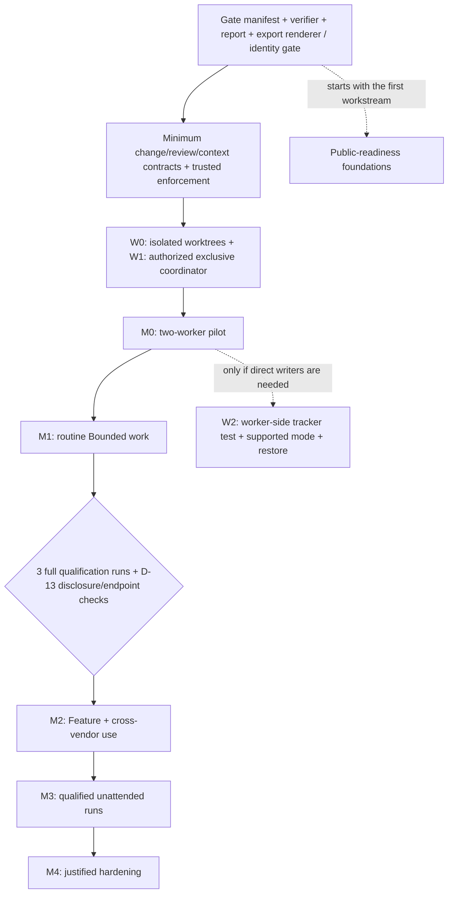

# Implementation plan: reach the Omnigent-first target

> **Changed, 2026-09-30.** [ADR 0007](../adr/0007-stage-2-reviews-by-codex-and-glm.md)
> (accepted by the merge of its pull request) amends D-13 for framework
> content: a green leak check and a declared endpoint hold on every foreign
> call, lakeswitch-ai's disclosure decision governs lakeswitch-ai's own
> content, and the first three stage-2 runs, measured, replace the three
> qualification runs before the first call. M2 is not entered. Before its
> merge the amendment was widened (2026-10-06): GLM 5.3 Flash explores and
> implements, as well as the reviews that Codex and GLM make. Where this
> document names D-13's four criteria as the entry condition for foreign calls,
> it records the earlier design.

> **Changed, 2026-10-05.**
> [ADR 0009](../adr/0009-architecture-delta-in-design-md.md) (accepted by
> the merge of its pull request) amends D-15 and O-3: an
> Architectural change shows its architecture delta in `design.md` — a
> Mermaid flowchart plus lists of the elements and relationships it adds,
> changes and removes — and the kit ships no model as code and no Node.js
> dependency for now. Where this document plans LikeC4 templates, a shared
> LikeC4 element specification, a model delta or a model build gate, it
> records the earlier design.

> **Read this first.** This is the delivery sequence for the
> [Omnigent-first target](2026-09-17-omnigent-first-target.md).
>
> - **The path in one line:** gates and enforcers → contracts → W0/W1 →
>   M0 pilot → M1 → M2 → M3 → M4.
> - **Nothing here activates a permission.** The three ADRs come first — see
>   the target document, [Decision continuity](2026-09-17-omnigent-first-target.md#decision-continuity).
> - **Status lives in Beads.** The tables below define deliverables and
>   acceptance — not task status.

This plan implements the [target contracts](2026-09-17-omnigent-first-target.md)
and addresses the [measured gaps](2026-09-17-gap-analysis.md) at `eddfc0b`.
It proposes implementation work; this documentation PR changes no runtime
permission. Beads remains the task tracker. Existing IDs identify coverage;
the tables below define deliverables and acceptance, not task status. A
2026-09-19 readability revision restructured presentation only — diagrams
and summaries were added; no contract changed.

The target's [decision continuity table](2026-09-17-omnigent-first-target.md#decision-continuity)
is the current mapping of every prior interview outcome. Preserve those
outcomes when creating implementation specs. Record the early-parallelism,
coordinator-permission and public-scan amendments in ADRs and update the
applicable instructions before deploying them.

## Dependency path

W0/W1 are mandatory M0 prerequisites. W2 is not on the M0 critical path.
A W0 isolation failure or W1 ownership failure blocks M0. A W2 failure keeps
worker-side tracker access disabled and does not invalidate the coordinator
pilot. M0 never migrates this repository's live tracker.

## Foundational deliverables

Nine foundations unblock everything else. Each row: what to build, what
proves it, and the Bead that covers it.

| Deliverable | Implementation and reason | Acceptance evidence | Existing coverage |
|---|---|---|---|
| One executable gate source | Implement D-10/O-4's neutral manifest, canonical verifier, generated CI adapter and machine-rendered report. A `make verify` wrapper may delegate without listing gates. | Local/CI return the same gate IDs and verdicts for the same candidate; report carries base/candidate SHAs and configuration hash; known-bad fixtures fail. | `coding-harness-bo0` |
| Export renderer and identity gate together | Deliver the one-writer renderer with its comparison gate, before M0. Auto-export stays off. | Under the coordinator lock a session-end render matches the store; a stale export is rejected; worker sessions cannot render. No gate depends on an undelivered writer. | `coding-harness-bo0` |
| Truthful, protected enforcement | Resolve inherited red rule tests by restoring enforcers, moving instance rules or using dated valves. Protect policies, hooks, gate definitions and acceptance fixtures; provide a separate reviewed maintenance path. | No high-level rule names an absent enforcer; ordinary workers cannot weaken a gate through edits or shell commands; an approved verifier evaluates a proposed gate change without trusting that change to approve itself. | `coding-harness-2ee`; adapter work |
| Minimum change contract | Add every D-2 field, O-1's single `verify green` line, class validator, plan-step IDs/scopes and findings template. Structural validation does not claim to prove semantic independence. | Missing class, protected areas, failure mode, size or DoD fails; explicit overlapping assignments are refused; reviewer checks semantic coupling; a Bounded example passes. | `coding-harness-9qo`, `coding-harness-jc3` |
| Agent entry and context packet | Fix the `CLAUDE.md` import, keep instruction budgets and generate the target's resume packet. Add checkout/dependency/baseline preflight. | Fresh context identifies the correct task, SHAs, decisions, protected paths, verdict and remaining budget; stale state is refused; an absent tool produces an actionable setup failure. | `coding-harness-21f`; adapter work |
| Common review contract | Preserve dimensions, origins, ambiguity/divergence handling and repair escalation from the current workflow. | An ambiguity blocks, divergence is BLOCKER, two fix-origin rounds escalate, and a clean result is accepted. Unattended runs also pause on MAJOR. | findings template and runner |
| W0: worktree isolation | Use in-repository worktrees through the selected adapter and one fetched base SHA. Separate worker branches from the candidate integration branch. Probe shared Git, symlinks, shells and child processes. | Workers can commit to their assigned branch but cannot alter the other tree, shared hooks/configuration, active policies or `main`; protected-path writes through a shell also fail. | worktree adapter; relevant portion of `coding-harness-m34` |
| W1: coordinator authorization | Change the pilot's explicit rule from no writes during concurrent sessions to one authorized writer. Implement exclusive ownership, stopped-writer takeover and run/attempt identity checks. | A second coordinator cannot write; kill/restart yields one owner; duplicate and stale results are rejected. Workers receive snapshots, and a main-checkout create/claim/update loop retains the full prefix. | coordinator adapter; relevant portion of `coding-harness-m34` |
| Public-readiness foundations | Start Apache-2.0, onboarding and the scan now, retaining D-17's timing. Document permitted tool names and reject customer/employer identifiers and secrets in the publishable content. | Licence present; onboarding describes the actual bootstrap path; scan has both allowed-tool and prohibited-fixture cases. These foundations finish by M1 exit; publication remains separately gated. | `coding-harness-lir` |

- **Controls before pilot.** The core M0 controls must pass before the pilot
  begins.
- **Classify red tests; never fake green.** Legacy instance-only failures may
  be classified with evidence and a dated valve; lowering a rule is a
  reviewed decision, not a way to manufacture a green run.
- **Green before routine.** The final repository gate must be green before
  routine use.
- **Reports are reproducible.** Every test report records its
  interpreter/dependency versions, command, commit and raw-output location.

## M0: first parallel Omnigent proof of concept

- **Throwaway, not live.** Use a disposable repository with synthetic content,
  its own tracker and the pinned OSS runtime on a dedicated host.
- **Preflight.** Startup verifies dependencies, checkout identity and baseline
  gates.
- **Declared endpoints only.** Begin with two independent coding tasks using
  already declared endpoints. Foreign model calls are not permitted before
  D-13 qualification.
- **Workers stay fenced.** Workers cannot alter `main`, tracker state or
  active control files.
- **Human merge.** The coordinator assembles a candidate branch; a human owns
  the final merge after verification and review of the combined result.

Each control below names its experiment and its pass condition. All must pass
before exit.

| Control | Experiment and pass condition |
|---|---|
| Runtime and effective permissions | Record exact runtime, worker adapter and model identifiers, host, sandbox backend and configuration hash; check terminal and subagent permissions separately. |
| Policies and worktree compatibility | Harmless known-bad probes produce DENY/ASK and an audit event; legitimate worktree creation succeeds. Check directory-change policies and random-worktree defaults against the retained placement rule. |
| Trust boundary | A fixture in repository text or tool output asks the worker to weaken a gate or write outside scope. It cannot change authority; independently enforced controls block the attempted effect. |
| Model calls and logs | Resolve coordinator, worker and any routing/reviewer calls against endpoint configuration. Test telemetry settings and observe egress. Evidence contains safe summaries and paths, not secrets. |
| Parallel progress | At most two coding workers run concurrently in separate worktrees; scopes and branch ownership match the assignment. W0/W1 remain valid during the run. |
| Candidate freshness | After combining each branch, verify the combined candidate. Then change its base or code after a green verdict: the old evidence must become stale and block promotion until checks/review are renewed. |
| Review and correctness | A fresh reviewer consumes the contract slice and candidate diff. A seeded faulty solution fails the acceptance checks/review; a known correct control can pass with no findings. |
| Aggregate limits | Deliberately trip worker and total-run spend, elapsed-time, call/iteration and approval-wait limits. The total includes coordinator, reviewer and retries; a retry never resets it. Record exposure from calls already in flight. |
| Retry and cancellation | Permit at most two attempts per task initially. Cancel a parent with active children: all children stop or are quarantined before reassignment, and a late result is rejected. |
| Restart and compaction | Kill a worker, then restart the coordinator after fencing the old process. Recover from the last durable checkpoint with the same decisions, task IDs, SHAs and remaining limits; uncommitted work is reported as unfinished. |
| Fallback | Repeat the task with ordinary harness sessions and the same contracts, candidate flow and verifier; inspect a deliberately blocked session through the chosen observation channel. |

**Exit:** all controls pass and one parallel loop reaches a reviewable PR.
The report records outcome correctness, escaped defects, wall time, total
model cost, human minutes, failed attempts and gate verdicts against a serial
run of comparable tasks. Freeze thresholds and initial conditions before
comparison. A single successful pilot proves feasibility only.

**Abort:** ineffective isolation or enforcement, undeclared endpoint, multiple
writers, stale evidence accepted, unbounded child processes, unrecoverable
checkpoint or verification that depends on the Omnigent server. Retain the
last durable state and return to the ordinary-session fallback.

## M1: repeatable Bounded operation and kit delivery

- **Dogfood here first.** Use coding-harness before any instance. Dispatch two
  workers only when the plan supports independent work; a one-step task can
  stay serial.
- **Doctrine and classes.** Complete the English doctrine, four classes,
  design phase 2b and a single vocabulary.
- **Routing and spec machinery.** Ship routing schema and example, roadmap,
  `discovered-from` convention and living-spec delta vocabulary.
- **Templates now, qualification next.** Deliver design/arc42/MADR/LikeC4
  templates now, so full same-lineage qualification runs can precede M2.
- **Backups are proven, not assumed.** Test full tracker backup/restore
  separately from JSONL issue recovery.
- **D-17 foundations.** Complete D-17's foundational work before M1 exit.

**A proposed packaging contract.** Exact filenames may be refined in the
implementation spec, but each entry must have a manifest role and a
bootstrap/update test.

- `mechanismus` files are copied.
- `geruest` values are instance-owned.
- A non-empty scaffold is rendered from its mechanism template: the current
  probe's empty-file behavior alone is not a usable bootstrap.

| Kit source / role | Instance destination and ownership | Acceptance |
|---|---|---|
| Prompts, validators, verifier and gate schema: mechanism | Same relative paths; the portable gate baseline plus explicit instance additions | One command works locally and in CI; instance floors cannot be weakened by updates |
| Spec, plan, findings, resume-packet and handover templates: mechanism | Render into `plans/changes/<name>/` and `docs/journal/handover/`; real records are instance content | A first change and a fresh-context resume pass the contracts |
| `templates/architecture/`: mechanism | arc42/MADR documents and `model/` scaffold; shared LikeC4 element specification stays mechanism | An Architectural example includes its ADR/model delta and passes the applicable build gate |
| Roadmap, agent-entry and onboarding templates: mechanism | `ROADMAP.md`, `AGENTS.md`, `CLAUDE.md` and instance onboarding: scaffold | Imported rules are concise and instance-correct; no copied source-repository task list |
| Routing/endpoint schemas and checks: mechanism | `model-routing.yaml`, `model-endpoints.yaml`: scaffold | Unresolved model, missing permission or disallowed data class blocks before dispatch |
| Pinned `tools/bd` wrapper, version/shim and export renderer: mechanism; store/config: scaffold | `tools/` plus an explicitly initialized instance tracker | Fresh IDs use the instance prefix; no source store/export data is imported; upgrades remain guarded |
| Omnigent/other harness adapters and compatibility tests: optional mechanism | Selected adapter directory plus instance-owned runtime configuration | Optional adapter removal preserves core verification; chosen adapter passes W0/W1 and context recovery |
| Planning templates and snapshot renderer/checks: mechanism; client examples: optional | Authored `ROADMAP.md` and idea inbox; generated `docs/planning/HOME.md`; personal app settings stay local | Stale/missing data and manual view edits are detected; plain Markdown works without the client; no second task status store |
| Kit version/probe/update tooling: mechanism | Installed-version record and local modifications belong to the instance | Apply an update with a reviewable diff, preserve local additions, rerun the probe and demonstrate rollback |

**Exit:** ten Bounded changes complete the contract, review and merge path;
measure human minutes, total cost, recovery and policy exceptions. Use the
research's ten-human-minute target as the declared calibration threshold.
The applicable repository gates and a fresh-instance bootstrap are green.
The new instance completes a Bounded change and resumes from its handover;
copying files alone is insufficient evidence. Each new adopted rule has a
working enforcer or dated valve. **Hold:** unresolved controls, recurring
excessive overhead or an unexplained policy non-fire stop expansion.

### Human planning trial

Deliver the [planning surface](2026-09-17-omnigent-first-target.md#human-planning-and-attention-support)
during M1. Start with portable templates, then trial one optional client in a
dedicated planning checkout. For Obsidian, use a bookmarked HOME and core
Templates/Properties; restrict optional Bases editing to human-owned idea
metadata. No community plugin or application install is part of this proposal.

The coordinator renders status under the authorized ownership protocol. Bind
the view to source revisions and show freshness; do not poll an embedded live
store from an independently running client. Keep generated views, authored
roadmap themes and captured ideas distinguishable. Promote an idea to one
Bead once, retaining a source link. Never infer approval from a draft answer.

**Acceptance:** the maintainer can find the next action, capture an idea,
resume after interruption, recognize blocked or stale state and answer a
revision-bound decision. Repeat the essential path in a plain Markdown editor.
Choose visible work limits and notification settings from the trial. Record
interface friction; optional timing is not a personal productivity target.
A manual edit to the generated view is detected with a recoverable copy. An
unavailable snapshot shows unknown; removing the client leaves core gates and
canonical records usable. Failure holds planning-client adoption, not unrelated
runtime qualification. Detailed setup is in the
[research addendum](../research/2026-09-18-human-planning-and-harness-gaps.md#proposed-setup).

### Quality evaluation and qualification for M2

Keep a small versioned set of representative changes with stable initial
repositories, acceptance tests and independently checked expected outcomes.
Include a known faulty change, a known correct change and an ambiguous
contract requiring escalation. Keep expected outcomes outside worker write
scope. Run each initial reviewer fixture three times: seeded blockers must be
found, clean controls must not acquire blocking false positives, and ambiguity
must be escalated. This is an initial qualification bar, not a statistical
reliability claim. Real PRs have no minimum findings count.

Compare serial/parallel and proposed prompt/model/runtime versions using the
same task set and declared attempt budgets. Record acceptance success, escaped
defects, false positives, unnecessary edits, human intervention, cost and time.
Classify environment failures separately. Keep richer trend evaluation advisory
until calibrated; established critical control regressions block activation.
A runtime, routing or prompt upgrade must rerun applicable qualification cases
and preserve the previous working configuration for rollback.

Third-party components stay off the M0 critical path. An optional evaluation
first names a measured missing function or review gap, pins the exact source,
binary, rules and endpoint, and runs synthetic faulty, clean, ambiguous,
injected-instruction and stale-evidence cases. Compare cost, time, correctness
and recovery with the existing path; keep the canonical verifier and human
reviewer authoritative. The [CrewAI](../research/2026-09-18-crewai-assessment.md),
[Open Code Review](../research/2026-09-18-open-code-review-assessment.md) and
[Agent Skills](../research/2026-09-18-agent-skills-assessment.md) assessments
set candidate-specific probes. Selective skill techniques require a precise
overlap/authority review and a reviewable harness-owned edit; no pack is
installed automatically. Real foreign-model calls still require every D-13
condition and instance permission, even in an optional trial.

Before enabling cross-vendor calls, retain **all D-13 entry criteria**: at least
three full seven-phase runs with metrics in coding-harness, lakeswitch's
written disclosure decision, green leak checks in every qualification run,
and the foreign endpoint's declared residency. These three runs can use a
fresh-context same-lineage reviewer. They are separate from the ten Bounded
runs and therefore do not create a dependency on cross-vendor use itself.
The instance still owns permission to send each change to that endpoint.

## M2: Feature and cross-vendor operation

Enter only after D-13 qualification. Apply the full contract and O-3's
architecture classification gate. Add requirement IDs and acceptance-test
links before a generated traceability matrix. Lakeswitch joins through its
own additive-runtime ADR and working instance gates, preserving O-2.

**Exit:** three Feature changes complete all required phases with traceable
specs, plans, tests, reviewer dispositions and human merges. Known faulty and
clean reviewer controls meet the declared evaluation bar; useful real findings
are recorded when they occur, never required. A reader unfamiliar with a change
reconstructs it from the artefacts; disclosure/leak checks pass for every call.
**Hold:** disclosure failure disables foreign calls; reviewer regressions revert
to the qualified same-lineage path while the cause is resolved.

## W2 and M3: separate expansion conditions

**Direct worker tracker access (W2)** is demand-driven and independent of night
operation. Retain all five original checks: shared visibility, environment
propagation, cross-checkout writes, concurrent claims/writes and full prefix.
Run them with a pinned, supported concurrent-writer mode in a disposable copy.
Verify backup/restore and update the writer rule explicitly before activation.
A concurrency test cannot waive embedded mode's single-writer constraint.
Until W2 is enabled, workers keep snapshots and the coordinator remains sole
writer. The server, if needed, serves the worker host; remote Dolt sync still
transports state between machines.

**Unattended operation (M3)** can retain coordinator-only writes. Prove total
budgets, process-group cancellation, approval timeout, restart, remote checkpoint
recovery and complete tracker restore. Declare backup destination, retention,
maximum acceptable lost work and recovery time in the instance runbook. Use
redacted operational evidence with controlled retention. Rehearse one bounded
night run and a human morning review before routine use. The retained trial
criterion is at least one mergeable PR per week and at most fifteen minutes of
morning review per run, measured only over weeks with assigned night work.
**Abort:** a control failure, two assigned-work weeks without a mergeable result,
or excessive morning review twice returns the workflow to M2 day operation.

## M4 and event-driven adoption

M4 adds mutation-score tools, generated traceability and stronger attestations
when a measured risk warrants the cost. Each added blocking check needs a
known-bad case, a valid subject set and a callable enforcer. Rehearse fallback
after adding it; a failed fallback or ineffective check holds the rollout.

Publication remains a separate D-17 event: Apache-2.0, onboarding and scan are
already delivered; both instances reach at least 95% on the declared kit-probe
metric; M2 entry runs are measured; an unfamiliar reader completes a first
Bounded change in one afternoon. A prohibited public-content finding holds
publication. T1 closes the separation-of-duties/branch-protection valves and
checks the first PR with different author and approver. At the fourth instance,
the retained Copier transition must preserve local changes and produce a
version/instance compatibility report.

## Tracker reconciliation and evidence

When an exclusive tracker writer is available, reconcile existing M0 work
(`coding-harness-eev`) with W0/W1 as mandatory dependencies and W2 as a separate
activation gate. Preserve the full five-check acceptance of
`coding-harness-m34`; split its delivery scope without closing untested checks.
Existing gate, rule, instruction, template, routing and publication Beads cover
much of the plan. Search before creating missing runtime, ownership, evaluation
or packaging items. No tracker write from this documentation worktree is part
of this proposal.

Each implementation PR links its decision/gap, deliverable, acceptance record
and Bead. Evidence carries commit, versions, command, expected/observed result
and raw-output location. Every phase has a hold condition and a recoverable
checkpoint; implementation status is asserted by those results, not by this
plan's wording.
