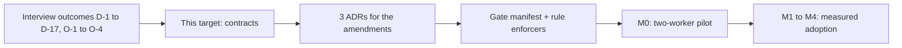
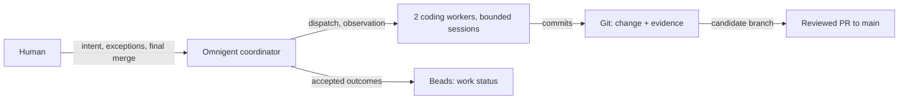
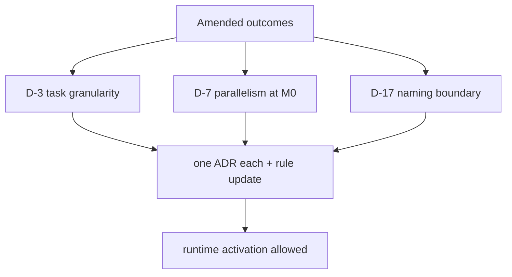
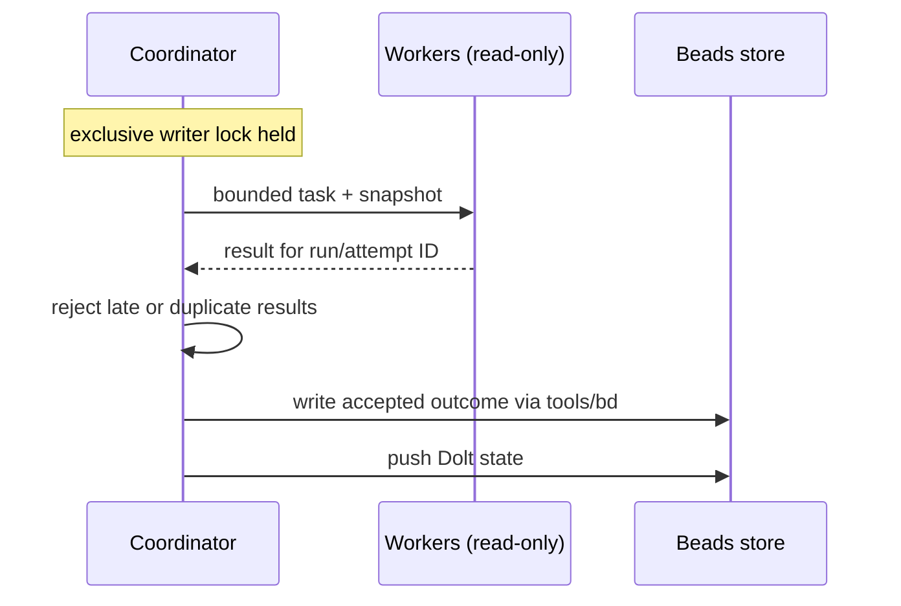
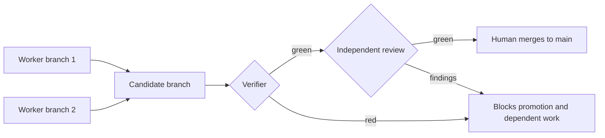

# Target state: an Omnigent-first coding harness

> **Changed, 2026-09-27.** [ADR 0006](../adr/0006-parallel-work-without-a-pilot.md)
> (accepted) drops the M0 pilot: Omnigent runs with native configuration
> and no Omnigent sandbox, the adoption path starts at M1, and parallel
> sessions run from then on, each in a worktree of its own. Where this
> document describes M0 — including "Read this first" below — it records
> the earlier design.

> **Changed, 2026-10-05.**
> [ADR 0009](../adr/0009-architecture-delta-in-design-md.md) (accepted by
> the merge of its pull request) amends D-15 and O-3: an
> Architectural change shows its architecture delta in `design.md` — a
> Mermaid flowchart plus lists of the elements and relationships it adds,
> changes and removes — and the kit ships no model as code and no Node.js
> dependency for now. O-3's ADR duty stays. LikeC4 remains the upgrade
> path, reopened by a revisit trigger. Where this document names a LikeC4
> specification, a `likec4 build` gate or a model diff, it records the
> earlier design.

> **Read this first.** One direction drives this document: Omnigent
> coordinates parallel coding from the first proof of concept (M0).
>
> - **What it asks of you:** review these contracts. Before any runtime
>   activation, three ADRs record the amendments — early parallelism
>   (D-3/D-7), coordinator permission, public-scan naming (D-17).
> - **What changes for daily work:** two bounded workers in isolated
>   worktrees; one coordinator owns every tracker write; Git holds the
>   change, Beads holds status, the human holds the merge.
> - **Where next:** the [implementation plan](2026-09-17-implementation-plan.md)
>   for sequencing, the [gap analysis](2026-09-17-gap-analysis.md) for what
>   is missing today.

**Confirmed direction, 2026-09-17:** Omnigent coordinates parallel coding
from the first proof of concept. This document proposes the contracts that
make that direction operable. It does not activate runtime permissions. The
[decision continuity table](#decision-continuity) preserves the earlier
interview outcomes and identifies each proposed amendment explicitly. A
2026-09-19 readability revision restructured presentation only — diagrams
and summaries were added; no contract changed.

The [gap analysis](2026-09-17-gap-analysis.md) measures the repository at
`eddfc0b`; the [implementation plan](2026-09-17-implementation-plan.md) defines
the delivery sequence. The [earlier architecture](target-architecture.md)
is a historical record. Operational instructions remain in `AGENTS.md` and
`WORKFLOW.md` until the implementation PRs update their rules and enforcers.
Research supplies evidence; an untested product claim is not a control.

## Outcome and boundaries

- **The promise.** A developer turns an agreed change into a reviewable pull
  request — through bounded workers, reproducible checks and an independent
  review.
- **Interruption is safe.** A fresh session resumes from a durable checkpoint,
  without the previous chat.
- **Who owns what.** Omnigent owns dispatch and observation. Git holds the
  change and its evidence. Beads holds work status. The human owns intent,
  exceptions and the final merge.

- **Harness vs instances.** The harness owns reusable process and its kit.
  Instances own domain rules, endpoint permissions, secrets and additional
  gates.
- **Customer boundary.** Customer expressions never enter harness artefacts.
- **Language.** Content, commit messages and PR bodies are English.
- **Naming amendment (D-17).** The proposed public scan permits tool names
  such as Omnigent and LikeC4; it rejects customer/employer identifiers and
  secrets. Model selection stays in routing configuration. This amendment
  does not postpone public-readiness work.

## Decision continuity

- The IDs below are the recorded interview outcomes of the historical
  architecture — not its earlier recommendations.
- **Retain** carries a decision forward unchanged. **Amend** changes it — and
  every amendment needs its ADR and rule update **before runtime activation**.
- Three outcomes are amended here: **D-3** (task-granularity timing), **D-7**
  (parallelism starts at M0) and **D-17** (public-scan naming boundary). The
  explicit instruction to start parallel orchestration early changes D-7; it
  does not silently repeal unrelated decisions.

The table below is the authoritative mapping. Read the **Disposition** column
first: everything not marked **Amend** carries forward unchanged.

| Decision | Disposition | Contract carried into this target |
|---|---|---|
| D-1 — vocabulary | Retain | Stage 1–3 names model routing; S0–S7 instance setup; T0–T2 team scale; M0–M4 Omnigent adoption; levels 1–5 rule enforcement. Correct the corpus vocabulary through the planned source-correction PR. |
| D-2 — change contract | Retain | `spec.md` carries goal, acceptance criteria, non-goals, class, protected areas, failure mode, size/context budget and change-specific Definition of Done. Beads carries status. |
| D-3 — task granularity | Amend timing for early parallelism | One Bead per change remains the default. M0 may use coordinator-claimed task Beads under the change epic when separate ownership is needed; plan steps retain stable IDs either way. Discovered work has a `discovered-from` edge. This does not grant worker-side tracker writes. Amended again by ADR 0006 (2026-09-27): no M0; a task Bead is used when two sessions need separate ownership, and its worker claims it itself (ADR 0005). |
| D-4 — export | Amend, direction confirmed | Auto-export stays off; the render is the portable contract (D-52, lakeswitch-ai PR #37, not yet ratified). The committed copy remains until all three D-52 conditions are shown — the pinned bd with verified checksum in the hosted runner was shown in #26; token read access to refs/dolt/data was recorded as shown there too, but was first shown on 2026-09-23 in #34 (correction in ADR 0004); every reader on one access point is Stage 3, bead 1jg.3. #34 removed the copy on 2026-09-23: export-identity is retired, and readers render fresh from Dolt. ADR 0004 (accepted 2026-09-23). |
| D-5 — worktrees | Retain; clarify activation | In-repository worktrees are created through the selected tool adapter, from one freshly fetched default-branch SHA per run. Direct worker tracker writes require the five-check test and an explicit rule/mode change. A passing sample never grants embedded Dolt concurrent-writer capability. |
| D-6 — instance gates | Retain | The portable kit retains its baseline `ruff`/`pytest` gates; domain and additional stack gates belong to the instance. |
| D-7 — Omnigent adoption | Amend, direction confirmed | Parallel coordination starts in M0. M1 qualifies routine Bounded work; M2 adds the full cross-vendor path; M3 qualifies unattended operation; M4 adds justified hardening. Git-native verification remains independently usable. Amended again by ADR 0006 (2026-09-27): there is no M0; the path starts at M1, and parallel sessions are available from M1, each in a worktree of its own. Amended again by ADR 0010 (2026-10-06): M3 qualifies unattended runs of the seven-phase workflow; a recurring job outside the phases is admitted by an ADR of its own. |
| D-8 — corpus corrections | Retain | Correct dates, missing images, ADR prefixes, language and unverified attribution in a source-correction PR; preserve provenance and historical disagreements. |
| D-9 — rule ownership | Retain | Harness rules and their enforcers live here; domain rules stay in their instances. Each retained rule has an enforcer or a dated ramp valve. |
| D-10 — one gate source | Retain | A platform-neutral manifest defines gates; local execution, CI and Omnigent invoke the same verifier. Generated adapters cannot add a second gate list. |
| D-11 — kit boundaries | Retain | The change-artifact validator travels as mechanism; the evidence pipeline remains instance-owned, with its marker convention and checks in the kit. |
| D-12 — classes | Retain | `class` is a validated frontmatter field: Spike, Bounded, Feature or Architectural; escalation is upward with a recorded reason. |
| D-13 — cross-vendor entry | Retain | Before M2: at least three full seven-phase runs with metrics in coding-harness, the lakeswitch disclosure decision, a green leak check in every qualification run, and the foreign endpoint's declared residency. Implementation cost is measured, not an activation switch. |
| D-14 — design | Retain | Phase 2b is mandatory for Architectural, optional for Feature with a stated omission reason, absent for Bounded and Spike. |
| D-15 — model as code | Amend | The kit ships LikeC4 with a specification defining system/container/component/code, arc42 and MADR templates, and a `likec4 build` gate for applicable architecture changes. Amended by ADR 0009 (2026-10-05): no model as code, no LikeC4 specification, no build gate and no Node.js dependency now; an Architectural change shows its architecture delta in `design.md` — a Mermaid flowchart plus lists of the elements and relationships added, changed or removed. LikeC4 stays the upgrade path, reopened by any of the three revisit triggers in ADR 0009. The arc42 and MADR templates are not amended. |
| D-16 — routing | Retain | Instance `model-routing.yaml` resolves phase requirements to declared endpoints through a kit schema/test; the retained initial example is Anthropic-only. No fixed model names in doctrine. |
| D-17 — public readiness | Retain timing; amend naming boundary | Apache-2.0, onboarding and the public scan begin with foundational work. The scan permits documented tool names. Publication still requires at least 95% kit-probe success in both instances, measured M2 entry runs, and a first Bounded change completed by an unfamiliar reader. |
| O-1 — Definition of Done | Retain | List change-specific documents, models, ADRs, protected non-goals, closure trailer and special runs; the only gate instruction is `verify green`, never a copied gate list. |
| O-2 — lakeswitch entry | Retain | The instance joins the Omnigent topology at M2 after its own gates and disclosure condition hold; its additive-runtime ADR remains. |
| O-3 — architecture detection | Amend | Architectural changes require an ADR and model diff; module creation/deletion/rename under `src/` or `spec/` in another class produces DRIFT requiring a class check. Amended by ADR 0009 (2026-10-05): the ADR duty stays; the model diff becomes a filled "Architecture delta" section in the change's `design.md`; the DRIFT rule is unchanged. |
| O-4 — gate schema | Retain | Start from lakeswitch's schema: aligned `entry`, advisory/report/block vocabulary, instance floor, `mutation_test`, and reporting schedule/reason. Do not invent a competing format. |

The two scaling axes also remain: a second collaborator activates the relevant
separation-of-duties and branch-protection valves; a fourth instance triggers
the previously selected Copier transition. Their acceptance scenarios are
retained in the implementation plan. Detailed software selection is not
reopened by this consistency revision.

## Source of truth and execution topology

One row per concern: **what is authoritative** and **who executes it**. If a
tool disagrees with this table, the table wins.

| Concern | Authority | Execution responsibility |
|---|---|---|
| Direction | One-page `ROADMAP.md`, Now/Next/Later with appetite | Human sets themes; changes link to a theme without duplicating tasks |
| Change | `spec.md`, optional `design.md`, `plan.md` | Validators check structure; acceptance tests and review check meaning |
| Work status | Beads Dolt store, transported through `refs/dolt/data` | Coordinator alone writes in M0; worker results are evidence for those updates |
| Execution evidence | A run record and attempt results under the change's `runs/` directory | Coordinator records assignments, commits, limits, verdict references and stop reasons; these are execution records, not a second task queue |
| Verification | One gate manifest and canonical verifier | Local runner, CI and runtime use the same definition; reports bind to the candidate and base SHAs |
| Review | `findings.md` for a specified candidate | Reviewer uses fresh context and the common review contract below |
| Runtime | Pinned Omnigent configuration plus bounded sessions | Coordinator dispatches; a supervisor enforces limits and cancellation |
| Durable memory | Living specs, ADRs, dated handovers and Beads | Resume uses a checkpoint, not private server history |

### Tracker ownership and activation

> **Changed, 2026-09-27.** [ADR 0006](../adr/0006-parallel-work-without-a-pilot.md)
> (accepted) keeps ADR 0005's claim rule and replaces its Omnigent session
> policy with the write guard of lakeswitch-ai D-60, which does not exist
> yet. The first writing session writes the tracker; a worker claims its
> own bead and adds its handover comment to it, nothing more — and only
> once the maintainer has rewritten house rule 4 in AGENTS.md.

> **Changed, 2026-09-23.** [ADR 0005](../adr/0005-workers-claim-their-own-bead.md)
> (accepted) lets workers claim and close their own bead, held by bd's claim
> rules, an Omnigent session policy and bd's events journal, instead of one
> exclusive coordinator writer. The section below records the earlier design
> of ADR 0002; its rules on stale results and the throwaway store still hold.

- **Today's rule.** No session writes while another session runs.
- **The change.** The proposed coordinator topology replaces that rule — it is
  not an interpretation of the existing permission. Before any parallel pilot
  writes its tracker, its instructions and enforcer must explicitly permit
  exactly one coordinator to write while its tracker-read-only workers run.
- **Isolation.** The harness's live store is not the pilot store.

- **How writes happen.** All coordinator writes use `tools/bd` from the
  designated main checkout, under one OS-held exclusive writer lock shared by
  coordinator processes.
- **Second coordinator: fails closed.** A replacement must prove that the old
  writer has stopped and acquire the lock before reconciling state. An elapsed
  timeout alone does not authorize concurrent ownership.
- **No late writes.** Run and attempt IDs reject late or duplicate results
  after reassignment. The coordinator writes accepted outcomes to Beads and
  pushes Dolt state; workers receive bounded snapshots.

- **The policy stays until replaced.** The single-coordinator policy remains
  after a successful worktree test until explicitly replaced.
- **Lifting it needs all of this.** Direct concurrent writers require a
  supported storage mode, the full five-check protocol, backup/restore
  evidence and a reviewed rule change.
- **No promotion by sample.** Embedded mode is not promoted to multi-writer by
  a successful stress-test sample.
  [Beads mode documentation](https://github.com/gastownhall/beads/blob/main/docs/architecture/dolt.md)
  provides the design basis; pin-specific behavior still needs testing.

### Candidate integration and final merge

- **Naming.** The protected default branch is called `main` below; an
  instance may name it differently.
- **Assembly.** The coordinator creates a temporary candidate branch and a
  separate integration worktree from the run's recorded base SHA. Each coding
  worker owns its own branch/worktree. The coordinator combines worker commits
  one at a time on the candidate branch.
- **Assembly is not release.** This local assembly is not a merge to `main`,
  a task closure, or permission to publish.

- **Check after every assembly.** The verifier checks the combined candidate.
  Independent review evaluates the final candidate against its base and
  contract.
- **Red blocks.** A failed check blocks candidate promotion and further
  dependent work.
- **Stale evidence.** A change to the candidate, target base, contract or
  enforcing configuration invalidates the relevant evidence and requires
  re-verification and review before merge.
- **The human merges.** Only the reviewed candidate with current CI evidence.
  Beads close only after the declaring PR reaches `main`, not after candidate
  assembly.

### Common review contract

One contract, four things to remember:

- **The record.** `findings.md` records dimension SPEC/MAINT, origin
  `base`/`fix-r<N>`, severity BLOCKER/MAJOR/MINOR, evidence, disposition and
  reviewed SHAs.
- **The merge bar.** Merge requires no open `[AMBIGUITY]` and no open BLOCKER;
  `[DIVERGENT]` is always BLOCKER.
- **Escalation.** Ambiguous intent returns to the human decision protocol.
  Two consecutive rounds containing fix-origin findings trigger escalation
  rather than a third automatic repair round. An unattended run additionally
  pauses on open MAJOR findings.
- **One contract, many readers.** This preserves the current
  [review prompt](../../prompts/06-review.md) and
  [workflow](../WORKFLOW.md); their implementations consume one contract.

- **A clean review is a valid result.** Reviewer qualification uses known
  faulty and known correct fixtures, checks missed defects and false
  positives, and calibrates judgments against independently checked outcomes.
  A real PR is never required to contain a defect for the review process to
  pass.

- **External engines propose; the harness reviewer decides.** An external
  review engine may propose findings, but the harness reviewer owns
  SPEC/MAINT, origin, severity and disposition. Empty engine output is not a
  clean verdict.
- **Traceable adapters.** Its adapter records the engine/version, approved
  rules digest, endpoint and reviewed SHAs; a changed candidate or rule
  invalidates its output. The
  [Open Code Review assessment](../research/2026-09-18-open-code-review-assessment.md)
  qualifies that engine as an advisory candidate, not a required gate.

## Run limits, context and recovery

- **Two workers, no more.** M0 permits at most **two coding workers** at once.
- **One ledger for everything.** A run-wide ledger counts coordinator, workers,
  reviewer calls and retries.
- **Limits before dispatch.** Set finite total spend, wall time and tool-call
  limits before dispatch, alongside worker limits.
- **Retries are not free.** The initial retry ceiling is two attempts per
  task, including the first attempt; retries consume the original run budget.
  Approval waits have a finite timeout.
- **Recorded, not inferred.** These are pilot settings recorded with the run,
  not inferred from model output.

- **Stop means stop everything.** On cancellation, budget exhaustion, loss of
  writer ownership or a supervisor failure, new dispatch stops and all child
  processes are stopped or quarantined before reassignment. The supervisor
  must be able to terminate the full process group.
- **No stale wins.** A stale worker cannot publish a result for a newer
  attempt.
- **A cost stop must actually stop.** Model downgrading is not a successful
  cost-stop test. If exact usage is unavailable, the adapter must reserve a
  conservative bound or stop dispatch, never report an unknown total as zero.
  In-flight cost exposure is recorded in the budget.

Every dispatch and resume loads a small context packet:

Six fields, one purpose: a fresh session resumes without claiming uncommitted
work survived.

| Packet field | Purpose |
|---|---|
| Change/Bead/plan-step IDs and current run/attempt | Locate the contract and identify ownership |
| Base and candidate SHAs, branch/worktree, contract hash | Detect stale context and results |
| Relevant requirement IDs/spec slices, permitted and protected paths | Bound the work and disclose dependencies |
| Open decisions, invariants, findings and gate verdict references | Preserve constraints across compaction |
| Last durable checkpoint, unfinished work and next action | Resume without claiming uncommitted work survived |
| Remaining run/worker budget and stop conditions | Prevent a fresh context from resetting limits |

- **Not a status store.** The packet is generated from existing artefacts and
  execution evidence, not maintained as another status store. Instruction
  imports retain the 200-line budget.
- **Bounded packets.** Pin each adapter's packet-size budget and record
  measured or estimated occupancy distinctly; unavailable telemetry is
  UNKNOWN.
- **Resume must be proven.** A fresh-context resume test must recover the
  packet's protected information and reject stale SHAs.
- **Compaction.** Compaction hooks are adapter-specific; an adapter without
  one must reload the same packet explicitly. Heavy logs remain in evidence
  storage with compact verdicts in context.
- **Living-spec deltas.** They use ADDED/MODIFIED/REMOVED/RENAMED; MODIFIED
  includes the complete replacement text.

- **Startup check first.** A startup check verifies checkout identity, pinned
  dependencies, required tools and the baseline gate result before coding.
- **Two failure classes.** Recovery distinguishes a process crash from loss of
  the host's disk: M0 proves process/session restart from durable local
  commits and tracker state.
- **Host loss comes later.** Host-loss recovery needs pushed checkpoints and
  full tracker backups, with a declared acceptable loss window, before
  unattended operation.
- **Backup realism.** JSONL recovery is issue-level; a full restore exercise
  checks additional store state. Do not claim uncommitted work survives.

## Trust and enforcement

- **Every rule has an enforcer.** Each binding rule names an enforcer or an
  owner and dated ramp valve. Gates have known-bad cases and prove they
  examined the intended inputs; an empty findings list can pass when the
  reviewed subject is valid and non-empty.
- **One gate list.** The gate manifest is the sole quality-gate list. Runtime
  policies enforce permissions around actions; they are not a second list of
  quality checks.
- **Workers cannot self-authorize.** Ordinary coding workers cannot change
  active policy, gate configuration, hooks, the tracker wrapper, protected
  acceptance fixtures or their own acceptance report.
- **Harness changes are their own class.** A dedicated harness-maintenance
  change may propose those edits with declared scope and human review; checks
  from an approved revision must still assess the transition. Branch-provided
  gate changes cannot grant themselves authority.
- **Bypass must be seen to fail.** The pilot proves that an attempted bypass
  is rejected.

- **External tools are components, not authorities.** External tools and
  skills are version-pinned, scoped components, not sources of workflow
  authority. Their prompts, repositories and rule files cannot change
  permissions, the Beads writer, the gate manifest, review dispositions or
  human decisions.
- **Control inputs stay protected.** Protect active review rules,
  adapter/action definitions and skill instructions as control inputs;
  evaluate proposed changes with an approved revision. Installation and
  updates require a reviewed, recorded choice, never an automatic import from
  repository text or a remote registry. The
  [CrewAI](../research/2026-09-18-crewai-assessment.md) and
  [Agent Skills](../research/2026-09-18-agent-skills-assessment.md)
  assessments retain Omnigent as coordinator and propose only bounded
  adapter/skill trials.

- **Worktrees share Git.** Worktrees isolate files but share Git resources.
  The adapter must constrain shells and descendant processes as well as editor
  tools, including writes via symlinks and to shared Git configuration, hooks
  and other workers' refs. Git operations are mediated so a worker can commit
  only to its assigned branch.
- **If isolation cannot be shown, stop.** If that cannot be demonstrated, pause
  M0 and propose a stronger isolation layout rather than declaring worktrees a
  security boundary.
- **Text is not permission.** Repository text, logs and tool results cannot
  grant permissions or override the assigned contract. A harmless
  injected-instruction fixture tests this boundary.

- **Every model call is checked.** Endpoint checks cover every model call,
  including coordinator, routing and review. Foreign calls also require the
  disclosure decision and leak check.
- **Probe the boundaries.** Runtime configuration is pinned, telemetry
  behavior tested, and required sandbox, secret-path, egress and write
  boundaries probed on safe fixtures. Terminal and subagent policies must be
  checked independently on the pinned release.
- **Record what ran.** The evidence record names effective configurations and
  their hashes. Logs sent to a model or stored with a PR are subject to the
  same data rules.

## Human planning and attention support

Human planning is a first-class use case. Provide a portable Markdown start
page, with Obsidian as an optional client and Foam or Zettlr as alternatives.
The [research addendum](../research/2026-09-18-human-planning-and-harness-gaps.md)
contains the client comparison, setup and evidence. No client is required for
core verification, and no client becomes a second task tracker.

- **The three authorities.** `ROADMAP.md` owns direction, Beads owns
  executable work, and change artifacts own decisions and intent.
- **A generated view, nothing more.** The proposed `docs/planning/HOME.md` is
  a generated view of these sources: current focus, one next action, last
  durable checkpoint, pending human decisions and waiting reasons. Show the
  source Git revision and tracker snapshot time/revision; missing data is
  unknown, never an empty queue.
- **Read-only UI.** The authorized coordinator supplies snapshots; the UI does
  not open Dolt or write task status. Generated-view edits are detected and
  preserved for recovery, not treated as tracker updates. Human-authored
  ideas use a separate inbox and become Beads work only after deliberate
  triage.

- **ADHD defaults to trial.** One primary focus, at most three visible Now
  themes, Next/Later behind a link, low-friction idea capture, a persistent
  last-done/next-action breadcrumb and batched routine updates.
- **What to avoid.** Mandatory timers, streaks and overdue-pressure displays.
  A focused view still exposes blockers and stale data.
- **Hypotheses, not gates.** These are usability hypotheses to test with the
  maintainer; personal throughput is not a score or adoption gate.

- **Separate checkout for planning.** Use a dedicated planning
  checkout/worktree so human edits do not collide with workers.
- **Boring technology first.** Begin with core client features and normal
  Markdown links. Client filters are navigation aids, not access controls.
- **No file-sync for live state.** Do not synchronize a live tracker or worker
  directory through file-sync tools.
- **Approvals stay explicit.** Optional mobile capture is separate; approvals
  require explicit identity and the exact revision being approved. An
  editable note or board movement does not grant merge permission.

## Acceptance scenarios

Each scenario below needs **evidence, not prose**. The
[implementation plan](2026-09-17-implementation-plan.md) assigns timing and
evidence to them.

| Scenario | Required outcome |
|---|---|
| First parallel run | Two concurrent coding workers, disjoint worktrees, one fenced coordinator, separate candidate branch; `main` unchanged until human merge |
| Second coordinator or stale result | Ownership conflict fails closed; an old attempt cannot update the current task or publish code |
| Integration changes after a green check | Evidence becomes stale; the new combined candidate is checked and reviewed again |
| Rule bypass or cross-worker write | Harmless probes are blocked through editor and shell paths; a trusted check detects attempted gate weakening |
| Retry or cancellation | Total budget does not reset; all children stop; no duplicate dispatch or late acceptance |
| Context reset or worker crash | A fresh session resumes the last durable checkpoint with decisions, scopes and budgets intact |
| Review quality | Seeded faults are detected and clean controls accepted; a defect-free real change can pass |
| Human planning | The maintainer starts, captures an idea and resumes after interruption; identifies blocked/stale state; the same essential information remains usable in plain Markdown |
| Routine adoption | A fresh instance bootstraps the shipped kit, passes applicable gates, completes a Bounded change and resumes from its handover |
| Expanded permissions | Direct tracker writers and unattended runs meet their separate mode, restore and recovery requirements before activation |

Record D-3/D-7/D-17 amendments and the coordinator permission change in ADRs
before activating the runtime. Other prior decisions remain as reconciled
above. Selecting a deployment, altering the live tracker or enabling a model
endpoint is separate implementation work.
