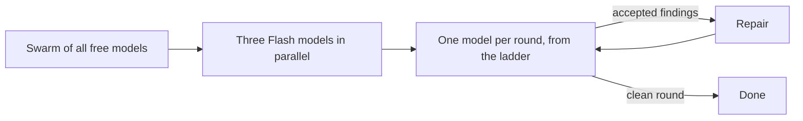
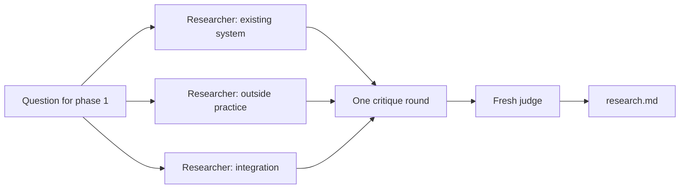
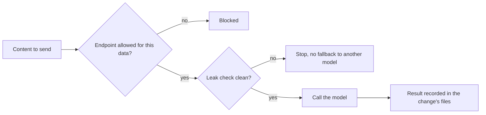

# How the workflow works

The reference behind the [README](../README.md): the phases, who does which
job, the two kinds of class, the planned swarms and the three stages. The full
doctrine is [`WORKFLOW.md`](WORKFLOW.md); where this page and the doctrine
disagree, the doctrine holds.

## The phases

| # | Phase | What it leaves | The question it answers |
|---|---|---|---|
| 1 | Explore | `research.md` | What is the situation? |
| 1a | Interview | `decisions.md` | What must a person decide? |
| 2 | Spec | `spec.md` | What exactly should change? |
| 2a | Spec review (optional) | rows in `findings.md` | Does the spec hold up? |
| 2b | Design (when the change needs one) | `design.md` | How is it built? |
| 3 | Plan | `plan.md` | In which steps, and when is it done? |
| 4 | Implement | code and tests | Does it work? |
| 5 | Verify | test output | Can we show it? |
| 6 | Review | `findings.md` | Does it match the spec? |
| 7 | Commit | a pull request | Does CI agree? |

At the end of any session, a handover file records where the work stands. The
gate for each phase is in `docs/WORKFLOW.md`, section 2.

## Who does what

**Claude is the orchestrator.** The Claude Code session runs each phase, calls
the runner, reads every result, decides on each finding, and writes the
handover. Other models do work inside a phase. They do not decide what happens
next.

Stage 2 hands some jobs to other models, and only framework content goes to
them:

| Job | Who does it | On main? |
|---|---|---|
| Orchestrate: run phases, decide findings, write the handover | Claude Code session | yes |
| Explore (phase 1) | GLM 5.3 Flash (Z.ai) | yes |
| Draft spec, design and plan (2, 2b, 3) | Codex, OpenAI | yes |
| Review the spec (2a) | Opus 5.5 (Anthropic) | yes |
| Review loop (4b) | Pi, running models from OpenCode Go, one model per round | yes, at most three rounds |
| Implement (4) | GLM 5.3 Flash | yes |
| Repair the findings the orchestrator takes | Codex; Sonnet 5.5 after two failed checks | yes |
| Final review (6) | Codex, in a fresh read-only session | yes |

- **Codex** is OpenAI's coding model. The runner calls it.
- **Pi** is the agent program the repository pins for the review loop
  (ADR 0019). It sends the calls to **OpenCode Go**, which offers several open
  models, so no single model reviews the change alone.

The models behind each job are listed in `model-endpoints.yaml` and in
`docs/WORKFLOW.md`, section 4. This table can lag behind them.

Each provider needs your own access, set up on your machine. The repository
tracks no credentials.

## Swarms (in progress, not merged)

Two swarms are being built. Neither is on main yet, so the table above does
not list them.

### Review swarm — bead `coding-harness-4fk`

Today the review loop calls one model per round. The planned change works in
stages, until a round leaves no accepted finding:

1. a swarm of all free models, in parallel;
2. three Flash models, in parallel;
3. then one model per round, from the ladder in `model-endpoints.yaml`.

The design waits for a decision pull request (ADR 0021). Only the maintainer
merges that.

### Research swarm — bead `coding-harness-icw`

Phase 1 would run three independent researchers: one on the existing system,
one on outside practice, one on how the change fits the rest. Then one round
of critique, and a fresh judge settles the result, which becomes
`research.md`. All calls go through the runner, behind the leak check. The proposal is a draft on main
(`docs/research/2026-10-08-explore-swarm-proposal.md`). Its implementation is
a draft branch, not merged.

## Two kinds of class

**Change classes** say how big a change is and what kind it is. Every spec
declares one, and the class sets how much process it gets:

| Class | What it is | Interview | Design phase | Stage-2 review |
|---|---|---|---|---|
| `spike` | answers a question; the output is a recommendation | three topics, or a reasoned skip | no | none |
| `bounded` | changes an existing, readable flow without deciding anything new | one answered question, or a reasoned skip | no | review loop and final review; spec review where held |
| `feature` | a self-contained deliverable | at least three substantive questions | yes, or a sentence why not | spec review, review loop and final review |
| `architectural` | a new subsystem or a break of an interface; it comes with its decision record | none, or five if it changes its ADR | always | spec review, review loop and final review |

Only a `feature` answers the question whether it needs an architecture decision
record (ADR). An ADR file is edited by the one change that claims it in its
spec header.

**Data classes** say what a model may see:

- **Framework content:** this repository's rules, prompts, templates and tests.
  Calls to other vendors in stage 2 cover this class only.
- **Customer code:** source code and database structure from a customer project.
  Only endpoints that declare where they process data may see it.
- **Customer data:** rows from source or target systems. No model endpoint may
  see it; checks between systems run where the data already lives, not in a
  model.

## Three stages

- **Stage 1 — Claude Code only.** All seven phases run with Anthropic models.
  This is the binding baseline, and the place to start.
- **Stage 2 — a second vendor as an extra check.** Models from other vendors
  draft, review and repair this repository's own content. The calls go only
  through `scripts/stage2.py`, and the scope is framework content (ADR 0007,
  amended since). Whether the second check finds more errors is being measured,
  not assumed.
- **Stage 3 — orchestration.** Agents as YAML files, parallel worktrees and
  automatic routing. This stage is evaluative and not in production.

How a call to a second vendor is allowed to happen in stage 2:

