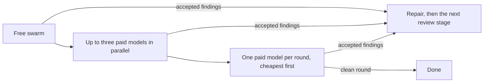
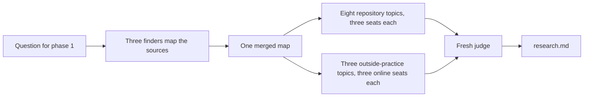
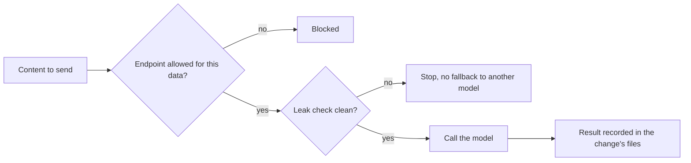

# How the workflow works

The reference behind the [README](../README.md). The full doctrine is
[`WORKFLOW.md`](WORKFLOW.md); where this page and the doctrine disagree, the
doctrine holds. Read *In one minute* and *The phases* for the overview; the
rest is reference.

## In one minute

A **change** is one unit of work: a bug fix, a feature, a decision. It runs
through seven core phases — explore, spec, plan, implement, verify, review and
commit — with optional steps such as the interview, the spec review, the design
and the review loop. You set the goal and answer the questions that are yours;
agents do the rest. Every step leaves a file, so another session, model or
person can resume. The harness (the agent program) reads `AGENTS.md`; Claude
Code is the full orchestration path today.

| Word | Meaning |
| --- | --- |
| change | one unit of work |
| harness | the agent program (Claude Code, Codex) |
| bead | the tracker item in the Beads database |
| gate | an automated check in `decisions/gates.yaml` |
| worktree | a second checkout of the same repository |
| ADR | architecture decision record |

## The phases

| # | Phase | What it leaves | The question it answers |
|---|---|---|---|
| 1 | Explore | `research.md` | What is the situation? |
| 1a | Interview | `decisions.md` | What must a person decide? |
| 2 | Spec | `spec.md` | What exactly should change? |
| 2a | Spec review (optional) | rows in `findings.md` | Does the spec hold up? |
| 2b | Design (when the change needs one) | `design.md` | How is it built? |
| 3 | Plan | `plan.md` | In which steps, and when is it done? |
| 4 | Implement | code and tests | Does it work? |
| 4b | Review loop (when it runs) | a loop record outside the repository; rows enter `findings.md` after the phase-6 verdict | Does the change survive the swarms? |
| 5 | Verify | test output | Can we show it? |
| 6 | Review | `findings.md` | Does it match the spec? |
| 7 | Commit | a pull request | Does CI agree? |

At the end of any session, a handover file records where the work stands. The
gate for each phase is in `docs/WORKFLOW.md`, section 2.

## Who does what

**Claude is the orchestrator.** The Claude Code session runs each phase, calls
the runner, reads every result, decides on each finding, and writes the
handover. Other models do work inside a phase. They do not decide what happens
next.

The second development stage (Stage 2) hands some jobs to other models, and
only framework content goes to them:

| Job | Who does it | Status on main |
|---|---|---|
| Orchestrate: run phases, decide findings, write the handover | Claude Code session | active |
| Explore (phase 1) | GLM 5.3 Flash (Z.ai) | active |
| Draft spec, design and plan (2, 2b, 3) | Codex, OpenAI | active |
| Review the spec (2a) | Opus 5.5 (Anthropic) | active |
| Review loop (4b) | Pi, running the free and Flash swarms, then one paid model per round | active; until a clean round or a stop |
| Implement (4) | GLM 5.3 Flash | active |
| Repair the findings the orchestrator takes | Codex; Sonnet 5.5 after two failed checks | active |
| Final review (6) | Codex, in a fresh read-only session | active |

- **Codex** is OpenAI's coding model. The runner calls it.
- **Pi** is the agent program the repository pins for the review loop
  (ADR 0019). It sends the calls to **OpenCode Go**, which offers models from
  several vendors. The operator is one, so the data recipient is one.

The models behind each job are listed in `model-endpoints.yaml` and in
`docs/WORKFLOW.md`, section 4. This table can lag behind them.

Each provider needs your own access, set up on your machine. The repository
tracks no credentials.

## Review and research swarms

The review loop (phase 4b) and the research of larger changes (phase 1) use swarms.

### Review swarm

The loop runs in **review stages** until a **clean round**: every row is
decided and none is accepted.

| Review stage | Who reviews | Input | Cost |
| --- | --- | --- | --- |
| 1 — free swarm | every reachable free model the `free_stage` rule selects from a live catalog refresh | source and test hunks; no tool access | selected from the free catalog; actual billing is not measured |
| 2 — Flash swarm | up to three of the cheapest reachable paid models whose data terms are read | the full change diff; read-only tools | paid |
| 3 and later — the ladder | one paid model per round, cheapest first by declared requests per five hours (more requests means cheaper) | the full change diff; read-only tools | paid, rising |

A skipped review stage — the free stage on a change without source or test
hunks — does not use a round number. `model-endpoints.yaml` holds the model set
and the declared cost values; a failed Flash member is replaced by the cheapest
unused rung.

[ADR 0021](adr/0021-review-swarms-until-clean.md) defines the loop. The
refreshed catalog comes from Pi’s intermediary `pi.dev`; membership does not
measure actual free billing. Paid models require a retention reading with a
declared expiry date and terms excluding training
([ADR 0022](adr/0022-paid-model-terms-expire.md)); ineligible members are skipped and named. The loop
stops when clean, when the paid ladder is exhausted, or after two consecutive
rounds accepting only findings caused by the preceding repairs.

### Runner details

These are operator details; you can skip them on a first read.

- All review calls go through one operator, OpenCode Go. The models come from
  several vendors; the data recipient is the same.
- A prompt carries at most 2,000 diff lines; a cut at that total is recorded
  and the round is not clean. The free round also bounds each file at 400
  lines; that per-file cut is not recorded as a cut round.
- `prepare-loop` probes each admitted candidate at least once; a probe that
  only ran out of time is retried once with a longer limit. Its receipt is
  bound to the worktree, the configuration and the diff and expires after 900
  seconds.
- A legacy declaration without the availability preflight uses its hand-kept
  `flash_swarm` list. A failed Flash member is replaced by the cheapest unused
  rung; a failed single rung is retired with
  `release-loop --stage-failed <model> --reason <text>`.
- Free models are admitted for the diff-only review under retention and
  training terms that have not been read. A paid model needs a terms reading
  whose declared `valid_until` date has not passed; the runner warns before
  it does.

### Research swarm

A `feature` or `architectural` change explores through the research swarm
([ADR 0020](adr/0020-phase-1-research-swarm.md)); a `bounded` change or a
`spike` keeps the single explorer. Three repository seats first map the
sources independently, and one Opus 5.5 context merges the maps. Then eleven
topics run on the same brief: eight about the repository, each read by the
three repository seats, and three about outside practice, each read by three
online seats; selected free models add public topics, best effort. One fresh
Opus 5.5 context reconciles the reports into `research.md`. Every call goes
through the runner and its leak check; a run that misses a required part is
marked incomplete and exits with an error. The `research-handoff` and `interview-minimums` gates then check that
the spec and the interview carry what the research found.

## Two kinds of class: change and data

**Change classes** say how big a change is and what kind it is. The bead's
description names the class, and the spec repeats it; the class sets how much
process it gets:

| Class | What it is | Interview | Design phase | Second-vendor review |
|---|---|---|---|---|
| `spike` | answers a question; the output is a recommendation | three topics, or a reasoned skip | no | none |
| `bounded` | changes an existing, readable flow without deciding anything new | one answered question, or a reasoned skip | no | review loop and final review; spec review where held |
| `feature` | a self-contained deliverable | at least three substantive questions | yes, or a sentence why not | spec review, review loop and final review |
| `architectural` | a new subsystem or a break of an interface; it comes with its decision record (ADR) | five when it creates or changes its ADR | always | spec review, review loop and final review |

A `feature` decides whether it needs an architecture decision record (ADR); an
`architectural` change always has one. A change that claims and edits an ADR
owes five interview answers in any class. An ADR file is edited by the one
change that claims it in its spec header.

**Data classes** say what a model may see:

- **Framework content:** this repository's rules, prompts, templates and tests.
  Calls to other vendors in the second development stage cover this class only.
- **Customer code:** source code and database structure from a customer project.
  Only endpoints that declare where they process data may see it.
- **Customer data:** rows from source or target systems. No model endpoint may
  see it; checks between systems run where the data already lives, not in a
  model.

## Three development stages

These are development stages, not the review stages of phase 4b.

- **Stage 1 — Claude Code only.** All seven phases run with Anthropic models.
  This is the binding baseline, and the place to start.
- **Stage 2 — a second vendor as an extra check.** Models from other vendors
  draft, review and repair this repository's own content. The calls go only
  through `scripts/stage2.py`, and the scope is framework content (ADR 0007,
  amended since). Whether the second check finds more errors than one has not
  been measured.
- **Stage 3 — orchestration.** Agents as YAML files, parallel worktrees and
  automatic routing. This stage is evaluated, not built.

How a call to a second vendor is allowed to happen in the second development
stage:

## Design rules

- **Files, because a change must outlive the session, the machine and the
  harness.** A state kept inside a tool dies with the tool.
- **One list, because two lists drift.** 22 gates live in one file
  (`decisions/gates.yaml`); 18 block, 3 report, 1 advisory (as of 2026-10-22).
  The file drives the local runner and the CI generator, and a gate holds the
  generated workflow to it byte for byte. `AGENTS.md` is the same kind of single
  entry for the agents; a test fails if a harness-specific file would replace
  it.
- **A merge, because a decision that lives in a chat is not a decision.** A
  rule or a person-reserved file changes when its pull request is merged, not
  when someone typed "yes".
- **Appetite, not estimates.** A plan card names a time limit as a stop, and a
  pre-mortem: "suppose it failed — most likely because …".
- **Evidence over summaries.** You judge a change by its tests, its findings
  table and green checks, not by an agent's account of itself. A repair of code
  counts only when its test fails on the code before the repair; a finding the
  spec supports but no test can show is marked and re-checked. Every count
  names its commit or date, and what could not be read is "not read", never
  "none".
- **Block, report or advisory, because a gate whose red means nothing is
  noise.** Every gate says which of the three it is.
- **Built for focus.** Every question carries its context; every session opens
  with where things stand, the next step and what is needed from you; messages
  lead with the result and ask one question at a time.

## How testing works, and what it does not prove

`make verify` runs `scripts/verify_all.sh`, which holds no commands of its own:
it reads the gate list in `decisions/gates.yaml`, the same list the CI workflow
is generated from. The pytest suite is one of those gates and runs in parallel
(`pytest -n auto`). The others check lint, the kit's classified tree, documents
and process rules.

Each checkout builds its own `.venv` with `make venv` from
`requirements-ci.txt`, where every package is pinned with its hash, and
installs the pinned Pi with `bash tools/pi/install.sh`; the Pi tests and the
review swarms need it. Results depend on the lock, not on what happens to be
installed on a machine, so a local green means what a CI green means.

A repair of code counts only when its test fails on the code before the
repair; the runner checks that itself. A test that would have passed anyway
proves nothing, and models readily write such tests.

On 2026-10-20 at `5c7db34`, `tests/` held 2306 tests in 40 files: about 29,800
lines of test code against about 13,900 lines in `scripts/`. That measures how
much is checked, not how well; mutation testing on one or two scripts is
planned (bead coding-harness-bvy).

## Follow one completed change

The change "frontmatter-current" (archived 2026-09-29) shows each step with
real files:

| Question | Where to see it |
| --- | --- |
| What was the task? | A document's header said when it was last *reviewed*, not when its content last changed — and nothing failed on a stale one. [`research.md`](../plans/changes/archive/2026-09-29-frontmatter-current/research.md) |
| What did a person decide? | In the maintainer's words: "The frontmatter headers in the files must always be maintained and current. This must be a basic mechanism." [`decisions.md`](../plans/changes/archive/2026-09-29-frontmatter-current/decisions.md) |
| What did the agent decide itself? | Mechanics, each marked `[DETAIL]` with its reason — for example which of the two key lists owns the held prefixes. [`spec.md`](../plans/changes/archive/2026-09-29-frontmatter-current/spec.md) |
| What was the contract? | The plan card: written for one option of a `[DECISION]`, with the one step the other option would change. [`plan.md`](../plans/changes/archive/2026-09-29-frontmatter-current/plan.md) |
| Which check found a defect? | Review finding F-1 (MAJOR): the ADR headers said `status: accepted` where the body recorded the ADR as superseded. The row reads `fixed in 0f4101f`. [`findings.md`](../plans/changes/archive/2026-09-29-frontmatter-current/findings.md) |
| What evidence stood at the merge? | The findings table with every row decided, and green CI — and the gate that came out of it, `frontmatter-current`, still runs on every pull request. |

