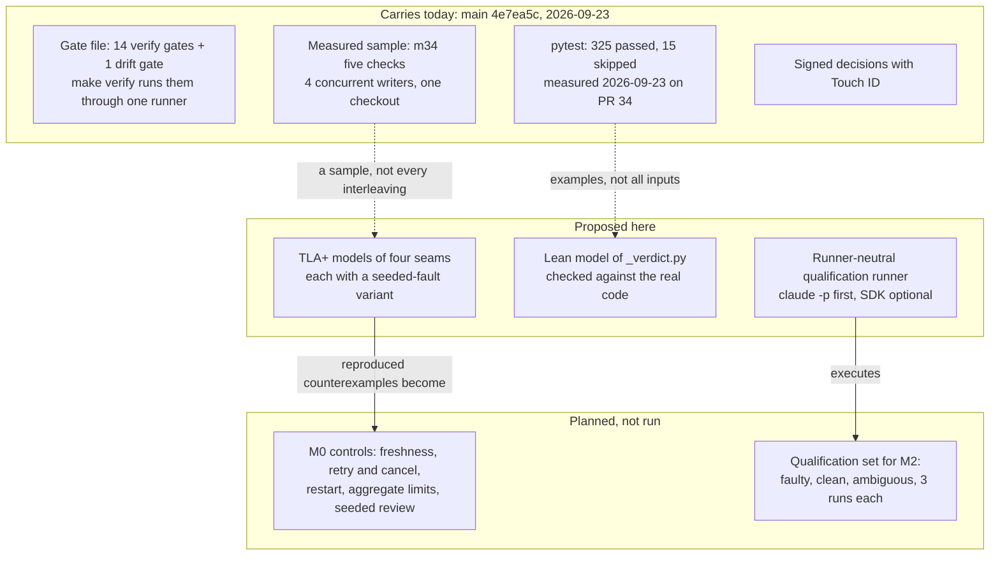
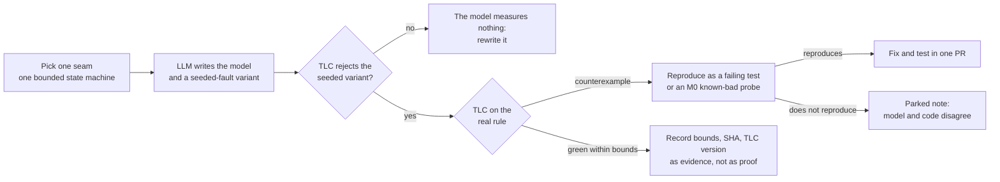
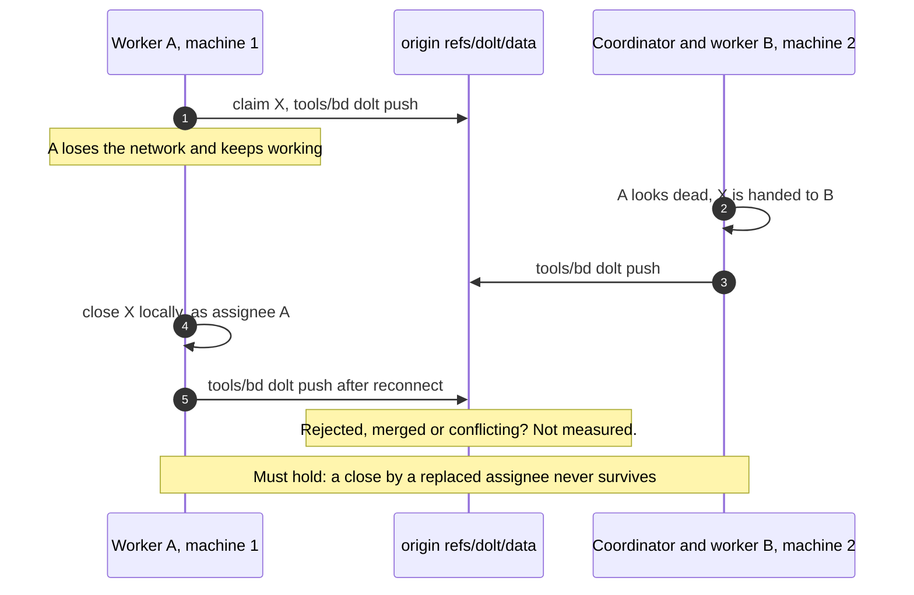
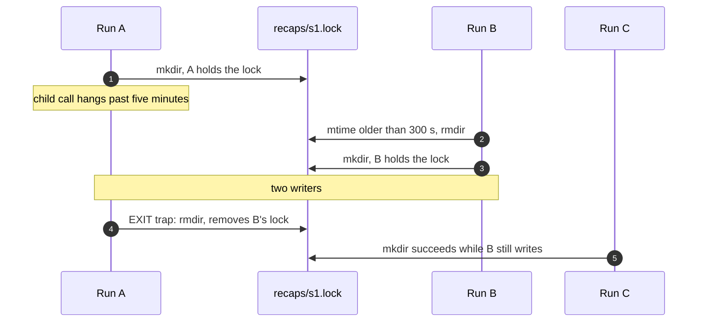
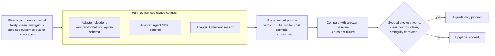
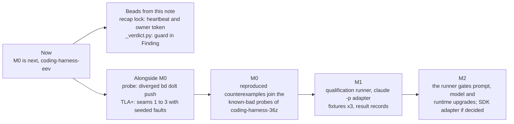

# Claude Agent SDK and formal models (TLA+, Lean) — assessment

Measured against `main` at `4e7ea5c` (2026-09-23, clean; read 2026-09-26).
The SDK part is a desk review; no SDK code was run. Three TLA+ models and one
Lean model were run (appendix). A second pass the same day re-checked every
claimed benefit against the code: it added the verdict vocabulary
(`scripts/_verdict.py`) as a Lean target that exists today, added the recap
hook's lock as a fourth protocol seam with a reproduced finding, and added the
alternatives. A third pass ran four alternatives on the same two targets
([measured](#measured-on-the-same-targets)); it moved the Lean recommendation
behind property tests. The tracker was not read, because the session's shell had no
`bd`; bead states below come from the
[2026-09-23 handover](../journal/handover/2026-09-23-pr-review-round-and-touch-id-signing.md)
and carry its date.

**Trigger.** On 2026-09-22 (UTC) the head of Claude Code reported that Opus
5.5 wrote a Lean model of the Claude Agent SDK, and that "a couple short
prompts" produced 16 pull requests fixing bugs and race conditions. He
combines Lean and TLA+ "to look for issues around data flow, concurrency, and
state mgmt" ([post](https://x.com/bcherny/status/2102543349102338309)). That
is a personal report and was not reproduced here. A reply calls the result
"bug finding more than verification"
([reply](https://x.com/benshanyoufeng/status/2102656345551847554)); this
assessment takes the same view. In that report the Agent SDK is the object
under study, not a tool of the method: neither TLA+ nor Lean needs the SDK.

## Recommendation

1. **TLA+ first, for four protocol seams, alongside M0.** A counterexample
   that reproduces becomes an M0 known-bad probe or a failing test. The
   method is qualified on a failure the harness already knew, the push order
   behind bead `coding-harness-4t8` ([A.2](#a2--push-order-the-calibration-case)),
   and it found one it did not know: the recap hook's lock admits two writers
   when a holder outlives the five-minute stale threshold. That was
   reproduced against the real script ([A.3](#a3--the-recap-lock-a-new-finding)).
2. **Property tests first for pure logic; Lean only where a proof is
   wanted.** `scripts/_verdict.py` already decides every drift tool's exit
   code. A Lean model of it proves three properties the gates rely on,
   refutes two that its docstring promises, and agrees with the real Python
   on all 6,614 verdicts of up to two findings ([A.4](#a4--the-verdict-vocabulary-in-lean)).
   Hypothesis, run on the real code, found the same two refutations in
   1.4 seconds with 33 lines and no new toolchain
   ([measured](#measured-on-the-same-targets)). For this harness that is the
   better default; Lean stays for a function whose guarantee must hold for
   every input, such as the merge bar once it is code.
3. **The Agent SDK is one adapter of a runner-neutral qualification runner
   (M1), not a coordinator.** Omnigent stays the coordinator. Start the
   runner on `claude -p --output-format json --json-schema`. The SDK library
   needs an endpoint decision first (decision 1 below).

## What each one is

| | Claude Agent SDK | TLA+ with TLC | Lean 4 |
|---|---|---|---|
| **Kind** | Python and TypeScript library that runs the Claude Code binary: same agent loop, tools, hooks, subagents, MCP, permissions and sessions | Specification language for state machines; TLC is an explicit-state model checker | Functional programming language and proof assistant with a small checking kernel |
| **Gives the harness** | Programmatic runs with typed results (`structured_output`, `total_cost_usd`, `num_turns`, `session_id`); in-process `PreToolUse` hooks and a `can_use_tool` callback; `max_turns`, `max_budget_usd`; resume and fork of a session | Every interleaving within declared bounds; a violated invariant comes with a shortest trace | A theorem that holds for all inputs of a modelled function, checked by the kernel |
| **Does not give** | Portability: it is Claude-specific. The reported cost is a client-side estimate | Any statement beyond the bounds, or about code the model abstracts away | Any statement about the Python code unless that code is derived from, or checked against, the model |
| **Sources** | [overview](https://code.claude.com/docs/en/agent-sdk/overview), [Python reference](https://code.claude.com/docs/en/agent-sdk/python), [hooks](https://code.claude.com/docs/en/agent-sdk/hooks), [headless mode](https://code.claude.com/docs/en/headless) | [tlaplus/tlaplus](https://github.com/tlaplus/tlaplus) | [lean-lang.org](https://lean-lang.org/), [leanprover/lean4](https://github.com/leanprover/lean4) |

Why the pairing suits an LLM: the model writes the specification and the
proof attempts, and a deterministic checker decides. That is "LLM in front,
determinism behind" in its strictest form, provided the checker itself is
tested against a seeded fault (see the method below).

## The harness as of now

Verification today is broad at the file and script level and thin at the
protocol level. The protocol rules exist, but their evidence is a sample or a
planned experiment.



| Seam | Rule today | Evidence today | Open | Best tool |
|---|---|---|---|---|
| **1 · Claim and close across machines** ([ADR 0005](../adr/0005-workers-claim-their-own-bead.md)) | A contested claim has one winner; writes carry `--if-assignee`; an Omnigent session policy; the events journal | Measured in one checkout with worktrees: 4 concurrent writers, 100 creates and 100 updates, nothing lost ([protocol](2026-09-23-worktree-tracker-writes.md), 2026-09-23). The session policy is documented, not tested. | ADR 0005 names it: "A second machine is outside one Omnigent server's policies." Two clones syncing through `refs/dolt/data` were not measured. | One probe, then TLA+ |
| **2 · Push order: tracker first, git second** (AGENTS.md house rule 4) | Prose rule; CI goes red when it is broken | Found in practice (bead `coding-harness-4t8`) | Nothing, which makes it the calibration case | TLA+ as calibration, run ([A.2](#a2--push-order-the-calibration-case)) |
| **3 · Late results, reassignment, fresh evidence** ([ADR 0002](../adr/0002-exclusive-coordinator-writer.md) rules kept by ADR 0005; [run limits](../architecture/2026-09-17-omnigent-first-target.md#run-limits-context-and-recovery)) | Run and attempt IDs reject late results; evidence is bound to SHAs; retries consume the run budget | Planned M0 experiments, not run | The interleavings of dispatch, cancel, reassign, restart and promote | TLA+ ([A.1](#a1--late-results-never-win) is the first slice) |
| **4 · Recap lock** (`tools/claude-code/hooks/recap.sh`, mode `stop`) | One update at a time per session: a `mkdir` lock; a lock older than five minutes counts as dead and is removed; the EXIT trap removes the lock | Two tests: a fresh foreign lock is never stolen, a stale one is removed (`tests/test_recap_lock.py`) | A holder that is alive but older than five minutes; the trap of such a holder removing its successor's lock | TLA+, then reproduced: a finding, MINOR ([A.3](#a3--the-recap-lock-a-new-finding)) |
| **5 · Verdict vocabulary** (`scripts/_verdict.py`) | The exit code is the highest effective level; DRIFT blocks only with `--strict`; a ramp reports a finding lower until its condition or deadline holds | pytest cases through the tools that use it | Guarantees over all inputs; the ramp's promise in the docstring | Hypothesis first (run: both promises refuted); Lean when a proof is wanted (run: 3 proved, 2 refuted, differential check green, [A.4](#a4--the-verdict-vocabulary-in-lean)) |
| **6 · Merge bar** ([review prompt](../../prompts/06-review.md)) | No open `[AMBIGUITY]`, no open BLOCKER; `[DIVERGENT]` counts as BLOCKER | Prose only | A guarantee over all inputs, once the merge bar is code | Lean then, following the A.4 pattern |
| **7 · Agent and reviewer correctness** ([gap P1](../architecture/2026-09-17-gap-analysis.md#gaps-ordered-by-effect-on-the-target)) | Faulty, clean and ambiguous fixtures, three runs each | Not built | A runner and a result record | Qualification runner; formal models do not help here |

**Where neither approach helps.** Agent and reviewer quality (seam 7), prompt
wording, and everything the file-level gates already hold (links,
frontmatter, schemas, generated files). A model also cannot tell whether the
tracker's content is true; it can only check the protocol that writes it.

## The method: model, counterexample, failing test, fix



Four rules. Each one is an existing harness principle applied to models.

- **A finding counts only when it reproduces.** Counterexample, then a
  failing test or M0 probe, then the fix. A model-only finding is a parked
  note, never a BLOCKER.
- **Every model ships with its seeded fault.** Removing one guard must make
  TLC report a violation, or make a Lean proof fail. A model whose broken
  variant also passes measures nothing; this is the known-bad rule the gates
  already follow. The same holds for the bridge between a Lean model and the
  Python it describes ([A.4](#a4--the-verdict-vocabulary-in-lean)).
- **Green means green within bounds.** Record the constants, the state
  count, the TLC version and the commit the model describes. "No promotion by
  sample" still applies: a model bounded at two workers says nothing about
  three.
- **The model is not the code.** Each model names the commands and paths it
  abstracts. When those change, the model is stale, like evidence bound to an
  old SHA.

## Seam 1 — the question a model has to answer

The realistic cross-machine case is not two workers handed the same bead
(the coordinator never does that). It is a worker that looks dead, is
replaced, and is still alive on another machine.



**One probe comes first.** Two clones of a throwaway repository diverge on
one bead and both push; record what `bd dolt push` and `bd dolt pull` do.
The model takes that measured behaviour as its transition rule. A model built
on a guessed merge rule would only verify the guess. The probe also answers
an open item of ADR 0005 on its own.

## Seam 3 — invariants for the run supervisor

The appendix model covers the first invariant. The others extend the same
module with cancel, restart and promotion.

| Invariant | Meaning | Status |
|---|---|---|
| `NoStaleWin` | An accepted result belongs to the task's current attempt | Run ([A.1](#a1--late-results-never-win)) |
| `FreshEvidence` | A promoted candidate's evidence names its current base and head SHA | To write |
| `BudgetNeverResets` | Spent budget never decreases across retry and restart | To write |
| `NoOrphans` | When a task is reassigned, no child of the cancelled attempt still runs | To write |

## Seam 4 — the recap lock, found on the second pass

The stop hook updates the session recap and the session note, one run at a
time per session. Its comment states the intent: "Without ownership this run
drops out instead of writing in parallel." The lock rests on one timing
assumption the script does not enforce: a lock older than five minutes
belongs to a dead holder. The holder's child call (`claude -p --model haiku`)
has no timeout.



- **Model** ([A.3](#a3--the-recap-lock-a-new-finding)): with the assumption,
  `OneWriter` holds (107 states). Without it, TLC finds two writers after
  five states. An ownership check on the EXIT trap alone does not restore it.
- **Reproduced** against the real script (A.3): a fake `claude` sleeps six
  seconds, and the lock's mtime is set 400 seconds back while run A is still
  inside its child call. A and B then ran their child calls at the same time;
  A's EXIT trap removed B's lock, and run C started while B was still
  running. The second effect is the one the fix of 2026-09-22 describes as
  removed (bead `coding-harness-hit`); it returns whenever a holder outlives
  the threshold.
- **Severity MINOR.** Only the recap line and the session note are at stake,
  and the trigger needs a child call longer than five minutes, such as a hung
  network call or a laptop that sleeps mid-run.
- **Fix options, for a bead, not applied:** a heartbeat that touches the lock
  while the child runs, so that "old" means "no sign of life"; an owner token
  in the lock directory, so the trap removes only its own lock; a bound on the
  child call below the threshold (macOS ships no `timeout`). The model can
  check each option before the script changes.

## Seam 5 — the verdict vocabulary, pure logic that decides exit codes

`_verdict.py` turns findings into exit codes for the drift tools
(`plans_registry.py`, `ramp_valves.py`, `ci_gates.py`, `new_change.py`, the
kit probe). It is pure apart from the date and the ramp predicate, which the
model takes as one evaluated `due` flag.

| Property | Result in Lean ([A.4](#a4--the-verdict-vocabulary-in-lean)) |
|---|---|
| A finding added to a verdict never lowers its exit code | Proved (`exit_monotone`) |
| `--strict` never lowers the exit code | Proved (`strict_not_lower`) |
| A BLOCK finding without a ramp blocks, strict or not | Proved (`block_blocks`) |
| A ramp only lowers a finding (the docstring: "vorlaeufig eine Stufe tiefer") | Refuted (`ramp_can_raise`): nothing stops `until_then` from lying above the finding's own level |
| Once due, a ramp reports its `target` | Refuted (`due_ignores_target`): `effective_level` returns the finding's own level; `target` appears only in the report text |
| Both, given `target == level` and `until_then < level` | Proved (`ramp_lowers`, `due_is_target`) |

The one call site that attaches a ramp to a finding (`plans_registry.py`: a
DRIFT finding, target DRIFT, until then INFO) meets the precondition, so no
current verdict is wrong. The precondition lives only in convention; a guard
in `Finding.__post_init__` would make it structural. The docstring's "one
level lower" also differs from the valves in use: two of the four go from
BLOCK to INFO.

**The bridge to the Python.** A Lean model says nothing about the script
unless the two are compared. The model was compiled and run over every
verdict of zero, one or two findings (57 finding shapes, both strict modes,
6,614 cases) and compared with the real `_verdict.py`: no mismatch. The
bridge has its own seeded fault: with `strict` inverted in the Python, 2,204
cases differ. This is the pattern AWS describes for Cedar: proofs about a
Lean model, and differential testing of the production code against it
([Amazon Science](https://www.amazon.science/blog/how-we-built-cedar-with-automated-reasoning-and-differential-testing)).

## Where the Agent SDK fits

**Why an SDK at all.** The SDK is for programs that drive Claude Code: a
runner, a CI job or a service that needs typed results, in-process hooks,
permission callbacks, budgets or session forks. Modelling work needs none of
that; interactive Claude Code or `claude -p` suffices. In this harness the
only candidate is the M1 qualification runner, and `claude -p` covers its
start.



| Adapter | Covered by `model-endpoints.yaml` today | Adds | Costs |
|---|---|---|---|
| `claude -p` with subscription login | Unclear. It is the official Claude Code program, but Anthropic's docs call it "the Agent SDK via the CLI" ([headless mode](https://code.claude.com/docs/en/headless)). Decision 1 | JSON result with `structured_output`, `total_cost_usd`, `session_id`; `--json-schema`; `--permission-mode dontAsk` for locked-down runs | Loads the host's hooks and settings unless `--bare`; `--bare` never reads the subscription login and needs an API key |
| Agent SDK, Python | No. `claude-code-plan` excludes it, so it routes to `anthropic-api` with token billing | In-process hooks and `can_use_tool`, for example denying writes outside the fixture as a probe; `max_budget_usd`; `fork_session` to rerun from one start state; typed messages | Claude-specific; a token budget under today's rule |
| Omnigent session | Yes, as decided 2026-09-23 (`omnigent claude`) | The same path the pilot uses | Depends on M0 |

**Billing status, as read on 2026-09-26.** On 2026-06-15 the Help Center
paused the planned separate monthly SDK credit and states: "Claude Agent SDK,
`claude -p`, and third-party app usage still draw from your subscription's
usage limits"
([Help Center](https://support.claude.com/en/articles/15036540-use-the-claude-agent-sdk-with-your-claude-plan)).
A secondary source reports the pause confirmed on 2026-08-28 with no new date
([AI Catchup](https://aicatchup.com/news/claude-agent-sdk-monthly-credit-paid-plans)).
The SDK docs separately forbid third-party developers from offering the
claude.ai login to their own users
([overview](https://code.claude.com/docs/en/agent-sdk/overview)). The
repository's classification of 2026-09-23 is stricter than this status.
Whether to keep it is the maintainer's call. This is a reading of the Help
Center, not a check against the terms of service.

**Portability.** The fixture set, the expected outcomes and the result-record
schema are harness-owned and tool-neutral. Adapters live beside their tool,
as `tools/claude-code/` does today. No doctrine or prompt names the SDK.

## Alternatives, and why this pairing

**Why the trigger report used TLA+ and Lean.** In the author's words: "TLA+
also works well. I sometimes combine Lean and TLA+ to look for issues around
data flow, concurrency, and state mgmt." A reply reports that he does not know
either language well; the model wrote the specifications. The following is a
reading, not his statement. Both languages have a large public corpus in
their niche, which is what a model writes fluently from. Both return a hard
machine verdict, a TLC trace or a kernel check, that an agent loop can act on
without a human judge. And they cover each other's blind spot: TLA+ the
interleavings, Lean the data and the functions.

| Alternative | What it checks | Fit for this harness |
|---|---|---|
| **PlusCal** (TLA+ family) | Pseudocode that translates to TLA+; same checker | An easier read for reviewers, same tooling |
| **Quint** ([informalsystems/quint](https://github.com/informalsystems/quint)) | TLA-based, typed, programming-style syntax; simulator, model checking through Apalache | Only if TLA+ syntax becomes the obstacle to review; smaller corpus |
| **FizzBee** ([fizzbee.io](https://fizzbee.io/)) | Python-like specifications with its own model checker | Closest to the maintainer's Python; young, small corpus |
| **P** ([p-org/P](https://github.com/p-org/P)) | State machines as code with systematic testing; used at AWS ([CACM 2025](https://cacm.acm.org/practice/systems-correctness-practices-at-amazon-web-services)) | Built for services; heavy for shell and Python scripts |
| **Alloy** ([alloytools.org](https://alloytools.org/)) | Relational structures, bounded, SAT-based; Alloy 6 adds time | Structure rather than interleavings, such as the bead dependency graph or the gate schema |
| **Hypothesis** property and stateful tests | Random inputs and operation sequences against the real Python | The cheapest step, no gap between model and code; samples, does not exhaust |
| **CrossHair** ([pschanely/CrossHair](https://github.com/pschanely/CrossHair)) | Symbolic execution of Python contracts with an SMT solver | Checks the real `_verdict.py` without a model; bounded and incomplete |
| **Deterministic simulation** (FoundationDB, TigerBeetle, Antithesis) | The real system under a controlled scheduler | Needs control over all nondeterminism; out of reach for bd, git and shell hooks |
| **Dafny** ([dafny.org](https://dafny.org/)) | Verified code, compiled to Python among other targets | Closes the gap by generating the code; generated Python would replace readable scripts |
| **Rocq (Coq), Isabelle/HOL** | Mature proof assistants | No advantage over Lean for these targets |

### Measured on the same targets

Four alternatives ran on the two targets whose answers were already known:
the verdict vocabulary (two refuted promises, three true properties) and the
recap lock (two writers without the timing assumption, none with it). Times
are wall clock in the cloud sandbox on 2026-09-26.

| Tool | Target | Found the known defect | Time | Lines | Checks the real code | Strength of a green result | Footprint |
|---|---|---|---|---|---|---|---|
| **Lean 4.34.0** + differential check | verdict | Yes, as two theorems of refutation | 24 s compile | 139 model and proofs, plus the check | Only through the differential check, up to two findings | Proof for the model, every input | 400 MB download, 2.9 GB unpacked |
| **Hypothesis** 6.168.1 | verdict | Yes, both, with shrunk examples | 1.4 s | 33 | Yes, directly | 100 random examples per property | One pip package |
| **CrossHair** 0.0.110 | verdict | Yes, both | 30 s (per-condition timeout) | 30 | Yes, directly | No counterexample within the timeout | One pip package with an SMT solver |
| **TLA+ / TLC** | recap lock | Yes, after 5 states | 1.1 s | 45 | No, a model | Every reachable state: 107 | 4.3 MB jar and Java |
| **Quint** 0.32.0, simulator | recap lock | Yes | 0.03 s | 51 | No, a model | 20,000 random runs of up to 12 steps | 43 MB npm package; its Rust evaluator could not be fetched here, the TypeScript backend ran |
| **Quint** with Apalache 0.56.1 | recap lock | Yes | 6.6 s | same | No, a model | Every run up to 12 steps, symbolic | plus 130 MB |
| **FizzBee** | recap lock | Not run: its releases were not reachable from the sandbox | | | | | |

Two seeded faults in a copy of `_verdict.py` show where sampling stops. With
`strict` inverted, every tool that looks at the Python fails at once. With a
fault that only appears in a verdict of more than twelve findings,
Hypothesis at its configured list size of six passes, and finds it at twenty.
The Lean differential check, bounded at two findings, also passes: it cannot
tell that the model describes the code before the fault. A Lean proof catches
such a fault only if the model is derived again from the current code.

**For this harness.** For protocols, TLA+ with TLC stays the best fit: the
models are small, TLC exhausts them in about a second, and the footprint is a
jar. Quint reads more like code and its simulator is the fastest to a first
counterexample, but for these models it adds nothing TLC lacks. For pure
Python logic, Hypothesis on the real code is the better default: it found
what Lean found, sits in the existing pytest suite and has no gap between
model and code. Lean earns its place only where a guarantee for every input
is the point. Scripted interleavings, as in A.3, remain the reproduction step
for the shell hooks. A Claude Code plugin already packages the same
workflow with TLA+ and Lean skills
([opum-ai/proof-skills](https://github.com/opum-ai/proof-skills), v0.1.1,
MIT, two commits as read on 2026-09-26). It was not evaluated; under the
[Agent Skills assessment](2026-09-18-agent-skills-assessment.md) it is a
source of techniques to test, not a component to import.

## Placement in the plan

TLA+ work stays off the M0 critical path, as the plan already requires for
optional components. If it is not ready, M0 runs its planned probes as they
are. The two findings of the second pass need no milestone: each is a bead
with a small fix and a test.



## Proposed changes, not applied

- [Implementation plan, M0](../architecture/2026-09-17-implementation-plan.md#m0-first-parallel-omnigent-proof-of-concept):
  add a row "Model-derived probes — each TLA+ counterexample for seams 1 to 3
  that reproduces becomes a known-bad probe, and TLC rejects its
  seeded-fault variant. Optional; M0 does not wait for it."
- [Implementation plan, qualification](../architecture/2026-09-17-implementation-plan.md#quality-evaluation-and-qualification-for-m2):
  add "The runner contract is harness-owned. Every adapter records the
  verdict, base and candidate SHAs, model, cost as an estimate, turns and
  attempts. An unknown cost is recorded as unknown, never as zero."
- [`model-endpoints.yaml`](../../model-endpoints.yaml), entry
  `claude-code-plan`: name `claude -p` explicitly, whichever way decision 1
  goes.
- `tools/claude-code/hooks/recap.sh`: a heartbeat on the lock while the child
  runs and an owner token that the EXIT trap checks. The A.3 reproduction
  becomes a case in `tests/test_recap_lock.py`: a live holder whose lock is
  backdated must not share the lock, and its exit must not free a successor.
- `scripts/_verdict.py`: a guard in `Finding.__post_init__` that a ramp's
  `target` equals the finding's level and `until_then` lies below it; the
  docstring says "lower" instead of "one level lower".
- If models are committed: `models/tla/` and `models/lean/` classified in
  `scripts/kit/manifest.yaml` and `provenance.yaml`; one gate `formal-models`
  in [`decisions/gates.yaml`](../../decisions/gates.yaml) with
  `enforcement: advisory` first, because TLC needs Java and Lean a toolchain
  of 2.9 GB unpacked in CI; the A.4 differential check as a test that skips
  without Lean. A dated ramp valve raises the gate.
- `tests/test_verdict_properties.py`: the Hypothesis properties of
  [A.5](#a5--the-alternatives-that-ran), with the two refuted promises
  expected to fail until the guard in `Finding` lands. Hypothesis becomes a
  pinned test dependency; the install line in CI is generated from the gate
  file, so the change goes through `scripts/ci_gates.py`.

## Decisions for the maintainer

1. `[DECISION]` **Which endpoint carries scripted runs?**
   (a) Keep today's rule: the SDK and `--bare` runs use `anthropic-api` with
   a token budget. (b) Declare `claude -p` with subscription login covered by
   `claude-code-plan`; the SDK library stays excluded. (c) Cover both under
   `claude-code-plan`, citing the Help Center status of 2026-06-15, with a
   re-check date. **Recommendation: (b).** The M1 runner can start without a
   token budget and without a new class of integration, and the exclusion
   stays where the repository drew it. Consequence: no in-process callbacks
   until (a) or (c) is chosen, and reproducible runs need a throwaway
   repository with pinned settings instead of `--bare`.
2. `[DECISION]` **When does the TLA+ pilot start?** **Recommendation:**
   alongside M0 and off its critical path, beginning with the seam-1 probe,
   because that probe also answers an open item of ADR 0005.
3. `[DECISION]` **Accept the recap-lock finding (MINOR)?**
   **Recommendation:** yes, fix it with heartbeat and owner token, and let
   the A.3 model check the fix first. Consequence: the hook's guarantee then
   holds without a timing assumption.
4. `[DECISION]` **Make the verdict precondition structural?**
   **Recommendation:** yes, a guard in `Finding`. It costs a few lines and
   turns two refuted promises into proved ones; the one current call site
   already complies.
5. `[DECISION]` **Add Hypothesis as a pinned test dependency?**
   **Recommendation:** yes. It is the cheapest tool that checks the real
   Python for all pure decision logic in `scripts/`, and it found in 1.4
   seconds what the Lean model found. Consequence: one more pinned package
   in the generated CI install line.

No bead was created for this work: the tracker was not reachable from this
session. It needs one bead before any of it starts.

## Limits and evidence status

- **SDK:** desk review of the documentation as served on 2026-09-26; not run.
- **TLA+:** three models run in a cloud sandbox with TLC2 version
  2026.09.25.163503 (rev `8f4bc8b`), `tla2tools.jar` SHA-256
  `ab4694601923fd5ac06452abbf847c366a5054a3d739552085edd6ed986c29ec`. They
  model the harness's rules, not bd or Omnigent code.
- **Lean:** run in the cloud sandbox with Lean 4.34.0 (commit `293d5d0`),
  from the GitHub release `lean-4.34.0-linux.tar.zst` (SHA-256
  `caaa98356098c85dc0fcbbd28e1ec66f39eb6551829972b752ff20e1286b646b`);
  `release.lean-lang.org` stayed blocked, so elan was not used. Core Lean
  only, no Mathlib; `#print axioms` lists only `propext` and `Quot.sound`.
  The differential check ran against a copy of `_verdict.py` at `4e7ea5c`
  with Python 3.11.
- **Alternatives:** Hypothesis 6.168.1, CrossHair 0.0.110 and pytest 9.1.1
  under Python 3.11; Quint 0.32.0 with its TypeScript simulator backend
  (the Rust evaluator is fetched from the GitHub API, which the sandbox
  refused) and Apalache 0.56.1. FizzBee was not installed. Times are single
  runs, not benchmarks.
- **Recap reproduction:** in the Cowork VM on the maintainer's machine
  (Linux, bash) with copies of `recap.sh` and `handover.sh` at `4e7ea5c`, a
  fake `claude` and a backdated lock mtime standing in for a five-minute
  hang. Not run on macOS; the lock logic is the same there.
- **Tracker:** not read.
- **M0 status:** this note follows the repository, which still names M0 as
  next (handover of 2026-09-23). A note in the maintainer's vault reports that
  the lakeswitch journal of 2026-09-24 dropped the M0 pilot; that was not
  verified here, because `lakeswitch-ai` was not connected. If it holds,
  "alongside M0" reads "alongside the Omnigent adoption": seams 1, 2, 4 and 5
  do not depend on M0, and the seam-3 invariants move to whatever supervises
  runs instead.
- **The trigger report:** not reproduced; the figure of 16 pull requests is
  the author's.

## Appendix — the models that were run

TLA+ command, per configuration:
`java -cp tla2tools.jar tlc2.TLC -deadlock -workers 1 -config <cfg> <module>.tla`.
`-deadlock` switches off deadlock detection, because a finished run has no
further step by design.

### A.1 — Late results never win

```tla
---- MODULE StaleResults ----
\* A late result must never win (ADR 0002, kept by ADR 0005).
\* GuardOn = FALSE is the seeded fault: TLC must then report a stale win.
EXTENDS Naturals
CONSTANTS Tasks, MaxAttempt, GuardOn
VARIABLES attempt, inflight, done, accepted
vars == <<attempt, inflight, done, accepted>>

Init == /\ attempt  = [t \in Tasks |-> 1]
        /\ inflight = {}
        /\ done     = {}
        /\ accepted = {}

Dispatch(t) == /\ t \notin done
               /\ inflight' = inflight \cup {<<t, attempt[t]>>}
               /\ UNCHANGED <<attempt, done, accepted>>

Reassign(t) == /\ t \notin done
               /\ attempt[t] < MaxAttempt
               /\ attempt' = [attempt EXCEPT ![t] = @ + 1]
               /\ UNCHANGED <<inflight, done, accepted>>

Accept(r) == /\ r[1] \notin done
             /\ GuardOn => r[2] = attempt[r[1]]
             /\ accepted' = accepted \cup {r}
             /\ done'     = done \cup {r[1]}
             /\ inflight' = inflight \ {r}
             /\ UNCHANGED attempt

Next == \/ \E t \in Tasks : Dispatch(t) \/ Reassign(t)
        \/ \E r \in inflight : Accept(r)

Spec == Init /\ [][Next]_vars

NoStaleWin == \A r \in accepted : r[2] = attempt[r[1]]
====
```

| Configuration | Result |
|---|---|
| `Tasks = {t1, t2}`, `MaxAttempt = 2`, `GuardOn = TRUE` | Green: 81 distinct states, depth 9 |
| Same, `GuardOn = FALSE` (seeded fault) | `NoStaleWin` violated after 4 states: `Dispatch(t1)`, `Reassign(t1)`, accept of `<<t1, 1>>` |

### A.2 — Push order, the calibration case

```tla
---- MODULE PushOrder ----
\* Calibration on a known failure (bead coding-harness-4t8): CI hydrates the
\* tracker from refs/dolt/data. A git push that outruns the tracker push can go red.
\* GuardOn = TRUE is house rule 4 ("tracker first, git second").
EXTENDS Naturals
CONSTANTS MaxV, GuardOn
VARIABLES local, remoteTracker, remoteGit, ciPending, ciRed
vars == <<local, remoteTracker, remoteGit, ciPending, ciRed>>

Init == /\ local = 0 /\ remoteTracker = 0 /\ remoteGit = 0
        /\ ciPending = FALSE /\ ciRed = FALSE

\* A session changes a bead; its next commit claims to include that change.
Work == /\ local < MaxV
        /\ local' = local + 1
        /\ UNCHANGED <<remoteTracker, remoteGit, ciPending, ciRed>>

PushTracker == /\ remoteTracker' = local
               /\ UNCHANGED <<local, remoteGit, ciPending, ciRed>>

PushGit == /\ GuardOn => remoteTracker >= local
           /\ remoteGit' = local
           /\ ciPending' = TRUE
           /\ UNCHANGED <<local, remoteTracker, ciRed>>

\* CI starts some time after the git push and reads the tracker it finds then.
CIRun == /\ ciPending
         /\ ciRed' = (ciRed \/ remoteTracker < remoteGit)
         /\ ciPending' = FALSE
         /\ UNCHANGED <<local, remoteTracker, remoteGit>>

Next == Work \/ PushTracker \/ PushGit \/ CIRun
Spec == Init /\ [][Next]_vars

NeverRedByOrder == ~ciRed
====
```

| Configuration | Result |
|---|---|
| `MaxV = 3`, `GuardOn = TRUE` | Green: 40 distinct states, depth 8 |
| Same, `GuardOn = FALSE` (the rule removed) | `NeverRedByOrder` violated after 4 states: `Work`, `PushGit`, `CIRun` reads the old tracker. This is the failure of bead `coding-harness-4t8`. |

The model also shows why a sample can miss it: without the rule, a tracker
push that lands between the git push and the CI start keeps CI green. The
failure depends on timing, and the model explores both orders.

### A.3 — The recap lock, a new finding

```tla
---- MODULE RecapLock ----
\* The recap hook's lock (tools/claude-code/hooks/recap.sh, mode stop).
\* A run takes the lock with mkdir, removes a lock whose mtime is older than
\* five minutes, and its EXIT trap runs rmdir without checking ownership.
\* Bounded = TRUE is the design assumption: a lock only grows old once its holder is dead.
\* OwnerCheck = TRUE is a candidate fix: the trap removes only a lock the run itself created.
EXTENDS Naturals, FiniteSets
CONSTANTS Runs, None, Bounded, OwnerCheck
VARIABLES pc, lock, owner, old
vars == <<pc, lock, owner, old>>

Init == /\ pc = [r \in Runs |-> "wait"]
        /\ lock = FALSE /\ owner = None /\ old = FALSE

Acquire(r) == /\ pc[r] = "wait" /\ ~lock
              /\ lock' = TRUE /\ owner' = r /\ old' = FALSE
              /\ pc' = [pc EXCEPT ![r] = "hold"]

\* Five minutes pass. Under the design assumption only a dead holder's lock ages.
Age == /\ lock /\ ~old
       /\ Bounded => pc[owner] = "dead"
       /\ old' = TRUE
       /\ UNCHANGED <<pc, lock, owner>>

Steal(r) == /\ pc[r] = "wait" /\ lock /\ old
            /\ lock' = FALSE /\ owner' = None /\ old' = FALSE
            /\ UNCHANGED pc

\* Killed: no EXIT trap runs, the lock stays.
Crash(r) == /\ pc[r] = "hold"
            /\ pc' = [pc EXCEPT ![r] = "dead"]
            /\ UNCHANGED <<lock, owner, old>>

\* Normal exit: the EXIT trap runs rmdir.
Finish(r) == /\ pc[r] = "hold"
             /\ pc' = [pc EXCEPT ![r] = "done"]
             /\ IF OwnerCheck /\ owner # r
                  THEN UNCHANGED <<lock, owner, old>>
                  ELSE /\ lock' = FALSE /\ owner' = None /\ old' = FALSE

Next == Age \/ \E r \in Runs : Acquire(r) \/ Steal(r) \/ Crash(r) \/ Finish(r)
Spec == Init /\ [][Next]_vars

OneWriter == Cardinality({r \in Runs : pc[r] = "hold"}) <= 1
====
```

Constants per run: `Runs = {a, b, c}`, `None = none`.

| Configuration | Result |
|---|---|
| `Bounded = TRUE`, `OwnerCheck = FALSE` (the design assumption holds) | Green: 107 distinct states, depth 12 |
| `Bounded = TRUE`, `OwnerCheck = TRUE` | Green: 107 distinct states, depth 12 |
| `Bounded = FALSE`, `OwnerCheck = FALSE` (the script as it is) | `OneWriter` violated after 5 states: `Acquire(a)`, `Age`, `Steal(b)`, `Acquire(b)` |
| `Bounded = FALSE`, `OwnerCheck = TRUE` (owner check alone) | The same violation after 5 states |

Reproduction against the real script, run from the repository root:

```bash
T=$(mktemp -d); H=$T/home
mkdir -p $H/.claude/hooks $H/.claude/recaps $H/.claude/session-notes $T/bin $T/repo
cp tools/claude-code/hooks/recap.sh tools/claude-code/hooks/handover.sh $H/.claude/hooks/
(cd $T/repo && git init -q -b main && git -c user.email=t@e.invalid -c user.name=T commit -q --allow-empty -m x)
cat > $T/bin/claude <<'FAKE'
#!/bin/bash
cat > /dev/null
echo "start $RUN $(date +%s.%N | cut -c1-14)" >> "$LOG"
sleep "$FAKE_SLEEP"
echo "end   $RUN $(date +%s.%N | cut -c1-14)" >> "$LOG"
printf 'RECAP: Erledigt: %s\n## Wo wir stehen\nFake.\n' "$RUN"
FAKE
chmod +x $T/bin/claude
export LOG=$T/log FAKE_SLEEP=6 RECAP_LOCK_SEKUNDEN=20
run() { printf '{"session_id":"s1","cwd":"%s","last_assistant_message":"x"}' "$T/repo" \
  | RUN=$1 HOME=$H PATH="$T/bin:$PATH" bash $H/.claude/hooks/recap.sh stop; }
run A & sleep 1.5
touch -d "@$(( $(date +%s) - 400 ))" $H/.claude/recaps/s1.lock   # A has hung for > 5 minutes
run B & sleep 5.5                                                  # A exits, its trap runs
run C & wait
cat $LOG
```

Output, in seconds after A's child call started: `start A +0.0`, `start B
+2.6`, `end A +6.0`, `start C +7.1`, `end B +8.6`, `end C +13.1`. After A's
exit the lock directory was gone while B was still running. The recap file
held C's text.

### A.4 — The verdict vocabulary in Lean

```lean
/-!
Model of `scripts/_verdict.py` (coding-harness, main 4e7ea5c).
The ramp's predicate and deadline are impure in Python; here `due` is their
already evaluated result.
-/

inductive Level where
  | info | drift | block
  deriving DecidableEq, Repr

def Level.toNat : Level → Nat
  | .info => 0
  | .drift => 1
  | .block => 2

structure Ramp where
  due       : Bool
  target    : Level
  untilThen : Level
  deriving Repr

structure Finding where
  level : Level
  ramp  : Option Ramp
  deriving Repr

/-- `Finding.effective_level` -/
def Finding.effective (f : Finding) : Level :=
  match f.ramp with
  | none   => f.level
  | some r => if r.due then f.level else r.untilThen

/-- `max(f.effective_level() for f in findings)`, with 0 for no findings -/
def worst : List Finding → Nat
  | []      => 0
  | f :: fs => Nat.max f.effective.toNat (worst fs)

/-- `Verdict.exit_code(strict)` -/
def exitCode (fs : List Finding) (strict : Bool) : Nat :=
  if worst fs = 1 ∧ strict = false then 0 else worst fs

/-! ## Helper facts -/

theorem Level.toNat_le_two (l : Level) : l.toNat ≤ 2 := by
  cases l <;> decide

theorem worst_le_two : ∀ fs : List Finding, worst fs ≤ 2
  | [] => by simp [worst]
  | f :: fs => by
      simp only [worst]
      exact Nat.max_le.mpr ⟨Level.toNat_le_two _, worst_le_two fs⟩

theorem worst_ge_of_mem (g : Finding) : ∀ fs : List Finding, g ∈ fs → g.effective.toNat ≤ worst fs
  | [], h => by simp at h
  | f :: fs, h => by
      simp only [worst]
      rcases List.mem_cons.mp h with e | m
      · subst e; exact Nat.le_max_left _ _
      · exact Nat.le_trans (worst_ge_of_mem g fs m) (Nat.le_max_right _ _)

theorem exit_true (fs : List Finding) : exitCode fs true = worst fs := by
  simp [exitCode]

theorem exit_false (fs : List Finding) :
    exitCode fs false = if worst fs = 1 then 0 else worst fs := by
  simp [exitCode]

/-! ## Three properties the gates rely on — proved -/

/-- A finding added to a verdict never lowers its exit code. -/
theorem exit_monotone (f : Finding) (fs : List Finding) (strict : Bool) :
    exitCode fs strict ≤ exitCode (f :: fs) strict := by
  have h1 : worst fs ≤ worst (f :: fs) := by
    simp only [worst]; exact Nat.le_max_right _ _
  have h2 := worst_le_two (f :: fs)
  cases strict
  · rw [exit_false, exit_false]; split <;> split <;> omega
  · rw [exit_true, exit_true]; exact h1

/-- `--strict` never lowers the exit code. -/
theorem strict_not_lower (fs : List Finding) :
    exitCode fs false ≤ exitCode fs true := by
  rw [exit_false, exit_true]; split <;> omega

/-- A BLOCK finding without a ramp always blocks, strict or not. -/
theorem block_blocks (fs : List Finding) (strict : Bool)
    (h : ⟨.block, none⟩ ∈ fs) : exitCode fs strict = 2 := by
  have h1 := worst_ge_of_mem _ fs h
  simp [Finding.effective, Level.toNat] at h1
  have hw : worst fs = 2 := by have := worst_le_two fs; omega
  cases strict <;> simp [exitCode, hw]

/-! ## Two properties the docstring promises — false in general -/

/-- "A ramp reports a finding lower for the time being" does not hold:
    nothing stops `untilThen` from lying above the finding's own level. -/
theorem ramp_can_raise :
    ¬ ∀ f : Finding, f.effective.toNat ≤ f.level.toNat := by
  intro h
  have := h ⟨.info, some ⟨false, .block, .block⟩⟩
  simp [Finding.effective, Level.toNat] at this

/-- Once due, the effective level is the finding's own level, not `target`. -/
theorem due_ignores_target :
    ¬ ∀ (f : Finding) (r : Ramp), f.ramp = some r → r.due = true → f.effective = r.target := by
  intro h
  have := h ⟨.block, some ⟨true, .drift, .info⟩⟩ ⟨true, .drift, .info⟩ rfl rfl
  simp [Finding.effective] at this

/-! ## The precondition that makes both hold -/

def WellFormed (f : Finding) : Prop :=
  match f.ramp with
  | none   => True
  | some r => r.target = f.level ∧ r.untilThen.toNat < f.level.toNat

theorem ramp_lowers (f : Finding) (hw : WellFormed f) :
    f.effective.toNat ≤ f.level.toNat := by
  cases hr : f.ramp with
  | none => simp [Finding.effective, hr]
  | some r =>
      simp only [WellFormed, hr] at hw
      obtain ⟨_, h2⟩ := hw
      simp only [Finding.effective, hr]
      split <;> omega

theorem due_is_target (f : Finding) (r : Ramp) (hr : f.ramp = some r)
    (hd : r.due = true) (hw : WellFormed f) : f.effective = r.target := by
  simp only [WellFormed, hr] at hw
  simp [Finding.effective, hr, hd]
  exact hw.1.symm

#print axioms exit_monotone
#print axioms strict_not_lower
#print axioms block_blocks
#print axioms ramp_can_raise
#print axioms due_ignores_target
#print axioms ramp_lowers
#print axioms due_is_target
```

`lean Verdict.lean` compiles with no error and prints, for every theorem, the
axioms it depends on: `propext` and `Quot.sound`, nothing else. Seeded fault:
with the condition in `exitCode` changed to `strict = true`, the proofs no
longer go through (`unsolved goals`).

Differential check: a `main` appended to the same definitions enumerates the
57 finding shapes (three levels, each with no ramp or a ramp of every
`due`, `target` and `until_then` combination) and prints `exitCode` for every
verdict of zero, one or two findings in both strict modes. A Python script
builds the same verdicts with the real `_verdict.py` (a ramp whose predicate
returns `due`, no deadline) and compares. Result: 6,614 cases, no mismatch.
With `strict` inverted in the Python: 2,204 mismatches.

### A.5 — The alternatives that ran

Hypothesis, run with `python3 -m pytest -q test_verdict_hyp.py` beside a copy
of `_verdict.py`. Three properties pass; the two docstring promises fail with
shrunk examples: an INFO finding whose not-yet-due ramp has `until_then =
DRIFT`, and an INFO finding whose due ramp has `target = DRIFT`.

```python
"""Hypothesis against the real _verdict.py (copy at main 4e7ea5c)."""
from hypothesis import given, settings, strategies as st
from _verdict import Finding, Level, Ramp, Verdict

levels = st.sampled_from(list(Level))
ramps = st.none() | st.builds(
    lambda due, target, until: Ramp("x", "c", (lambda d=due: d), target, until),
    st.booleans(), levels, levels)
findings = st.builds(lambda lv, r: Finding(lv, "m", "", r), levels, ramps)

def code(fs, strict):
    v = Verdict(); v.findings = list(fs); return v.exit_code(strict=strict)

@given(st.lists(findings, max_size=6), findings, st.booleans())
def test_adding_a_finding_never_lowers_the_exit_code(fs, f, strict):
    assert code(fs, strict) <= code(fs + [f], strict)

@given(st.lists(findings, max_size=6))
def test_strict_never_lowers_the_exit_code(fs):
    assert code(fs, False) <= code(fs, True)

@given(st.lists(findings, max_size=6), st.booleans())
def test_a_block_without_ramp_always_blocks(fs, strict):
    assert code(fs + [Finding(Level.BLOCK, "m")], strict) == 2

@given(findings)
def test_a_ramp_only_lowers(f):                       # docstring promise
    assert f.effective_level() <= f.level

@given(findings)
def test_a_due_ramp_reports_its_target(f):             # docstring promise
    if f.ramp is not None and f.ramp.due:
        assert f.effective_level() == f.ramp.target
```

CrossHair, run with `crosshair check --analysis_kind=PEP316
--per_condition_timeout=30`, reported `ramp_only_lowers(0, False, 1, 2)` and
`due_reports_target(2, 0, 2)` as false, and nothing for
`strict_never_lowers` within its timeout.

Quint, the recap lock of A.3 in Quint syntax. `quint run
--backend=typescript --main=asIs --invariant=oneWriter --max-steps=12
--max-samples=20000` finds the violation; `quint verify` with the same
arguments hands it to Apalache.

```quint
module recapLock {
  type Pc = Wait | Hold | Dead | Done
  const RUNS: Set[str]
  const BOUNDED: bool
  const OWNER_CHECK: bool
  var pc: str -> Pc
  var lock: bool
  var owner: str
  var old: bool

  action init = all {
    pc' = RUNS.mapBy(_ => Wait),
    lock' = false, owner' = "none", old' = false,
  }
  action acquire(r: str): bool = all {
    pc.get(r) == Wait, not(lock),
    lock' = true, owner' = r, old' = false, pc' = pc.set(r, Hold),
  }
  // five minutes pass; under the design assumption only a dead holder's lock ages
  action age: bool = all {
    lock, not(old),
    if (BOUNDED) pc.get(owner) == Dead else true,
    old' = true, pc' = pc, lock' = lock, owner' = owner,
  }
  action steal(r: str): bool = all {
    pc.get(r) == Wait, lock, old,
    lock' = false, owner' = "none", old' = false, pc' = pc,
  }
  action crash(r: str): bool = all {
    pc.get(r) == Hold,
    pc' = pc.set(r, Dead), lock' = lock, owner' = owner, old' = old,
  }
  action finish(r: str): bool = all {
    pc.get(r) == Hold,
    pc' = pc.set(r, Done),
    if (OWNER_CHECK and owner != r) all { lock' = lock, owner' = owner, old' = old }
    else all { lock' = false, owner' = "none", old' = false },
  }
  // finished runs just stay (TLC: -deadlock)
  action idle: bool = all { pc' = pc, lock' = lock, owner' = owner, old' = old }
  action step = any {
    age,
    idle,
    nondet r = RUNS.oneOf()
    any { acquire(r), steal(r), crash(r), finish(r) },
  }
  val oneWriter = RUNS.filter(r => pc.get(r) == Hold).size() <= 1
}

module asIs { import recapLock(RUNS = Set("a", "b", "c"), BOUNDED = false, OWNER_CHECK = false).* }
module assumed { import recapLock(RUNS = Set("a", "b", "c"), BOUNDED = true, OWNER_CHECK = false).* }
```
