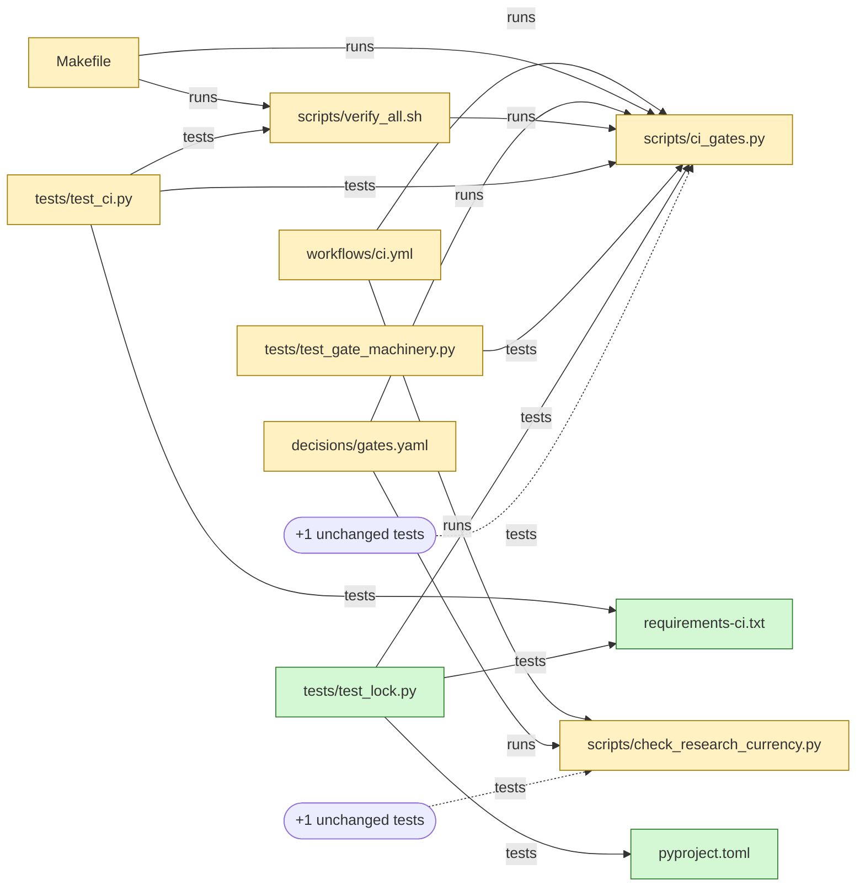

# Diagrams in pull requests

## Result first

**A standard: yes, but not "a diagram in every pull request", and never one
an agent draws.**

1. **Every pull request that changes code carries a touch list.** A script
   writes it from the diff: which code files changed, what runs them, what
   tests them. It is plain Markdown, so it reads in the GitHub Mobile app.
2. **A Mermaid map of the same graph is extra, for a big change only** (three
   or more changed code files), collapsed at the end of the body. The GitHub
   Mobile app shows Mermaid as raw code (community reports from 2022 to
   September 2026; no official statement found). In a phone-width column, a
   13-box map shrinks to 5.6-pixel text (measured, section 5).
3. **Architectural and Feature changes link their `design.md` architecture
   delta** (ADR 0009) instead of copying it. The touch list is a cross-check
   against that delta: the delta shows the intended end state, the list shows
   what this one pull request touches.
4. **Prose-only pull requests get one line and no map.** 37 of the 80 pull
   requests so far changed no code (#1 to #82, read 2026-10-06).
5. **No agent-drawn diagram.** The review bots that draw one (Qodo
   Merge/PR-Agent, CodeRabbit, Sourcery, Greptile) are AI services; the one
   with open source asks a language model for it. A tracker and a user
   report broken, partial and wrong pictures, and nothing checks such a
   picture against the code.

**Evidence in one line:** understanding the change is reviewers' main
problem, and dependency views are *perceived* as helpful for mid-size
changes; no study found here *measured* that a diagram finds more defects,
while small, split changes measurably do, and stale or wrong pictures cost.

**The sample** (section 5, run read-only on `origin/feat/project-lock` at
`1cb043f`): the list is readable on a phone; the map is readable on a desktop
and needs zooming on a phone. All 14 drawn links checked out against the
code; on a second branch the script missed at least four test links.

**First slice:** `scripts/touch_map.py` with tests, the template section of
6.2, and one line in `prompts/07-commit.md`. The gate follows in a second
slice. **Before that, one five-minute test on your phone** settles whether
the collapsed map belongs in the body at all (6.4).

## 1 · Question and scope

The maintainer asked on 2026-10-06: "Can you put a diagram of the touched
module's code into every pull request? Check what best practice is for that,
whether it can become a standard for PR reviews, and whether something like
it already exists." The maintainer reviews and merges mostly on a phone, in
the GitHub app or a phone browser, and agents write the pull request bodies.

Read for this note, all on 2026-10-06:

- **This repository** at `d5813ec` (`origin/main`): both pull request
  templates, `tests/test_pr_templates.py`, `prompts/07-commit.md`,
  [ADR 0009](../adr/0009-architecture-delta-in-design-md.md), the
  [LikeC4 note](2026-10-05-likec4-roadmap-arc42.md) (its open point on
  Mermaid in the GitHub Mobile app), the
  [decision pull request note](2026-09-30-decision-pull-requests.md) §2.5, the
  [ADHD frame note](2026-09-30-adhd-frame.md) §2.1, `provenance.yaml`,
  `scripts/kit/manifest.yaml`, `.github/workflows/ci.yml` and the imports
  under `scripts/` and `tests/`.
- **Two branches, read-only through git objects:** `origin/feat/project-lock`
  at `1cb043f` and `origin/feat/hermes-runner-2` at `88c7660`, including the
  first filled "Architecture delta" (`plans/changes/hermes-runner/design.md`).
- **The pull request list** of this repository through the GitHub API:
  80 pull requests, #1 to #82, with their changed files and bodies.
- **Web sources**, listed under Sources, each with its strength.
- **Trials** in a scratch directory outside the repository: pydeps,
  pyreverse, code2flow, a 199-line prototype (appendix), and local renders
  with mermaid-cli 12.0.0 (Mermaid 12.1.0). Nothing was installed into the
  repository, no pull request was changed, no model was called.

## 2 · What exists

### 2.1 Review bots that draw diagrams

Four AI review services draw diagrams. PR-Agent's source shows a language
model writing it; the other three do not say how theirs is made. None
documents a check of the picture against the code.

- **Qodo Merge / PR-Agent** (open source, now `The-PR-Agent/pr-agent`).
  `/describe` adds a "changes diagram", on by default
  (`enable_pr_diagram=true`). Its prompt, read in the source at `06a2991`,
  asks the model for "a horizontal diagram that represents the main PR
  changes, in the format of a valid mermaid LR flowchart … Leave empty if no
  diagram is relevant" (measured: source read). Its own tracker records the
  cost, read through the GitHub API:
  - 2025-05-25 added (#1826); 2025-06-24 on by default (#1897);
  - 2025-07-06 "Mermaid changes diagram is counterproductive … Doesn't
    really give good insights" (#1919, closed);
  - 2025-07-18 double quotes break the chart (#1943); 2026-02-12 backticks
    make GitHub "fail silently, resulting in a broken or invisible diagram"
    (#2211); 2026-04-21 errors on GitLab (#2342);
  - 2026-08-05 the direction is chosen from the graph's shape instead of
    always left to right (#2597, #2598); 2026-08-26 a sanitiser for the
    model's Mermaid (#2819).
- **CodeRabbit.** The walkthrough holds "Mermaid sequence diagrams showing
  the updated flow" for pull requests "that affect component interactions —
  API calls, event flows, async workflows"; `sequence_diagrams` defaults to
  `true` (official docs, undated). A named practitioner tried it on three
  pull requests: "just noise" on a broad one, because it covered two of many
  changes; useful on a focused one, but it left out that a save happened
  only when a flag was set (Golov, 2025-06-17, practice).
- **Sourcery.** The reviewer's guide adds a sequence diagram "for changes with
  non-trivial control flow"; on by default, with a toggle (official docs,
  undated).
- **Greptile.** The summary picks a sequence, entity-relation, class or flow
  diagram by change type, in Mermaid, and none for minimal changes
  (official docs).
- **No diagram:** GitHub Copilot's pull request summary is "a prose paragraph
  … followed by a bulleted list of key changes"; it is "not auto-updated" when
  the pull request changes, and files with more than 400 changed lines are
  left out (official application card). Graphite's generated description
  mentions no diagram (official docs, PR page only).
- **Deterministic, gone:** CodeSee's "Review Maps" drew the code a pull
  request affects from a dependency analysis. GitKraken bought CodeSee on
  2024-05-14 (official press release); that the stand-alone product was then
  retired comes from third-party pages only (weak).
- **A vendor claim, not tested:** PR Lens (2026-09-02) ranks five ways to
  draw a pull request and itself first: a typed document and a deterministic
  renderer, redrawn on every push, because "ask three times and you get three
  different pictures" from an agent (vendor page).

### 2.2 Deterministic generators, tried on this repository

Measured on `origin/feat/project-lock` at `1cb043f`:

- **pydeps 3.0.9:** "No dependencies to draw for 'ci_gates.py'". Images
  also need Graphviz, which this machine lacks.
- **pyreverse (pylint 4.1.2), `-o mmd`:** a Mermaid diagram of all 19
  modules under `scripts/` with 10 import edges, for the whole tree, not the
  diff. The two scripts the branch changes have no import edge at all.
- **code2flow 2.5.1:** the two changed scripts alone give a call graph of 33
  functions and 52 calls. Far too big for a phone.
- **Not run:** grimp, import-linter and tach need a package or a module
  configuration; `scripts/` is neither.

**Why import graphs say little here:** the scripts are standalone. What ties
them together are paths: `decisions/gates.yaml`, the `Makefile`, the CI
workflow and `scripts/verify_all.sh` run them, and the tests import them or
name their path. The useful graph for this repository is therefore "what
runs and what tests the changed code", built from imports *and* paths. That
is what the prototype in section 5 draws.

### 2.3 What GitHub renders

- **On the web:** "Diagram rendering is available in GitHub Issues, GitHub
  Discussions, pull requests, wikis, and Markdown files" (official docs). No
  pull request of this repository has used Mermaid so far (measured: 0 of 80
  bodies).
- **In the GitHub Mobile app: raw code, by every report found.** A 2022
  community discussion (#27434, 2022-07-28): GitHub staff "submitted the
  feedback request … to our Product team", no update since. A Mermaid issue
  for the iOS app (#5246, 2024-01-28) was closed as not planned. Two pull
  requests from September 2026 replaced Mermaid with images because "the
  mobile app does not render mermaid" (2026-09-17) and the app shows "the
  flowchart as a code block (screenshot from the mobile app prompted this)"
  (2026-09-22). All community, no official statement. This answers the open
  point of the LikeC4 note with "most likely not"; one look on the
  maintainer's phone confirms it.
- **In a phone browser:** github.com renders the diagram, but how it fits a
  narrow column (scaled to fit, or panned) was not verified on a phone. The
  widths in section 5 assume it is scaled to fit.

### 2.4 The architecture delta that exists already

ADR 0009 requires, for an Architectural change, a Mermaid flowchart with the
C4 level in each box and the lists **Added**, **Changed**, **Removed** in
`design.md`. The first one exists (`plans/changes/hermes-runner/design.md`
at `88c7660`):

- **Its size:** 18 boxes and 18 links, drawn 2656 pixels wide. Fitted to a
  phone column that is 2.2-pixel text (measured, section 5). On the phone,
  its three lists carry it, not the picture.
- **It answers another question than a touch list.** It shows the
  orchestrator `scripts/research_recheck.py`, which this branch does not
  contain: the delta is the end state of seven planned slices, the diff is
  one slice. A reviewer needs both, and seeing one beside the other is
  itself a check.

## 3 · Does a diagram help review?

### 3.1 For

- **Understanding is the problem.** In Microsoft's interview study, change
  understanding was the key aspect of review, and current tools did not meet
  most of the needs (Bacchelli and Bird, ICSE 2013; read through a summary).
- **Dependency views are perceived as helpful, for mid-size changes.**
  ReviewVis draws a merge request's classes and methods as a graph; nine
  professional developers and a 37-person survey perceived it as helping to
  navigate and understand (Fregnan et al., JSS 195, 2023; abstract through
  a summary). A follow-up thesis reports earlier work in which developers
  expected the graph to lose some of its benefit for small and for large
  merge requests; in its own six interviews, some chose no tool at all for
  a small one (Kramer, University of Zurich, 2022; read by keyword search).
- **Changed code is often connected.** In 39.6% of sampled GitHub pull
  requests, more than half of the changed functions sit in call-graph
  clusters; a full call graph "can be overwhelming", so CG-Diff splits it
  (Gyawali et al., arXiv, 2026-09; seven participants, qualitative only).
- **Impact views are welcome.** A pull-request change impact analysis from
  call graphs and history scored 3.66 of 5 in two focus groups (Göçmen et
  al., EMSE 2025; perception, abstract read).
- **Working memory matters for scattered defects.** In a controlled
  experiment with 50 participants, working memory capacity was moderately
  associated with finding defects that span several places; reviews of small
  changes were significantly more effective; the effect of ordering stayed
  inconclusive (Baum, Schneider and Bacchelli, EMSE 2019; abstract read). A
  map of links outside the head is the kind of aid the ADHD frame note calls
  externalising working memory (its §2.1). That a touch list helps this
  maintainer is an inference, not a measurement.
- **Reviewers want dependency-aware order.** 66% of 1,355 surveyed
  developers asked for customisable file order and dependency-aware
  grouping (Rahman et al., arXiv, 2026-09; a survey of preferences).
- **Generated descriptions shorten review.** Pull requests with Copilot-made
  description parts needed less review time and were merged more often
  (Xiao et al., FSE 2024; 18,256 pull requests, correlational; text, not
  diagrams).

### 3.2 Against

- **Diagrams help with hard tasks, not with time.** UML documentation
  improved the correctness of complex changes after a learning curve, saved
  no time, and for simple tasks keeping it current cost more than it gave
  (Arisholm et al., TSE 2006; read through a summary).
- **Pictures go stale.** Up-to-dateness was 39% of documentation content
  issues (Aghajani et al., ICSE 2019; through a summary); most of over 3,000
  GitHub projects held an outdated code reference at some point (Tan et al.,
  2022, abstract read). A pull request body is a copy too: Copilot's
  summaries are "not auto-updated".
- **Model-drawn diagrams break or mislead** — the PR-Agent trail and the
  CodeRabbit report in 2.1. A benchmark of models writing Mermaid sequence
  diagrams found "significant capability gaps", hardest on control flow and
  error handling, and its two model judges disagreed by up to 24 points
  (MermaidSeqBench, arXiv, 2025-11; open models of 0.5 to 72 billion
  parameters only).
- **Small changes do not need one.** Golov's "No sequence diagram this
  time. That's a good thing!", Greptile's rule of no diagram for minimal
  changes and the ReviewVis interviews agree.

### 3.3 What this means

No study found here measured that a diagram in a pull request finds more
defects. The evidence supports three narrower claims: a map of what depends
on what helps orientation in mid-size changes (perceived); small and split
changes help (measured; splitting also cut wrongly reported issues, Di Biase
et al., PeerJ 2019, 28 participants); and a stale or wrong picture is a real
cost. A standard should therefore be generated, sized to the change, and
cheap to throw away.

## 4 · Options for Coding Harness

Hours are estimates, not measurements.

### (a) An agent draws a Mermaid "what this touches" in every body

- **Cost:** 5–10 min of agent time per pull request; nothing to build.
- **Accuracy:** unknown and uncheckable. The bots in 2.1 show the failure
  modes; an agent that wrote the code also draws what it believes it did.
- **Phone:** raw code in the app; small text in the browser.
- **Gate:** presence only. Truth cannot be checked, and even a syntax check
  needs Mermaid's own parser, which runs on Node.js, the runtime ADR 0009
  kept out of the kit.
- **Verdict:** no.

### (b) A script writes the touch list (and map), a gate checks it

- **Cost:** about 2–3 h for script, tests, template and prompt; about 1–2 h
  more for the gate. Under a minute per pull request.
- **Accuracy:** measured in section 5: 14 of 14 drawn links right on one
  branch, 3 of 3 on another, and at least 4 links missed there.
- **Phone:** the list reads everywhere; the map only after zooming.
- **Maintenance:** the path rules (what is code, prose, a runner, a
  registry) are instance settings. The template travels with the kit
  (`scripts/kit/manifest.yaml`), so LakeSwitch needs its own rules. That is
  the same open question as O-3's watched paths in ADR 0009.
- **Gate:** in CI on `pull_request`, read the body from the event file (no
  token), regenerate for the base and head, and fail when the list is missing
  or differs. The workflow then also needs the `edited` event, set where
  `ci.yml` is generated (`scripts/ci_gates.py`).
- **Verdict:** yes, list first.

### (c) Architectural and Feature changes reuse the `design.md` delta

- **Cost:** already paid in the design phase (ADR 0009); one link per body.
- **Accuracy:** a human-reviewed statement of intent, not of the diff.
- **Phone:** its Added/Changed/Removed lists read well; the picture does not
  (2.2-pixel text at 18 boxes).
- **Gate:** that the section is filled is already the change-artefact
  validator's job (ADR 0009); this option adds only the link.
- **Verdict:** yes, as a link beside the touch list, never a copy.

### (d) Nothing for prose-only pull requests

- **Cost:** none. **Gate:** the script prints the prose-only line itself.
- **Size:** 37 of 80 pull requests so far.
- **Verdict:** yes.

### Size thresholds (all counted by the script)

- **No changed code, runner or data file:** one line, "Prose only: no code,
  runner or test changed." (37 of 80 so far.)
- **One or two changed code files:** the list only (28 of 80). A picture of
  three boxes says nothing the list does not.
- **Three or more changed code files:** the list, plus the collapsed map at
  the end (15 of 80). The counts sort past pull requests by their changed
  `.py` and `.sh` files outside `tests/` plus runner files; the final rule
  counts only the former.
- **More than about 15 boxes:** no map; the list, and the hint that the
  change may want splitting (Baum 2019; Di Biase 2019).

## 5 · The sample: one real diff, read-only

The prototype (appendix) ran against `origin/main...origin/feat/project-lock`
(`d5813ec`...`1cb043f`) in about one second. Output, unedited:

Code this pull request changes, and what runs or tests it (at 1cb043f):

- `scripts/check_research_currency.py` (changed) · run by ci.yml, gates.yaml · tests: +1 unchanged
- `scripts/ci_gates.py` (changed) · run by Makefile, ci.yml, gates.yaml, verify_all.sh · tests: test_ci.py, test_gate_machinery.py, test_lock.py, +1 unchanged
- `scripts/verify_all.sh` (changed) · run by Makefile · tests: test_ci.py
- `pyproject.toml` (added) · tests: test_lock.py
- `requirements-ci.txt` (added) · tests: test_ci.py, test_lock.py
- Runners changed: `.github/workflows/ci.yml`, `Makefile`, `decisions/gates.yaml`
- No code link: `.gitignore`, `decisions/answers/project-lock/adr.yaml`, `provenance.yaml`, `scripts/kit/manifest.yaml`
- Prose files, not drawn: 8



### 5.1 Is it right?

- **Precision: 14 of 14.** Each drawn link was checked against the line that
  makes it at `1cb043f` — a `run:` or `command:` line, a `make` recipe, an
  `exec`, an `import`, or a path constant in a test. The two "+1 unchanged"
  counts were not checked one by one.
- **What an earlier rule got wrong:** before comments and docstrings were
  removed, two links came only from comments (`gates.yaml` and
  `verify_all.sh` naming each other), and "names" links (a path inside an
  error message) added four more. The final rule draws neither.
- **Recall is the weak side.** On `origin/feat/hermes-runner-2` (`88c7660`)
  the list has three links, all right, and misses at least four:
  `tests/test_hermes_profile.py` reads `config.yaml`, `sudoers` and
  `env.example` through `p / "config.yaml"` and a tuple of bare names, which
  path matching cannot see; and `tests/test_kit.py` checks
  `prompts/research-recheck.md`, which the prototype counts as prose. A
  shipped version needs a rule for directory-relative names, and
  `prompts/` declared as code for this repository.
- **What it does not show:** what changed inside a file, and a "writes"
  link (`ci_gates.py` generates `ci.yml`). It is a context map, not a
  summary.

### 5.2 Is it readable?

Rendered locally with mermaid-cli 12.0.0 (Mermaid 12.1.0); GitHub's own
Mermaid version was not checked. "Text on a phone" assumes the diagram is
scaled to a 358-pixel column (a 390-pixel phone minus margins): 16 pixels ×
358 ÷ drawn width.

| Diagram | Boxes / links | Drawn width | Text on a phone |
|---|---|---|---|
| First rule: every mention | 37 / 91 | 5425 px | 1.1 px |
| The sample above, left to right | 13 / 16 | 1022 px | 5.6 px |
| The sample, top to bottom | 13 / 16 | 1933 px | 3.0 px |
| Hermes branch, final rule | 4 / 3 | 532 px | 10.8 px |
| Hermes `design.md` delta | 18 / 18 | 2656 px | 2.2 px |

**Verdict on the sample:**

- **The list is readable** on a phone in any client: eight lines, and the
  hub (`ci_gates.py`: four runners, three changed tests) shows in the
  second line.
- **The map is readable on a desktop.** The same hub is visible at a glance
  there. On a phone the shape still shows, one hub with eight arrows, but
  the names need zooming, and the app would show 31 lines of Mermaid source.
- **Left to right beats top to bottom** for this shape. PR-Agent learned the
  same and now picks the direction from the graph (#2597).
- **Only a small map stays legible in a phone column without zooming:**
  the four-box one reaches 10.8 pixels, the 13-box one 5.6.

## 6 · Recommendation

### 6.1 The standard

- **For which pull requests:** every pull request from the ordinary
  template that changes a code, runner or data file. Prose-only pull
  requests get the one line. Decision pull requests stay as they are for
  now: they change ADRs and prose.
- **What it is:** the list, generated, pasted unchanged. The map only at
  three or more changed code files, collapsed at the end. Never drawn by
  hand or by a model.
- **Architectural and Feature changes:** one more line linking the
  `design.md` "Architecture delta" (ADR 0009). The reviewer compares the two.
- **No decision pull request needed:** `.github/` and `prompts/` are
  `human-written` in `provenance.yaml`, not `human-decided`. The change goes
  through the seven phases, and the maintainer's merge adopts it.

### 6.2 Template text

In `.github/pull_request_template.md`, between "What changes" and "Where it
fits" (no table, no checkbox, as `tests/test_pr_templates.py` requires):

```markdown
## What it touches
<the list from `python3 scripts/touch_map.py origin/main HEAD`, pasted unchanged, or "Prose only: no code, runner or test changed.">
<for an Architectural or Feature change: "Architecture delta: `plans/changes/<name>/design.md`, section Architecture delta">
```

At the very end, after the evidence block, only when the script prints a map:

```markdown
<details><summary>Touch map at <short sha></summary>

<the Mermaid block from the same command, unchanged>
</details>
```

In `prompts/07-commit.md`, beside the template instructions:

> Run `python3 scripts/touch_map.py origin/main HEAD` and paste its output
> under "What it touches" unchanged; never edit it or draw a map by hand.
> When the branch moves, run it again and replace the section.

### 6.3 The first slice

1. `scripts/touch_map.py`: the prototype's rules, the thresholds of section
   4, the prose-only line, directory-relative names, and the path rules
   read from one place an instance can change.
2. Tests with planted faults: an import link, a runner link, a link found
   only in a comment (must not draw), a registry (must not draw), a removed
   file still named elsewhere, a prose-only diff, and each size threshold.
3. The template section and the prompt line of 6.2.
4. **Slice 2, the gate:** `touch-map-current` in `decisions/gates.yaml`, CI
   on `pull_request` including `edited`, red when the section is missing or
   differs from a fresh run.
5. **Stop rule:** after five pull requests with a list, the maintainer is
   asked once whether it changed what they looked at. If not, it goes.

### 6.4 One test on the phone first

No pull request here holds a Mermaid block yet, so the pull request that
carries this note can hold the sample map inside `<details>` at the end of
its body. Open it in the GitHub app and look at two things: does the block
render as a picture, and does `<details>` stay closed? If `<details>` stays
closed, the map goes in as in 6.2. If it opens, the map stays out of the
body and the list alone is the standard. The same look settles the open
points of the LikeC4 note and of the decision pull request note §2.5.

## 7 · Not read or not verified

- **Mermaid in the GitHub Mobile app:** no official statement found; all
  reports are community ones. Not tested on the maintainer's phone.
- **`<details>` in the app:** one weak report (2024) that it works, taken
  from the decision pull request note.
- **How github.com fits a diagram into a phone column** (scaling, pan and
  zoom controls) was not verified; the widths in 5.2 come from local
  renders, and GitHub's Mermaid version was not read.
- **The review bots were not run:** private repository, no accounts, and no
  external model calls in this session. Their behaviour comes from their
  documentation, except PR-Agent's prompt, read in its source.
- **Studies read through a summary only:** Bacchelli and Bird 2013,
  Fregnan et al. 2023 (full text refused with 403), Di Biase et al. 2019,
  Arisholm et al. 2006, Aghajani et al. 2019.
- **Graphite:** only its PR page documentation; a diagram feature described
  elsewhere would be missed.
- **CodeSee's retirement:** third-party pages only; no vendor statement read.
- **tach, grimp, import-linter, pyan:** not run.
- **The prototype's recall** was measured on two branches only; the
  threshold counts in section 4 used a simpler rule than the script.
- **The hours** in section 4 are estimates.

## Sources

Strength: **official** = the vendor's or tool's own documentation, source or
tracker; **study** = peer-reviewed paper; **preprint**; **practice** = a named
practitioner's documented experience; **community** = an issue, discussion
or pull request; **vendor** = marketing; **measured** = run or queried in
this session. All read 2026-10-06 unless stated.

- **pr-agent-src:** <https://github.com/The-PR-Agent/pr-agent>, files
  `pr_agent/settings/configuration.toml` and
  `pr_agent/settings/pr_description_prompts.toml` at `06a2991` — official,
  measured
- **pr-agent-issues:** issues and pull requests #1826, #1897, #1919, #1943,
  #2211, #2342, #2597, #2598, #2819 of the same repository — official
  tracker, community reports, GitHub API read
- **coderabbit:** <https://docs.coderabbit.ai/pr-reviews/walkthroughs> —
  official, undated
- **golov:** <https://www.die-welt.net/2025/06/arguing-with-an-ai-or-how-evgeni-tried-to-use-coderabbit/>
  — practice, 2025-06-17
- **sourcery:** <https://docs.sourcery.ai/reviews/anatomy-of-a-review/> —
  official, undated
- **greptile:** <https://www.greptile.com/docs/code-review/first-pr-review>
  — official, undated
- **copilot-card:** <https://docs.github.com/en/copilot/responsible-use/pull-request-summaries>
  — official, undated
- **graphite:** <https://graphite.com/docs/pr-page-overview> — official,
  undated
- **codesee:** <https://www.prnewswire.com/news-releases/gitkraken-acquires-codesee-launches-new-devex-platform-including-support-for-google-geminis-ai-model-302144298.html>
  — official, 2024-05-14; the retirement through search summaries of
  third-party pages — weak
- **prlens:** <https://prlens.dev/guides/visualize-a-pull-request-as-a-diagram>
  — vendor, 2026-09-02
- **gh-diagrams:** <https://docs.github.com/en/get-started/writing-on-github/working-with-advanced-formatting/creating-diagrams>
  — official
- **gh-mobile-mermaid:** <https://github.com/orgs/community/discussions/27434>
  (2022-07-28, with a staff reply), <https://github.com/mermaid-js/mermaid/issues/5246>
  (2024-01-28), <https://github.com/haytham-breaka/uitalk/pull/10>
  (2026-09-17), <https://github.com/myersben9/fdia-graph/pull/108>
  (2026-09-22) — community
- **bacchelli-bird:** A. Bacchelli, C. Bird, "Expectations, outcomes, and
  challenges of modern code review", ICSE 2013,
  doi:10.1109/ICSE.2013.6606617 — study; through a search summary
- **reviewvis:** E. Fregnan, J. Fröhlich, D. Spadini, A. Bacchelli,
  "Graph-based visualization of merge requests for code review", JSS 195,
  111506, doi:10.1016/j.jss.2022.111506 — study; metadata and a search
  summary, full text not read
- **kramer:** M. Kramer, "Extension of ReviewVis", bachelor's thesis,
  University of Zurich, 2022-07-31,
  <https://capuana.ifi.uzh.ch/publications/PDFs/22727_Thesis_Marc_Kramer_15-917-941.pdf>
  — weak (six interviews); PDF read by search
- **cg-diff:** B. R. Gyawali, D. Hayatpur, N. Polikarpova, "CG-Diff:
  Organizing Code Changes Around Call Graphs", <https://arxiv.org/abs/2609.32057>
  — preprint, 2026-09-25; HTML read
- **gocmen:** I. S. Göçmen, A. S. Cezayir, E. Tüzün, "Enhanced code reviews
  using pull request based change impact analysis", EMSE 2025,
  doi:10.1007/s10664-024-10600-2 — study; abstract read
- **baum:** T. Baum, K. Schneider, A. Bacchelli, "Associating working memory
  capacity and code change ordering with code review performance", EMSE
  2019, doi:10.1007/s10664-018-9676-8 — study; abstract read in the authors'
  copy <https://sback.it/publications/emse2019a.pdf>
- **dibiase:** M. di Biase et al., "The effects of change decomposition on
  code review — a controlled experiment", PeerJ Computer Science 2019,
  doi:10.7717/peerj-cs.193 — study; through a search summary
- **rahman:** M. S. Rahman, Z. Codabux, C. K. Roy, "Breaking the Alphabet:
  Rethinking File Ordering in Code Review", <https://arxiv.org/abs/2609.04207>
  — preprint, survey; abstract read
- **xiao:** T. Xiao, H. Hata, C. Treude, K. Matsumoto, "Generative AI for
  Pull Request Descriptions", FSE 2024, doi:10.1145/3643773 — study;
  abstract read
- **arisholm:** E. Arisholm, L. C. Briand, S. E. Hove, Y. Labiche, "The
  impact of UML documentation on software maintenance", TSE 32(6), 2006 —
  study; through a search summary
- **aghajani:** E. Aghajani et al., "Software Documentation Issues
  Unveiled", ICSE 2019 — study; through a search summary
- **tan:** W. S. Tan, M. Wagner, C. Treude, "Detecting outdated code element
  references in software repository documentation",
  <https://arxiv.org/abs/2212.01479> (EMSE 2023) — study; abstract read
- **mermaidseqbench:** B. Shbita, F. Ahmed, C. DeLuca,
  <https://arxiv.org/abs/2511.14967> — preprint, 2025-11-18; HTML read
- **Trials:** sections 2.2 and 5 — measured 2026-10-06 (pydeps 3.0.9,
  pylint 4.1.2, code2flow 2.5.1, mermaid-cli 12.0.0, Python 3.12.4)
- **Repository and API reads:** section 1 — measured 2026-10-06

## Appendix · The prototype

Research only: it lives outside the repository and is not a gate. Run as
`python3 touch_map.py origin/main origin/feat/project-lock --repo .` from a
scratch directory; it reads git objects only.

<details><summary>touch_map.py (199 lines, standard library)</summary>

```python
#!/usr/bin/env python3
"""touch_map.py (prototype, research only) - what a diff touches, as a list and a Mermaid map.

Reads git objects only (`git diff`, `git ls-tree`, `git show`): no checkout,
no network, standard library only.

    python3 touch_map.py BASE HEAD [--repo PATH] [--direction LR|TD]

The question: "which code does this pull request change, and what runs or
tests that code?" Rules, all deterministic:

  * Centre: changed code files (.py, .sh) outside tests/.
  * Links, found in code with comments and docstrings removed:
      runs     Makefile, decisions/gates.yaml, a CI workflow or a shell
               script names the centre's path;
      imports  a Python module imports the centre's module;
      tests    a file under tests/ imports the centre or names its path, or a
               changed test names a changed data file.
  * Prose (docs/, plans/, *.md) and registries (files naming >= 15 tracked
    paths, e.g. the kit manifest) draw no links: they mention, they do not
    depend.
  * Unchanged tests of a centre fold into one "+k unchanged tests" node.
"""

from __future__ import annotations

import argparse
import ast
import re
import subprocess
from pathlib import PurePosixPath

PROSE_DIRS = ("docs/", "plans/")
RUNNERS = ("Makefile", "decisions/gates.yaml", ".github/workflows/")
DATA = (".yaml", ".yml", ".toml", ".txt", ".json", ".plist")
CODE = (".py", ".sh")
STATUS = {"A": "added", "M": "changed", "D": "removed", "R": "changed"}


def git(repo: str, *args: str) -> str:
    return subprocess.run(["git", "-C", repo, *args], capture_output=True,
                          text=True, check=True).stdout


def imports(text: str) -> set[str]:
    try:
        tree = ast.parse(text)
    except SyntaxError:
        return set()
    mods: set[str] = set()
    for n in ast.walk(tree):
        if isinstance(n, ast.Import):
            mods.update(x.name.split(".")[0] for x in n.names)
        elif isinstance(n, ast.ImportFrom) and n.module and not n.level:
            mods.add(n.module.split(".")[0])
    return mods


def code_only(path: str, body: str) -> str:
    """The text a file executes: comments and docstrings removed."""
    if path.endswith(".py"):
        try:
            tree = ast.parse(body)
        except SyntaxError:
            return body
        for n in ast.walk(tree):
            if isinstance(n, (ast.Module, ast.FunctionDef, ast.AsyncFunctionDef,
                              ast.ClassDef)) and n.body \
                    and isinstance(n.body[0], ast.Expr) \
                    and isinstance(getattr(n.body[0], "value", None), ast.Constant) \
                    and isinstance(n.body[0].value.value, str):
                n.body[0] = ast.Pass()
        return ast.unparse(tree)  # unparse drops comments
    return "\n".join(line for line in body.splitlines()
                     if not line.lstrip().startswith("#"))


def main() -> int:
    ap = argparse.ArgumentParser()
    ap.add_argument("base")
    ap.add_argument("head")
    ap.add_argument("--repo", default=".")
    ap.add_argument("--registry-threshold", type=int, default=15)
    ap.add_argument("--direction", default="LR")
    a = ap.parse_args()

    status: dict[str, str] = {}
    for line in git(a.repo, "diff", "--name-status", "-M",
                    f"{a.base}...{a.head}").splitlines():
        cols = line.split("\t")
        status[cols[-1]] = STATUS.get(cols[0][0], "changed")
    prose_changed = [p for p in status
                     if p.startswith(PROSE_DIRS) or p.endswith(".md")]

    tracked = git(a.repo, "ls-tree", "-r", "--name-only", a.head).splitlines()
    readable = [p for p in tracked if p.endswith(CODE + DATA)
                or PurePosixPath(p).name == "Makefile"]
    text = {p: code_only(p, git(a.repo, "show", f"{a.head}:{p}")) for p in readable}
    modules = {PurePosixPath(p).stem: p for p in tracked if p.endswith(".py")}
    registries = {p for p, t in text.items()
                  if not p.startswith(RUNNERS)
                  and sum(q in t for q in tracked) >= a.registry_threshold}
    names = [PurePosixPath(p).name for p in tracked]
    unique = {n for n in names if names.count(n) == 1}

    def mentions(body: str, path: str) -> bool:
        name = PurePosixPath(path).name
        return path in body or (name in unique and len(name) > 8 and name in body)

    centre = [p for p in status if p.endswith(CODE) and not p.startswith("tests/")]
    edges: dict[tuple[str, str], str] = {}
    unchanged_tests: dict[str, int] = {}
    for c in centre:
        stem = PurePosixPath(c).stem
        for src, body in text.items():
            if src == c or src in registries:
                continue
            named = mentions(body, c)
            imported = src.endswith(".py") and stem in imports(body)
            if not (named or imported):
                continue
            if src.startswith("tests/"):
                if src in status:
                    edges[(src, c)] = "tests"
                else:
                    unchanged_tests[c] = unchanged_tests.get(c, 0) + 1
            elif src.startswith(RUNNERS) or src.endswith(".sh"):
                edges[(src, c)] = "runs"
            elif imported:
                edges[(src, c)] = "imports"
        body = text.get(c, "")
        for m in imports(body) if c.endswith(".py") else ():
            dst = modules.get(m)
            if dst and dst != c and dst in status:
                edges[(c, dst)] = "imports"
    # changed tests -> changed data files they name (config checked by tests)
    for t in (p for p in status if p.startswith("tests/") and p in text):
        for dst in status:
            if dst.endswith(DATA) and dst not in registries \
                    and not dst.startswith(RUNNERS) and mentions(text[t], dst):
                edges[(t, dst)] = "tests"

    def nid(p: str) -> str:
        return re.sub(r"[^A-Za-z0-9]", "_", p).strip("_")

    def short(p: str) -> str:
        path = PurePosixPath(p)
        return f"{path.parent.name}/{path.name}" if path.parent.name else path.name

    nodes = {n for e in edges for n in e} | set(centre)
    out = [f"flowchart {a.direction}"]
    for n in sorted(nodes, key=lambda p: (p not in centre, p)):
        cls = f":::{status[n]}" if n in status else ""
        out.append(f'  {nid(n)}["{short(n)}"]{cls}')
    for (s, d), k in sorted(edges.items(), key=lambda e: (e[1], e[0])):
        out.append(f"  {nid(s)} -->|{k}| {nid(d)}")
    for c, n in sorted(unchanged_tests.items()):
        out.append(f'  t_{nid(c)}(["+{n} unchanged tests"]) -.->|tests| {nid(c)}')
    out += ["  classDef added fill:#d4f7d4,stroke:#2a7a2a",
            "  classDef changed fill:#fff1c2,stroke:#a07800",
            "  classDef removed fill:#f7d4d4,stroke:#a02a2a"]
    loose = sorted(p for p in status if p not in nodes and p not in prose_changed)
    head = git(a.repo, "rev-parse", "--short", a.head).strip()

    def who(target: str, kind: str) -> list[str]:
        return sorted(PurePosixPath(s).name for (s, d), k in edges.items()
                      if d == target and k == kind)

    print(f"Code this pull request changes, and what runs or tests it (at {head}):")
    print()
    for c in centre:
        parts = [f"- `{c}` ({status[c]})"]
        for kind, verb in (("runs", "run by"), ("imports", "imported by"),
                           ("tests", "tests:")):
            names = who(c, kind)
            if kind == "tests" and c in unchanged_tests:
                names.append(f"+{unchanged_tests[c]} unchanged")
            if names:
                parts.append(f"{verb} {', '.join(names)}")
        print(" · ".join(parts))
    runners = [p for p in status if p in nodes and p.startswith(RUNNERS)]
    data = [p for p in status if p.endswith(DATA) and p in nodes
            and p not in centre and p not in runners]
    for d in data:
        tested = who(d, "tests")
        print(f"- `{d}` ({status[d]}) · tests: {', '.join(tested) or 'none found'}")
    if runners:
        print(f"- Runners changed: {', '.join(f'`{p}`' for p in runners)}")
    print(f"- No code link: {', '.join(f'`{p}`' for p in loose) or 'none'}")
    print(f"- Prose files, not drawn: {len(prose_changed)}")
    print()
    print("```mermaid")
    print("\n".join(out))
    print("```")
    return 0


if __name__ == "__main__":
    raise SystemExit(main())
```
</details>
