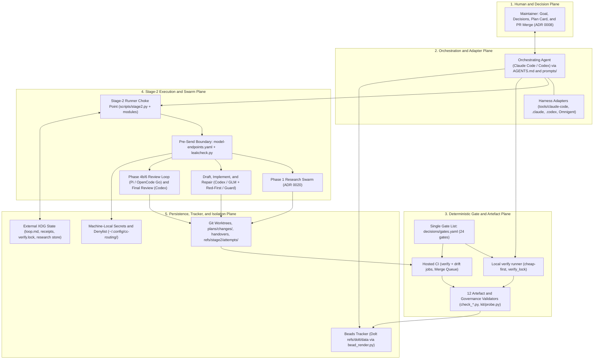
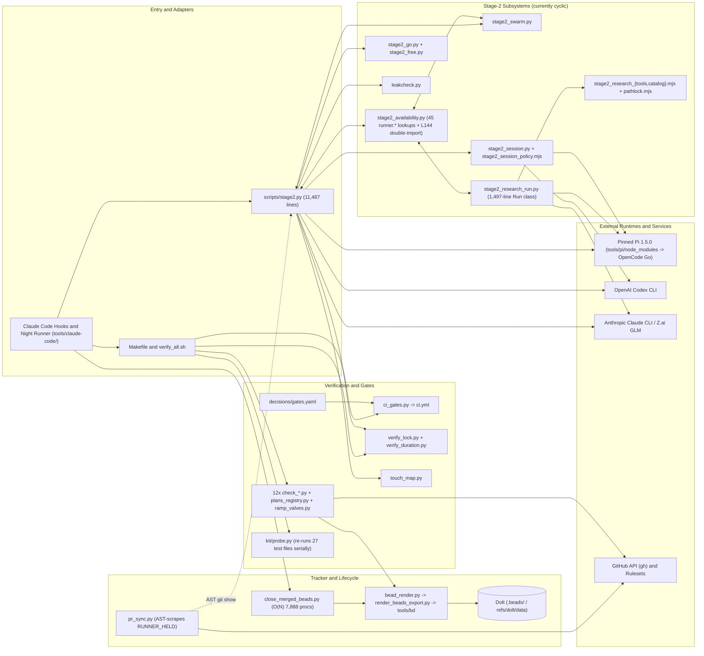

# Full codebase audit — architecture, security, modularization, verification speed, onboarding docs and project transfer

**Baseline and scope:** Strictly read-only static audit measured against local `main` at commit `24632499` (`2026-11-22`, completed `2026-11-23`). When this report branch was cut from `origin/main` at `4eb4c151`, commits merged after `24632499` had not been re-measured; every line reference, count, and finding below carries the `24632499` cut-off unless explicitly dated otherwise. No code was modified during inspection.

> [!WARNING]
> **Upcoming calendar cliff (`2026-11-30`):** Thirteen blocking valves in `scripts/ramp_valves.py`, `BESTAND_OHNE_ARTEFAKT` in `scripts/plans_registry.py:188`, six `@pytest.mark.skip` deadlines in `tests/test_feedback_channel.py:473-482`, and the DeepSeek terms readings in `model-endpoints.yaml:218` all expire on **`2026-11-30`**. In addition, vacant role deadlines in `provenance.yaml:75-82` passed on `2026-10-31`, and the two-week measurement trigger for ADR 0025 fell due on `2026-11-22`. Without an explicit triage PR, local verification and CI will turn red simultaneously after `2026-11-30`.

## 1. Verification scope and 100% line-by-line subagent coverage

Multi-agent read workflows read and audited every non-generated executable source, configuration, tool, decision, and test file in the repository at `24632499`, followed by an independent filesystem interval verification confirming zero unread line ranges.

| Directory scope | Files audited | Lines read / total | Line coverage | Unread gaps |
| --- | ---: | ---: | ---: | ---: |
| `scripts/` (runner, gates, swarm, lifecycle) | 67 | 40,716 / 40,716 | 100.00% | 0 |
| `tests/` (including `test_stage2.py` 28,466 lines and 5 `.mjs` drivers) | 93 | 87,423 / 87,423 | 100.00% | 0 |
| `tools/` (Claude Code hooks/night, Pi, Beads, Omnigent, Cloud-Env) | 24 | 1,923 / 1,923 | 100.00% | 0 |
| Repository root configs (`model-endpoints.yaml`, `provenance.yaml`, `Makefile`, `ruff.toml`, `pyproject.toml`, `research-swarm-limits.yaml`, `.gitignore`) | 7 | 1,392 / 1,392 | 100.00% | 0 |
| `decisions/` (`gates.yaml`, `adoption.yaml`, 22 `answers/*/adr.yaml`) | 24 | 653 / 653 | 100.00% | 0 |
| Adapters & templates (`.github/`, `.codex/`, `.claude/`, `templates/gate-record.yaml`, `.agents/`, `.vscode/`) | 17 | 561 / 561 | 100.00% | 0 |
| **Total audited codebase and configuration** | **232** | **132,668 / 132,668** | **100.00%** | **0** |

In addition to the 100% code-and-config sweep, dedicated specialist audits reviewed all entry/onboarding documents, the `scripts/stage2.py` modularization surface via Python AST analysis, the `make verify` duration/test-ratchet bottlenecks, and repository transferability across greenfield and brownfield projects.

---

## 2. Architecture overview (conceptual and detailed)

### 2.1 Conceptual architecture

Monotrope is neither a standalone agent binary nor a long-running server; it is a **file-backed workflow and verification discipline** layered around coding-agent harnesses such as Claude Code and Codex. State persists in versioned repository artefacts rather than chat history, model claims are verified by deterministic scripts rather than prose trust, and external models (Stage 2) are invoked through a single choke point guarded by endpoint allowlists and leak checks.

Conceptually, the system separates into **five planes**:

1. **Human and decision plane:** States goals, answers `[DECISION]` questions supplied with structured context (ADR 0018), reviews plan cards, and confirms binding rules or ADR answers exclusively by merging decision pull requests (ADR 0008).
2. **Orchestration and adapter plane:** The primary agent session reads [`AGENTS.md`](../../AGENTS.md) and phase prompts under `prompts/`, assisted by harness-specific UI hooks and policy wrappers under `tools/claude-code/`, `.claude/`, `.codex/`, and `tools/omnigent/`.
3. **Deterministic gate and artefact plane:** One declarative file (`decisions/gates.yaml`) drives both local verification (`scripts/verify_all.sh`) and hosted GitHub Actions CI (`.github/workflows/ci.yml`), enforced by 12 specialized gate scripts (`check_*.py`, `plans_registry.py`, `ramp_valves.py`, `kit/probe.py`).
4. **Stage-2 execution and swarm plane:** `scripts/stage2.py` and companion modules orchestrate foreign model calls (Codex, GLM Flash, and OpenCode Go via pinned Pi) across exploration swarms (ADR 0020), drafting, implementation, review loops (ADR 0021), red-first / guard-test proofs (ADR 0023), targeted verification (ADR 0025), and rollback.
5. **Persistence, tracker, and isolation plane:** Per-change folders (`plans/changes/<name>/`), dated handovers (`docs/journal/handover/`), Git worktrees, the Dolt-backed Beads tracker (`refs/dolt/data` read via `scripts/bead_render.py`), failed-attempt side refs (`refs/stage2/attempts/*`), outside-repository state under `$XDG_STATE_HOME`, and machine-local secrets/denylists under `~/.config/cc-routing/`.

**End-to-end change lifecycle (7 phases + 8th movement handover):**

- **Phase 1 (Explore) and 1a (Interview):** `spike` and `bounded` changes explore via GLM 5.3 Flash; `feature` and `architectural` changes run the research swarm (`prepare-explore` -> selection receipt -> `explore`, ADR 0020). Human `[DECISION]` answers land in `decisions.md` (`interview-minimums`, `question-context`, `research-handoff`).
- **Phase 2 / 2a / 2b / 3 (Spec, Spec Review, Design, Plan):** Codex drafts `spec.md`, optional `design.md` (with ADR for `architectural`), and `plan.md` containing `## Criterion ledger`; Opus 5.5 performs optional spec review (`spec-review`); `adr-answers` checks human ADR decisions for features.
- **Phase 4 / 4b (Implement and Review Loop):** GLM 5.3 Flash implements under targeted checks (ADR 0025). Review loop (`prepare-loop` -> `review-loop`) runs Free swarm -> Flash swarm -> paid ladder until clean or stopped (ADR 0021); taken findings go to Codex `repair` with isolated red-first or `STAGE2_PLANT_FAULT=1` guard proof (ADR 0023).
- **Phase 5 / 6 / 7 (Verify, Review, Commit):** Full `make verify`, fresh read-only Codex final review releasing loop rows into `findings.md`, `pr_sync.py` touch-map check, and Merge Queue landing, closing sessions with a schema-checked handover under `docs/journal/handover/`.

### 2.2 Detailed technical architecture

At `24632499`, the implementation comprises **67 scripts (40,716 lines)**, **24 tool scripts/configs (1,923 lines)**, **48 root/decision/adapter configs (2,605 lines)**, and **93 test files (87,423 lines)** organized across **six concrete subsystems**:

| Subsystem | Core files and footprint | State and persistence | Trust boundaries and execution model | Key architectural tensions |
| --- | --- | --- | --- | --- |
| **1. Stage-2 Core Runner** | `scripts/stage2.py` (11,487 lines; 20 domains, 336 functions, 19 classes), `stage2_availability.py` (1,556), `stage2_session.py` (689), `stage2_go.py` (378), `stage2_runs.py` (347), `stage2_free.py` (176), `leakcheck.py` (471), `model-endpoints.yaml` (779) | Change artefacts, `$XDG_STATE_HOME/.../stage2/<change>@<hash>/{loop.md,availability.json}`, `refs/stage2/attempts/*`, `~/.config/cc-routing/{secrets.env,denylist.txt}` | Subprocesses (`claude`, `codex`, `tools/pi/pi`, `node`, `git`) under filtered `foreign_env`; no OS sandbox around Codex/Pi; paid review-loop Pi calls run without pathlock; `RED_PROBE_SOURCE` runs in-process with untrusted tests | Four circular import loops (`stage2` <-> `availability` <-> `swarm` <-> `research_run`); `sys.modules[__name__]` service locator (`runner.*`); `__main__` double-import bug (`stage2_availability.py:144`); 50+ regex parsers on Markdown state |
| **2. Research Swarm (ADR 0020)** | `stage2_research_run.py` (1,937 lines; 1,497-line `Run`), `research_capture.py` (1,465), `check_research_handoff.py` (1,028), `stage2_swarm.py` (718), `stage2_research_store.py` (526), `stage2_research_{tools,catalog}.mjs` (634), `stage2_repository_pathlock.mjs` (147), plus `dispatch`, `snapshot`, `report`, `refs`, `judge`, `map`, `history`, `limits`, `research_{handoff,census}.py` | External store `$XDG_STATE_HOME/.../stage2/research/...` (enforces outside `$HOME`), atomic slot JSON files, resumable checkpoints, `research.md` | Repo seats load `stage2_repository_pathlock.mjs`; online seats use only `public_search`/`public_fetch` (DNS pinning + SSRF checks); fresh Opus 5.5 judge | Redundant `stage_merge` LLM call verified against deterministic Python union; 39-90x serialized full-history leakcheck per run; 100 Hz busy-poll in `dispatch`; unthrottled `[DECISION]` creation by optional free seats |
| **3. Verification, Gates and CI** | `decisions/gates.yaml` (328 lines, 24 gates), `verify_lock.py` (978), `ci_gates.py` (920), `touch_map.py` (873), `verify_all.sh` (570), `verify_duration.py` (528), `ramp_valves.py` (371), `mutation_evidence.py` (258), `_verdict.py` (214), `adoption.py` (67), 12 `check_*.py`, `.github/workflows/ci.yml` (208) | Machine admission lock (`fcntl` + `verify.holder.json`) & duration JSONL in `$XDG_STATE_HOME`; generated `ci.yml` held by `ci-drift` | `verify_all.sh` injects runtime pytest plugin via `PYTEST_ADDOPTS`; CI promotes `GITHUB_TOKEN` header to `--global` git config; `ruleset` gate invokes live `gh api` | 67 `verify_duration.py` spawns per local verify; 4x redundant local Dolt exports without `BEAD_RENDER`; 0/12 `check_*.py` use `_verdict.py`; `touch_map.py` is blind to Python subpackages |
| **4. Lifecycle, Tracker and Reporting** | `pr_sync.py` (1,104), `outcome_test.py` (1,052), `archive_closed_changes.py` (782), `run_report.py` (711), `harness.py` (527), `plans_registry.py` (491), `close_merged_beads.py` (429), `machine_facts.py` (335), `new_change.py` (331), `time_records.py` (246), `gate_record.py` (204), `handover_schema.py` (178), `render_beads_export.py` (153), `bead_render.py` (138), `tools/bd` (67) | Dolt DB under `.beads/` (`refs/dolt/data` on origin), normalized JSONL via `BEAD_RENDER`, `plans/INDEX.md`, `decisions/answers/*/adr.yaml` | One-writer discipline (D-60) is prose-only; `tools/bd` only checks `$1` for `init`/`migrate`/`upgrade`; `pr_sync.py` AST-scrapes `stage2.py:RUNNER_HELD` | `close_merged_beads.py` spawns ~7,888 subprocesses (O(N) over 3,944 commits) on SessionStart; 18 frontmatter parsers and 7 duplicate-key YAML loaders across scripts |
| **5. Adapters, Policies and Supply Chain** | `omnigent_policy.py` (692), `merge_guard.py` (167), `tools/claude-code/` (`handover.sh` 388, `statusline.sh` 257, `night.py` 186, `beads-start.sh` 170, `session-scan.sh` 142, `recap.sh` 124, `install.sh` 86), `.claude/settings*.json`, `.codex/*`, `tools/{pi,beads,omnigent,cloud-env}/*` | `~/.claude/{settings.json,handover-trust,recaps/,session-notes/,sessions/}`, `$TMPDIR/claude-statusline/`, `~/.local/bin/bd-1.3.4`, `tools/pi/node_modules/` | `.claude/settings.local.json` permits `gh pr *`, `git push *`, `git merge *`, `codex exec:*` (active under `night.py`); `statusline.sh` and `handover.sh` run untrusted `$root/tools/bd` | ~1,253 lines of core safety/entry logic locked inside Claude-only shell scripts; 4-way settings fragmentation; untracked `.codex/agents/*.toml` drop tool/sandbox restrictions |
| **6. Kit and Portability** | `scripts/kit/manifest.yaml` (453), `scripts/kit/probe.py` (505), `scripts/export/manifest.yaml` (29), `provenance.yaml` (314), `prompts/` (19), `templates/` (10) | Ephemeral git repo in `/tmp` during `leerprobe` (`DECKEL = 44` exemptions in `REIST_NICHT`) | `probe.py` copies tracked `mechanismus` files via `git ls-files` and runs isolated `pytest` | Conflicting manifests (`kit` vs `export`); prompts & `research-swarm-limits.yaml` travel without `stage2.py`; 7 German domain agents & personal `provenance.yaml` marked `mechanismus` |

---

## 3. Twelve architecture improvement proposals (`A-1` to `A-12`)

### A-1 · Acyclic decomposition of `scripts/stage2.py` (11,487 lines) and `tests/test_stage2.py` (28,466 lines) [Priority: P0]

- **Problem and evidence:** `scripts/stage2.py` grew 14.7x in 46 days (20 distinct responsibilities, 719-line `run_attempts`, 295-line `_review_round`), participates in four circular import loops (`stage2` <-> `stage2_availability` <-> `stage2_swarm` <-> `stage2_research_run`), passes `sys.modules[__name__]` as an untyped `runner` service locator across 66 attributes, and triggers a silent double import of itself when `stage2_availability.py:144` runs `from stage2 import scrub` on network/parse failures. Worse, `stage2.py:6911-6912` forces full 24-minute `make verify` whenever `tests/test_stage2.py` is linked, defeating ADR 0025 targeted verification (`coding-harness-vg9`).
- **Target design:** Extract 15 acyclic flat sibling modules (`scripts/stage2_<domain>.py`, Layers 0-4) plus a ~220-line CLI entrypoint, keeping `RUNNER_HELD` intact for `pr_sync.py` until migrated and pairing each extracted module with its split test file (detailed in Section 5).
- **Trade-offs:** Avoids `touch_map.py` and `test_ci.py:_scripts()` subpackage blindness immediately without changing directory conventions; requires coordinated `monkeypatch` and `criterion-ledger` updates per PR slice.

### A-2 · Consolidate shared primitives to enforce House Rule 9 in code [Priority: P0]

- **Problem and evidence:** Across `scripts/`, shared actions are re-implemented repeatedly with diverging edge-case behavior: **18** frontmatter parsers, **7** duplicate-rejecting YAML `SafeLoader` subclasses, **6** `git` wrappers (`stage2_session`, `stage2_swarm`, `stage2_runs`, `leakcheck`, `stage2_research_history`, `stage2.run_git` — only `run_git` strips `LC_ALL` and sets timeouts), **5** atomic file writers plus **7** non-atomic `write_text` calls mutating `findings.md`/`plan.md`, **4** `model-endpoints.yaml` readers across 9 call sites, **4** Pi launch pipelines, **2** drifted Pi pathlock JS extensions (`stage2_repository_pathlock.mjs` vs `stage2_session_policy.mjs`), **2** catalog refreshers, and **0 of 12** `check_*.py` validators sharing `scripts/_verdict.py` (resulting in 7 bespoke `CannotMeasure` exceptions). `scripts/render_beads_export.py:11-13` claims `check_bead_export` checks every render, yet `scripts/bead_render.py:61` bypasses `check_bead_export.run()`.
- **Target design:** Extract four shared primitives: `_yaml_strict.py` (one `SafeLoader` + frontmatter span parser), `_fs_atomic.py` (one symlink-safe `mkstemp` + `fsync` + dir `fsync` writer), `_git_exec.py` (one `GIT_*`-sanitized runner), and one Pi launcher paired with a single shared pathlock JS extension. Route all `check_*.py` scripts through `scripts/_verdict.py`.
- **Trade-offs:** Modest upfront consolidation across 3-4 PRs; eliminates an entire class of CRLF, symlink, duplicate-key, and policy-drift regressions.

### A-3 · Replace 50+ Markdown state regexes with a structured JSON state sidecar [Priority: P1]

- **Problem and evidence:** `scripts/stage2.py` parses human-editable Markdown (`loop.md`, `findings.md`) via 50+ regexes for machine control lines (`Loop state:`, `Record digest:`, `Rounds run:`, `Phase 6 verdict:`). Verified parser defects include `_PIPE = re.compile(r"(?<!\\)\|")` (`stage2.py:615`) failing on even backslashes (`\\|`), inconsistent `splitlines()` vs `split("\n")` across `resolve_finding_rows` (`L3556`), `_record_lines` (`L3990`), and `mark_repaired_findings` (`L8457`), `fill_marks` (`L3895-3912`) slicing off the last file byte when `_last_release == -1`, `mark_repaired_findings` (`L8442-8466`) dropping `Broke a test` proof marks for findings rows, and `retire_stage` (`L4685-4703`) matching previously consumed `free` stages instead of the active paid stage while `## Stage failed` corrupts `_record_lines` state.
- **Target design:** Persist loop state canonically as locked `loop.state.json` (schema-validated) and deterministically render `loop.md` and released `findings.md` blocks from it, mirroring the pattern already used for `plans/INDEX.md` and `docs/governance/gate-catalog.md`.
- **Trade-offs:** One-time reader fallback for in-flight `loop.md` files; removes fragile table/regex state corruption permanently.

### A-4 · Eliminate O(N) SessionStart subprocess explosion in `scripts/close_merged_beads.py` [Priority: P0]

- **Problem and evidence:** `scripts/close_merged_beads.py:171-245` scans all 3,944 commits on `origin/main` sequentially, spawning `git log -1`, `tempfile.mkdtemp()`, and `git interpret-trailers` per commit (~7,888 subprocesses and ~3,944 temp directories), triggered automatically at every Claude Code `SessionStart` via `tools/claude-code/hooks/beads-start.sh`.
- **Target design:** Query all trailer-bearing commits in one `git log --grep='^Closes-Bead:' --format=...` call with Git's built-in `%(trailers:...)` formatter, backed by an immutable watermark cache in `.git/`.
- **Trade-offs:** Reduces SessionStart reconciliation from seconds / thousands of forks to <50 ms with identical closure semantics.

### A-5 · Replace `scripts/verify_all.sh` and 67 wrapper spawns with a parallel Python gate runner [Priority: P1]

- **Problem and evidence:** Verification orchestration spans 2,996 lines across `scripts/verify_all.sh` (570 lines of Bash with two inline Python heredocs and a broken Bash 5.2 `patsub_replacement` substitution at `L505-516`), `verify_lock.py`, `verify_duration.py`, and `ci_gates.py` (whose `--check-schema` branch at `L850-858` is unreachable dead code because `gates()` aborts with exit 2 at `L845` first). Each local `make verify` spawns `verify_duration.py` 67 times, runs all 19 `seconds` gates serially, exports Dolt 4 times without `BEAD_RENDER`, and fails on external clones due to `ruleset` (`placement: writer`). Meanwhile, `Makefile` targets (`make test`, `make change`, `make report`) invoke bare `python3` rather than `.venv/bin/python3`.
- **Target design:** Consolidate `verify_all.sh` into `scripts/verify_runner.py` (with a 5-line shell compatibility shim) that calls `verify_duration` in-process, exports `BEAD_RENDER` once per local run, and executes independent read-only `seconds` gates via `ThreadPoolExecutor(max_workers=4)` while keeping cheap-first early abort before `minutes` gates. Update `Makefile` recipes to prefer `.venv/bin/python3`.
- **Trade-offs:** Eliminates Bash quoting bugs and improves Linux/WSL portability alongside ~45-55 s latency savings.

### A-6 · Streamline Research Swarm (`stage2_research_run.py`) and fix concurrency/outcome bugs [Priority: P1]

- **Problem and evidence:** `stage2_research_run.py` centers on a 1,497-line `Run` god class that `research_capture.py:1090` bypasses via `Run.__new__(Run)`. During execution, `stage_merge` pays an Opus 5.5 LLM call only to enforce equivalence with Python's deterministic union; 39-90 slot launches serialize full repo+history `leakcheck` scans over the same unchanged commit; `stage2_research_dispatch.py` busy-polls at 100 Hz while `on_terminal` mutates state without a lock; `stage_topics` overwrites a failed correction attempt's reason with attempt 1's `invalid-report`; and default `$XDG_STATE_HOME` (`~/.local/state`) fails `Store.assert_outside` because it lies inside `$HOME`. Also, `stage2_research_refs.py:154-188` omits decorators when computing Python definition extents.
- **Target design:** Split `Run` into `Snapshot`, `Planner`, `Dispatcher`, and `Reconciler`; replace `stage_merge`'s LLM call with deterministic Python merging; run the repository/history leakcheck once per immutable tree and only scan per-slot prompt deltas inside parallel slots; replace 100 Hz polling with blocking wait (`wait`/`Future`); and document/validate external state root setup clearly.

### A-7 · Unify `implement`, `repair`, and `draft` onto a single `AttemptEngine` [Priority: P1]

- **Problem and evidence:** `run_attempts` (719 lines, `stage2.py:9322-10040`) and `draft` (171 lines, `L10361-10531`) duplicate attempt execution, verification, checkpointing, and rollback. As a result, `draft()` lacks `preflight_recovery` symlink checks, `findings.md` tamper checks, `protect_diagnostics` on `call_error` (`L10435-10440`), and time-logging of rejected attempts. Meanwhile `run_attempts` executes `verify_attempt` *before* checking `uncommittable()`, `restore_baseline` uses `git clean -fdq` (leaving nested untracked `.git` directories behind), and `plan_baseline_restore` (`L5382`) diffs against `HEAD` instead of `baseline`.
- **Target design:** Extract one shared `AttemptEngine` executing `preflight_recovery` -> `execute` -> `uncommittable` -> verb-specific `VerifyStrategy` (`DraftVerify`, `ImplementVerify`, `RepairVerify`) -> atomic `checkpoint` / `restore_baseline -ffdq`.

### A-8 · Unify the two conflicting kit manifests and drive `DECKEL` from 44 to 0 [Priority: P1]

- **Problem and evidence:** `scripts/kit/manifest.yaml` (duplicate `ci.yml` rule at `L157` & `L331`, dead paths like `.markdownlint.jsonc`, 7 German Databricks agents under `.claude/agents/`, shipping `prompts/` and `research-swarm-limits.yaml` without `stage2.py`) conflicts with `scripts/export/manifest.yaml` (which carries `check_bead_export.py` and `check_dangling_bead_ids.py` while dropping their required import `bead_render.py`). `scripts/kit/probe.py:208` requires `DECKEL = 44` permanently exempted test failures.
- **Target design:** Retire `scripts/export/manifest.yaml`; adopt one release/bundle manifest separating `core` vs optional `stage2` components, isolate repository-inventory tests (`test_this_repository_*.py` -> `bestand`), remove domain agents and dead rules, and drive `DECKEL` to `0`.

### A-9 · Resolve unused pinned dependencies (`pydantic`, `Jinja2`) [Priority: P2]

- **Problem and evidence:** `pyproject.toml` and `requirements-ci.txt` lock `pydantic==2.13.5` and `Jinja2==3.1.6`, yet static analysis shows **0 runtime imports** of either package in `scripts/` or `tests/`, while >800 lines of manual dictionary checks harbor live `AttributeError`/`TypeError` crashes on non-dict YAML (`plans_registry.py:85-93,304-357`, `archive_closed_changes.py:438-444`, `ci_gates.py:369-422`, `stage2.py:1733`).
- **Target design:** Decide via ADR/bead either to adopt Pydantic models for the four core YAML schemas (`model-endpoints.yaml`, `gates.yaml`, `provenance.yaml`, future `monotrope.yaml`) and remove `Jinja2`, or drop both unused packages from `pyproject.toml` and `requirements-ci.txt` to shrink the supply-chain surface.

### A-10 · Upgrade `touch_map.py` and `test_ci.py` for Python subpackage awareness [Priority: P2]

- **Problem and evidence:** `scripts/touch_map.py:420-429` resolves only top-level `.py` file stems and ignores relative or dotted subpackage imports; `tests/test_ci.py:_scripts()` globs `scripts/*.py` non-recursively. Together they prevent using the `harness/` package layout anticipated in `pyproject.toml:7`.
- **Target design:** Extend `touch_map.py` to resolve dotted module paths (`scripts.pkg.mod` / `harness.pkg.mod`) and relative imports, and make `test_ci.py:_scripts()` recursive.

### A-11 · Decouple workflow logic from Claude-only shell hooks (Targets H6/C3) [Priority: P2]

- **Problem and evidence:** Roughly 1,253 lines of core operational behavior (session scanning, parallel-checkout warnings, `night.py` permission tightening, `beads-start.sh` reconciliation, Haiku recap safety net) reside exclusively under `tools/claude-code/`. Meanwhile, untracked `.codex/agents/*.toml` strip away tool/sandbox constraints, `stage2_session.py:72` hardcodes macOS `osascript`, and no automated H6 adapter-deletion test exists.
- **Target design:** Move reusable orchestration logic (`session_scan`, `night_policy`, `terminal_dispatch`) into harness-neutral Python modules; shrink `.claude/`, `tools/claude-code/`, and `.codex/` into thin adapters; add an H6 verification test proving core workflows run with adapters removed.

### A-12 · Resolve the `2026-11-30` governance cliff, split `docs-links` alert fatigue, and enforce D-60 writer locks [Priority: P0/P1]

- **Problem and evidence:** Thirteen valves (`ramp_valves.py`), `BESTAND_OHNE_ARTEFAKT` (`plans_registry.py:188`), six skips (`test_feedback_channel.py:473-482`), and DeepSeek readings expire on `2026-11-30`; `check_docs.py` (`enforcement: report`) accumulates 199 findings (56 outside legacy handovers, masking broken links); `check_criterion_ledger.py:63` ignores `decisions/adoption.yaml`; and D-60's single-writer rule lacks technical enforcement in `tools/bd` (`session-scan.sh` cannot detect non-interactive, Codex, Pi, or night sessions).
- **Target design:** Land a pre-`2026-11-30` valve triage + DeepSeek re-reading PR; split `check_docs.py` into blocking strict link/anchor validation on current docs plus a legacy frontmatter ratchet; and add a machine-wide writer lease check in `tools/bd`.

---

## 4. Ten verified security improvement proposals (`S-1` to `S-10`)

### S-1 · Close persistent code execution via gitignored `tools/pi/node_modules/` and `tool_state()` bypasses [Severity: CRITICAL]

- **Finding and evidence:** `tool_state()` (`scripts/stage2.py:4971-5009`) SHA-256 digests `.venv/` to prevent R-21 runtime tampering during writable `implement`/`repair`/`draft` attempts, but completely excludes `tools/pi/node_modules/` (`.gitignore:41`). An attempt overwriting JS inside `tools/pi/node_modules/@earendil-works/pi-coding-agent/` evades `changed_paths` (gitignored), evades `tool_state()`, and survives `restore_baseline()` because `plan_baseline_restore` (`L5383`) only removes *newly added* ignored files. `require_pi()` (`L3163-3197`) only checks `--version` stdout before executing Pi with `OPENCODE_API_KEY` on later `review-loop` runs and `make verify`. Related bugs: `ignored_snapshot()` (`L5295-5303`) uses text-mode `_git_output` instead of `_git_bytes` (corrupting `\r` or non-UTF-8 filenames so created ignored files escape cleanup and credential checks), and `selected_tests()` (`L6559`) follows symlinks outside the worktree into `cheap_checks`.
- **Remediation:** Digest `tools/pi/node_modules/` alongside `.venv/` (using streaming `file_digest` or integrity manifest verification prior to Pi/verify), migrate `ignored_snapshot()` and `alias_baseline()` to `_git_bytes`, reject symlinks in `selected_tests()`, and run `uncommittable()` before `verify_attempt()`.

### S-2 · Isolate `RED_PROBE_SOURCE` anti-forgery tokens and guard-source checks from untrusted test processes [Severity: HIGH]

- **Finding and evidence:** `_attempt_tree_proof` (`scripts/stage2.py:7891-7957`) and `red_first` (`L8061-8162`) execute unreviewed test code inside the same Python process as `RED_PROBE_SOURCE` (`L543-603`) while leaving `STAGE2_RED_REPORT` (with distinguishable prefixes `stage2-red-` vs `stage2-fixed-`) and the 128-bit `STAGE2_RED_TOKEN` in `os.environ`. Model-authored tests or `conftest.py` can either branch on `"stage2-red-"` to fail only during `red_first` or read `STAGE2_RED_TOKEN` and overwrite `STAGE2_RED_REPORT` via `atexit` with forged passing/assertion-failed JSON. Moreover, `GUARD_SOURCE_PROBE_SOURCE` (`L7837`) checks only substring `"STAGE2_PLANT_FAULT" in inspect.getsource(...)`, which a comment satisfies.
- **Remediation:** Normalize scratch prefixes across legs, `os.environ.pop()` probe variables immediately before importing user tests, write records over a closed/wrapped write-only inherited file descriptor (`pass_fds`) rather than an environment path, upgrade the guard source probe to inspect AST nodes rather than comments, and treat full process isolation (e.g., separate probe supervisor) as the clean target.

### S-3 · Confine foreign Pi review reads, eliminate `leakcheck` blind spots, and unify `secret_values()` scrubbing [Severity: HIGH]

- **Finding and evidence:**
  1. `run_reviewer()` (`scripts/stage2.py:3275-3299`) launches paid OpenCode Go models with `--no-extensions --tools read,grep,find,ls` — omitting `stage2_repository_pathlock.mjs` even though it already confines those exact tools in research swarms. Paid `probe()` (`L11221-11232`) also grants full file-read tools for a model-ID ping.
  2. `stage2_session_policy.mjs:82-180` lacks Pi 1.5.0's macOS `resolveReadPath` fallbacks (`AM`/`PM` U+202F, NFD, curly apostrophe) checked by `stage2_repository_pathlock.mjs`. Even with `stage2_repository_pathlock.mjs`, models can read gitignored and VCS-internal paths inside the worktree (`.git/config`, `.git/logs/`, `.beads/`, `.claude/worktrees/`, `.stage2-sessions/`, `.env*`) — the exact files skipped by `leakcheck.py:324` (`--exclude-standard`), while `leakcheck.py:391-405` omits `refs/stage2/attempts/*`, `refs/dolt/data`, `refs/stash`, and reflogs.
  3. `run_codex()` (`stage2.py:3150-3160`), `_protect_diagnostics()` (`L875-927`), `discover_free()` (`L2807-2866`, which also passes real `OPENCODE_API_KEY` without `secret=key`), `stage2_availability.py`, and `stage2_research_run.py:409-410` fail to scrub all `secret_values()`; `_secret_entries()` (`stage2.py:730-733`) fails open to `[]` on undecodable bytes; and `ENV_ALLOW` (`L409-422`) passes `CODEX_HOME`, `TMPDIR`, `USER`, and `LOGNAME` to unrelated foreign CLIs.
- **Remediation:** Attach one hardened pathlock extension (blocking `.git/`, `.beads/`, `.claude/worktrees/`, `.stage2-sessions/`, `.env*` + macOS `readFallbacks`) to every Pi review call; pass `--no-tools` in `probe()`; scrub `secret_values()` across all foreign call diagnostics and errors; fail closed if `secrets.env` cannot decode; pass `CODEX_HOME` only to Codex; and use the `catalog-only` sentinel in `discover_free()`.

### S-4 · Fix CLI option injection, path traversal, relative `PATH` hijacking, YAML injection, and symlink overwrites [Severity: HIGH]

- **Finding and evidence:**
  1. `run_codex()` (`stage2.py:3131-3160`) and `recorded_2a_session()` (`L3672-3694`) accept leading-dash `resume`/`prompt` arguments (enabling flag injection such as `--dangerously-bypass-approvals-and-sandbox`), while `thread_id()` (`L3101-3110`) interpolates unvalidated Codex stdout strings directly into `findings.md` control lines (`L3859-3881`, enabling newline line injection).
  2. `declared_class()` (`L8755-8760`) and `prepare_explore()` (`L8835-8870`) construct `plans/changes/<change>` and unlink `research_receipt_path` *before* `folder_of()` validates `change`.
  3. `refuse_repository_git()` (`L4896-4898`) returns without checking containment when `GIT` is relative (bypassed by relative `PATH` entries like `.`), and `run_codex`/`run_work_model` invoke bare `codex`/`claude` with unfiltered `PATH` and `cwd=ctx.root`.
  4. Unescaped frontmatter interpolation affects `research_producer_field` (`L1493`), `findings_header` (`ctx.bead`, `L1856`), `new_change.py:95-108` (`--owner`), and `harness.py` (`--reason`/`--stated-in`); `research_publication()` (`L1575`) inserts governance keys inside multiline scalars matching `^tags:`; `write_atomic()` (`L1254-1258`) follows dangling symlinks when `stat()` raises `FileNotFoundError`; and `Makefile:33` (`leakcheck`) shell-interpolates `"$(NAME)"`.
- **Remediation:** Validate `change`, `bead`, `resume`, and `thread_id` against strict single-line non-leading-dash regexes; use `--` option delimiters; resolve `git`, `codex`, `claude`, and `node` through a repo-stripped `PATH`; serialize frontmatter fields via `json.dumps()`/`yaml.safe_dump()`; use `lstat()` + symlink rejection + `mkstemp`/`os.replace` everywhere in `write_atomic()`; and pass `NAME` via environment in `Makefile:33`.

### S-5 · Stop automatic `tools/bd` execution in untrusted clones and harden Claude hook trust boundaries [Severity: HIGH]

- **Finding and evidence:** Both user-global scripts `tools/claude-code/statusline.sh:148-163` and `tools/claude-code/hooks/handover.sh:141-155` execute `$root/tools/bd` automatically inside any repository containing `.beads/` and an executable `tools/bd`, bypassing `~/.claude/handover-trust` completely at SessionStart and every 15 seconds. Additionally, a single blank line in `~/.claude/handover-trust` matches every origin via `grep -qE -f` (fail-open, `handover.sh:199-204`); untrusted branch names, handover titles, and `git status` paths enter `additionalContext`; unset `TMPDIR` falls back to shared `/tmp/claude-statusline/`; `$sid` is unvalidated across four hook scripts; and `recap.sh` sends 6 KB of unscanned assistant text to Haiku on every turn.
- **Remediation:** Execute `$root/tools/bd` only for verified trusted origins (falling back to pinned `$HOME/.local/bin/bd-<version>` otherwise), strip blanks/comments and require anchored patterns in `handover-trust`, validate `$sid` strictly (`[A-Za-z0-9._-]+`), move cache directories into `$HOME/.cache/` with `0700`, and sanitize hook context output.

### S-6 · Close live permission bypasses in `.claude/settings.local.json`, `night.py`, Omnigent policy, and `merge_guard.py` [Severity: HIGH]

- **Finding and evidence:**
  - `.claude/settings.local.json:4-25` pre-approves `Bash(gh pr *)`, `Bash(git push *)`, `Bash(git merge *)`, `Bash(codex exec:*)`, and `Bash(tools/bd *)` — remaining active under `night.py --permission-mode dontAsk` (allowing `git push --force`, `gh pr merge/edit`, etc.).
  - `tools/claude-code/night.py:57-69` falls open if `git` fails (dropping all 43 rules in `.claude/settings.json`) and omits CLI bypass flags (`--allowedTools`, `--mcp-config`, `--add-dir`, `--setting-sources`, `--allow-dangerously-skip-permissions`).
  - `scripts/omnigent_policy.py` uses CEL `endsWith("/.omnigent/config.yaml")` (bypassable via relative paths, macOS case insensitivity, `./`, symlinks, `$OMNIGENT_CONFIG_HOME`, `Bash`), while `.claude/settings.json:62` omits `Write` and `MultiEdit`.
  - `scripts/merge_guard.py` misses `gh api -X POST repos/*/merges`, `PATCH repos/*/git/refs/heads/main`, lowercase HTTP verbs, `git -C . push`, bare `git push`, and `env`/`timeout` wrappers. Untracked `.codex/agents/*.toml` drop all tool and sandbox boundaries.
- **Remediation:** Force `night.py` overlays to explicitly deny destructive/push/merge/external-model rules even if permitted in `settings.local.json`, block all CLI bypass flags, fail closed on `git` errors, tokenize commands cleanly in `merge_guard.py`, add `Write`/`MultiEdit` to `.claude/settings.json:62`, and enforce normalized path checks for Omnigent config protection.

### S-7 · Fix `prepare-loop` source-diff leakage, Pi 1.5.0 catalog fallback bypass, SSRF redirects, and swarm injection [Severity: HIGH]

- **Finding and evidence:**
  1. `stage2_availability.prepare()` (`L1432, 1465`) calls `free_probe_prompt()` and transmits up to 2,000 lines of real repository diff to every discovered `-free` model (unread retention/training terms) during `prepare-loop` before operator approval, contradicting `AGENTS.md` and `model-endpoints.yaml:583-586`.
  2. Writing raw `models-store.json` into temporary Pi directories enables silent fallback in Pi 1.5.0 (`model-config.js:144-150`) if any `models.json` entry fails schema validation, yet `probe_go` (`stage2_availability.py:540-595`) and `stage2_research_run.py:866-872` never call `check_overlay()`.
  3. `_fetch_intelligence()` (`stage2_availability.py:81-87`) uses `urllib.request.urlopen` with `x-api-key`, which forwards `ARTIFICIAL_ANALYSIS_API_KEY` across HTTP redirects.
  4. `model-endpoints.yaml:729` (`research_swarm.online_free.exclude`) drifted from `free_stage.exclude` (`L494-535`, leaving 3 models unblocked); `probe_free_research` (`stage2_availability.py:974`) caches a stale declaration across probes; `dispatch_go` (`stage2.py:2249-2260`) and `public_declaration_problem` (`L1753-1774`) omit `excluded_problem` and `isinstance(modelle, list)` checks; and `stage2_go.url_problem` (`L247-284`) admits trailing `?`, `#`, spaces, `..`, and `//`.
  5. In the research swarm, `stage_finders()` (`stage2_research_run.py:1270`) omits `system=`, elevating the brief to system prompt; optional `online_free` seats can inject unbounded merge-blocking `H-<n>` `[DECISION]` questions (`research_handoff.py:85-94`) or exhaust Opus's 1.6M-char judge packet; `public_sentence_problems` misses single-word tracked names; and `stage2_research_tools.mjs` lacks code-enforced tool call limits, uses a Slowloris idle timeout, keeps `<script>`/`<style>` text in excerpts, and risks ReDoS on DDG extraction.
- **Remediation:** Restore static tool-free diff-less probes in `prepare-loop`; remove raw `models-store.json` from active Pi dirs and run single-row `models.json` + `check_overlay` on all Pi paths; disable redirects in `_fetch_intelligence`; unify free exclusion lists in `model-endpoints.yaml`; enforce strict URL/admission checks across `dispatch_go` and `public_declaration_problem`; isolate finder prompts; cap `[DECISION]` provenance from optional seats; and enforce hard call/byte/total-timeout limits in `stage2_research_tools.mjs`.

### S-8 · Harden CI `GITHUB_TOKEN` scoping, workflow `permissions:`, action SHA pinning, and local npm execution [Severity: HIGH]

- **Finding and evidence:** `scripts/ci_gates.py:623-636` promotes `GITHUB_TOKEN`'s `http.https://github.com/.extraheader` from `--local` to `--global` (`~/.gitconfig`) and never clears it before unpinned third-party actions (`markdownlint-cli2-action@v20`, `lychee-action@v2`) and PR pytest code execute. `.github/workflows/ci.yml` declares zero `permissions:` blocks and pins zero actions by 40-char commit SHA. Locally, `ci_gates.py:303-322` runs unpinned `npx --yes markdownlint-cli2` with npm lifecycle scripts enabled. Elsewhere, `tools/bd:59-65` only blocks `init`/`migrate`/`upgrade` at `$1` (bypassed by `tools/bd --json init`), and `tools/cloud-env/setup.sh` lacks `set -e`, always exits 0, and skips `--require-hashes` on a sibling repo.
- **Remediation:** Declare least-privilege `permissions:` in `ci_gates.py`, pin every workflow action to a full SHA, unset `--global extraheader` immediately after `bd` hydration (or pass it scoped to the one `bd` step), pin `markdownlint-cli2` locally with `--ignore-scripts`, scan all positional/flag args in `tools/bd`, and harden `tools/cloud-env/setup.sh`.

### S-9 · Scrub public-readiness and House Rule 6 boundary leaks and enforce the ADR 0003 CI denylist gate [Severity: HIGH]

- **Finding and evidence (exact tracked file locations by leak category, without repeating raw leaked strings):**
  - **Customer-instance terminology inside a kit test (`mechanismus`):** `tests/test_regelwerk.py:340-346` embeds plaintext system, layer, and column identifiers of the private customer instance directly inside a tracked regex literal, violating House Rule 6 in a portable test.
  - **Maintainer personal SSH public key and fingerprint:** `docs/how-to/signed-decisions.md:46-57` publishes the maintainer's personal hardware-backed SSH key, fingerprint, and private branch/module identifiers.
  - **Internal classification & employer-linked handles in `mechanismus` and root docs:** `docs/governance/quality-gates.md:13-17` carries an internal-disclosure frontmatter marker (`disclosure: intern`) and an employer-linked handle; that same handle appears across 28 tracked files including `COMMERCIAL.md:29` and `provenance.yaml:60-74` (together with personal names and noreply emails).
  - **Local machine home-directory paths:** User home-directory paths appear across 73 tracked files (9 handovers, 1 research note, 63 change artefacts).
  - **Legacy/private project names and paths:** `provenance.yaml:186`, `scripts/handover_schema.py:107`, `tests/test_feedback_channel.py:28,135,206-282`, `docs/research/Lake-Switch-Architektur-arc42.md`, `tools/claude-code/README.md:19-21`, and `tools/cloud-env/setup.sh:36-54` expose legacy client assets, origin-repo filenames, or personal/sibling repository names.
- **Remediation:** Scrub all live/kit occurrences (replacing plaintext instance literals in `tests/test_regelwerk.py` with a local/hashed fixture pattern outside git and sanitizing `signed-decisions.md`, `COMMERCIAL.md`, `quality-gates.md`, `provenance.yaml`, `tools/claude-code/README.md`, and `test_feedback_channel.py`), and implement the blocking PR denylist gate committed to in ADR 0003 (`coding-harness-lir`).

### S-10 · Harden gate kill-switches, receipt locking, and 6 defective security/control tests [Severity: MEDIUM-HIGH]

- **Finding and evidence:**
  - `ADR_ANSWERS_TOLERATE_CHANGE` (`scripts/check_adr_answers.py:433-450`) acts as an unchecked environment kill-switch ignored by `check_guard_test_environment.py`; `check_dangling_bead_ids.py:33,80` skips all of `plans/` (277 cited IDs) and dotted sub-beads; frontmatter dates can be backdated to exempt checks; and review-loop availability receipts (`stage2_availability.py:218-251,1390,1522-1556`) use unkeyed SHA-256 without `receipt_lock` across `prepare`/`consume`/`spend`.
  - Six verified defective security/control tests surfaced during 100% test-suite reading: (1) `tests/test_kit.py:396-406` asserts only `assert v is not None` instead of `assert _blockt(v)`; (2) `tests/test_stage2_availability.py:441-472` claims to test withdrawn admission stopping a second probe yet never withdraws an admission; (3) `tests/test_stage2_research_store.py:347-381` swaps in a synthetic launcher stripping `XDG_STATE_HOME` itself rather than testing production launchers; (4) `tests/test_stage2_session_policy.py:406-411` catches any `AssertionError` without verifying the load refusal reason; (5) `tests/pi_network_guard.mjs` leaves `Socket.prototype.connect`, `http2`, `WebSocket`, `dns`, and `options.host` overrides open (and `test_stage2_research_catalog.py:188-261` omits the guard altogether); (6) `tests/test_ci.py:3483-3512` creates and deletes a live file inside `scripts/` during parallel `-n auto` runs (xdist race), while `tests/test_stage2_research_dispatch.py:679-707` can deliver `SIGINT` to the pytest runner after test exit.
- **Remediation:** Guard `ADR_ANSWERS_TOLERATE_CHANGE` inside `check_guard_test_environment.py`; extend `check_dangling_bead_ids.py` to `plans/` and dotted IDs; enforce `receipt_lock` + nonce/change binding on all review-loop receipts; and repair all six defective tests and sandboxed `pi_network_guard.mjs`.

---

## 5. Modularization blueprint for `scripts/stage2.py` (11,487 lines) and `tests/test_stage2.py` (28,466 lines)

### 5.1 AST coupling inventory and hidden pitfalls

Static AST inspection across `scripts/` and `tests/` established:

- **Surprisingly small mutable global footprint (5 globals total in 11,487 lines):** `_LIVE_GROUPS` (`L960`), `_LIVE_LOCK` (`L961`), `_LAUNCH_STOPPED` (`L962`), `_terms_warning_evidence` (`L2143`), and `_address_notice_evidence` (`L2168`).
- **Four structural traps that would break a naive refactor:**
  1. **Package-shadowing trap:** Placing `scripts/stage2/` beside `scripts/stage2.py` shadows `import stage2` with `__init__.py` while `python3 scripts/stage2.py` executes `stage2.py` as `__main__`.
  2. **`touch_map.py` and `test_ci.py` subpackage blindness (critical):** `scripts/touch_map.py:420-429` resolves only top-level `.py` stems and ignores relative or dotted package imports, so moving code into `scripts/stage2_pkg/` breaks test linkage and drops every file back to full 24-minute `make verify`. Likewise, `tests/test_ci.py:_scripts()` globs `scripts/*.py` non-recursively, silently excluding subpackages from `OHNE_TEST`/`OHNE_AUFRUFER`.
  3. **`scripts/pr_sync.py:203-222` AST-scrape trap:** `committed_runner_held()` parses `git show <rev>:scripts/stage2.py` via AST expecting a top-level `ast.Assign` binding `RUNNER_HELD` to a literal tuple/list of constant strings (an `ImportFrom` causes immediate refusal).
  4. **Extensive test and cross-file coupling:** 362 `monkeypatch.setattr(stage2, ...)` calls across 88 unique symbols in 14 test files (`launch` 43, `terms_today` 26, `run_work_model` 25, `read_secret` 17, `verify_attempt` 17, `run_codex` 15, `_git_output` 15, `checkpoint` 13, `worktree_tree` 8), **718** `tests/test_stage2.py::test_*` references across **57 `plan.md` ledgers** (1 live + 56 archived), and **9 other test files** importing `World`/`git`/`TEST_LADDER` directly from `tests/test_stage2.py`.

### 5.2 Recommended acyclic target layout: flat sibling modules `scripts/stage2_<domain>.py` (Layers 0-4)

Choosing flat sibling modules (`scripts/stage2_<domain>.py`) plus a thin ~220-line `scripts/stage2.py` CLI avoids package shadowing completely, preserves immediate ADR 0025 targeted verification via `touch_map.py`, aligns with all 16 existing `stage2_*.py` modules, and stays fully visible to `tests/test_ci.py`. Relocating four tiny helpers (`_valid_date`, `_one_line` -> `stage2_core.py`; `reviewer_key` -> `stage2_secrets.py`; `parse_marks`/`fill_marks` -> `stage2_loop_record.py`; `_mask_stamp` -> `stage2_artifacts.py`) yields **zero circular dependencies**:

| Layer | Target modules (*new* / *existing*) | Approx. lines | Primary responsibilities and exported seams |
| --- | --- | ---: | --- |
| **L0 · Core** | `stage2_core.py` *(new)*; existing `stage2_go.py`, `stage2_research_{refs,limits,history,dispatch}.py` | ~600 + exist. | All 11 exceptions, clock helpers, shared constants (`PI_WRAPPER`, `PI_VERSION`, `ENV_ALLOW`, `CLASSES`, `CARD_LABELS`, `SHARED_INFRASTRUCTURE`, `RED_PROBE_SOURCE`), `_valid_date`, `_one_line` |
| **L1 · Infra** | `stage2_secrets.py` *(new)* | ~205 | `secrets_path`, `read_secret`, `secret_values`, `scrub`, `protect_diagnostics`, `protect_files`, `foreign_env`, `glm_env`, `reviewer_key` (fixes `stage2_availability.py:144` double-import immediately) |
| **L1 · Infra** | `stage2_process.py` *(new)* | ~175 | Owns `_LIVE_GROUPS`, `_LIVE_LOCK`, `_LAUNCH_STOPPED`, `kill_live`, `defer_launch_signals`, `launch`, `fail`, `remaining` |
| **L1 · Infra** | `stage2_git.py` *(new)* | ~335 | `resolve_git`, `GIT`, `refuse_repository_git`, `run_git`, `_git_output`, `_git_bytes`, `changed_paths`, `intend_new_files`, `change_diff`, `free_diff`, `bounded_review_diff` |
| **L1 · Infra** | `stage2_artifacts.py` *(new)* + `stage2_research_pub.py` *(new)* | ~240 + ~305 | Markdown table I/O (`split_row`, `render_table`, `is_table_furniture`), `write_atomic`, `append`, `stamp_updated`, time-log helpers, frontmatter span surgery & `publish_research` |
| **L2 · Domain** | `stage2_admission.py` *(new)*, `stage2_free_catalog.py` *(new)*, `stage2_preflight.py` *(new)* | ~440 + ~475 + ~200 | Single `model-endpoints.yaml` reader, `entry_problem`, `terms_problem`, `dispatch_go`, `ladder`, both `ContextVar`s (lock-protected), `exclusion_problem` (moved down from `stage2_swarm`), free catalog/overlay/discovery, `Context`/`preflight`/`checked_prompt`/`begin_*call` |
| **L2 · Domain** | `stage2_loop_record.py` *(new)*, `stage2_worktree.py` *(new)*, `stage2_checkpoint.py` *(new)* | ~990 + ~650 + ~450 | External `loop.md` state machine (`holding_record`, `write_round`, `release`, `retire_stage`, `restart_loop`), `findings_rows`, `parse_marks`/`fill_marks`; `tool_state`, `runner_env`, `save_attempt`, `restore_baseline`, `lifecycle_snapshot`, `uncommittable`, `checkpoint` |
| **L3 · Engine** | `stage2_runners.py` *(new)*, `stage2_targeted.py` *(new)*, `stage2_verify.py` *(new)*, `stage2_repair_proof.py` *(new)*; existing `stage2_{availability,session,swarm,research_run}.py` | ~325 + ~500 + ~700 + ~905 + exist. | Single foreign model launch boundary (`run_codex`, `require_pi`, `run_reviewer`, `run_swarm`, `run_work_model`); targeted/verify engine (added to `SHARED_INFRASTRUCTURE`); isolated `red_first`/guard proofs; all 66 `runner.*` lookups replaced by typed L0-L3 imports |
| **L4 · Verbs & CLI** | `stage2_attempts.py`, `stage2_draft.py`, `stage2_repair.py`, `stage2_review_verbs.py`, `stage2_explore_triage.py`, thin `scripts/stage2.py` CLI + `stage2_runs.py` | ~2,490 + ~220 | Decomposes 719-line `run_attempts` and 295-line `_review_round`; leaves literal `RUNNER_HELD` in ~220-line `scripts/stage2.py` until a 2-step `pr_sync.py` migration; `stage2.py` stops being a hot file |

### 5.3 Monkeypatch preservation and incremental PR roadmap (<= 800 lines per PR)

- **Golden module-import rule for monkeypatched seams:** Callers always `import stage2_process` and call `stage2_process.launch(...)` — never `from stage2_process import launch` — so retargeted `monkeypatch.setattr(stage2_process, "launch", ...)` patches intercept every caller automatically. Enforced via a 15-line AST guard test (`tests/test_stage2_architecture.py`) checking both acyclicity and forbidden seam `ImportFrom`s.
- **Sixteen green-at-every-merge slices:**
  1. **PR 0a:** Extract shared test fixtures (`World`, `FakeClock`, `TEST_LADDER`, etc.) from `tests/test_stage2.py` into `tests/stage2_support.py`, update the 9 importing test files, and add `tests/test_stage2_architecture.py`.
  2. **PR 0b:** Split the 42 pure doctrine/prompt tests (`tests/test_stage2.py:19307-21108`, ~1,800 lines, 1 monkeypatch) into `tests/test_stage2_doctrine.py` and update matching `criterion-ledger` entries.
  3. **PR 1-5 (Layers 0-1):** Extract `stage2_core.py`, `stage2_secrets.py` (immediately fixing the `stage2_availability.py:144` double-import bug), `stage2_process.py`, `stage2_artifacts.py` + `stage2_research_pub.py` (decoupling `stage2_runs.py`, `run_report.py`, and `research_census.py`), and `stage2_git.py`, retargeting each seam's monkeypatches and splitting matching tests atomically.
  4. **PR 6-9b (Layer 2):** Extract `stage2_admission.py`, `stage2_free_catalog.py` + `stage2_preflight.py`, `stage2_loop_record.py` (2 slices), and `stage2_worktree.py` + `stage2_checkpoint.py` (2 slices, shrinking `test_stage2.py` by another ~2,500 lines).
  5. **PR 10-13 (Layer 3):** Extract `stage2_runners.py`, `stage2_targeted.py` + `stage2_verify.py` (both registered in `SHARED_INFRASTRUCTURE`), `stage2_repair_proof.py` (2 slices, moving ~9,000 lines out of `test_stage2.py`), and eliminate all 66 `runner.*` lookups across `stage2_availability`, `stage2_session`, `stage2_research_run`, and `stage2_swarm`.
  6. **PR 14a-15 (Layer 4 & ADR 0025 unlock):** Extract the verb orchestrators (`explore_triage`, `draft`, `review_verbs`, `attempts`/`repair`), reducing `scripts/stage2.py` to ~220 lines and `tests/test_stage2.py` to <1,000 lines, then delete the hardcoded fallback at `stage2.py:6911-6912` (`coding-harness-vg9`) and remove `scripts/stage2.py` from `SHARED_INFRASTRUCTURE`.

---

## 6. Twelve proposals to reduce test count and accelerate `make verify`

**Empirical baseline at `24632499` (integrated with `docs/research/2026-11-04-verify-duration-baseline.md` and `docs/research/2026-11-09-make-verify-long-term.md`):**

- Full local `make verify` climbed from **~3 min** (Oct) -> **20.4 min** (2026-11-05: `pytest` 991 s [81%], `leerprobe` 196 s [16%]) -> **22.9 min** (2026-11-09: 151 runs over 5.5 days, **median 7 full runs/change**, **57.1 h** execution + **77.3 h** lock contention wait) -> **~24-26 min est.** at `24632499` (**2,976 `def test_*`**, **839 `@pytest.mark.parametrize` decorators**, **~6,335 collected cases**, 86,827 Python test lines).
- **Structural append-only lock-in:** 103 `plan.md` files (8 live, 95 archived) pin **1,631 unique test references** (including 1,546 inside `## Criterion ledger` sections = 51.9% of all `def test_*`, and 533/943 in `test_stage2.py`), while `check_criterion_ledger.py` provides zero syntax to retire or consolidate tests. Conversely, `mutation_evidence.py` (RB-G4) actually requires only ~1 test per gate (~19 total, despite 293 matching test names).

### 6.1 Six proposals to reduce test count safely (-600 to -910 `def test_*` / -20% to -31%)

1. **R-1 · Add retirement and consolidation syntax to `check_criterion_ledger.py` + expiring transition tests (`coding-harness-1ga5`):** Extend ADR 0013 / `check_criterion_ledger.py` with `- <n>: superseded by tests/<path>::<fn> — <reason>` and `- <n>: retired — <reason>` (or a central `decisions/ledger-redirects.yaml`), plus `@pytest.mark.transition(until_bead=...)` checked against `BEAD_RENDER`. Unlocks safe refactoring across **R-2..R-6** and clears ~100-200 one-off hotfix/migration tests over subsequent sprints.
2. **R-2 · Parametrize single-assertion and prefix-clustered micro-tests:** AST clustering identified **433 single-assertion tests (14.5%)**, **22 unparametrized >=5-test prefix clusters covering 158 tests (3,518 lines)** (led by `test_stage2.py` and `test_ci.py`), and combinatorial test loops (e.g., 432x CLI combinations at `test_stage2.py:10608-10645`, 144x at `L9360-9382`). Collapse repeated setup/refusal variants into `@pytest.mark.parametrize` contract tables while preserving 1 `MUTATIONS_NAMEN` case per gate. *Savings:* **-300 to -450 `def test_*`** (-6,000 to -9,000 lines).
3. **R-3 · Prune and table-consolidate brittle prose-substring doctrine tests (`coding-harness-0swp`):** Direct repo-markdown substring assertions span **159 tests across 23 files** (55 in `test_stage2.py`, 30 in `test_check_interview_minimums.py`, including `inspect.getsource` checking a Python comment at `test_stage2.py:10475-10486`). Following `docs/research/2026-11-12-test-strategy-draft.md`, pin only machine-parsed tokens in one parsed contract table per artefact family and leave prose review to Phase 6. *Savings:* **-90 to -120 `def test_*`**.
4. **R-4 · Retire all 10 permanently skipped `2ee-triage` bootstrap tests:** Two skipped tests in `test_ci.py:3177,3390` and eight in `test_feedback_channel.py` (6 expiring `2026-11-30`) reference origin-repository files absent from this repository. Remove origin-only tests and track active instance readiness via `ramp_valves.py` rather than permanent skips. *Savings:* **-9 to -10 tests** (zero unconditional `@pytest.mark.skip` left).
5. **R-5 · Demote duplicate pure-logic tests out of full-swarm / full-runner harnesses (`coding-harness-dca4`):** `tests/test_stage2_swarm.py` runs **184 full `sworld.run()` pipelines** across 161 tests even though 8 dedicated unit modules (`test_stage2_research_*.py`, >300 tests) already cover the same parser/schema/scoring logic. Retire redundant E2E duplicates and retain ~30-40 lean E2E wiring/isolation tests. *Savings:* **-120 to -200 heavy tests** plus **-250 to -350 s** worker CPU.
6. **R-6 · Deduplicate `test_ci.py`, `test_repo_settings.py`, and copy-pasted fixtures (2x `leerprobe` leverage):** `test_ci.py` (4,263 lines, 21 `verify_all.sh` subprocess spawns) overlaps newer dedicated modules (`test_verify_cheap_first.py`, `test_verify_duration.py`, `test_verify_lock.py`, `test_gate_machinery.py`), while `_git` / `make_repo` / `world` helpers are duplicated up to 19 times across 87 test files. Centralize helpers into `mechanismus` test utilities and merge duplicate shell/ruleset assertions (delivering a 2x execution reduction because both files run in both `pytest` and `leerprobe`). *Savings:* **-80 to -130 tests**, -3,000 to -5,000 boilerplate lines.

### 6.2 Six proposals to accelerate `make verify` (~24 min -> ~6.5-8.5 min full; <60 s targeted)

7. **V-7 · Parallelize `leerprobe` (`probe.py`) and diff-trigger locally (`coding-harness-w2ay`):** `scripts/kit/probe.py:356` re-runs **784 `mechanismus` tests across 27 files serially (no `-n auto`)**, consuming 196-204 s (16% of `make verify`). Immediately pass `-n auto --dist worksteal` and run the throwaway-repo pytest locally only when `mechanismus` files, `manifest.yaml`, or tracked file membership changed (CI continues running it unconditionally). *Wall-time saved:* **-140 to -200 s**.
8. **V-8 · Inject an in-process stand-in transport seam and session repo template in `test_stage2_swarm.py` (`coding-harness-wnka`, `coding-harness-dca4`):** Spawning a fresh Python stand-in subprocess for every swarm role creates **~5,500-7,000 Python interpreter startups** and 11 of the 12 slowest tests (up to 36.8 s each, 438 s of top-60 time). Add an in-process callable transport seam in `stage2_research_dispatch.py` for orchestration/schema/judge tests (keeping 5-8 real subprocess tests for `PI_WRAPPER`/env/SIGKILL) and clone one session-scoped swarm git template (`cp -cR` on APFS). *Wall-time saved:* **-100 to -130 s**.
9. **V-9 · Session APFS git template, stand-in pytest, batched Node drivers, and fast `tool_state()` for `test_stage2.py`:** 766 `world` tests (~1,500+ setups) run ~9,000+ `git` spawns, 53+ nested `pytest`-in-`pytest` calls (8.5-9.8 s each), 258 individual `node` subprocesses (`test_stage2_session_policy.py` / `test_stage2_research_tools.py`), and repeated `.venv/` SHA-256 hashing (`tool_state()`). Clone one session-per-worker `world` template via `cp -cR`, route non-proof nested pytest cases through `venv_pytest`, batch JS test cases per Node driver invocation, and stub `tool_state()` outside R-21 tampering tests. *Wall-time saved:* **-150 to -250 s**.
10. **V-10 · Enable `--dist worksteal`, replace 58 `time.sleep()` waits, and benchmark worker count (`coding-harness-351h`):** `decisions/gates.yaml:67` uses default `--dist load`, stalling 3 workers behind 25-37 s tail tests. Switch to `pytest tests/ -q -n auto --dist worksteal`, replace fixed/polling `time.sleep()` calls across 10 files with `threading.Event`/pipes/fake clocks, and benchmark 4 vs 6 workers on the 8-core host. *Wall-time saved:* **-95 to -180 s**.
11. **V-11 · Preset `BEAD_RENDER` once locally, scope `ruleset` with `-k`, parallelize `seconds` gates, and pin local `markdownlint-cli2`:** Unifies four quick-win fixes: rendering `BEAD_RENDER` once before local gates (removing 4x Dolt exports), running `ruleset` (`decisions/gates.yaml:271`) with `-k test_master_has_a_ruleset_with_required_checks`, executing all 19 read-only `seconds` gates in parallel inside a single Python runner (removing 67 `verify_duration.py` spawns), and invoking a pinned local `markdownlint-cli2` instead of `npx --yes`. *Wall-time saved:* **-45 to -63 s** (with <3 s fast-fail).
12. **V-12 · Unlock ADR 0025 targeted checks + content-addressed local verdict cache (`coding-harness-43iz`, `coding-harness-u3qg`):** Splitting `test_stage2.py` and removing `stage2.py:6911-6912` cuts full `make verify` frequency per change from **median 7 -> 1-2** (-60 to -70% daily load and ~80% lock wait reduction). Caching `require_installed_pi()` at session scope, deriving `fast`/`integration`/`system` tiers from fixtures in `conftest.py`, and caching local green verdicts under `$XDG_STATE_HOME` by `(git tree + dirty diff + gates.yaml + requirements-ci.txt + package-lock.json + BEAD_RENDER)` hash reduces the ~28% repeated identical-tree runs (`43/151` observed) from **~24 min to <1 s** while keeping CI uncached.

| Rollout phase | Included items | Expected local `make verify` wall time (from ~23-25 min) | Daily throughput impact |
| --- | --- | ---: | --- |
| **Phase 1: Quick Wins** | V-7 (`probe -n auto --dist worksteal`), V-10a (`--dist worksteal` + sleeps), V-11 (`BEAD_RENDER`, `ruleset -k`, parallel Python runner, local markdownlint), R-4 | **~16-18 min** (-280 to -400 s) | Immediate savings on every run; <3 s fast-fail |
| **Phase 2: Structural & Fixtures** | V-8 (swarm in-process stand-in + template), V-9 (`world` APFS template + fake pytest + batched Node), R-1..R-3, R-5..R-6 (-20-31% tests), V-12a | **~6.5-8.5 min** (beats 10-min target) | Eliminates 25-37 s tail stragglers and 600-910 tests |
| **Phase 3: Demand Elimination** | Section 5 split (`stage2.py:6911` removed), V-12b (content-hashed cache & hosted Phase-6 gate) | **<60 s** targeted / **<1 s** cached | Cuts full runs/change from **7 -> 1-2** (~80% less lock contention) |

---

## 7. Revision plan for `README.md` and all entry/onboarding documentation

### 7.1 `README.md` section-by-section revisions

- **`README.md:54-62` (Contradicts `L154-157`, ADR 0023, and ADR 0025):** Claims repair runs `make verify` on the repaired code. Update to document **targeted checks** with full `make verify` fallback and add ADR 0023 guard-test proof (`STAGE2_PLANT_FAULT=1`) for test-only repairs.
- **`README.md:89-95` and `L261` (Security boundary precision):** Distinguish that research-swarm repository seats already load `stage2_repository_pathlock.mjs` while paid review-loop Pi calls still run without pathlock, note that `leakcheck.py` skips gitignored files, and note that `tools/claude-code/hooks/recap.sh` sends conversation excerpts to Haiku outside the Stage-2 runner.
- **`README.md:109-117` (Phase table):** Include sub-phase numbering (`1a`, `2a`, `2b`, `4b`) matching [`AGENTS.md`](../../AGENTS.md) and [`WORKFLOW.md`](../WORKFLOW.md), and mention the single-explorer vs research-swarm split (ADR 0020).
- **`README.md:164` (Broken self-reference):** `"and the parallel-work rules below"` has no target heading (also breaking `docs/orchestration.md:29`). Restore a `### Working in parallel` subsection or link directly to [`docs/orchestration.md`](../orchestration.md).
- **`README.md:173-184` (Four external cloner blockers):**
  1. `make verify` fails for every external cloner because `ruleset` (`placement: writer`, `decisions/gates.yaml:269-277`) calls `gh api` requiring admin/ruleset permissions on `bicycle-brakes/monotrope`. Document `bash scripts/verify_all.sh --ci` explicitly for external clones.
  2. `L173` states `"macOS or Linux"`, whereas `tools/beads/checksums/` only contains `darwin_arm64` and `linux_amd64` (failing closed on Intel macOS and ARM64 Linux).
  3. `Makefile` targets (`make test`, `make change`, `make report`) call bare `python3` rather than `.venv/bin/python3`; document `.venv` activation until `Makefile` is fixed.
  4. Document local Stage-2 configuration paths: `~/.config/cc-routing/secrets.env`, mandatory `~/.config/cc-routing/denylist.txt`, `ARTIFICIAL_ANALYSIS_API_KEY`, and **`XDG_STATE_HOME` outside `$HOME`** (hard-required by `stage2_research_store.py:152-166`).
- **`README.md:205`:** Mark the private sibling product repository clearly as a private dogfooding instance or describe it generically.
- **`README.md:225-231` (Inconsistent status cut-offs):** `L225-226` cites `2026-11-01` / `2026-11-03` while `L231` cites `2026-11-12` (`8c54b1a0`); unify onto one current commit/date (note: the 24-gate breakdown — 20 block, 3 report, 1 advisory — still matches `decisions/gates.yaml` at `24632499`).
- **`README.md:240` (Factual error):** Claims an open `[DECISION]` in a `spec.md` is enforced by a gate — false because `validate_change_artefacts.py` is unbuilt (`L259`). Narrow the claim to `research-handoff` holding `[DECISION]` questions surfaced by research reports.
- **`README.md:290-292` (Hook accuracy):** Clarify that `beads-start.sh` actively mutates the shared tracker (`close_merged_beads.py --write` + `dolt push`), `statusline.sh` runs background `git fetch`, and `recap.sh` invokes Haiku.

### 7.2 File-by-file entry and onboarding audit

| Document | Verified errors, contradictions, and required edits |
| --- | --- |
| [`AGENTS.md`](../../AGENTS.md) | Must remain `< 200` lines (187 today). Retains September bootstrap status (`L1-8`); phase table (`L17-25`) omits `research-handoff` on Phase 1 and cites non-existent `validator green` and `stop-hook`; Stage-2 block omits ADR 0023 guard proofs and ADR 0025 `implement` behavior; `L185` includes legacy internal transfer phrasing. |
| [`ROADMAP.md`](../../ROADMAP.md) | Exceeded its own two-handover staleness deletion trigger (`L9-10`, frozen at `2026-10-11` `a6b7150`); four completed/archived beads still listed under "Now"; private repo milestones in Now 2; `2026-10-14` under "Next". Refresh completely against live backlog or retire per `L9-10`. |
| [`COMMERCIAL.md`](../../COMMERCIAL.md) | `L29` exposes employer-linked personal handle instead of neutral project/org contact; `L13-15` references superseded `D-17` in `docs/architecture/target-architecture.md` which still says Apache-2.0. |
| [`docs/how-it-works.md`](../how-it-works.md) | `status: proposed` / `review: pending`; `L151-152` and `L198-199` still claim `implement` runs full `make verify` (contradicting ADR 0025 and `README.md:152`); omits `prepare-explore` and `XDG_STATE_HOME` (`L203-216`), omits 4th data class `public-web` (`L246-254`), omits ADR 0023 (`L305-308`), and quotes `2026-10-28` test counts (`L331-337`). |
| [`docs/orchestration.md`](../orchestration.md) | **Dead anchor at `L29`** (`../README.md#working-in-parallel`); `L108-109` contradicts `WORKFLOW.md:1901-1906` on 2x night-run appetite extension; `L41` frames `8 GB` memory as universal; omits `night.py` and 30-min wake; references private sibling rule `D-60` at `L136`. |
| [`docs/testing.md`](../testing.md) | `L61,94` describe non-existent Stop hook as active; `L62` contradicts ADR 0025 (`implement` runs targeted check); `L80-83` claims test-only guard runner is "open work" despite ADR 0023 being live; `L30` omits `tools/pi/install.sh` and `placement: writer` (`ruleset`). |
| [`docs/WORKFLOW.md`](../WORKFLOW.md) | 2,213-line monolith with internal contradictions: 8 sections refer to non-existent `validate_change_artefacts.py`/stop hook as live; `L837-838` claims `test_repo_settings.py` enforces a container fence directly contradicted by `L45-46`; `L418` makes a false claim about `AGENTS.md`; `L529` lists incomplete `Makefile` targets; `L922` omits non-chat-completions wire APIs; `L1593` gives old DeepSeek expiry (`2026-10-31`); `L1799` misstates `red-first` exit codes (`1 or 2` vs `1` only); `L2084` claims `templates/findings.md` is absent; section 9 is obsolete Sept-2026 bootstrap text. Recommend splitting into core doctrine plus runner/operations reference. |
| [`docs/governance/gate-catalog.md`](../governance/gate-catalog.md) | Rendered from `decisions/gates.yaml:126,267` with German reasons at `L54,67` and outdated count `35` instead of `199` `check_docs.py` findings. Translate in `decisions/gates.yaml` and regenerate via `--catalog`. |
| [`docs/governance/quality-gates.md`](../governance/quality-gates.md) | Carries `disclosure: intern` (`L17`), employer-linked `approved_by` (`L13`), mixed German/English prose, data-warehouse delivery gates (`HG-1..4`, missing `scripts/validate_contract.py`), missing `produced_by`, and **8 dead links**. Replace or retire via decision PR. |
| [`docs/governance/regelwerk.md`](../governance/regelwerk.md) | Entirely German (House Rule 1, `coding-harness-yim`), **7 dead links** to origin-repo files, domain rules (`RB-M3..M5`), mandatory sibling-repo changelog lines, and `RB-A2` contradicting `WORKFLOW.md:822-825`. Requires dedicated decision PR. |
| [`docs/architecture/target-architecture.md`](../architecture/target-architecture.md) | Banner (`L24-34`) still calls `2026-09-17-omnigent-first-target.md` "the current target", and `L156` states Apache-2.0 despite PolyForm Noncommercial adoption (`COMMERCIAL.md`). Clarify historical Sept-2026 archive status. |
| `tools/claude-code/README.md` | `L19-21` leaks private branch, personal repo, and vault names in terminal output sample; `"The pieces"` table (`L39-46`) lists 6 instead of all 8 installed files (omitting `night.py` and `night-settings.json` in the table). |
| `tools/cloud-env/README.md` | Hardcoded to private maintainer checkouts (`setup.sh:36-54`) rather than generic `monotrope`; `setup.sh` omits `bash tools/pi/install.sh` so `make verify` fails in created cloud snapshots. |
| `tools/omnigent/README.md` & `tools/pi/README.md` | `omnigent`: `L10` states `27` denied tools instead of `29` verified in `omnigent_policy.py` and `.claude/settings.json`; `pi`: typo at `L50` ("missing Node of the wrong major"), inline Node `26` pin helpful for first-time cloners. |
| Indices & slash command | `plans/INDEX.md` mixes active changes mid-alphabet across 500+ archived rows (`plans/_README.md:55,107` cites wrong bead prefix and false `AGENTS.md` rule); `docs/journal/_INDEX.md` is entirely German with no link to `handover/`; `docs/research/_INDEX.md` omits 45 of 68 research notes (66%); `.claude/commands/workflow-start.md` hardcodes `coding-harness-` prefix and calls bare `python3`. |
| **Missing standard entry files (create 5)** | (1) `docs/_INDEX.md` (situation-routed map, promised in `target-architecture.md:156`), (2) `docs/onboarding.md` (cloner `--ci`, Stage-2 setup, external repo transfer, `coding-harness-lir`), (3) `CONTRIBUTING.md`, (4) `SECURITY.md` (disclosure contact and security boundaries), (5) `docs/adr/_INDEX.md`. |

---

## 8. Ten concrete proposals for transferring Monotrope to new (greenfield) and existing (brownfield) projects (`T-1` to `T-10`)

### 8.1 Current transfer readiness assessment

- **Strong reusable assets already in place:** Declarative `decisions/gates.yaml` -> CI generator pattern, prospective per-repo gate adoption dates (`scripts/adoption.py` + `decisions/adoption.yaml`), dated debt valves (`scripts/ramp_valves.py`), executable throwaway-repo kit probe (`scripts/kit/probe.py`), Stage-1 artefact/question discipline (`[DECISION]`/`[GAP]`/`[DETAIL]`), and the normalized JSONL tracker abstraction (`scripts/bead_render.py`).
- **Verified code blockers preventing clean adoption today:**
  - Hardcoded repo identity: `PRAEFIX = "coding-harness-"` (`check_dangling_bead_ids.py:32`, `workflow-start.md:13`), hardcoded `main` across 8+ scripts, hardcoded `Data Architect`/`maintainer` roles, and shared `"coding-harness"` XDG paths.
  - Strict Python/`pytest`/`ruff`/`.venv` coupling in `ci_gates.py:324-348`, `check_criterion_ledger.py:66,303-304`, `touch_map.py:67-72`, `verify_all.sh`, and `stage2.py:517-604,4806-4826`.
  - Mandatory Dolt/Beads across four `floor: true` gates; missing installer/lockfile (`coding-harness-dj9`); conflicting `kit/manifest.yaml` vs `export/manifest.yaml` shipping 7 German Databricks agents and `check_decision_continuity.py` (which hardcodes Sept-2026 Omnigent docs as a blocking floor gate!).
  - Brownfield collisions: `check_criterion_ledger.py:63,316-317` ignores `decisions/adoption.yaml` (`coding-harness-wpv`), `check_docs.py:28-63` breaks standard SSG docs frontmatter, `ci_gates.py` owns `.github/workflows/ci.yml` exclusively, `test_entry_points.py` forbids `CLAUDE.md`, full-history `leakcheck` scans do not scale to 50k-commit brownfield repos, `stage2_session.py:72` requires macOS `osascript`, and `LICENSE`/`COMMERCIAL.md` (PolyForm Noncommercial 1.0.0) plus `model-endpoints.yaml` personal-subscription notes restrict commercial brownfield teams.

### 8.2 Transfer architecture proposals

1. **T-1 · Staged adoption maturity ladder (`L0 -> L1 -> L2 -> L3`) split for greenfield vs brownfield:**
   - **L0 (Artefact & question discipline, 15 min, 0 toolchain):** `AGENTS.md` snippet, `prompts/`, `templates/`, `plans/changes/`, task classes, `[DECISION]`/`[GAP]`/`[DETAIL]` + handover. Works immediately in any language/harness as the risk-free brownfield pilot entry.
   - **L1 (Deterministic Stage-1 workflow gates):** `decisions/gates.yaml`, `validate_change_artefacts.py`, `plans-registry`, `interview-minimums`, `question-context`, `adr-answers`, `criterion-ledger` anchored via `decisions/adoption.yaml` — ideal greenfield Day-1 default, or Week-2 promotion from `report` -> `block` in brownfield repos.
   - **L2 (Guarded verification & single-vendor runner):** `touch_map`, red-first proofs, `verify_lock`, optional tracker adapter, `leakcheck.py` + `model-endpoints.yaml`.
   - **L3 (Cross-vendor swarms & team governance):** Optional `monotrope[stage2]` package, D-60 writer lease, multi-person role approvals (`CODEOWNERS`, approver != author), and ruleset checks.
2. **T-2 · Single project configuration contract (`monotrope.yaml`) eliminating hardcoded identity:** Declare `project.name`, `default_branch` (`main`/`master`/`trunk`), `level`, `paths.*`, `tracker.{kind,prefix}`, `toolchain.{languages,test_dirs,format_cmd,lint_cmd,test_cmd}`, `ci.{forge,mode,required_check}`, and `governance.{human_roles,default_owner}` in one schema-validated file (`human-decided`) read by one `project_config.py` helper across all 14 parameterized scripts.
3. **T-3 · Unified packaging, pinned release lockfile, and CLI (`monotrope init / upgrade / doctor / verify-pin`, `coding-harness-dj9`, `coding-harness-lir`):** Retire `scripts/export/manifest.yaml`; distribute `monotrope-core` (Python stdlib + PyYAML only, no Node/Pi/Dolt required) plus optional `monotrope[stage2]` extra with SHA-256 verification (`harness.lock.yaml`). `init` detects language, default branch, existing CI/docs/`CLAUDE.md` without overwriting user files; `upgrade` performs three-way diffs (Copier-style) introducing new gates as `report` from upgrade date; `doctor` checks only runtime prerequisites required for the declared level.
4. **T-4 · Unified brownfield grandfathering ratchet across every gate:** Wire `scripts/adoption.py` into `check_criterion_ledger.py` (`coding-harness-wpv`) so both live and archived plans `<=` adoption date pass and missing `plans/changes/` returns clean exit `0` ("examined nothing") rather than exit `3` BLOCK. Scope `check_docs.py` and `check_frontmatter_current.py` strictly to `frontmatter: required` subtrees in `provenance.yaml` (never breaking existing Docusaurus/MkDocs/Hugo docs), add a PR-diff mode when `fetch-depth: 0` is impractical, and move `ramp_valves.py` rules into project-owned `decisions/valves.yaml`.
5. **T-5 · Polyglot toolchain adapter layer (decoupling from Python/`pytest`/`ruff`/`.venv`):** Allow arbitrary runtimes and `setup_steps` under `tools:` in `decisions/gates.yaml`; make `check_criterion_ledger.py` test-locator resolution pluggable (`pytest`, `vitest`/`jest`, Go `func Test`, Rust `fn test_`); generalize `stage2` red-first proofs and cheap checks behind a `ToolchainAdapter` parsing structured JSON/JUnit/TAP/`go test -json` reporters (keeping `RED_PROBE_SOURCE` as the Python adapter); and add TS/JS, Go, and Rust import scanners to `touch_map.py` with safe full-verify fallback.
6. **T-6 · Pluggable tracker adapter (`none | beads | github-issues | linear | jira`) reusing ADR 0004:** Generalize `scripts/bead_render.py` into `tracker_render.py` emitting the same normalized JSONL snapshot (`{"id", "status", ...}`). Support `tracker.kind: none` for friction-free L0/brownfield onboarding, `beads` as opt-in for Dolt agent dependency graphs, and thin API adapters for GitHub/GitLab Issues, Linear, or Jira.
7. **T-7 · Non-invasive CI (`additive` mode) and multi-forge ruleset checks:** Keep full `.github/workflows/ci.yml` generation for greenfield (`ci.mode: generate-full`), and add `ci.mode: additive` for brownfield repos (generating an isolated `.github/workflows/monotrope-gates.yml`, reusable workflow `@vX.Y.Z`, or single `monotrope verify --ci` job inside existing GitHub Actions, GitLab CI, or Buildkite pipelines). Support `placement: admin` or `report` degradation on HTTP 403 `bypass_actors` in `test_repo_settings.py` so non-admin contributors can run local verify.
8. **T-8 · Harness-agnostic adapters and cross-platform execution:** Preserve `AGENTS.md` as the single canonical rule source while replacing the blanket ban on `CLAUDE.md` (`tests/test_entry_points.py`) with generated, drift-checked pointer shims (`@AGENTS.md` for Bedrock/Vertex/no-telemetry Claude Code, `.cursor/rules/`, `.github/copilot-instructions.md`, `.codex/`). Replace macOS-only `osascript` in `stage2_session.py` with pluggable terminal launchers (`macos-terminal`, `tmux`, `linux-terminal`, `foreground`), and run verification locks/runners natively in Python across Linux, macOS, and WSL.
9. **T-9 · Complete D-16 role-to-model decoupling, enterprise endpoint profiles, scalable brownfield `leakcheck`, and license clarity:** Remove hardcoded model IDs from `prompts/`, `WORKFLOW.md`, and runner defaults in favor of capability roles mapped via repo-owned `model-routing.yaml`. Ship starter endpoint profiles (`anthropic-stage1`, `enterprise-cloud` for Bedrock/Vertex/Azure, `openai-codex-only`, `stage2-multi-vendor-oss`), enforce `usage_context: commercial | client-paid` blocking personal subscriptions technically, add `leakcheck --history-scope branch` for multi-decade brownfield histories (explicitly logged as scoped in audit lines), and publish clear commercial licensing boundaries in `COMMERCIAL.md`.
10. **T-10 · Kit hygiene cleanup, missing validator delivery (`coding-harness-jc3`), and dual greenfield/brownfield `probe.py`:** Remove the 7 German Databricks agents from `.claude/agents/`, extract a sanitized `templates/provenance.yaml`, parameterize `plans_registry.py` (`BESTAND_OHNE_ARTEFAKT`) and `check_decision_continuity.py` (`2026-09-17-omnigent-first-target.md`), ship the promised `validate_change_artefacts.py`, drive `DECKEL` from 44 to 0, and run `scripts/kit/probe.py` continuously against **both** a clean greenfield fixture and a non-Python brownfield fixture (`master` branch, legacy SSG docs, existing CI workflow, existing `CLAUDE.md`, and legacy un-ledgered plans) proving Day-1 green adoption.
