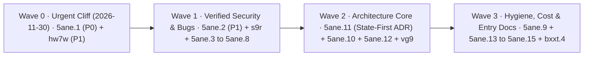

# Verified audit synthesis, four-wave roadmap, and non-normative multi-stack transfer parking lot

**Cut-off and authority:** Re-verified on `2026-11-24` against `origin/main` (`b9ce3ac0`, worktree branched at `a5b117f8`) and the live Dolt tracker (**Epic `coding-harness-5ane`**). This concise synthesis replaces the superseded PR `#437` package (whose baseline `24632499` from `2026-11-16` was 665 commits behind `origin/main` and lacked live tracker reconciliation). Task status remains exclusively in Beads (House Rule 2); no tracker writes were performed by this PR.

---

## 1. Verified live baseline (`2026-11-24`, `origin/main` `b9ce3ac0`)

| Surface / metric | Verified live state (`2026-11-24`) | Operational consequence |
| --- | --- | --- |
| `scripts/stage2.py` | **14,115 lines** (grew from 11,487 at `24632499`) | Earlier line-number split tables are stale; `coding-harness-vg9` carries a re-measurement note (`L8948-8949` still holds the `test_stage2.py` targeted-verify fallback) |
| `scripts/verify_all.sh` + `scripts/verify_run.py` | `verify_all.sh` shrunk to **337 lines** bootstrap; shared two-phase scheduler **`scripts/verify_run.py`** (1,006 lines) + **`scripts/venv_guard.py`** (125 lines) landed (`coding-harness-bxxt.6`) | Earlier Bash-runner replacement proposal (`A-5`) is **already resolved** |
| `scripts/ramp_valves.py` | **12 valves** expire on **`2026-11-30`** (`agents-evidence-contract` / RB-A1 closed `2026-11-18`) | Immediate **P0** blocker (`coding-harness-5ane.1`): `make verify` turns red globally after `2026-11-30` |
| `model-endpoints.yaml` | `deepseek-v4.1-flash` (`L223`) and `deepseek-v4-pro` (`L299`) expire **`2026-11-30`** | Tracked as **P1** (`coding-harness-hw7w`) |
| `decisions/gates.yaml` | **24 gates** unchanged; `interview-minimums` still omits `needs_history: true` | Tracked in `coding-harness-5ane.9` |
| `git worktree list` | **162 entries** (1 main + **161 worktrees**) | Noted on existing bead `coding-harness-bxxt.4` |
| `docs/adr/` | `0001`–`0025` on `main`; **`0026` and `0027` drafted on open branches** (`feat/central-config`, `feat/review-fewer-rounds`) | New ADR drafts must use placeholder `<NNNN>` until assigned at merge |
| Live Dolt tracker | **Epic `coding-harness-5ane`** (15 verified children: 1 P0, 1 P1, 9 P2, 4 P3) + 5 notes on existing beads; **15 open non-epic P1 beads** (23 open P1 issues including 8 epics; exceeds 10-bead P1 cap) | No draft beads needed; maintainer P1 triage remains required |

---

## 2. Four-wave execution roadmap (mapped to live Beads)

### Wave 0 — Calendar cliff (`2026-11-30`, immediate)

| Live Bead | Priority | Scope |
| --- | --- | --- |
| `coding-harness-5ane.1` | **P0** | Decide all **12 ramp valves** in `scripts/ramp_valves.py` due `2026-11-30` (close, extend with documented reason, or retire rule) before `make verify` turns red everywhere |
| `coding-harness-hw7w` | **P1** | Re-read DeepSeek zero-data-retention terms (`model-endpoints.yaml:223,299`) before `2026-11-30` |

### Wave 1 — Verified security & correctness bugs

| Live Bead | Priority | Verified issue |
| --- | --- | --- |
| `coding-harness-5ane.2` | **P1** | **Highest-impact concrete attack vector:** status line and Claude hooks execute `$root/tools/bd` from any opened repository without a trust check |
| `coding-harness-s9r` *(note)* | **P1** | Writing-attempt isolation must cover `tools/pi/node_modules/` inside `tool_state()` integrity checks |
| `coding-harness-5ane.3` | **P2** | Red-first proof token (`STAGE2_RED_TOKEN`) is readable by the model-written test process it judges |
| `coding-harness-5ane.4` | **P2** | Pi reviewer path confinement (`--no-extensions`), Codex secret scrubbing, and fail-closed secret-list loading |
| `coding-harness-5ane.5` | **P2** | Maintainer decision on free-model admission: `prepare-loop` transmitting bounded diff early and `-free` suffix auto-admission (ADR 0021 Decision 3) |
| `coding-harness-5ane.6` | **P2** | Harden hosted CI workflow (`permissions:` least privilege, 40-char SHA action pinning, no persistent `--global` git auth header) |
| `coding-harness-5ane.7` | **P2** | **Verified kit bug:** `scripts/export/manifest.yaml` ships `check_bead_export.py` and `check_dangling_bead_ids.py` while omitting their required import `scripts/bead_render.py` |
| `coding-harness-5ane.8` | **P2** | **Verified gate gap:** `class: architectural` (`MINIMUMS["architectural"] = 0`) does not verify that an architectural change claims an ADR file (reconcile 5 vs. 10 answers on `coding-harness-6slq`) |

### Wave 2 — Architecture core (aligned with existing goals & house rules)

| Live Bead | Priority | Architectural lever |
| --- | --- | --- |
| `coding-harness-5ane.11` | **P2** | **State-First:** canonical machine-readable JSON/JSONL state for review loops, `lanes.py`, `jobs.py`, and attempts instead of parsing Markdown (aligned with `coding-harness-oebl`; see companion [State-First & Single Manifest ADR draft](./2026-11-24-draft-adr-state-first-and-manifest.md)) |
| `coding-harness-5ane.10` | **P2** | **Single kit manifest:** retire `scripts/export/manifest.yaml`, maintain one manifest aligned with `feat/central-config`, and plan `DECKEL` reduction `44 -> 0` |
| `coding-harness-5ane.12` | **P2** | **Shared primitives (House Rule 9):** one strict YAML loader, one symlink-safe atomic file writer, and one sanitized git runner across `scripts/` |
| `coding-harness-vg9` *(note)* | **P2** | Split `scripts/stage2.py` (14,115 lines) and `tests/test_stage2.py` to unlock ADR 0025 targeted verification (`stage2.py:8948-8949`); re-measure slices against live `main` |

### Wave 3 — Hygiene, swarm cost, & missing entry files

| Live Bead | Priority | Scope |
| --- | --- | --- |
| `coding-harness-5ane.9` | **P3** | Declare `needs_history: true` on `interview-minimums` in `decisions/gates.yaml` so CI and local verify agree |
| `coding-harness-5ane.13` | **P3** | Guard gate kill-switches (`ADR_ANSWERS_TOLERATE_CHANGE`) and extend `dangling-beads` coverage to `plans/` |
| `coding-harness-5ane.14` | **P3** | Run repository/history `leakcheck` once per research-swarm run rather than per seat |
| `coding-harness-5ane.15` | **P3** | Author the two missing standard entry files: `SECURITY.md` and `CONTRIBUTING.md` |
| `coding-harness-bxxt.4` *(note)* | **P2** | Prune accumulated worktrees (161 live) and add safe garbage collection |

---

## 3. Superseded, deferred, or rejected items (out of active repo scope)

* **Already resolved on `origin/main` (`b9ce3ac0`):** Bash verify runner replacement (`scripts/verify_run.py` + `scripts/venv_guard.py`, `coding-harness-bxxt.6`), RB-A1 ramp valve (closed `2026-11-18`), and the 30 unverified draft beads from PR `#437` (superseded by Epic `coding-harness-5ane`).
* **Deferred:** OS-level sandboxing (`sandbox-exec` is deprecated on macOS; containerization deferred per note on `coding-harness-nevd`).
* **Rejected for this repository's internal ADR:** Unmeasured test-count (`-600..-910`) and verify-duration (`6-8 min`) estimates, plus any recommendation conflicting with settled rules (House Rule 2 "Beads only", House Rule 9 "one entry point", `COMMERCIAL.md` PolyForm license, ADR 0021 Decision 3 without maintainer decision `5ane.5`).
* **Reference note on `coding-harness-oebl`:** `AGENTS.md:123` cites `coding-harness-oebl` for OpenTelemetry GenAI JSONL logging; live Dolt confirms `coding-harness-oebl` covers splitting the runner audit log out of `findings.md` into structured OpenTelemetry GenAI JSONL (alongside related `coding-harness-phcy` and `coding-harness-zaqf`).

---

## 4. Future external-project transfer parking lot *(non-normative · out of current repo scope)*

> [!NOTE]
> **Strictly non-normative parking lot:** None of the options below amend any active house rule or ADR in `coding-harness`. They capture forward-looking design hooks specifically for the maintainer's upcoming projects in **TypeScript, Rust, SQL, and PySpark** so that `feat/central-config`, `coding-harness-5ane.10`, and `coding-harness-5ane.11` avoid locking in unnecessary Python-only assumptions.

### 4.1 What already transfers cleanly via active repository work

1. **Central project configuration (`feat/central-config` + `5ane.10`):** Externalizing repo prefix, default branch, and kit manifest removes the primary hardcoding barrier for any language stack.
2. **Prospective gate adoption (`scripts/adoption.py` + `decisions/adoption.yaml`):** Existing brownfield repos can adopt Stage-1 gates from day 1 without rewriting legacy history.
3. **State-First JSON/JSONL (`5ane.11` + `oebl`):** Language-neutral structured state makes external runners, linters, and CI tools trivial to integrate without Markdown regexes.

### 4.2 Stack-specific abstractions for upcoming projects (`TypeScript`, `Rust`, `SQL`, `PySpark`)

| Upcoming stack | Deterministic `seconds` gates (`decisions/gates.yaml`) | Test & `criterion-ledger` / red-first contract (`ToolchainPort` hook) | `touch_map` & brownfield considerations |
| --- | --- | --- | --- |
| **TypeScript** | `tsc --noEmit`, `eslint`, `prettier --check`, lockfile pin (`package-lock.json` / `pnpm-lock.yaml`) | `vitest --reporter=json` or `jest --json` / JUnit XML; ledger locators matching `*.test.ts::describe > it` | Resolve ES/TS `import` / `tsconfig` paths; keep `node_modules/` outside `leakcheck` and inside integrity pins |
| **Rust** | `cargo fmt --check`, `cargo clippy -- -D warnings`, `Cargo.lock` pin | `cargo test --message-format=json` or `cargo nextest` JUnit output; ledger locators matching `crate::module::test_fn` | Resolve crate `mod`/`use` graph; separate fast unit checks (`--lib`) from heavy integration binaries |
| **SQL** | `sqlfluff lint/format`, schema-migration drift checks, dbt compile/parse checks | SQL contract / dbt test results emitted as structured JSON (`run_results.json`) referenced by `criterion-ledger` | Treat `.sql` migrations and semantic models as first-class tracked artefacts rather than falling back to full Python verify |
| **PySpark** | `ruff` + schema/contract validators + deterministic local-mode unit tests | `pytest` with isolated session-scoped local `SparkSession` fixtures (no cluster dependency in `verify`), separating pure DataFrame transform tests (`seconds`) from Spark integration tests (`minutes`) | Avoid committing sample data; apply `leakcheck` strictly to schemas/sample fixtures; additive CI workflow for existing data pipelines |

### 4.3 House rules & ADRs that would require an explicit future decision PR (only when adopting externally)

* **Tracker abstraction (`TrackerPort`: `none | beads | github-issues | linear`):** Would require a scoped exception or instance-level override to House Rule 2 (**"Beads only"**) for brownfield repositories that cannot install Dolt on day 1.
* **Harness pointer shims (`CLAUDE.md` / `.cursor/rules/` / `.github/copilot-instructions.md`):** Would require an explicit instance rule distinct from House Rule 9 (**"one entry point"**) and `tests/test_entry_points.py` (which guards against `CLAUDE.md` silently shadowing `AGENTS.md`).
* **Additive CI mode (`ci.mode: additive`):** Would extend `scripts/ci_gates.py` beyond exclusive ownership of `.github/workflows/ci.yml` so brownfield repos can keep existing TypeScript/Rust/PySpark pipelines intact alongside a dedicated `monotrope-gates.yml` workflow.
* **Commercial / team licensing:** `COMMERCIAL.md` (PolyForm Noncommercial 1.0.0) governs this repository; any external commercial project requires either a written license or an explicit future maintainer decision (`D-17`).

---

## Companion draft in this PR

* Narrowly scoped internal ADR draft (`5ane.11`, `5ane.10`, `5ane.12`): [2026-11-24-draft-adr-state-first-and-manifest.md](./2026-11-24-draft-adr-state-first-and-manifest.md)
