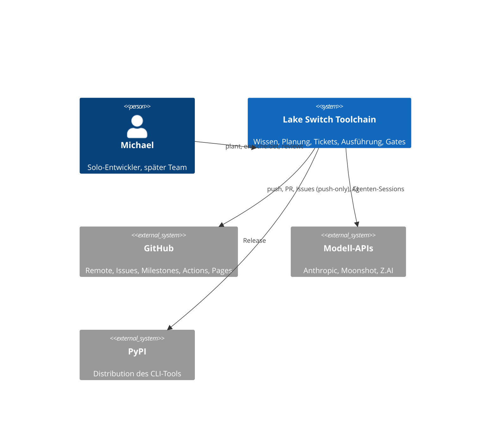
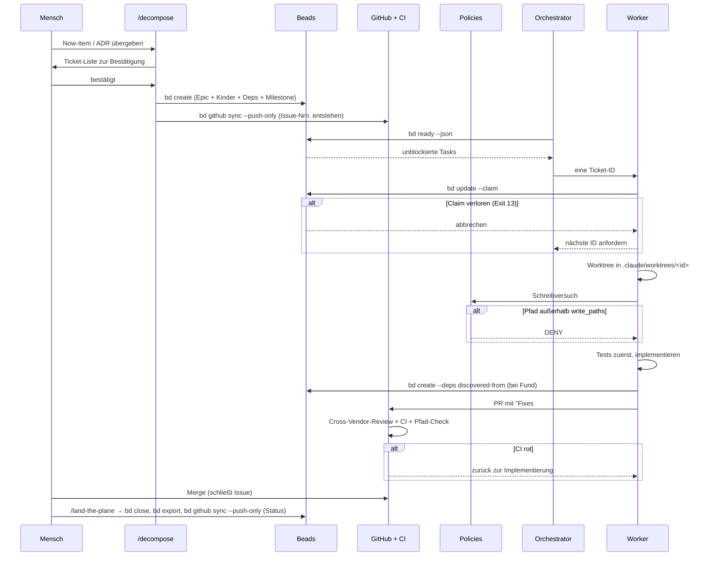

# Lake Switch — Architektur der Arbeits- und Wissensumgebung

> arc42-Dokumentation der Toolchain, in der Lake Switch entwickelt wird.
> Die arc42-Dokumentation des **Produkts** Lake Switch liegt unter `docs/arc42/`.

| | |
|---|---|
| **Version** | 4.0 |
| **Status** | Review-fähig; vor Stufe 0 der Umsetzung |
| **Datum** | 2026-09-16 |
| **Autor** | Michael (mit KI-Unterstützung) |
| **Ablageort** | `docs/architecture/toolchain.md` |
| **Template** | arc42 (de), v8.2-Gliederung |

**Scope.** Dieses Dokument beschreibt nicht die Produktarchitektur von Lake Switch, sondern die Architektur der Umgebung, in der Lake Switch entwickelt wird: Wissen, Planung, Tickets, Agenten-Ausführung, Qualitätssicherung, Architekturdokumentation.

## Zielbild (normativ)

Ein Solo-Entwickler steuert ein Multi-Harness-Agentensystem (Orchestrator, Worker, Reviewer), das Lake Switch baut. Jede Wissensart liegt an genau einem Ort in Git. Zwischen Planung, Ticket-Ebene und Ausführung liegt genau eine Schleuse (`/decompose` mit menschlicher Bestätigung). Kein Agent kann ohne Isolation (Worktree) und Gate (Policies präventiv, CI und Branch Protection reaktiv) in `main` schreiben. Der komplette Zyklus läuft lokal auf einem Laptop; einzige externe Abhängigkeit sind die Modell-APIs. Jede Entscheidung ist über ADR und Provenance ohne Chatverlauf rekonstruierbar.

Diese Architektur gilt als erreicht, wenn **alle** Bewertungsszenarien S1–S12 (Kapitel 10.2) nachweisbar eintreten.

---

## 1. Einführung und Ziele

### 1.1 Aufgabenstellung

Beim Vorgängerprojekt „adwaive" ging die Kontrolle über Code und Repository verloren. Die Ursachenklasse ist typisch für agentische Entwicklung mit einem einzelnen Entwickler:

- Artefakte wurden mehrfach und an verschiedenen Orten erzeugt (Pläne, TODOs, Notizen), ohne dass eine Quelle kanonisch war.
- Agenten schrieben direkt in den Hauptzweig, ohne isolierte Arbeitsbereiche und ohne Review-Gate.
- Entscheidungen existierten nur im Chatverlauf und waren nach Wochen nicht mehr rekonstruierbar.
- Emergente Arbeit („dabei ist mir aufgefallen …") vermischte sich mit geplanter Arbeit und blähte laufende Aufgaben auf.

Diese Architektur ist die strukturelle Antwort darauf: Jede Wissens- und Arbeitsart hat genau einen Ort, zwischen den Ebenen liegen kontrollierte Schleusen, und kein Agent kann ohne Isolation und Gate in den Hauptzweig schreiben.

### 1.2 Qualitätsziele

Priorisiert; bei Konflikten entscheidet die höhere Priorität (Q1 vor Q2 usw.).

| # | Ziel | Begründung | Messbar an |
|---|------|-----------|-----------|
| Q1 | **Kontrollierbarkeit** | Kernproblem aus adwaive | Kein Commit auf `main` ohne PR; jeder Artefakt-Typ hat genau einen Ort; Agenten können geschützte Pfade nicht beschreiben |
| Q2 | **Portabilität** | Mehrere Harnesses (Claude Code, Kimi, GLM, Omnigent) | Alle Kernartefakte sind aus Text in Git rekonstruierbar; kein Werkzeug ist ersetzungsfest |
| Q3 | **Nachvollziehbarkeit** | Solo-Entwickler mit Unterbrechungen | Jedes Ticket verweist auf sein Quellartefakt; jede Entscheidung hat einen ADR |
| Q4 | **Lokale Lauffähigkeit** | Kein SaaS-Zwang, kein Vendor-Lock-in | Vollständiger Zyklus auf einem Laptop, ohne andere Dienste als die Modell-APIs |
| Q5 | **Kognitive Entlastung** | Planerische und kreative Klarheit | Ein Blick (`ROADMAP.md`) beantwortet „was ist das Ziel"; ein Befehl (`bd ready`) beantwortet „was jetzt" |
| Q6 | **Skalierbarkeit** | Späteres Team im Omnigent-Umfeld | Solo→Team ohne Werkzeugwechsel in den Kern-Ebenen |

Die operationalisierten Bewertungsszenarien stehen in Kapitel 10.

### 1.3 Stakeholder

| Rolle | Bezug zur Architektur | Erwartung |
|-------|----------------------|-----------|
| Michael (Solo-Entwickler, Product Owner, Reviewer) | Einziger Mensch im Loop; plant, entscheidet, mergt | Q1–Q5; minimale Reibung im Alltag, maximale Rekonstruierbarkeit nach Unterbrechungen |
| Zukünftige Teammitglieder | Treten ab Stufe 1 des Skalierungspfads bei (8.8) | Onboarding ohne mündliche Übergabe; Q6 |
| Agenten (Orchestrator, Worker, Reviewer) | Ausführende „Nutzer" der Toolchain | Eindeutige, maschinenlesbare Verträge (Ticket-Schema, AGENTS.md, Policies) |
| Externe Nutzer des CLI (später) | Konsumenten von `docs/guide/` und PyPI-Releases | Verlässliche Nutzerdokumentation; keine internen Artefakte im Blick |
| Arbeitgeber (indirekt) | IP-Abgrenzung (Anhang B.2) | Saubere Trennung von Arbeitsmitteln, Accounts und Inhalten |

---

## 2. Architekturrandbedingungen

### 2.1 Technische Randbedingungen

| Randbedingung | Konsequenz |
|---------------|------------|
| Vollständiger Zyklus auf einem einzelnen Rechner | GitHub ist Remote und Publikationsziel, nicht Betriebsvoraussetzung; einzige externe Abhängigkeiten sind die Modell-APIs |
| Produktsprache Python | Gates mit `ruff`, `mypy`, `pytest`; Distribution über PyPI |
| Omnigent hat Alpha-Status mit Breaking Changes im Wochentakt | Version pinnen; Omnigent nur additiv (ADR-0007); keine harte Kopplung an Interna |
| Beads nutzt Dolt als binären Arbeitsspeicher | Export- und Backup-Disziplin als P1-Bedingung (5.2.5) |
| Mehrere Agenten-Harnesses (Claude Code, Kimi, GLM) | Instruktionen in `AGENTS.md`, CLI vor MCP (P4) |

### 2.2 Organisatorische Randbedingungen

- Ein Entwickler, Unterbrechungen sind der Normalfall → Q3, Q5.
- Begrenztes Budget für KI-Coding-Werkzeuge → Kostenkontrolle als Architekturthema (8.5).
- Trennung vom Arbeitgeber: kein Betrieb über den Arbeitgeber-Databricks-Account; Omnigent ausschließlich als OSS-Variante (rechtlicher Hinweis in Anhang B.2).

### 2.3 Konventionen

- ADRs im **MADR-Format**, Dateiname `NNNN-kurzer-titel.md`, Status `proposed` / `accepted` / `superseded-by`.
- Conventional Commits, SemVer, Changelog via `git-cliff`.
- Standard-Markdown-Links als Default, keine Wikilinks (Ausnahme: der gewählte SSG rendert sie nachweislich).
- Sprache der Artefakte: Deutsch für Wissen und Entscheidungen, Englisch für Code und Commit-Messages.

### 2.4 Nicht-Ziele

- Keine Team-Kollaboration in Echtzeit in der ersten Ausbaustufe.
- Kein Enterprise-Entwicklerportal.
- Keine vollautomatische Ticket-Erzeugung ohne menschliches Bestätigungs-Gate.
- Keine harte Kopplung an Omnigent-Interna, solange dessen API als alpha gilt.
- Keine bidirektionale Synchronisation zwischen Beads und GitHub in der Solo-Stufe.
- Kein Betrieb über den Arbeitgeber-Databricks-Account.

### 2.5 Stack-Grenzen und Ausstiegspfade

Der Stack deckt bewusst nicht ab: Enterprise-Architecture-Management, MBSE/SysML, Confluence-Publikation. Wenn diese Anforderungen wachsen, gelten die folgenden Ausstiegspfade — sie sind Alternativen, keine Stack-Bestandteile (P8):

| Wenn … | Ausstiegspfad |
|--------|---------------|
| Stakeholder GUI statt DSL brauchen | IcePanel oder draw.io **nur als Sicht**; Quelle bleibt das LikeC4-Modell im Repo |
| Dokumentation nach Confluence soll | docToolchain (baut arc42 aus AsciiDoc/Markdown und publiziert) |
| Projekt kleiner wird, arc42 zu schwer | arc42-Canvas (einseitig); ADRs und C4-Modell bleiben |
| Zentrale Diagramm-Render-Pipeline nötig | Kroki als Renderer für Mermaid/PlantUML ergänzen; LikeC4-Modell bleibt Quelle |
| MBSE-Anforderungen entstehen | SysML v2 / Cameo — außerhalb dieses Stacks |

---

## 3. Kontextabgrenzung

### 3.1 Fachlicher Kontext



Die Toolchain läuft lokal. Planung, Ticket-Erzeugung, Ausführung und lokale Gates funktionieren auf einem einzelnen Rechner; GitHub ist Remote und Publikationsziel, nicht Betriebsvoraussetzung.

### 3.2 Technischer Kontext

| Nachbarsystem | Kanal / Protokoll | Richtung | Bemerkung |
|---------------|-------------------|----------|-----------|
| GitHub (Remote) | Git über HTTPS/SSH; `gh`-CLI (REST/GraphQL) | bidirektional für Code; **push-only** für Issues | Branch Protection, CODEOWNERS, Actions, Pages |
| Modell-APIs (Anthropic, Moonshot, Z.AI) | HTTPS, API-Schlüssel aus `.env` / Omnigent-Serverkonfiguration | ausgehend | Einzige zwingende externe Abhängigkeit |
| PyPI | HTTPS, OIDC Trusted Publishing | ausgehend | Kein langlebiges Token (8.6) |
| Lokale Harnesses (Claude Code, Kimi CLI) | Prozessaufruf über Omnigent-Runner; CLI | lokal | Deny-by-default-Environment seit Omnigent v0.8.0 |
| Dolt (Beads-Backend) | lokal, embedded oder Shared-Server (Port 3308) | lokal | Mehrprozess-Zugriff: Verifikationspunkt (Anhang B.1) |

---

## 4. Lösungsstrategie

### 4.1 Tragende Ideen

1. **Schichten nach Zeithorizont.** Jedes Artefakt liegt in genau einer von sieben Schichten (L0–L6), sortiert nach Lebensdauer. Je langlebiger, desto höher die Änderungshürde. Zwischen Planung/Wissen und Ausführung liegt genau eine Schleuse (Ticket-Generator), zwischen Ausführung und Hauptzweig genau ein Gate-Verbund.
2. **Zweistufige Durchsetzung.** Schutz geschieht präventiv (Policies und Sandbox lassen eine Aktion gar nicht entstehen) *und* reaktiv (Review-Gates und CI hindern sie am Merge) — unabhängig voneinander, damit der Ausfall einer Stufe den Schutz nicht kippt.

### 4.2 Architekturprinzipien

Bei Zweifelsfällen entscheidet der niedrigere Prinzipien-Index.

**P1 — Alles ist aus Git rekonstruierbar.**
Jedes Artefakt, das länger als eine Session leben soll, hat eine Textrepräsentation im Repository, aus der es wiederhergestellt werden kann. Arbeitsspeicher außerhalb von Git (Datenbanken, Caches) sind zulässig, wenn ein Export in Git liegt und ein Import daraus den Zustand wiederherstellt. Bei Beads ist die Wiederherstellung zweigeteilt: Issue-Level aus `issues.jsonl`, vollständig aus `bd backup` (5.2.5).

**P2 — Ein Format, mehrere Frontends — für Markdown.**
Alle Markdown-Artefakte werden lokal in Obsidian navigiert, im Editor bearbeitet, von Agenten gelesen und von einem Static-Site-Generator publiziert, ohne Konvertierung. Gilt nicht für DSL-Artefakte (`.c4`, `.argdown`) und nicht für Beads; diese haben je genau ein Werkzeug.

**P3 — LLM vorne, Determinismus hinten.**
Sprachmodelle planen, formulieren und schlagen vor. Reihenfolge, Abhängigkeitsauflösung, Claim-Vergabe, Validierung und Gates laufen in deterministischem Code.

**P4 — CLI vor MCP.**
Integration über Kommandozeilenaufrufe, Shell-Skripte, Git-Hooks und Slash-Commands. MCP ist optionaler Zusatz für Clients ohne Shell.

**P5 — Genau ein Ort pro Wissensart.**
Überlappungen erzeugen Drift. Die Zuordnung in 8.1.4 ist normativ. Wenn ein Artefakt in zwei Zeilen passt, ist es falsch geschnitten. Gilt auch für Steuerdateien: `AGENTS.md` ist die eine Instruktionsquelle.

**P6 — Isolation vor Vertrauen, zweistufig.**
Agenten arbeiten in separaten Worktrees auf eigenen Branches; der Hauptzweig ist geschützt. Durchgesetzt **präventiv** (Policies, Sandbox-Pfadgrenzen) und **reaktiv** (Review-Gates, CI). Beide Wege müssen unabhängig funktionieren; die präventive Stufe darf keine Voraussetzung für die reaktive sein.

**P7 — Nicht erfinden.**
Agenten markieren Unklares als `OFFEN` statt zu raten. Ein Ticket, ein ADR oder ein Modell-Abschnitt, der eine Annahme enthält, die nicht aus einem Quellartefakt belegt ist, gilt als fehlerhaft. Die Korrektur von `OFFEN` ist menschliche Aufgabe und hat Vorrang vor neuer Arbeit. Gilt auch für die Obsidian-Kuration (6.4): Eine Notiz mit unbelegter Aussage wird nicht promoviert, sondern als `OFFEN` markiert oder verworfen.

**P8 — Werkzeug-Wildwuchs ist ein Risiko, kein Feature.**
Neue Werkzeuge, Renderer oder Speicherorte werden nur per ADR eingeführt. Die Ausstiegspfade in 2.5 zeigen Alternativen auf, ohne sie in den Stack zu heben.

### 4.3 Zentrale Technologieentscheidungen im Überblick

| Entscheidung | Kurzfassung | Begründung |
|---|---|---|
| Beads als einziger Task-Speicher | Kein zweites Backlog-System | ADR-0002 (9.1) |
| `ROADMAP.md` als einzige Planungsquelle | Planung ist Prosa in Git | ADR-0002 (9.1) |
| `AGENTS.md` als einzige Instruktionsquelle | `CLAUDE.md` enthält nur `@AGENTS.md` | ADR-0012 (9.3) |
| LikeC4 als einzige C4-Modellquelle | Kein paralleles Structurizr-Modell | ADR-0010 (9.3) |
| Omnigent ab Stufe 5, rein additiv | Git-native Gates funktionieren allein | ADR-0007 (9.2) |
| SSG publiziert nur `docs/guide/` | Interne Artefakte bleiben intern | ADR-0004 (9.3) |

---

## 5. Bausteinsicht

### 5.1 Ebene 1: Schichtenmodell

| Ebene | Name | Zeithorizont | Primärer Speicher | Durchsetzung präventiv | Durchsetzung reaktiv |
|-------|------|--------------|-------------------|------------------------|----------------------|
| L6 | Publikation | permanent | `site/` (generiert) | — | CI |
| L5 | Qualitäts-Gates | pro Änderung | `.pre-commit-config.yaml`, `.github/workflows/`, Policy-Definitionen | Policies (greifen zur L4-Laufzeit) | CI, CODEOWNERS-Äquivalent |
| L4 | Ausführung | Minuten–Stunden | Git-Worktrees, Branches | `write_paths`, Policies | — |
| L3 | Ticket-Ebene | Tage | `.beads/` (Dolt + JSONL-Export) | `write_paths` erlaubt `.beads` | Wochenroutine sichtet |
| L2 | Ticket-Generator | Ereignis | `.claude/commands/decompose.md` | `write_paths` schließt aus | Mensch bestätigt |
| L1 | Planung | Wochen–Monate | `ROADMAP.md`, GitHub Milestones | `write_paths` schließt aus | Mensch, direkt |
| L0 | Wissen & Entscheidung | Jahre | `docs/`, `brain/`, `model/` | `write_paths` schließt aus | Pfad-Gate (CI + Review) |

Der Zeithorizont ist das Sortierkriterium. Je langlebiger ein Artefakt, desto weiter unten liegt es und desto höher die Hürde für Änderungen.

**Zwei Durchsetzungswege.** Die präventive Spalte beschreibt, was ein Agent technisch nicht tun kann: Ein Worker mit `write_paths: [src, tests, .beads]` kann `docs/`, `brain/`, `model/`, `ROADMAP.md` und `.claude/` nicht beschreiben — der Tool-Call schlägt fehl, bevor eine Datei entsteht. Die reaktive Spalte beschreibt, was beim Merge geprüft wird: ein deterministischer Pfad-Check in CI plus (ab Team-Stufe) CODEOWNERS-Review auf den geschützten Pfaden.

**Solo-Betrieb und CODEOWNERS.** GitHub erfüllt „Require review from Code Owners" nicht durch Selbst-Review. In der Solo-Stufe gilt daher: Branch Protection mit Bypass-Berechtigung für den Repo-Admin, und der eigentliche Pfad-Schutz läuft als CI-Job, der PR-Diffs gegen die geschützte Pfadliste prüft und den Merge blockiert. CODEOWNERS wird trotzdem gepflegt — als Dokumentation der Schutzzonen und als nahtloser Übergang in die Team-Stufe (ADR-0008).

**L4 und L5 sind verbunden, aber nicht voneinander abhängig.** Die Policy-Ebene gehört formal zu L5, greift aber zur Laufzeit von L4. Läuft kein Omnigent, fehlt die präventive Stufe — die reaktive greift trotzdem. Das ist die Bedingung aus P6 und der Grund, warum die git-nativen Gates nicht durch Policies ersetzt werden.

### 5.2 Ebene 2: Bausteine je Schicht

#### 5.2.1 L0 — Wissen und Entscheidung

Fünf Bausteine, plus eine Sicht- und Erfassungsschicht (5.2.2):

**`brain/` — Doctrine.** Langfristige Projektziele, gelernte Lektionen, Domänenfakten zu Oracle- und Databricks-Migrationen, Playbooks. Kein Task-Tracking, keine Statuszeilen. Wird von Agenten als Kontextquelle gelesen, nicht automatisch geschrieben. **Intern, wird nicht publiziert.**

**`docs/decisions/` — ADRs im MADR-Format.** Unveränderliche Datei je Entscheidung mit Kontext, Decision Drivers, Considered Options, Pros/Cons je Option, Decision Outcome. Abgelöste ADRs werden über `superseded-by` verkettet, nie gelöscht. **Intern.**

**`docs/arguments/` — Argdown.** Für Abwägungen, die die Pro/Contra-Tabelle eines ADR überfordern: Migrationsstrategie-Varianten, Monetarisierungswege, Grundsatzfragen. Rendering über `argdown map`. Ein Argdown-Dokument mündet in einen ADR und wird dort unter Decision Drivers verlinkt. **Intern — enthält Geschäftsüberlegungen.**

**`model/` — LikeC4-Modell.** Die Zielarchitektur von Lake Switch als `.c4`-DSL und einzige C4-Modellquelle (ADR-0010). `likec4 start` liefert den interaktiven lokalen Server, `likec4 build` die statische Site. Validierung in CI. **Intern, bis ADR-0006 etwas anderes festlegt.**

**`docs/arc42/` — Produkt-Architekturdokumentation.** Zwölf Einzeldateien `01_einfuehrung_und_ziele.md` bis `12_glossar.md` für die Ist-Architektur von Lake Switch (nicht dieser Toolchain). Bewusste Ausnahme von der Ein-Dokument-Regel: Pro Abschnitt eigene Datei für saubere PR-Diffs und Ownership (ADR-0011). Wird vom Bootstrapping-Command `/bootstrap-arch` initial befüllt (8.2.2). **Intern.**

#### 5.2.2 L0-Sicht — Obsidian als Wissensmanagement-Ebene

Obsidian ist die **Sicht- und Erfassungsschicht** über L0: Graph View, Backlinks, Dataview, schnelle Erfassung. Es ist kein Speicherort — aber es ist nicht beliebig, denn eine falsch konfigurierte Sicht erzeugt genau die Drift, die P5 verhindern soll. Drei normative Regeln:

**Regel 1 — Inbox ist Übergang, nie Ziel.** Die Schnellerfassung (Quick Switcher, Hotkey, Mobile) schreibt ausschließlich nach `brain/inbox/`. Dieser Ordner ist der einzige, in dem Obsidian-Notizen ohne kanonischen Zielort leben dürfen — maximal eine Woche. Die wöchentliche Kuration (6.4) leert die Inbox: Doctrine-Inhalte wandern nach `brain/`, Domänenwissen nach `docs/domain/`, Entscheidungsstoff nach `docs/arguments/` oder als ADR-Skeleton nach `docs/decisions/`. Nach der Promotion wird die Inbox-Datei **gelöscht**, nicht archiviert — sonst existiert dieselbe Erkenntnis zweimal.

**Regel 2 — Dataview ist Ansicht, nie Quelle.** Dataview-Abfragen (z. B. „alle ADRs mit Status `proposed`") sind erlaubt, solange sie ausschließlich über Dateien in `docs/` und `brain/` aggregieren. Verboten sind Dataview-Blöcke, die ihrerseits Inhalt erzeugen (Inline-Felder, die von Abfragen verändert werden) — das wäre ein Schreibzugriff außerhalb der Git-Historie. Dashboards, die regelmäßig gebraucht werden, gehören als Markdown-Datei nach `docs/domain/dashboards/`.

**Regel 3 — Agenten schreiben nicht in Obsidian-Dateien.** `.obsidian/` und `brain/inbox/` liegen außerhalb aller `write_paths`. Agenten dürfen `brain/` und `docs/` lesen (als Kontextquelle), aber keine Datei anlegen, die nur für Obsidian bestimmt ist (keine Canvas-Dateien, keine Excalidraw-JSON, keine `.obsidian/`-Änderungen). Visualisierungen für Agenten laufen über LikeC4 oder Mermaid.

**Konfiguration.**

| Datei/Ordner | Versioniert? | Begründung |
|---|---|---|
| `.obsidian/app.json`, `appearance.json`, `core-plugins.json`, `community-plugins.json`, `hotkeys.json` | **ja** | Gleiche Plugins und Einstellungen auf jedem Gerät |
| `.obsidian/workspace.json`, `workspace-mobile.json`, `graph.json` | nein | Fensterzustand ist flüchtig und geräteindividuell |
| `.obsidian/plugins/` (Plugin-Binaries) | nein | Zu groß; Plugin-Liste reicht zur Wiederherstellung |
| `.trash/` | nein | — |
| `brain/inbox/` | ja, aber kurzlebig | Kurationspfad 6.4; leer nach Wochenroutine |

Vault-Root ist das Repo-Root. Als Excluded Files werden `src/`, `tests/`, `.beads/`, `.claude/worktrees/`, `site/` und `node_modules/` ausgeblendet. **Mobile Erfassung** landet im selben Vault und in derselben `brain/inbox/` wie Desktop; die Synchronisation zwischen Telefon und Laptop (Working Copy, Syncthing o. ä.) ist Aufgabe des Entwicklers, nicht Teil dieser Architektur.

#### 5.2.3 L1 — Planung

Ein Quellartefakt, eine abgeleitete Sicht.

**`ROADMAP.md` — die Quelle.** Drei Abschnitte: Now, Next, Later. Richtwert eine Bildschirmseite. Jedes Item ist ein Thema mit ein bis drei Sätzen Begründung und, sobald geschnitten, einem Verweis auf sein Beads-Epic und sein Milestone:

```markdown
## Now
### Pfad-Handling S3 → Delta
Warum: Erster Kundenfall scheitert an ungültigen URIs. Blockiert alles weitere.
Appetite: 2 Wochen · Epic: ls-a3f2 · Milestone: v0.3

## Next
### Schema-Evolution
Warum: ...
Spec: docs/decisions/0009-schema-evolution.md

## Later
- Multi-Tenant-Konfiguration
- OCI-Quelle
```

`ROADMAP.md` enthält keine Tasks, sondern Themen, Begründungen und Zeitbudgets. Das ist die Ebene, auf der Shape Up wirkt: fester Appetite statt Schätzung, Zyklus mit Cool-down, Scope wird geschnitten statt der Termin verschoben.

**GitHub Milestones — die Sicht.** Jedes Now-Item entspricht einem Milestone; Milestones liefern die Fortschrittsanzeige, gepflegt über die `gh-milestone`-Extension. Sie sind eine abgeleitete Ansicht, kein zweiter Planungsspeicher: Bei Divergenz gilt `ROADMAP.md`. In der Solo-Stufe optional.

**Abgleich L1 ↔ L3.** Keine Automatik. Die Wochenroutine (6.3) listet Now-Items mit geschlossenem Epic; der Mensch verschiebt oder streicht sie. Die Kopplung ist absichtlich manuell.

#### 5.2.4 L2 — Ticket-Generator

Der Generator ist die **Schleuse von oben**: die einzige Verbindung von Planung und Wissen zur Ticket-Ebene. Ein Slash-Command in `.claude/commands/decompose.md`, als Markdown-Prompt mit Shell-Aufrufen realisiert, damit er auf andere Harnesses portierbar bleibt.

**Eingaben:** ein Now-Item aus `ROADMAP.md`, ein ADR, eine Spec, oder ein GitHub-Issue nach menschlicher Triage.
**Ausgabe:** ein Beads-Epic mit Kind-Tasks nach dem Ticket-Schema (8.1.1), Epic verknüpft mit dem Milestone.
**Gate:** Der Command zeigt die geplante Ticket-Liste inklusive Abhängigkeiten an und wartet auf Bestätigung, bevor `bd create` läuft.

Drei Phasen:

1. **Planen.** Mit dem stärksten verfügbaren Modell wird aus dem Quellartefakt ein Implementierungsplan. Optional als Zwischenformat OpenSpec (`openspec/`, delta-basiert, brownfield-tauglich).
2. **Schneiden.** Jedes Ticket muss so bemessen sein, dass Ticket, relevante Dateien und Tests gemeinsam deutlich unter dem Kontextbudget bleiben (Richtwert 30 000–50 000 Token).
3. **Importieren.** `bd create` mit Epic, Kindern, Abhängigkeiten, vollständigem Body und Milestone-Referenz — **danach sofort `bd github sync --push-only`** (ADR-0009). Erst dadurch existiert die GitHub-Nummer, die der Worker später in den PR-Body schreibt.

**Die drei Eingänge nach Beads:**

| Eingang | Auslöser | Gate |
|---------|----------|------|
| `/decompose` | Mensch, aus L0/L1 | Bestätigung der Ticket-Liste |
| `bd create --deps discovered-from:<id>` | Agent während Ausführung | Muss auf ein Eltern-Bead verweisen; wird in der Wochenroutine gesichtet |
| `bd github sync --pull` | GitHub-Issue | **In der Solo-Stufe deaktiviert.** Issues werden vom Menschen triagiert und gehen über `/decompose` |

Ein bidirektionaler Sync würde jedes GitHub-Issue ungefiltert in die Agenten-Queue heben. Der Sync ist deshalb ausschließlich push-only (5.2.5).

#### 5.2.5 L3 — Ticket-Ebene

**Beads (`bd`)** ist die Drehscheibe, nicht die Wahrheit über das Projekt. Es hält den Kurzhorizont:

- Abhängigkeitsgraph mit vier Kantentypen: `blocks` (wirkt auf die Ready-Queue), `parent-child` (Epic-Struktur), `related` (nicht blockierend), `discovered-from` (Provenienz emergenter Arbeit).
- `bd ready --json` liefert per topologischer Sortierung nur unblockierte Arbeit.
- Atomare Claims (`bd update <id> --claim`) setzen Assignee und Status in einer Transaktion; der erste gewinnt. Leases mit Heartbeat und Compare-and-Set-Guards (`--if-assignee`, `--if-status`, Exit-Code 13 bei Mismatch).
- Hash-basierte IDs verhindern Kollisionen bei parallelem Anlegen.
- `bd prime` lädt Workflow-Kontext und Kommandoführung in Agenten-Sessions (SessionStart-Hook, 8.2.3); eine semantische Kompaktion fasst alte geschlossene Tasks zusammen und entlastet die Kontext-Ökonomie (8.3).

**Arbeitsspeicher und P1.** Beads verwendet Dolt als Backend; die Datenbank liegt unter `.beads/` und ist binär. Die Wiederherstellung ist zweistufig:

- `.beads/issues.jsonl` ist der **Issue-Level-Export**: getrackt, diffbar, Basis für `bd import` auf einem frischen Klon. Er erfasst bewusst nicht Dolt-Branches, Commit-Verlauf, Working-Set-Zustand und Nicht-Issue-Tabellen — dafür ist **`bd backup`** (Dolt-Remote) der vorgesehene Weg, zusätzlich einzurichten.
- Der JSONL-Export wird **ausschließlich in `/land-the-plane` auf `main`** geschrieben. Schriebe jeder parallele Worktree dieselbe getrackte Datei, entstünden Merge-Konflikte bei jedem PR.
- Die Dolt-Dateien selbst stehen in `.gitignore`.

**Selbständigkeit von `bd` begrenzen.** `bd` kann automatisch committen, Git-Hooks installieren und als RPC-Daemon laufen. Alle drei Verhaltensweisen kollidieren mit dieser Architektur: Auto-Commit unterläuft den seriellen Export-Punkt `/land-the-plane`, automatische Hooks unterlaufen den pre-commit-Verbund, und ein Daemon ist eine weitere Betriebskomponente (Q4). Auto-Commit und Auto-Hooks sind daher abzuschalten, und die Deaktivierbarkeit ist vor Abschluss von Stufe 1 zu belegen (Risiko R15, Anhang B.1).

**Nebenläufigkeit.** Mehrere Worktrees greifen auf dieselbe Dolt-Datenbank zu. Vor Stufe 2 ist zu verifizieren, ob embedded Dolt zwei gleichzeitige Writer toleriert; falls nicht, ist `bd init --shared-server` der dafür vorgesehene Modus (Risiko R13).

**Rückfalloption `br`.** Der Rust-Port von Beads (SQLite-Primärspeicher mit JSONL-Export, kein Dolt, kein Daemon, keine automatischen Git-Operationen) friert die klassische Architektur bewusst ein, während `bd` sich weiterentwickelt. Drei seiner Fähigkeiten treffen offene Punkte dieser Architektur direkt: `br lint` prüft Issues auf fehlende Template-Abschnitte und macht das Ticket-Schema (8.1.1) maschinell durchsetzbar; `br history` hält begrenzte lokale JSONL-Snapshots (mildert R14); `br coordination status --json` macht verwaiste Claims sichtbar, und SQLite im WAL-Modus mit gebundenen Write-Locks adressiert das Nebenläufigkeitsrisiko nativ, ohne Server-Modus. Zu prüfen bleiben Claim-Semantik und die Abbildung der vier Kantentypen. Die Entscheidung zwischen `bd` und `br` ist offen und Gegenstand von ADR-0005.

**GitHub Issues** ist die menschenlesbare Spiegelung:

- Sync läuft ausschließlich `bd github sync --push-only` — **bei `/decompose`** (damit die Issue-Nummer vor dem PR existiert) und **bei `/land-the-plane`** (Statusabgleich nach Merge).
- GitHub-Issues sind für Menschen lesbar und kommentierbar; ihre Kommentare fließen nicht nach Beads zurück.
- Wer Arbeit ändern will, tut das über `ROADMAP.md` oder einen ADR und dann `/decompose` — oder direkt mit `bd`.

Damit entfällt jede Konfliktregel: Es gibt nur eine Richtung.

**Vor Produktivnutzung im Wegwerf-Repo zu verifizieren:** Verhalten von `bd github sync --push-only` bei mehreren geänderten Beads in einem Lauf; Zeitstempel-Kollisionen; Abbildung von Parent-Child auf Sub-Issues; exakter Flagname für die Milestone-Referenz am Epic (Anhang B.1).

#### 5.2.6 L4 — Ausführung

**Omnigent** (Databricks, Apache 2.0, geprüft gegen v0.13.0 vom 2026-09-09, Status alpha) orchestriert Harnesses: ein Server hält Sessions, Policies und MCP-Konfiguration; Runner führen aus. Der Orchestrator-Agent schreibt keinen Code, sondern plant, delegiert an Coding-Sub-Agenten in parallelen Worktrees und routet jedes Diff an einen Reviewer eines anderen Anbieters. Eingesetzt wird ausschließlich die OSS-Variante, nicht die Databricks-managed Version.

**Was deklarativ abgebildet wird.** Drei Teile wandern in die Agent-YAML:

```yaml
name: lakeswitch_orchestrator
instructions: AGENTS.md          # eine Instruktionsquelle, kein Duplikat (P5)

executor:
  harness: claude-sdk

os_env:
  type: caller_process
  cwd: .
  sandbox:
    write_paths: [src, tests, .beads]
    env_passthrough: ["BEADS_DIR", "LS_ROLE", "GITHUB_TOKEN"]
    allow_network: true

tools:
  worker:
    type: agent
    description: Implementiert genau ein Beads-Ticket.
    executor:
      harness: claude-sdk
    os_env: inherit
    pass_history: true
    max_sessions: 2              # Parallelität deklarativ begrenzt
  reviewer:
    type: agent
    description: Reviewt ein Diff. Anderer Anbieter als der Autor.
    executor:
      harness: kimi
      model: kimi-k2-turbo
```

- `instructions: AGENTS.md` hält die eine Instruktionsquelle. Die Spec empfiehlt das ausdrücklich für Prompts, die mit anderem Tooling geteilt werden.
- `max_sessions` begrenzt die Zahl paralleler Worker.
- Getrennte `executor.harness` je Sub-Agent ergeben das Cross-Vendor-Review.

**Was Prosa in `AGENTS.md` bleibt.** Der Beads-Zyklus selbst, weil Omnigent kein Ticket-Konzept kennt:

**Rolle Orchestrator:**
1. `bd ready --json` aufrufen und Tasks auswählen.
2. Jedem Sub-Agenten genau eine Ticket-ID übergeben.
3. Sub-Agenten rufen `bd ready` **nicht** selbst auf — sonst versuchen alle, dieselbe erste ID zu claimen.

**Rolle Worker:**
1. `bd update <id> --claim`. Exit-Code 13 → abbrechen, Orchestrator informieren.
2. Worktree anlegen, Branch aus Ticket-ID (8.1.3).
3. Tests zuerst, dann implementieren.
4. Folgearbeit als `bd create --deps discovered-from:<id>`, nie in den laufenden Task.
5. PR mit `Fixes #<gh-nr>` im Body — die Nummer existiert seit dem Push-Sync bei `/decompose`.
6. Nach Merge: `bd close <id>` — ausgeführt durch `/land-the-plane`.

Fehlgeschlagene Sub-Agent-Turns bleiben fehlgeschlagen und melden ihren Fehler an den Parent; eine automatische Wiedervergabe ist nicht dokumentiert. Die Exit-13-Schleife bleibt deshalb Prosa. Seit v0.13.0 stoppt der Abbruch eines Sub-Agenten den Worker harness-übergreifend hart (Kimi, Goose, Cursor u. a. wie Claude) — das macht das Abbruchverhalten im Cross-Vendor-Betrieb vorhersagbar.

> **Warnung: Omnigents eigene Worktree-Funktion nicht aktivieren.**
> Seit v0.12.0 kann Omnigent Sessions global in frische Zufalls-Worktrees starten („Always use a random worktree"), und Projekte können Worktree-Defaults tragen. Diese Worktrees liegen außerhalb der hier normativen Konvention — nicht unter `.claude/worktrees/<ticket-id>/` und ohne Ticket-ID im Pfad. Ein Worker in einem solchen Worktree findet `.beads/` beim Aufwärtssuchen möglicherweise nicht, und die Provenance aus Branch- und Pfad-Namen (8.1.3) bricht. Die globale Einstellung bleibt **aus**; Worktrees entstehen ausschließlich über das Rollenprotokoll.

**Isolation und Beads — drei Voraussetzungen.** Worktrees teilen `.git`, aber keine untracked oder ignorierten Verzeichnisse. Die Dolt-Datenbank in `.beads/` ist ignoriert. Zusätzlich gilt: Agenten-CLIs starten seit Omnigent v0.8.0 mit einem deny-by-default-Environment, und Sandbox-Dotfile-Maskierung greift auf oberster Ebene. Daraus folgen drei Bedingungen, die **alle** erfüllt sein müssen:

1. **Worktree-Pfad.** Worktrees liegen innerhalb des Repo-Verzeichnisses unter `.claude/worktrees/<ticket-id>/` (ignoriert), damit `bd` beim Aufwärtssuchen das gemeinsame `.beads/` findet.
2. **Umgebungsvariablen.** `BEADS_DIR`, `LS_ROLE` und `GITHUB_TOKEN` müssen in `env_passthrough` deklariert sein. Ohne diese Deklaration sieht ein Worker sie nicht — das Rollenprotokoll und die Beads-Auffindbarkeit hängen daran.
3. **Dotfile-Sichtbarkeit.** `.beads/` ist ein Dot-Verzeichnis auf oberster Ebene. Ob es unter Standardeinstellungen für einen sandboxed Worker sichtbar ist, geht aus der Dokumentation nicht eindeutig hervor.

**Verifikationspflicht vor Stufe 2 — ein Testlauf, vier Prüfungen.** Ein Sub-Agent in einem Worktree muss (a) dasselbe `bd list` sehen wie das Hauptverzeichnis, (b) `echo $LS_ROLE` und `echo $BEADS_DIR` gefüllt bekommen, (c) mit `bd create` ein Bead anlegen, das im Hauptverzeichnis sichtbar ist, und (d) **gleichzeitig mit einem zweiten Worktree** claimen und schreiben können. Schlägt eines davon fehl und lässt sich nicht über `env_passthrough` beziehungsweise Sandbox-Konfiguration beheben, sind die Rückfalloptionen in dieser Reihenfolge: `bd init --shared-server` (bei Nebenläufigkeitsproblemen), Sandbox auf `type: auto` (der seit v0.9.0 explizit wählbare Plattform-Default), Sandbox vorübergehend auf `type: none` (verliert die präventive Durchsetzung), dann `br` statt `bd`.

#### 5.2.7 L5 — Qualitäts-Gates

Gates greifen auf drei Stufen.

**Stufe 1 — Präventiv: Policies zur Laufzeit.** Omnigent-Policies sind deklarative Gates mit den Verdikten ALLOW, DENY und ASK. Sie komponieren sich, werden in Deklarationsreihenfolge ausgewertet, und ein DENY kurzschließt den Rest. Drei Ebenen: Session (zuerst), Agent-Spec (Mitte), Server-weit (zuletzt).

| Policy | Wirkung | Deckt ab |
|---|---|---|
| `github.github_policy` | `write_repos` und `write_branches` begrenzen, wohin `git` und `gh` schreiben dürfen — auch als Shell-Kommandos | Branch-Konvention vor dem Push |
| `safety.enforce_sandbox` | erzwingt `write_paths`, `read_paths`, `env_passthrough` | Pfad-Boundaries aus 5.1 |
| `cost.cost_budget` | harte Obergrenze plus ASK-Schwellen; über Budget Herunterschaltung auf günstigere Modelle statt Abbruch | Kostenkontrolle (8.5) |
| `safety.max_tool_calls_per_session` | DENY nach N Tool-Calls | Endlosschleifen |
| `detect_loop`, `detect_thrashing` | erkennen festgefahrene Agenten und fordern zum Eingreifen auf | Selbstheilung |
| `safety.ask_on_os_tools` | Rückfrage vor jedem `sys_os_read/write/edit/shell` | Approval-Gate für heikle Phasen |
| `safety.deny_pii_in_llm_request` | scannt auf PII-Muster | Ergänzt gitleaks um die Prompt-Richtung |

Die GitHub-Policy blockiert destruktive Löschoperationen standardmäßig; `allow_destructive: true` ist ein bewusstes Opt-in. Ergänzend differenziert Omnigent seit v0.7.0 bei gefährlichen Shell-Kommandos: Wiederherstellbare sind konfigurierbar als ASK oder DENY, katastrophale werden immer blockiert — das erlaubt einen feineren Schliff als das pauschale `ask_on_os_tools`.

> **Warnung: `block_working_dir_changes` nicht aktivieren.**
> Diese Builtin-Policy blockiert Shell-Kommandos, die das Arbeitsverzeichnis wechseln (`cd`, `pushd`, `git -C`) **oder Git-Worktrees verwalten**, und parst verkettete Kommandos gegen Umgehungen. `block_worktree` steht standardmäßig auf `true`. Aktiviert schlägt `git worktree add` fehl und damit die gesamte Isolationsmechanik aus P6. Falls sie aus anderen Gründen gebraucht wird, nur mit `block_worktree: false` und einer `allowed_dirs`-Liste, die `.claude/worktrees/` einschließt.

**Stufe 2 — Lokal: pre-commit.**

| Gate | Werkzeug |
|------|----------|
| Lint + Format | `ruff` |
| Typen | `mypy` |
| Secrets | `gitleaks`, `detect-secrets` |
| Commit-Format | `conventional-pre-commit` |
| Beads-Frische | `bd export --check` (nur prüfend, nicht schreibend; falls kein Check-Modus existiert: Vergleich via `bd export` in Temp-Datei) |

**Stufe 3 — Reaktiv: CI und Review.**

| Gate | Werkzeug | Blockiert Merge |
|------|----------|-----------------|
| Lint, Typen, Secrets | wie Stufe 2, serverseitig | ja |
| Tests | `pytest` + `hypothesis` | ja |
| Golden Files | `pytest`-Fixtures mit Ein-/Ausgabepaaren | ja |
| Architektur-Modell | `likec4 build` | ja |
| Pfad-Schutz | CI-Job (Diff gegen geschützte Pfadliste) + CODEOWNERS | ja |
| LLM-Qualität | `deepeval` oder `promptfoo`, **Nightly** | **nein** |

Lokale Hooks sind Komfort, CI ist Durchsetzung. LLM-Evaluationen mit Modell-als-Richter sind nicht deterministisch und kosten Tokens; sie laufen als nächtlicher Job mit Trendbericht, nicht als Merge-Gate.

**Teststrategie bei agentisch generiertem Code.** Zeilenüberdeckung verliert an Aussagekraft, wenn dasselbe Modell Code und Tests schreibt. Mehrschichtig: verhaltensbasierte Tests aus den Acceptance Criteria, Contract-Tests an Modulgrenzen, property-based Testing für Invarianten (Zeilenzahlen, Summen, Schemakonsistenz zwischen Quelle und Ziel), Golden Files für bekannte Migrationsfälle.

#### 5.2.8 L6 — Publikation

**Publiziert wird ausschließlich `docs/guide/`** — die Nutzerdokumentation des CLI. `docs/decisions/`, `docs/arguments/`, `docs/domain/`, `docs/arc42/`, `brain/` und `model/` bleiben intern. Der SSG wird so konfiguriert, dass sein Quellverzeichnis `docs/guide/` ist, nicht `docs/`.

Empfehlung: **Astro Starlight** (MIT). Alternativen: Quartz (falls Obsidian-Kompatibilität für einen später publizierten Wissensbereich wichtiger wird) und **Zensical** — der offizielle Nachfolger von Material for MkDocs, das sich seit November 2025 im Maintenance-Modus befindet und damit für Neuanlagen ausscheidet (ADR-0004).

Build in GitHub Actions, Ziel GitHub Pages. GitHub Pages aus einem privaten Repository setzt einen kostenpflichtigen Plan voraus; alternativ Cloudflare Pages oder Netlify.

**Extraktionspfad.** Sollte ADR-0006 zu einem offenen oder Open-Core-Modell führen, wandern `brain/` und `docs/arguments/` vollständig sowie `docs/decisions/` und `docs/arc42/` selektiv in ein privates Repository `lake-switch-internal`, bevor das Hauptrepo öffentlich wird.

### 5.3 Ablagestruktur

```
lake-switch/
├── AGENTS.md                  # kanonische Agenten-Instruktionen (einzige Quelle)
├── CLAUDE.md                  # enthält nur: @AGENTS.md
├── README.md                  # Einstieg für Menschen, Mermaid-Systemkontext
├── ROADMAP.md                 # Now / Next / Later — Quelle der Planung
├── .beads/
│   ├── issues.jsonl           # Export, getrackt — Issue-Level-Wiederherstellung
│   └── <dolt>                 # Arbeitsspeicher, ignoriert
├── brain/                     # Doctrine — intern
│   └── inbox/                 # Obsidian-Schnellerfassung — Lebensdauer ≤ 1 Woche
├── docs/
│   ├── guide/                 # Nutzerdokumentation — wird publiziert
│   ├── decisions/             # MADR-ADRs — intern
│   ├── arguments/             # Argdown — intern
│   ├── domain/                # Migrationsmuster, Glossar, Runbooks, Dashboards — intern
│   ├── arc42/                 # Produkt-Architektur (12 Einzeldateien) — intern
│   └── architecture/          # dieses Dokument (Toolchain-arc42), Addenda
├── model/                     # LikeC4-Modell (.c4) — intern, einzige C4-Quelle
├── agents/                    # Omnigent-Agent-YAML (Orchestrator, Worker)
├── openspec/                  # optional: Specs als Zwischenformat
├── src/lakeswitch/
├── tests/
│   ├── golden/
│   └── evals/                 # DeepEval/promptfoo, Nightly
├── .claude/
│   ├── commands/              # decompose, new-adr, argmap, weekly-review, land-the-plane, bootstrap-arch
│   ├── worktrees/             # Agenten-Worktrees, ignoriert — muss im Repo liegen (5.2.6)
│   └── settings.json          # Hooks
├── .github/
│   ├── CODEOWNERS
│   ├── ISSUE_TEMPLATE/agent-task.yml
│   └── workflows/
├── .env                       # API-Schlüssel, ignoriert; Vorlage: .env.example
├── .pre-commit-config.yaml
└── pyproject.toml
```

`CLAUDE.md` enthält eine einzige Zeile `@AGENTS.md`. Das ist robuster als ein Symlink und ergibt dieselbe eine Instruktionsquelle, auf die auch die Omnigent-Agent-YAML über `instructions: AGENTS.md` zeigt.

Das Verzeichnis `agents/` steht unter dem Pfad-Schutz — eine Änderung an den Policies oder `write_paths` ist eine Sicherheitsänderung und braucht eine Review.

API-Schlüssel liegen in `.env` (ignoriert, `.env.example` als Vorlage) beziehungsweise in der Omnigent-Serverkonfiguration.

---

## 6. Laufzeitsicht

### 6.1 Feature-Zyklus



Zwei Durchsetzungspunkte sind sichtbar: die Policy greift, bevor eine Datei entsteht; CI und Pfad-Check greifen beim Merge. Der frühe Push-Sync bei `/decompose` stellt sicher, dass `Fixes #N` im PR-Body auf ein existierendes Issue zeigt.

### 6.2 Entscheidungs-Zyklus

1. Eine offene Frage entsteht — beim Planen oder während der Implementierung.
2. Bei mehreren ernsthaften Optionen: Argdown-Dokument in `docs/arguments/`, gerendert über `argdown map`.
3. ADR in `docs/decisions/` mit Considered Options und Pros/Cons, Status `proposed`. Als PR, weil L0 unter dem Pfad-Schutz steht — und weil ein Worker-Agent dort ohnehin nicht schreiben kann.
4. Entscheidung, Status `accepted`, betroffene Stellen im LikeC4-Modell nachziehen (ebenfalls per PR).
5. Falls die Entscheidung Arbeit auslöst: `/decompose` mit dem ADR als Quelle.

Trifft ein Agent während der Implementierung eine architektonisch relevante Entscheidung, war das Ticket unterspezifiziert. Korrekt ist ein neues ADR-Proposal per PR plus ein `discovered-from`-Bead.

### 6.3 Wochenroutine

Slash-Command `/weekly-review`, rein lesend:

```bash
bd ready --json | jq 'length'                     # Wieviel ist abarbeitbar?
bd blocked                                         # Was hängt woran?
bd list --type epic --status closed --since 7d     # Welche Now-Items sind fertig?
bd list --deps-type discovered-from --since 7d     # Was ist unterwegs entstanden?
gh milestone list --json title,progress            # Fortschritt für Menschen
git log --oneline --since="7 days ago"             # Was ist tatsächlich passiert?
```

Vier Fragen, die der Mensch danach beantwortet: Welche Now-Items wandern nach Done? Welche `discovered-from`-Beads gehören zu einem bestehenden Thema, welche verlangen ein neues Next-Item? Stimmt das, was passiert ist, noch mit `ROADMAP.md` überein? Und: Hat eine Policy diese Woche etwas geblockt, das sie nicht hätte blocken sollen — oder etwas durchgelassen, das sie hätte blocken müssen?

### 6.4 Wissenskuration (Obsidian-Inbox)

Wöchentlich, direkt nach `/weekly-review`, manuell mit Agenten-Unterstützung:

1. `brain/inbox/` auflisten — nichts darin darf älter als eine Woche sein.
2. Pro Datei eine von vier Entscheidungen: **Doctrine** → verschieben nach `brain/`; **Domänenwissen** → verschieben nach `docs/domain/`; **Entscheidungsstoff** → Argdown-Seed nach `docs/arguments/` oder ADR-Skeleton nach `docs/decisions/`; **verwerfen** → löschen. Unbelegte Aussagen werden nicht promoviert, sondern als `OFFEN` markiert (P7).
3. Inbox-Datei nach erfolgreicher Promotion **löschen** — keine Archive.
4. Prüfen: Ist `brain/inbox/` jetzt leer? Wenn nein, wurde Schritt 2 nicht vollständig ausgeführt.

Der Pfad ist absichtlich manuell (wie der L1↔L3-Abgleich in 5.2.3): Automatische Kuration würde das menschliche Urteil ersetzen, das Doctrine von Notizen trennt. Agenten dürfen beim Kuratieren helfen (vorschlagen, wohin eine Notiz gehört), aber die Promotion selbst ist ein menschlicher Commit.

---

## 7. Verteilungssicht

Die Toolchain ist bewusst kein verteiltes System — aber sie hat vier Ausführungsorte, deren Trennung für Q4 (lokale Lauffähigkeit) normativ ist.

```mermaid
C4Deployment
  Deployment_Node(laptop, "Entwickler-Laptop", "macOS/Linux") {
    Deployment_Node(repo, "Repo-Klon", "Git-Arbeitskopie") {
      Container(bd, "Beads (bd)", "Go-CLI + Dolt embedded/shared-server", "Ticket-Stand unter .beads/")
      Container(omni, "Omnigent-Server", "Python, lokal, per-user-Dienst (omni host enable)", "Sessions, Policies, Automations")
      Container(harness, "Harness-CLIs", "Claude Code, Kimi CLI", "Agenten-Ausführung in Worktrees")
      Container(obs, "Obsidian", "Desktop-App + Mobile", "Sicht und Erfassung auf brain/ und docs/")
    }
  }
  Deployment_Node(gh, "GitHub", "SaaS") {
    Container(remote, "Repository-Remote", "git", "Branch Protection, CODEOWNERS")
    Container(actions, "GitHub Actions", "CI", "Gates Stufe 3, Nightly-Evals, Pages-Build, PyPI-Release")
    Container(issues, "Issues + Milestones", "", "Menschliche Spiegelung, push-only")
  }
  Deployment_Node(api, "Modell-APIs", "SaaS") {
    Container(models, "Anthropic / Moonshot / Z.AI", "HTTPS")
  }
  Deployment_Node(pypi, "PyPI", "SaaS")

  Rel(bd, remote, "git push/pull", "HTTPS/SSH")
  Rel(omni, models, "Agenten-Sessions", "HTTPS")
  Rel(actions, pypi, "Trusted Publishing", "OIDC")
```

| Knoten | Pflicht für den Kernzyklus? | Fällt er aus, dann … |
|--------|------------------------------|----------------------|
| Entwickler-Laptop | ja | — |
| Modell-APIs | ja (einzige externe) | keine Agenten-Ausführung; Planung und Gates lokal weiter möglich |
| GitHub | nein | Arbeit läuft lokal weiter; Sync, CI und Publikation warten |
| PyPI | nein | betrifft nur Releases |

Der Omnigent-Server läuft seit v0.12.0 als per-user-Dienst (`omni host enable`, launchd/systemd), damit geplante Automations nicht an eine versehentlich geschlossene App gebunden sind.

Backup ist ein `git clone` plus `bd import` (Issue-Level) beziehungsweise `bd backup restore` (vollständig); Rollback ist ein `git revert`.

---

## 8. Querschnittliche Konzepte

### 8.1 Datenmodelle und Konventionen

#### 8.1.1 Ticket-Schema

Normativ für den Beads-Body und die GitHub Issue Form.

```markdown
# <Verb + Objekt + Ergebnis>

## Provenance
- Source: ROADMAP.md#now/pfad-handling · docs/decisions/0007-storage-abstraction.md §3.2
- Generated-by: /decompose 2026-09-17, epic ls-a3f2
- Milestone: v0.3
- GitHub: #123                      # befüllt durch den Push-Sync bei /decompose

## Context
- Problem: <ein bis drei Sätze>
- Current behavior / Desired behavior

## Scope
- In scope: <konkrete Verhaltensweisen>
- Out of scope: <explizit unangetastete Bereiche>
- Likely files: src/lakeswitch/migrate/paths.py, tests/test_paths.py
- Protected areas: auth/, billing/   # Änderung erfordert menschliche Freigabe

## Acceptance Criteria
- [ ] GIVEN ungültiger S3-URI, WHEN `migrate --src` aufgerufen, THEN Exit-Code 2 und Meldung "invalid S3 URI"
- [ ] Bestehende Tests grün; neue Tests decken Happy Path, leeren Bucket, fehlende Credentials ab

## Test expectations
- Runner: pytest + hypothesis; failing tests zuerst
- Failure mode: <wie sieht falscher Output aus?>

## Definition of Done
- Ein PR; conventional commit mit Ticket-ID; PR-Body enthält "Fixes #<gh-nr>"
- pre-commit, gitleaks, pytest grün
- Architektur-Synchronisation: Bei architekturrelevanter Änderung sind `model/`, `docs/arc42/`
  und ggf. ein ADR im selben PR aktualisiert; Annahmen sind als OFFEN markiert, nicht erfunden (P7)

## Dependencies
- blocked-by: ls-a3f1
- Size: S   # Kontextbudget < 30k Token
```

Die drei Felder mit dem größten Unterschied zwischen einem für Menschen und einem für Agenten geschriebenen Ticket: **Out of scope** begrenzt den Wirkungsradius; **verifizierbare Acceptance Criteria** in GIVEN/WHEN/THEN sind prüfbar, „schnell" und „intuitiv" nicht; **Entscheidungen statt Optionen** — „unterstütze beides" und „TBD" werden als Anweisung implementiert.

#### 8.1.2 ID-Räume

| Raum | Format | Vergeben durch | Sichtbar in |
|------|--------|----------------|-------------|
| Beads-Issue | `ls-a3f2`, Kinder `ls-a3f2.1` | `bd` (Hash) | Branches, Commits, Provenance |
| GitHub-Issue | `#123` | GitHub (beim Push-Sync in `/decompose`) | PR-Bodies, Milestones, Ticket-Schema |
| GitHub-Milestone | `v0.3` | Mensch | ROADMAP.md, Epic-Referenz |
| ADR | `ADR-0007` | Mensch | Provenance, Argdown |

#### 8.1.3 Branch- und Commit-Konventionen

```
Branch:   feat/ls-a3f2.1-s3-uri-validator
Commit:   feat(migrate): add S3 URI validator (ls-a3f2.1)
PR-Body:  Fixes #123
```

Beads-ID im Commit, GitHub-Nummer im PR-Body. `Fixes #N` muss im PR-Body stehen, nicht nur im Commit-Trailer, sonst schließen über eine Merge Queue gemergte PRs das Issue nicht.

Die Branch-Präfixe `feat/`, `fix/`, `chore/` sind zugleich die `write_branches`-Allowlist der GitHub-Policy (5.2.7). `main` fehlt dort bewusst.

#### 8.1.4 Zuordnung: Wissensart zu Speicherort

Normative Tabelle (P5). Wenn ein Artefakt in zwei Zeilen passt, ist es falsch geschnitten.

| Wissens-/Arbeitsart | Ort | Frontend | Lebensdauer | Sichtbarkeit |
|---------------------|-----|----------|-------------|--------------|
| Aktuelle und emergente Tasks | `.beads/` | CLI | Tage | intern; Spiegel in GitHub Issues |
| Strategische Themen, Appetite | `ROADMAP.md` | Editor | Monate | intern |
| Fortschritt je Thema | GitHub Milestones | GitHub | Monate | Repo-Sichtbarkeit |
| Laufende Agenten-Sessions | Omnigent Canvas | Web-UI | Stunden | intern |
| Architekturentscheidungen | `docs/decisions/` | Editor, Obsidian | permanent | intern |
| Durchdachte Abwägungen | `docs/arguments/` | Argdown-Render | permanent | intern |
| Zielarchitektur (Produkt, C4-Modell) | `model/` | LikeC4-Server | permanent | intern |
| Produkt-Architekturdokumentation (arc42) | `docs/arc42/` | Editor, Obsidian | permanent | intern |
| Toolchain-Architekturdokumentation | `docs/architecture/` | Editor | permanent | intern |
| Domänenwissen, Runbooks, Glossar, Dashboards | `docs/domain/` | Obsidian | Jahre | intern |
| Projekt-Doctrine, Lektionen | `brain/` | Obsidian | Jahre | intern |
| Obsidian-Schnellerfassung (Übergang) | `brain/inbox/` | Obsidian (Desktop + Mobile) | ≤ 1 Woche (6.4) | intern |
| Obsidian-Konfiguration | `.obsidian/` (selektiv, 5.2.2) | Obsidian | permanent | intern |
| Nutzerdokumentation | `docs/guide/`, README, `--help` | SSG, GitHub | pro Release | **öffentlich** |
| Agenten-Konventionen | `AGENTS.md` | Claude Code u. a. | permanent | intern |
| Agenten-Konfiguration und Policies | `agents/` | Omnigent | permanent | intern |
| Specs (optional) | `openspec/` | Editor | bis Archivierung | intern |

Canvas ist eine Prozess-Sicht auf laufende Sessions mit Worktree-Branches und PR-Links. Es ersetzt Beads nicht — kein Abhängigkeitsgraph, keine Ready-Queue, keine Provenance.

Bewusst ausgeschlossen: ein separates Wiki-System, ein zweiter Task-Speicher neben Beads und ein zweites C4-Modell neben LikeC4.

### 8.2 Instruktions- und Integrationskonzept

#### 8.2.1 AGENTS.md (einzige Instruktionsquelle)

Inhalt mindestens:

- Build-, Test- und Lint-Kommandos.
- Das Rollenprotokoll aus 5.2.6 (Orchestrator wählt, Worker claimt, `discovered-from`, Close).
- „Planung außerhalb Beads; Beads nur für aktuelle und emergente Arbeit."
- Boundaries: welche Pfade geschützt sind und welche `write_paths` gelten — `.obsidian/` und `brain/inbox/` gehören nicht dazu (5.2.2, Regel 3).
- Konventionen für Branches, Commits, PR-Bodies.
- Worktree-Pfad `.claude/worktrees/<id>/` als Pflicht.
- **P7-Regel:** Unklares als `OFFEN` markieren, nicht raten.
- Verweis auf beide arc42-Orte: `docs/architecture/` (Toolchain) und `docs/arc42/` (Produkt) — gegen Verwechslung (R16).

Die Datei ist zugleich Prompt-Quelle für Claude Code (über `CLAUDE.md` → `@AGENTS.md`), Kimi CLI und die Omnigent-Agenten (`instructions: AGENTS.md`). Sie bleibt unter etwa 200 Zeilen; Details per Pfadverweis.

#### 8.2.2 Slash-Commands

| Command | Zweck | Schreibt nach | Gate |
|---------|-------|---------------|------|
| `/decompose` | Quelle → Beads-Epic + Tasks → GitHub-Push-Sync | `.beads/`, GitHub Issues | Bestätigung |
| `/new-adr` | ADR-Gerüst | `docs/decisions/` (Branch) | PR-Review |
| `/argmap` | Argdown-Gerüst + Render | `docs/arguments/` (Branch) | PR-Review |
| `/weekly-review` | Statuszusammenfassung | nichts | — |
| `/land-the-plane` | Session abschließen | Git, `.beads/`, GitHub | — |
| `/bootstrap-arch` | arc42-Produktdateien initial befüllen, ADRs `proposed`, Unklares als `OFFEN` | `docs/arc42/`, `docs/decisions/` | PR-Review |

`/new-adr` und `/argmap` werden vom Menschen ausgeführt, nicht von Worker-Agenten — deren `write_paths` schließen `docs/` aus.

`/land-the-plane` führt in dieser Reihenfolge aus: alle Änderungen committen; für offene Beads mit gemergtem PR `bd close`; `bd export` nach `.beads/issues.jsonl` (**einzige Stelle, die diese Datei schreibt**); `bd github sync --push-only` (Statusabgleich); kurzen Handoff-Kontext schreiben.

`/bootstrap-arch` ist der Bootstrapping-Command für Stufe 0 (Anhang A): „Lies AGENTS.md. Analysiere den bestehenden Code und fülle die arc42-Abschnitte 1, 3, 4 und 5 sowie das LikeC4-Modell in `model/` mit der tatsächlichen Ist-Architektur. Lege für jede erkannte wesentliche Entscheidung einen ADR im Status `proposed` an. Markiere alles Unklare als `OFFEN` statt zu raten."

#### 8.2.3 Hooks und Automations

**Lokale Hooks** (Claude Code, Git):

| Hook | Bedingung | Aktion |
|------|-----------|--------|
| SessionStart | `LS_ROLE=orchestrator` | `bd ready --json` und `bd prime` in den Kontext |
| PostToolUse | Änderung in `model/` | `likec4 build` |
| PostToolUse | Änderung in `docs/arguments/` | `argdown map` (Syntaxprüfung) |
| pre-commit | Commit | ruff, mypy, gitleaks, Commit-Format, Beads-Frische-Check |
| SessionEnd | Session endet | Erinnerung an `/land-the-plane`, falls nicht gelaufen |

Ein Post-Merge-Git-Hook ist nicht vorgesehen: Er feuert nur bei lokalem `git merge`, nicht bei Merge über die GitHub-Oberfläche. Die Nacharbeit nach dem Merge liegt in `/land-the-plane`.

**Omnigent-Automations** (ersetzen Cron). Omnigent kennt geplante Tasks mit eigener Seite, „Run now", Laufhistorie über `GET /v1/scheduled-tasks/{id}/runs` und einer Ausgabenobergrenze pro Auslösung:

| Automation | Rhythmus | Aktion | Deckel |
|---|---|---|---|
| Eval-Nacht | täglich | `deepeval test run tests/evals/` | `max_cost_usd` gesetzt |
| Wochenroutine | wöchentlich | `/weekly-review` erzeugt Zusammenfassung; danach Inbox-Kuration (6.4) anstoßen | niedrig |
| Beads-Hygiene | täglich | JSONL-Frische und `bd doctor` prüfen, Divergenz melden | trivial |

Zwei Betriebsbedingungen: Jede Automation bekommt seit v0.11.0 einen **expliziten Permission-Mode** (z. B. „Accept edits" für die Eval-Nacht) — ohne ihn wartet ein unbeaufsichtigter Lauf auf eine Approval, die nie kommt. Und Automations setzen einen laufenden Omnigent-Server voraus, der als per-user-Dienst installiert wird (Kapitel 7).

Ohne Omnigent bleiben diese Jobs als GitHub-Actions-Cron bestehen — sie sind additiv, nicht abhängig.

### 8.3 Kontext-Ökonomie

Modellleistung degradiert mit wachsender Eingabelänge, nicht gleichmäßig und ohne festen Schwellwert. Konsequenzen:

- Tickets werden nach Kontextbudget geschnitten, nicht nach fachlicher Vollständigkeit. `Size` ist ein Architekturmerkmal.
- `bd ready` liefert den nächsten Task, nicht den Plan.
- `AGENTS.md` bleibt kurz; Details per Pfadverweis.
- Sessions enden bei etwa halbem Kontextfenster oder werden kompaktiert. Seit Omnigent v0.13.0 überlebt ein verifizierter Kompaktions-Checkpoint auch einen fehlschlagenden Turn — das senkt das Verlustrisiko beim Kompaktieren, ersetzt aber nicht die Budget-Disziplin.
- Beads kompaktiert alte geschlossene Tasks semantisch — die Ready-Queue und Agenten-Kontexte bleiben klein, ohne dass der Verlauf gelöscht wird.

### 8.4 Sicherheit und Kontrollverlust-Prävention

Sechs Mechanismen, in der Reihenfolge, in der sie greifen:

1. **`write_paths`** — ein Worker kann geschützte Pfade nicht beschreiben. Präventiv, greift vor der ersten Dateiänderung.
2. **`github_policy`** — `git push` auf `main` scheitert am Policy-Gate, nicht erst am Server. Präventiv.
3. **`detect_loop` / `detect_thrashing`** — ein festgefahrener Agent wird gemeldet statt weiterlaufen gelassen. Präventiv. Der Abbruch wirkt seit v0.13.0 harness-übergreifend hart.
4. **Worktree-Isolation** innerhalb des Repos, mit gemeinsamem Ticket-Stand.
5. **Branch Protection, Pfad-Check-CI und CODEOWNERS** — reaktiv beim Merge, unabhängig von Omnigent (Solo-Konfiguration in 5.1).
6. **Vollständiger Audit-Trail** — Provenance im Ticket, `discovered-from`, ADRs, Git-History, JSONL-Export.

Die Mechanismen 1 bis 3 setzen Omnigent voraus. Die Mechanismen 4 bis 6 funktionieren ohne. Das ist die Zweistufigkeit aus P6.

**Secrets und Abhängigkeiten:** `gitleaks` und `detect-secrets` lokal und in CI. GitHub Push Protection und Secret Scanning aktiv. Renovate oder Dependabot für Abhängigkeiten. SBOM im Release-Workflow. Schlüssel in `.env` oder Omnigent-Serverkonfiguration, nie im Repo.

**Prompt-Richtung:** `deny_pii_in_llm_request` scannt die Richtung, die gitleaks nicht abdeckt. Der deny-by-default-Environment-Mechanismus von Omnigent (5.2.6) wirkt hier doppelt — er ist eine Fehlerquelle beim Einrichten, aber eine Sicherheitseigenschaft im Betrieb: Ein Worker sieht nur die Variablen, die er erklärtermaßen braucht.

### 8.5 Kostenkontrolle

Das Budget für KI-Coding-Werkzeuge ist begrenzt, und agentische Parallelarbeit skaliert Kosten schneller als Einzelsessions. Sechs Ebenen:

| Mechanismus | Wirkung |
|---|---|
| `cost_budget` (Agent-Spec) | Harte Obergrenze pro Session plus ASK-Schwellen. Über Budget wird nicht abgebrochen, sondern auf günstigere Modelle heruntergeschaltet |
| `user_daily_cost_budget` (Server) | Tagesdeckel über alle Sessions; genehmigte Schwellen werden pro Tag gemerkt |
| `max_cost_usd` (Automation) | Deckel pro Auslösung eines geplanten Tasks — relevant für die Eval-Nacht |
| Usage-Seite | Session-Kosten, Tagesausgaben, Aufschlüsselung nach Harness und Modell |
| `max_sessions` (Sub-Agent) | Begrenzt die Parallelität und damit die gleichzeitige Verbrennung |
| Smart Routing (seit v0.9.0) | Ein LLM-Klassifikator ordnet in der OSS-Variante jeden (Sub-)Task dem passenden Modell und Harness zu — Routinearbeiten laufen so auf günstigeren Modellen, ohne dass `cost_budget` erst nachträglich herunterschalten muss |

Die Kombination aus `max_sessions: 2` und einem Session-Budget ist der praktische Hebel: Sie deckelt die Kosten nach oben, ohne eine laufende Arbeit hart abzubrechen.

### 8.6 Release- und Publikationskonzept

Conventional Commits → `git-cliff` → Changelog. SemVer. PyPI über GitHub Actions mit Trusted Publishing (OIDC), ohne langlebiges Token. Publikation der Doku gemäß 5.2.8.

### 8.7 Evaluation der LLM-Anteile

Zwei Ebenen, die nicht verwechselt werden dürfen:

**Produkt-Ebene — was Lake Switch ausgibt.** Lake Switch folgt P3: Das Modell erzeugt Migrationspläne mit strukturierter Ausgabe, deterministischer Code (Jinja2, Pydantic) führt aus. Getestet über `pytest`, `hypothesis` und Golden Files als Merge-Gate; die LLM-Anteile über `deepeval` oder `promptfoo` als Nightly mit Trend. Jede Modellausgabe passiert eine Pydantic-Validierung, bevor deterministischer Code sie verarbeitet.

**Werkzeug-Ebene — wie Lake Switch entwickelt wird.** Agenten-Telemetrie, Tool-Calls und Kosten über `omnigent[tracing]` (OpenTelemetry). Das ersetzt Langfuse für diesen Zweck, aber nicht DeepEval für die Produkt-Ebene.

### 8.8 Skalierung Solo → Team

| Stufe | Auslöser | Änderung |
|-------|----------|----------|
| 0 | heute | Beads kanonisch für Agenten; Sync push-only; Milestones optional; Obsidian lokal; Pfad-Schutz via CI, Admin-Bypass in Branch Protection |
| 1 | erster Mitarbeiter | Milestones verpflichtend; Issue Forms + Labels; CODEOWNERS-Review wird aktiviert (Admin-Bypass entfällt); Policies auf Server-Ebene statt nur Agent-Spec |
| 2 | mehrere Entwickler | GitHub Projects v2 als Board; `docs/guide/` publiziert; Triage-Rolle; bidirektionaler Sync neu bewerten; `user_daily_cost_budget` pro Person |
| 3 | mehrere Maschinen / Omnigent-Team | Omnigent-Server mit Authentifizierung; geteilte Sessions; Beads server-seitig (`bd init --shared-server`) oder `bd dolt push/pull` |
| 4 | GitHub soll kanonisch werden | Einmalige Migration der Beads nach GitHub Issues; Beads für dieses Repo stilllegen |

**Was skaliert:** Beads, GitHub Issues und Milestones, ADRs, LikeC4, docs-as-code, alle Gates, das Rollenprotokoll, die Policy-Ebene (sie ist für Server-weite Durchsetzung gebaut).
**Was sich ändern muss:** `ROADMAP.md` als alleinige Planungsquelle trägt bis etwa drei Personen; danach übernimmt GitHub Projects die Rolle. Rein lokale Obsidian-Notizen müssen nach `docs/`.

---

## 9. Architekturentscheidungen

### 9.1 ADR-0002: Planungsebene ohne Backlog.md (entschieden)

**Kontext.** Der ursprüngliche Entwurf sah Backlog.md als taktische Planungsebene mit Milestones, Tasks, Abhängigkeiten und Definition of Done vor — parallel zu Beads, das Epics, Tasks und Abhängigkeiten hält. Sobald `/decompose` einen Backlog-Task in ein Beads-Epic übersetzt, existiert dieselbe Arbeit an zwei Orten, und der Rückweg war undefiniert. Das verletzt P5.

**Betrachtete Optionen.**

| Option | Vorteil | Nachteil |
|--------|---------|----------|
| A: Backlog.md behalten, Beads nur für `discovered-from` | Lokales Kanban, Definition of Done im Tool | Zwei Task-Speicher; `bd ready` sieht geplante Arbeit nicht |
| B: Backlog.md nur für Milestones | Kein doppelter Task-Speicher | Werkzeug für das, was `gh milestone` in einer Zeile kann |
| C: `ROADMAP.md` + GitHub Milestones + Beads-Epics | Genau ein Task-Speicher; Planung ist Prosa in Git | Kein lokales Kanban |
| D: Beads für alles inklusive Later-Items | Ein Werkzeug | Beads würde zur Halde; Ready-Queue verwässert |

**Entscheidung: C.** Ein Task-Speicher (Beads), eine Planungsquelle (`ROADMAP.md`), eine menschliche Sicht (Milestones). Die Definition of Done ist als Pflichtabschnitt im Ticket-Schema besser aufgehoben als in einem Werkzeug, weil sie dann im Kontext des Agenten steht.

### 9.2 ADR-0007: Omnigent als Durchsetzungsschicht (entschieden)

**Kontext.** Eine frühere Fassung behandelte Omnigent als optionale Ausführungsschicht (L4) mit loser Kopplung über `AGENTS.md`. Die Prüfung gegen v0.13.0 zeigte, dass der größere Wert in der Policy-Engine liegt: Sie setzt präventiv durch, was Pfad-Checks und Branch Protection nur reaktiv prüfen. Zugleich bleibt der Alpha-Status mit Breaking Changes im Wochentakt real.

**Betrachtete Optionen.**

| Option | Vorteil | Nachteil |
|--------|---------|----------|
| A: Omnigent gar nicht, Claude Code direkt | Keine Alpha-Abhängigkeit | Keine präventive Durchsetzung, keine Kostendeckel, keine Parallelitätsgrenze |
| B: Omnigent ab Stufe 1 als Fundament | Policies von Anfang an | Schutzmechanismen hängen an Alpha-API; Fehler nicht zuordenbar |
| C: Omnigent ab Stufe 5, rein additiv | Git-native Gates stehen zuerst und funktionieren allein; Policies verschärfen sie | Bis Stufe 5 keine präventive Durchsetzung |
| D: Omnigent ersetzt die git-nativen Gates | Weniger Doppelung | Verstoß gegen P6; Ausfall von Omnigent = Ausfall des Schutzes |

**Entscheidung: C.** Omnigent wird ab Stufe 5 eingeführt, ausschließlich additiv. Die präventive Stufe darf keine Voraussetzung für die reaktive sein (P6). Betriebsform: OSS-Variante, nicht die Databricks-managed Version — das hält den Stack unabhängig vom Arbeitgeberkonto und ist angesichts der IP-Frage (Anhang B.2) die sauberere Trennung.

**Policy-Set zum Start:** `cost_budget`, `github_policy`, `max_tool_calls_per_session`, `detect_loop`. Ausdrücklich **nicht**: `block_working_dir_changes`.

**Konsequenzen.** `agents/` kommt ins Layout und unter den Pfad-Schutz. Die Verifikationspflicht aus 5.2.6 umfasst vier Punkte. Nightly-Jobs wandern von Cron zu Automations, bleiben aber als Actions-Cron lauffähig.

### 9.3 Zu erstellende ADRs

| Kandidat | Frage | Status |
|----------|-------|--------|
| ADR-0001 | Neuaufbau statt Fork von adwaive | zu erstellen |
| ADR-0002 | Planungsebene — Inhalt aus 9.1 formal ablegen | entschieden, zu formalisieren |
| ADR-0003 | Spec-Zwischenformat: OpenSpec oder direkt `/decompose`? | offen |
| ADR-0004 | Static-Site-Generator: Astro Starlight, Quartz oder Zensical? MkDocs Material scheidet wegen Maintenance-Modus aus | offen |
| ADR-0005 | Beads: `bd` mit Export-/Backup-Pflicht oder `br` (SQLite+JSONL)? `bd` bietet `bd prime`, semantische Kompaktion und Dolt-Sync, bringt aber Auto-Commit/Auto-Hooks/Daemon mit (R15); `br` bietet `br lint` als Schema-Gate, `br history` gegen R14 und WAL+Write-Locks gegen R13, friert die klassische Architektur ein und akzeptiert keine externen Contributions. Abhängig vom Verifikationstest inklusive Nebenläufigkeit **und** vom Auto-Commit-Nachweis | offen |
| ADR-0006 | Lizenzmodell von Lake Switch; Konsequenz für den Extraktionspfad | offen |
| ADR-0007 | Omnigent als Durchsetzungsschicht — Inhalt aus 9.2 formal ablegen | entschieden, zu formalisieren |
| ADR-0008 | Solo-Pfad-Schutz: CI-Pfad-Check + Admin-Bypass statt CODEOWNERS-Review; Aktivierung von CODEOWNERS ab Team-Stufe 1 | entschieden, zu formalisieren |
| ADR-0009 | Zeitpunkt des GitHub-Push-Syncs: bei Ticket-Erzeugung statt erst beim Session-Abschluss | entschieden, zu formalisieren |
| ADR-0010 | LikeC4 als einzige C4-Modellquelle; kein paralleles Structurizr-Modell | entschieden, zu formalisieren |
| ADR-0011 | arc42-Produktdokumentation als zwölf Einzeldateien statt Einzeldokument | entschieden, zu formalisieren |
| ADR-0012 | `AGENTS.md` als einzige Instruktionsquelle; `CLAUDE.md` enthält nur `@AGENTS.md` | entschieden, zu formalisieren |

---

## 10. Qualitätsanforderungen

### 10.1 Qualitätsbaum

```
Qualität
├── Q1 Kontrollierbarkeit
│   ├── kein ungewollter Schreibzugriff auf geschützte Pfade
│   ├── kein Commit auf main ohne Gate
│   └── genau ein Ort pro Wissensart (inkl. Instruktionsquelle)
├── Q2 Portabilität
│   ├── Rekonstruierbarkeit aus Git-Text
│   └── Harness-Austauschbarkeit
├── Q3 Nachvollziehbarkeit
│   ├── Provenance Ticket → Quelle
│   ├── Entscheidung → ADR
│   └── OFFEN-Marker statt erfundener Annahmen (P7)
├── Q4 Lokale Lauffähigkeit
├── Q5 Kognitive Entlastung
└── Q6 Skalierbarkeit Solo → Team
```

### 10.2 Bewertungsszenarien

Szenarioformat: Auslöser → Reaktion → Zielmaß. Das Zielbild (Seite 1) gilt als erreicht, wenn alle zwölf Szenarien nachweisbar eintreten.

| ID | Qualitätsziel | Szenario | Zielmaß |
|----|---------------|----------|---------|
| S1 | Q1 | Ein Worker-Agent versucht, `docs/decisions/` zu beschreiben | Tool-Call schlägt an der Sandbox fehl (präventiv); zusätzlich würde der CI-Pfad-Check den Merge blockieren (reaktiv) — beide Wege einzeln getestet |
| S2 | Q1 | Ein Agent versucht `git push origin main` | `github_policy` lehnt ab; ohne Omnigent lehnt Branch Protection ab |
| S3 | Q2 | Frischer Klon auf neuem Rechner | `bd import` aus `issues.jsonl` stellt den Issue-Stand wieder her; `bd backup restore` den vollständigen Zustand; kein Werkzeug-Login nötig |
| S4 | Q2 | Claude Code fällt als Harness aus | Derselbe Orchestrator läuft mit Kimi-Harness nach Änderung einer YAML-Zeile; `AGENTS.md` unverändert |
| S5 | Q3 | Drei Wochen nach einer Entscheidung fragt der Entwickler „warum?" | Weg von Ticket → ADR über Provenance-Feld ohne Chatverlauf in < 2 Minuten |
| S6 | Q3 | Emergente Arbeit ist entstanden | Jedes `discovered-from`-Bead zeigt auf sein Eltern-Bead; Wochenroutine findet 100 % davon |
| S7 | Q4 | GitHub ist einen Tag nicht erreichbar | Planung, Ticket-Erzeugung, Ausführung und lokale Gates laufen unverändert |
| S8 | Q5 | Wochenstart nach Urlaub | `bd ready` + `ROADMAP.md` beantworten „was jetzt" und „warum" in < 5 Minuten |
| S9 | Q6 | Erster Mitarbeiter startet | Onboarding ausschließlich aus Repo-Artefakten; kein Werkzeugwechsel in L0–L3 |
| S10 | Q1/Q5 | Ein Agent läuft in eine Endlosschleife | `detect_loop`/`max_tool_calls_per_session` stoppt oder fragt; Tagesdeckel begrenzt den Schaden |
| S11 | Q3 | Ein Agent soll einen Abschnitt der Produkt-arc42 füllen, für den es keinen Code-Beleg gibt | Der Abschnitt enthält `OFFEN`-Marker statt erfundener Inhalte; `/bootstrap-arch`-PR zeigt 0 unmarkierte Annahmen |
| S12 | Q5 | Montagmorgen: Inbox-Notizen von unterwegs (Mobile) liegen vor | `brain/inbox/` enthält nur Dateien < 7 Tage alt; nach Wochenroutine + Kuration ist die Inbox leer, jede Notiz hat genau einen kanonischen Zielort |

---

## 11. Risiken und technische Schulden

### 11.1 Risiken

| # | Risiko | Wirkung | Gegenmaßnahme |
|---|--------|---------|---------------|
| R1 | Beads-Schema-Migrationen brechen ältere Binaries | Arbeitsunterbrechung | Version pinnen; JSONL-Export + `bd backup` als Wiederherstellung; `br` als Rückfall |
| R2 | `bd github sync` früh-reif | stille Divergenz | Push-only; Wegwerf-Repo-Test; `--dry-run` in `/land-the-plane` |
| R3 | `block_working_dir_changes` blockiert `git worktree` | Isolationsmechanik fällt aus | Policy nicht aktivieren, oder nur mit `block_worktree: false` und `allowed_dirs` |
| R4 | deny-by-default-Environment verbirgt `BEADS_DIR`, `LS_ROLE`, `GITHUB_TOKEN` | Rollenprotokoll und Beads-Zugriff scheitern ohne klare Fehlermeldung | `env_passthrough` explizit deklarieren; Verifikationstest (5.2.6) |
| R5 | Dotfile-Maskierung verbirgt `.beads/` im Sandbox | Worker sieht keinen Ticket-Stand | Verifikationstest (5.2.6); Fallback `sandbox.type: none`, dann `br` |
| R6 | Omnigent-Breaking-Changes im Wochentakt | Konfiguration bricht nach Upgrade | Version pinnen; Agent-YAML unter Pfad-Schutz; Upgrade nur bewusst |
| R7 | Worktree sieht anderes `.beads/` | divergierender Ticket-Stand | Worktrees im Repo; Verifikation vor Stufe 2 |
| R8 | Agenten nutzen Werkzeuge nicht proaktiv | Claims fehlen, Tickets veralten | Protokoll explizit; Hooks; Stichproben im Review |
| R9 | Policies blocken zu viel oder zu wenig | Reibung oder Scheinsicherheit | Wochenroutine prüft Policy-Wirkung (6.3) |
| R10 | Werkzeug-Wildwuchs | Rückfall in adwaive-Muster | Abschnitt 8.1.4 normativ; P8; neue Werkzeuge nur per ADR |
| R11 | Interne Artefakte werden publiziert | Geschäftsüberlegungen öffentlich | SSG-Quelle nur `docs/guide/`; Extraktionspfad vorbereitet |
| R12 | Wikilinks binden an Obsidian | Migrationsverlust | Standard-Links als Default (2.3) |
| R13 | `ROADMAP.md` und Milestones laufen auseinander | zwei Wahrheiten | Wochenroutine; `ROADMAP.md` gilt |
| R14 | Embedded-Dolt verträgt keine parallelen Writer aus mehreren Worktrees | Beschädigter Ticket-Stand, verlorene Claims | Concurrency-Test vor Stufe 2; `bd init --shared-server`; Rückfall `br` (SQLite/WAL) |
| R15 | `bd` commitiert automatisch, installiert eigene Hooks, läuft als Daemon | Auto-Commits unterlaufen `/land-the-plane` und den pre-commit-Verbund; Daemon widerspricht Q4/P1 | Auto-Commit und Auto-Hooks deaktivieren und Deaktivierung verifizieren (Stufe-1-Kriterium); fällt das aus, kippt ADR-0005 zugunsten von `br` |
| R16 | JSONL-Export unvollständig (kein Dolt-Verlauf, keine Nicht-Issue-Tabellen) | Wiederherstellung lückenhaft trotz „grünem" Export | `bd backup` zusätzlich einrichten; Wiederherstellung halbjährlich proben; bei `br` eingebaute `br history`-Snapshots |
| R17 | Toolchain- und Produkt-arc42 werden verwechselt | Agenten schreiben Produktfakten in dieses Dokument oder umgekehrt | Pfad-Konvention in 8.1.4; `AGENTS.md` benennt beide Orte explizit; Pfad-Schutz trennt beide |
| R18 | Agenten erfinden Architekturfakten beim Befüllen der arc42-Dateien | Falsche Ist-Architektur wird kanonisch | P7 in `AGENTS.md`; S11 als Test; `/bootstrap-arch` verlangt `OFFEN`-Marker |
| R19 | Obsidian-Inbox wird zum zweiten Speicherort (P5-Verstoß) | Wissen existiert doppelt: in Inbox und in `brain/` | Kurationspfad 6.4 mit Lösch-Regel; Wochenroutine prüft leere Inbox |
| R20 | Dataview-Abfragen werden zu versteckten Dashboards mit Schreiblogik | Inhalt entsteht außerhalb der Git-Historie | Regel 2 in 5.2.2: Dataview nur lesend; Dashboards als Markdown in `docs/domain/dashboards/` |
| R21 | IP-Abgrenzung zum Arbeitgeber | rechtliches Risiko | Vor Kommerzialisierung anwaltlich klären (Anhang B.2) |

### 11.2 Technische Schulden (bewusst eingegangen)

- **Solo-Bypass in Branch Protection** schwächt die reaktive Stufe formal ab — akzeptiert, weil der CI-Pfad-Check deterministisch blockiert; wird in Team-Stufe 1 geschlossen (ADR-0008).
- **Bis Stufe 5 keine präventive Durchsetzung** (ADR-0007, Option C) — akzeptiert zugunsten unabhängig verifizierbarer git-nativer Gates.
- **Die arc42-Produktdokumentation startet als Gerüst mit `OFFEN`-Markern** — akzeptiert, weil das Befüllen ohne Code-Beleg sonst R18 auslöst.

---

## 12. Glossar

| Begriff | Bedeutung |
|---------|-----------|
| ADR | Architecture Decision Record; hier im MADR-Format unter `docs/decisions/` |
| Appetite | Shape-Up-Begriff: festes Zeitbudget für ein Thema, statt Schätzung |
| arc42 | Template für Architekturdokumentation; hier zweifach: dieses Dokument (Toolchain) und `docs/arc42/` (Produkt, zwölf Dateien) |
| Beads (`bd`) | Git-naher, Abhängigkeits-graphischer Issue-Tracker (Go), Dolt-Backend |
| `bd prime` | Beads-Kommando, das Agenten Workflow-Kontext und Kommandoführung in die Session lädt |
| `br` | Rust-Port von Beads; SQLite-Primärspeicher mit JSONL-Export |
| Canvas | Omnigent-Web-UI für laufende Agenten-Sessions |
| Claim | Atomare Reservierung eines Beads-Tickets (Compare-and-Set) |
| `discovered-from` | Beads-Kantentyp für emergente, während der Arbeit gefundene Folgearbeit |
| Dolt | Git-artige SQL-Datenbank; Backend von Beads ab v1.x |
| Golden Files | Gespeicherte Ein-/Ausgabepaare als Test-Referenz |
| Harness | Ausführungsumgebung eines Agenten (z. B. Claude Code, Kimi CLI) |
| LikeC4 | Architektur-Modellierung als Code (`.c4`-DSL); einzige C4-Quelle |
| MADR | Markdown Architectural Decision Records — ADR-Format |
| Obsidian | Markdown-Desktop-App mit Graph/Backlinks; hier Sicht- und Erfassungsschicht über L0, kein Speicherort |
| Obsidian-Inbox | `brain/inbox/` — einziger Übergangsort für Schnellerfassung; wöchentlich zu kuratieren und zu leeren (6.4) |
| `OFFEN` | Pflicht-Marker für unbelegte Annahmen statt erfundener Inhalte (P7) |
| Omnigent | Open-Source-Meta-Harness (Databricks, Apache 2.0): orchestriert Agenten, setzt Policies durch |
| Permission-Mode | Claude-Code-Ausführungsmodus (z. B. Accept edits), seit Omnigent v0.11.0 pro Automation setzbar |
| Policy | Deklaratives Omnigent-Gate mit Verdikt ALLOW / DENY / ASK |
| Provenance | Rückverweis eines Artefakts auf seine Quelle (Ticket → Roadmap/ADR) |
| Ready-Queue | `bd ready`: topologisch sortierte, unblockierte Arbeit |
| Schleuse | Der einzige kontrollierte Übergang zwischen zwei Schichten |
| Shape Up | Planungsmethode (Basecamp): Appetite, Zyklen, Cool-down |
| Smart Routing | Omnigent-Funktion (seit v0.9.0): ordnet Tasks und Sub-Agenten automatisch Modell und Harness zu; in OSS per LLM-Klassifikator |
| Worktree | Git-Arbeitskopie eines Branches im selben Repo, hier unter `.claude/worktrees/` |

---

## Anhang A — Umsetzungsreihenfolge

| Stufe | Inhalt | Agenten | Prüfkriterium |
|-------|--------|---------|---------------|
| 0 | Repo-Skelett anlegen: `AGENTS.md`, `ROADMAP.md`, `docs/decisions/`, `docs/arc42/`-Gerüst, `model/`-Gerüst; `/bootstrap-arch` ausführen lassen; alle `OFFEN`-Marker menschlich auflösen | nein | arc42-Abschnitte 1, 3, 4, 5 der Produktdateien sind befüllt; 0 unmarkierte Annahmen; alle erkannten Entscheidungen haben ADR `proposed` |
| 1 | `bd init`, `bd backup` einrichten, bd-Auto-Commit/Auto-Hooks deaktivieren, `AGENTS.md` mit Rollenprotokoll, `docs/decisions/` mit ADR-0001 | **nein** | Ein Ticket von Hand end-to-end; `bd import` auf frischem Klon stellt den Issue-Stand her; kein automatischer Commit durch bd nachweisbar |
| 2 | Worktree-Test inkl. Concurrency; pre-commit (ruff, mypy, gitleaks); Branch Protection mit Admin-Bypass; CI-Pfad-Check; CODEOWNERS; `.claude/worktrees/` | ja, einzeln | Kein direkter Commit auf `main`; zwei Sub-Agenten in Worktrees sehen und schreiben dasselbe `.beads/` konfliktfrei |
| 3 | `/decompose` mit Gate und frühem Push-Sync; Ticket-Schema; Issue Form; `/land-the-plane` | ja, mit Orchestrator | Ein ADR erzeugt reproduzierbar gut geschnittene Tickets; jede Ticket-GH-Nummer existiert vor dem ersten PR |
| 4 | pytest + hypothesis + Golden Files; CI-Workflow; `likec4 build` in CI | ja | Ein roter Test blockiert den Merge |
| 5 | Omnigent als Durchsetzungsschicht — sieben Teilschritte (A.1) | ja, parallel | Ein Worker kann `docs/` nachweislich nicht beschreiben |
| 6 | Argdown, LikeC4, Obsidian mit Excluded Files, Inbox-Konvention und Kurationspfad, `/weekly-review` | ja | Eine Architekturfrage ist ohne Chatverlauf rekonstruierbar; `brain/inbox/` ist nach Wochenroutine leer |
| 7 | Milestones, SSG nur für `docs/guide/`, `git-cliff`-Release | ja | Ein Außenstehender versteht Stand und Richtung aus dem Repo |

Agenten-Ausführung beginnt erst mit Stufe 2, nachdem Isolation und reaktive Gates stehen. Ein Ticket-Generator (Stufe 3) ohne diese Mechanik erzeugt genau die Dynamik, die zum Kontrollverlust bei adwaive geführt hat.

### A.1 Stufe 5 im Detail

Die Reihenfolge ist nicht beliebig: Schritt 2 ist ein Gate für alles Weitere, und die Policies kommen nach der Sandbox, weil sie sonst Fehler maskieren, die von der Sandbox stammen.

| Schritt | Inhalt | Abbruchkriterium |
|---|---|---|
| 5.1 | `uv tool install omnigent`, Version pinnen, `omni run` mit `instructions: AGENTS.md`. Sandbox zunächst `type: none` | Agent startet und antwortet |
| 5.2 | **Verifikationstest aus 5.2.6** (vier Prüfungen inkl. Concurrency) | Schlägt etwas fehl: erst `env_passthrough` prüfen, dann `bd init --shared-server`, dann Rückfall auf `br` erwägen. **Nicht weitergehen** |
| 5.3 | Sandbox aktivieren mit `write_paths: [src, tests, .beads]` und `env_passthrough` — erst `type: auto`, nicht direkt eine harte Variante. Test aus 5.2 wiederholen | Ein Schreibversuch nach `docs/` wird abgelehnt, einer nach `src/` nicht |
| 5.4 | Policies in dieser Reihenfolge: `cost_budget` → `github_policy` → `max_tool_calls_per_session` → `detect_loop`; optional Smart Routing aktivieren | Nach jeder einzelnen einen Zyklus fahren; bei Reibung zurücknehmen statt sammeln |
| 5.5 | Sub-Agent-Definitionen für Worker und Cross-Vendor-Reviewer, `max_sessions: 2` | Zwei Tickets laufen parallel ohne Claim-Kollision |
| 5.6 | Automations für Wochenroutine und Eval-Nacht, jeweils mit `max_cost_usd` und explizitem Permission-Mode; `omni host enable` für Dienstbetrieb | Ein Lauf erscheint in der History und läuft unbeaufsichtigt durch |
| 5.7 | Canvas aktivieren (`OMNIGENT_FEATURES=canvas`) | Erst sinnvoll ab drei parallelen Workern |

Bricht Stufe 5 an irgendeinem Punkt ab, bleibt der Stand aus Stufe 4 vollständig arbeitsfähig. Das ist der Zweck der additiven Einführung aus ADR-0007.

---

## Anhang B — Verifikationsliste und rechtlicher Hinweis

### B.1 Vor Produktivnutzung zu verifizieren

- **Verifikationstest aus 5.2.6** (Worktree-Sicht, `env_passthrough`, Dotfile-Sichtbarkeit, Concurrency aus zwei Worktrees) — Voraussetzung für Stufe 2 beziehungsweise für den Omnigent-Einsatz in Stufe 5.
- **`bd`-Auto-Commit und Auto-Hooks deaktivieren** und die Deaktivierung belegen (R15) — Stufe-1-Abbruchkriterium zugunsten von `br`.
- Exakte Schreibweise von `env_passthrough` in der eingesetzten Omnigent-Version (erscheint als `enforce_sandbox`-Parameter und als `os_env.sandbox.env_passthrough`).
- Sicherstellen, dass Omnigents globale Worktree-Einstellung **deaktiviert** ist; Worktrees entstehen nur über das Rollenprotokoll.
- Permission-Mode je Automation explizit setzen; `omni host enable` für den Dienstbetrieb der Automations.
- `bd github sync --push-only` im Wegwerf-Repo: mehrere Beads pro Lauf, Zeitstempel, Sub-Issues — zusätzlich der frühe Sync-Zeitpunkt in `/decompose`.
- Exakte Flagnamen bei `bd create` für External-Reference und Milestone.
- Ob `bd export` einen nicht-schreibenden Check-Modus für den pre-commit-Hook hat; sonst Temp-Datei-Vergleich.
- Ob der SSG mit ausschließlich `docs/guide/` als Quelle sauber konfigurierbar ist (je nach ADR-0004: Starlight, Quartz oder Zensical).

### B.2 Rechtlicher Hinweis

Nach deutschem Recht liegt das Urheberrecht an Software beim Entwickler; nur bei Entwicklung in Erfüllung arbeitsvertraglicher Aufgaben oder nach Weisung gehen die Verwertungsrechte nach § 69b UrhG auf den Arbeitgeber über. Risikofaktoren: thematische Nähe zum Aufgabenbereich, Nutzung von Arbeitsmitteln oder Arbeitszeit, arbeitsvertragliche Klauseln. **Keine Rechtsberatung.** Vor Kommerzialisierung anwaltlich prüfen.

---

## Anhang C — Dokumenthistorie

| Version | Datum | Änderung |
|---------|-------|----------|
| 1.0–1.2 | bis 2026-09-15 | Erstentwurf; Prüfung gegen Omnigent v0.13.0; L4/L5 als verbundene Durchsetzungsschicht; ADR-0007 |
| 2.0 | 2026-09-16 | Formalisierung nach arc42; zwei Logikfehler korrigiert (Push-Sync-Zeitpunkt, CODEOWNERS im Solo-Betrieb); Merge-Konflikt-Falle beim JSONL-Export behoben |
| 2.1 | 2026-09-16 | Werkzeugstand 2026-09 aktualisiert: Omnigent v0.9–v0.13 (Smart Routing, Permission-Modes, `omni host`, Zufalls-Worktrees als Antipattern), Beads-Selbständigkeit als Risiko R15, `br` als gleichwertige Option in ADR-0005 |
| 3.0 | 2026-09-16 | Konsolidierung mit Repo-Vorlage (UEBERGABE): MADR statt Nygard, LikeC4 als einzige C4-Quelle, Produkt-arc42 als zwölf Einzeldateien, P7/P8 neu, Bootstrapping-Stufe 0 |
| 3.1 | 2026-09-16 | Obsidian als Wissensmanagement-Ebene ausdifferenziert: Inbox-Konvention, Dataview-Regel, Agenten-Ausschluss, Kurationspfad 6.4 |
| 4.0 | 2026-09-16 | Best-Practice-Neuauflage: Review-Annotationen aus dem Fließtext entfernt, Entscheidungen nach Kapitel 9 (ADRs) verlagert, Risiken konsolidiert (R1–R21), Nummerierung bereinigt, Dokument-Metadatenblock nach arc42 |
