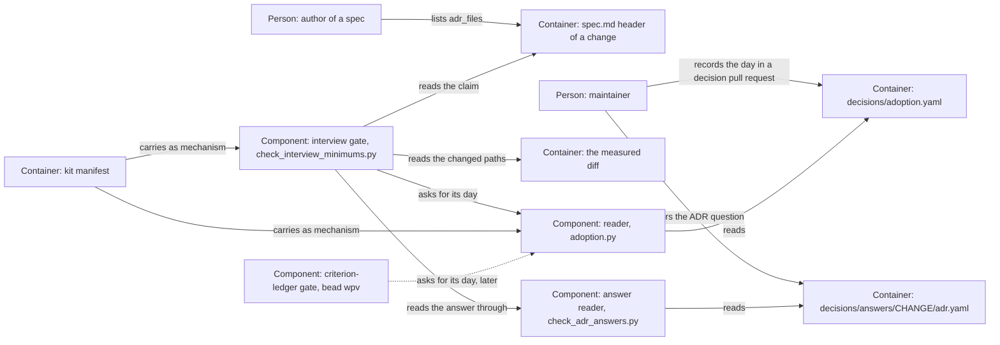

# Design — `adr-owning-change`

How the system is shaped for the change that `spec.md` describes, written from
`spec.md`, `research.md` and `decisions.md`. Phase 2b runs because the
maintainer answered "yes" to the ADR question (`decisions.md` Q-3). Where the
claim lives, what happens to an unclaimed edit, what travels and the reverse
direction are the maintainer's answers Q-1 to Q-5 and are not weighed again;
which change of a diff can claim an edit is a `[DETAIL]` of the spec. What is
left to this phase is how a repository records its adoption day, which bead
`coding-harness-wpv` asks for the criterion-ledger gate as well.

## Alternatives

- **An adoption record per repository, read by one shared reader.** A file
  `decisions/adoption.yaml` maps a gate id to the day the repository adopted
  that gate; the kit manifest gives it the role `bestand`, so it never travels,
  and `provenance.yaml` reserves it for `human-decided`. One module,
  `scripts/adoption.py`, reads it for any gate id. Consequences: every gate
  that exempts older changes reads its day the same way, and the
  criterion-ledger gate needs only its own key and one call (bead wpv); moving
  a day is a decision pull request visible in the diff; an instance must write
  the file before the gate measures there — until then the gate exits 3 and
  `make verify` is red, the cost Q-4 accepts.
- **A day in the gate list.** A field `adopted:` on the entry in
  `decisions/gates.yaml`. Consequences: no new file, but the gate list travels
  as "the same file in the target repository" (`scripts/kit/manifest.yaml`),
  so every instance would receive this repository's day, and an instance's
  own edit would be overwritten by the next kit release.
- **A day outside the tree.** An environment variable that each instance sets
  in its CI and on each machine. Consequences: nothing to commit, but the day
  is in no file a review sees, a local run and the hosted run can disagree,
  and a variable that is not set measures nothing.
- **A day derived from the history.** The date of the commit that added the
  gate's script. Consequences: no file to keep, but a shallow CI checkout
  cannot see that commit, a rebase or a re-import of the kit moves it, and the
  day the script arrived is not the day the repository decided to hold its
  changes to it.

Chosen: the adoption record per repository with one shared reader, because it
is the only one of the four that stays with its repository, is visible in a
review and cannot be moved by a kit release. The choice is a proposal; the
merge of the pull request decides it.

## Interfaces

- **The claim** — between the author of a spec (phase 2) and the gate. Passed:
  the list `adr_files` in the spec header, each item a claimable path
  (`spec.md`, "Terms"). Promised: the gate attributes each ADR edit to the
  change of the diff that claims it, and reports a claim it cannot read; the
  gate `adr-answers` ignores the field, so its reading of a feature's header
  does not change.
- **The adoption record** — between a repository's maintainer and every gate
  that exempts older changes. Passed: the gate id and its day. Promised: a
  change dated on or before that day is stock for that gate; a missing record
  or a missing day is "not measured" (exit 3), never green.
- **The reader** — between `scripts/adoption.py` and its callers, today the
  interview gate and, with bead `coding-harness-wpv`, the criterion-ledger
  gate. Passed: the repository root and a gate id. Promised: the day as a
  `date`, or one exception whose message names the record's path and the line
  to add; the reader neither writes nor guesses a day.
- **The answer** — the gate reads `decisions/answers/<change>/adr.yaml` through
  `check_adr_answers.answer_rel()` and `load_answer()`, the one reader of that
  format, and treats an answer those refuse as absent; the format itself does
  not change (Q-1).

## Data model

- **`adr_files`** in the header of a change's `spec.md` — a YAML list of
  claimable paths, in any class; absent or `[]` claims nothing. Written by the
  phase-2 author, changed by any later phase of that change, read by the gate.
- **`decisions/adoption.yaml`** — written by hand in a decision pull request,
  read by `scripts/adoption.py`:

  ```yaml
  # The day this repository adopted each gate that exempts the changes begun
  # before it (ADR 0014). Moving a day is a decision pull request.
  schema_version: 1
  adopted:
    interview-minimums: 2026-10-08
  ```

  `schema_version` is the integer 1; a day is an unquoted YAML date; a key is a
  gate id of `decisions/gates.yaml`, and a key no gate asks for is not read.

## ADR draft

Phase 4 writes the text below as `docs/adr/0014-a-change-claims-its-adr-files.md`,
with `created`, `last_reviewed`, `updated` and the date line set to the day it
writes the file. It travels in this change's pull request, which makes it a
decision pull request, and takes effect when the maintainer merges it (ADR
0008).

````markdown
---
title: "ADR 0014 — A change claims the ADR files it edits in its spec header, and the interview gate travels with the kit"
category: adr
status: accepted
created: 2026-10-12
last_reviewed: 2026-10-12
updated: 2026-10-12
owner: framework-architect
provenance: human-decided
produced_by: {kind: llm-session, name: claude-code, version: "2026-10-12"}
review: {status: pending, approved_by: null, approved_at: null}
tags: [adr, gates, interview-minimums, kit]
---

# ADR 0014 — A change claims the ADR files it edits in its spec header, and the interview gate travels with the kit

* Status: accepted by the merge of the pull request that carries this file.
  Until that merge, the pull request's state is the decision's state: open
  is proposed, closed is rejected. Amends no decision and supersedes no ADR.
* Review: the maintainer's answers of 2026-10-12 in the interview of change
  adr-owning-change, recorded as Q-1 to Q-5 in
  `plans/changes/adr-owning-change/decisions.md` — the change claims its ADR
  files in its own spec header (Q-1); an ADR edit no change claims is a
  finding, and the inference from the diff goes (Q-2); this rule gets an ADR
  and the gate travels with the kit, "Das soll auch reisen, beides" (Q-3);
  the whole gate travels, with a day per repository (Q-4); answer and claimed
  files agree in both directions (Q-5) — and the answer "yes" to the ADR
  question (`decisions/answers/adr-owning-change/adr.yaml`) · the acceptance
  is the merge commit and is written nowhere else, so the header's `review`
  stays empty (ADR 0008) · Decider: maintainer · prepared by a Claude Code
  session
* Date: 2026-10-12 · takes effect on merge

## Context

* **The interview gate infers an ADR's owner from the diff.** Every change
  folder with a file in the measured diff owns an ADR the diff changes, and
  exactly one must (`scripts/check_interview_minimums.py`, read at `2d6a1c6`).
  The duty behind it is the maintainer's of 2026-10-08: creating or changing
  an ADR owes five interview answers, whatever the change's class
  (`plans/changes/archive/2026-10-08-interview-minimums/decisions.md`).
* **The inference fails on cross-folder work.** Change criterion-test-ledger
  (bead coding-harness-909) adds ADR 0013 and migrates the plans of four other
  changes; the gate went red, and the change repaired it with an interim rule:
  a folder touched through `plan.md` alone is no owner, and beside another
  owner the ADR's text decides (pull request #126, read at `7f53552`). Any
  other cross-folder edit breaks that rule again.
* **Nothing states an owner.** `owner:` in an ADR header names a role, never
  a change (`provenance.yaml`, the roles block). An answer file binds a change
  to its answer, never an ADR to a change, and its format (`schema_version:
  1`) is shared with LakeSwitch and frozen "not now"
  (`docs/research/2026-10-11-adr-answer-pin-plan.md`).
* **A "yes" is not followed up.** `docs/WORKFLOW.md` §2 said: "Nothing checks
  … that a 'yes' is followed by an ADR."
* **The gate does not travel.** The gate list that runs it travels with the
  kit, the script does not, and its cut-off is a constant holding this
  repository's day, 2026-10-08 (`scripts/kit/manifest.yaml`, read at
  `2d6a1c6`). The criterion-ledger gate of ADR 0013 has the same constant of
  its own (bead coding-harness-wpv). LakeSwitch runs an instance of the
  workflow with changes begun before it takes the kit.

## Decision Drivers

* An ADR edit is attributed to the change that makes it, also when that change
  touches other change folders (Q-1).
* One rule, not an explicit rule beside an inference (Q-2).
* The ADR format and the answer format stay as they are (Q-1).
* The recorded answer and the ADR files of a change cannot drift apart (Q-5).
* Every repository attributes an ADR edit the same way, and adopting the gate
  does not break the changes an instance already has (Q-3, Q-4).

## Considered Options

Where the owning change is stated (Q-1):

* (1) **In the spec header of the change that creates or changes the ADR.**
  The claim lives in the change folder and is made per edit: a later change
  that amends the ADR claims that amendment itself.
* (2) **In the ADR header**, as a field naming the change. A reader of the ADR
  sees it, but an ADR has one header for every edit, so an amendment must
  rewrite it, and `owner:` there already names a role.
* (3) **In the answer file**, as a key listing the ADR paths. It changes the
  format shared with LakeSwitch, and only a feature has an answer file.

On an ADR edit no change claims (Q-2): a finding that names the remedy, with
the inference removed; or the claim beside the old inference as a fallback.

On the form and reach (Q-3): a record of its own with the gate carried by the
kit; or a rule of this repository's gate alone.

On what travels (Q-4): the whole gate, with a day per repository; the
attribution alone; or the whole gate with this repository's day.

On the reverse direction (Q-5): the gate also holds the answer to the claimed
files; or only the edit to its claim.

## Decision

Chosen: option (1), with the inference removed, the reverse direction held,
and the whole gate carried by the kit with a day per repository — because an
attribution per edit needs the claim where the edit is made, one rule is
easier to hold than an explicit rule beside a guess, and a workflow rule that
holds in one repository alone is not a rule of the workflow (Q-1 to Q-5).

**What is decided**, in five points:

1. A change claims, in the header of its own spec, every file under
   `docs/adr/` it creates, changes or removes. A later change that amends an
   ADR claims that amendment itself.
2. An ADR edit belongs to the change of the measured work that claims it. A
   change that does not claim the file is no owner of it, whatever else the
   work touches. The owner owes five interview answers of the maintainer,
   whatever its class and its date.
3. An ADR edit that no change of the work claims is a finding that names the
   remedy. Nothing infers an owner from the paths a diff touches or from an
   ADR's text.
4. For a feature begun after its repository adopted the gate, the answer "yes"
   comes with at least one claimed ADR file, and the answer "no" with none.
5. The interview gate travels with the kit as mechanism. Each repository
   records the day it adopted the gate; a change begun on or before that day
   is exempt from the class minimums and from point 4, never from points 2 and
   3. Moving that day is a decision pull request.

**How it holds from this change on:**

* The claim is the spec header field `adr_files`; the gate
  `interview-minimums` (`scripts/check_interview_minimums.py`) holds points 2
  to 4.
* The day stands in `decisions/adoption.yaml`, a file that stays in its
  repository; this repository's day is 2026-10-08, the day it adopted the
  gate, so no change here moves between stock and subject. The gate reads the
  day through `scripts/adoption.py`, which any other gate can call with its
  own id (bead coding-harness-wpv); without the record the gate does not
  measure (exit 3).
* The gate script, its test, the reader and the reader's test travel as
  mechanism (`scripts/kit/manifest.yaml`); the record stays as stock. An
  instance such as LakeSwitch receives them with its next pinned Coding
  Harness release (bead coding-harness-dj9).

**What this record does not fix.** The field's name, the record's name and
form, the reader and the gate's messages are the change's design: they change
in an ordinary change as long as the five points hold.

This record amends no D- or O-number. It replaces the attribution of the
archived change interview-minimums — the change folders a diff touches — and
the interim rule of pull request #126; ADR 0013 is unchanged.

## Consequences

* **Even a typo fix in an ADR needs a change folder** whose spec claims the
  file and whose interview carries five answers (Q-2).
* **An amendment costs one header line** in the amending change's spec;
  nothing else in the tree moves.
* **criterion-test-ledger claims ADR 0013** in the pull request that carries
  this record; its answer is already "yes", so answer and claim agree.
* **Each instance writes one file** before the gate measures there; until
  then the gate exits 3 and `make verify` is red (Q-4).
* **The day exempts, it does not excuse an ADR edit.** A change begun before
  an instance's day that edits an ADR after it claims the file and owes five
  answers, as a change of this repository's stock does today.
* **What stays unheld.** That a claimed file exists — a change claims its ADR
  in phase 2 and writes it in phase 4; that an `architectural` change claims
  its ADR; that a class is right, or that a decision pull request carries its
  label and block. An archived change is no claimant, also when the same pull
  request archives it.
* **The criterion-ledger gate keeps its own cut-off** until bead
  coding-harness-wpv makes it read the record.

## Validation

* The gate `interview-minimums` is green at the head of the pull request that
  carries this record: this change claims ADR 0014, criterion-test-ledger
  claims ADR 0013.
* The gate's tests hold the five points: an unclaimed ADR edit is reported; a
  claimant beside four unclaiming folders is decided by its own answers; two
  claimants of one edit are reported; a "yes" without a claim and a "no" with
  one are reported; a missing record exits 3; the gate's mutation test stays.
* The empty-repository probe (gate `leerprobe`) is green with the gate's test
  and the reader's test, and its exemption list does not grow.
* Not validated by this record: an instance running the gate. That comes with
  the release of bead coding-harness-dj9.
````

## Architecture delta



**Added**

- The claim, `adr_files` in a spec header, and the gate's reading of it.
- The adoption record `decisions/adoption.yaml`, and the reader
  `scripts/adoption.py` with its relationship to the record.
- The gate's relationships to the reader and to the answer reader, and the
  agreement of answer and claim it holds.
- The kit's relationships to the gate and to the reader: both travel as
  mechanism.

**Changed**

- The interview gate attributes an ADR edit to its claimant among the changes
  of the diff, where it took every change folder the diff touches.
- The interview gate takes the day that separates stock from subject from the
  record, where it held a constant.

**Removed**

- The inference "a change folder the diff touches owns the ADR", and the
  interim rule of pull request #126 — a folder touched through `plan.md`
  alone, and the ADR text deciding between candidates.
- The constant `CUTOFF` in `scripts/check_interview_minimums.py`.
