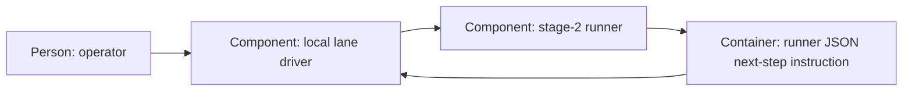

# Design — `advance-verb`

## Alternatives

- A separate local lane driver consumes the runner's instruction: one additional entry point, with the runner retaining its model-call safeguards.
- A runner verb drives the lane: fewer entry points, but adds lane coordination to the existing runner.

Chosen: the separate driver, as the maintainer decided in `decisions.md` Q-2; the decision pull request makes the architecture effective.

## Interfaces

The operator invokes the local driver with an optional change. The driver reads local lane membership and the schema-validated instruction in `next.json` beside the runner record for each named worktree; it starts allowed steps as separate runner child processes in that worktree. The dependency `ladder-next-step` owns the JSON instruction contract and records a hand instruction for held rows. The runner retains its checks, locks, commits and pushes. Stops are reported on standard error; the future job launcher owns its own record.

## Data model

The driver owns `${XDG_STATE_HOME:-~/.local/state}/coding-harness/lanes.json`: a schema-validated JSON array of change, worktree and optional park reason; its `add`, `remove`, `clear` and `hold` subcommands manage entries and marks under the same locks as `advance`. A missing file represents an empty list. A central repository setting carries allowed and counted verbs and both per-lane limits; the driver validates it before acting. The runner alone writes `next.json` and remains the next-step decider; its written time is part of the content compared after a step. A per-lane lock covers lane work; contention is skipped without blocking and reported on standard error. The current entry and mark are reread under that lock, and a file lock serializes atomic lanes-file replacements. A successful step reaching either limit ends the lane before the next instruction is read. A signalled child is a failed step and parks the lane; runner refusal stops it without parking. The night routine shares this machine-local file across runs.

## ADR draft

**Proposed amendment to ADR 0021** (decisions.md Q-1, Q-4 and Q-15; effective only on merge). Carried into ADR 0021 as its lane-driver amendment by the orchestrator on 2026-11-24 (Q-26).

### Context

At baseline `17d1e15f20c9`, the runner names a next step but does not start it; waiting for a hand start leaves lanes idle (research.md; decisions.md Q-1).

### Decision Drivers

- Continue authorized lane work without a hand start while retaining the runner's safeguards.

### Considered Options

- A separate driver starts the recorded step, preserving the runner's responsibilities but adding a local entry point.
- The runner only names the step, preserving the current boundary but leaving lanes waiting for a person.

### Decision

Propose the separate local driver. It may start only `repair`, `review`, `review-loop`, `release-loop`, `prepare-loop` and `implement` as separate runner processes from the recorded instruction. Adding another verb requires a further amendment. The runner's existing checks, locks and stops remain effective.

### Consequences

The driver and machine-local lane state need maintenance; the runner remains the decision maker for the next step.

### Validation

The phase-6 review checks the amendment and retained stops; the driver tests check admission and child-process invocation.

## Architecture delta

**Added**

- The driver reads local lane membership and consumes the runner's next-step instruction.

**Changed**

- The separate driver can start the named runner step within a central per-call bound.

**Removed**

- Nothing: the runner remains the next-step decider and owner of its safeguards.
