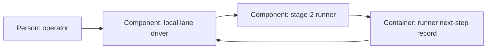

# Design — `advance-verb`

## Alternatives

- A separate local lane driver consumes the runner's instruction: one additional entry point, with the runner retaining its model-call safeguards.
- A runner verb drives the lane: fewer entry points, but adds lane coordination to the existing runner.

Chosen: the separate driver, as the maintainer decided in `decisions.md` Q-2; the decision pull request makes the architecture effective.

## Interfaces

The operator invokes the local driver with an optional change. The driver reads local lane membership and the latest instruction in the runner record for each named worktree; it starts allowed steps as separate runner child processes in that worktree. The dependency `ladder-next-step` owns the instruction grammar and records `next: hand` for held rows. The runner retains its checks, locks, commits and pushes. Stops are reported on standard error and in the job record.

## Data model

The driver owns `${XDG_STATE_HOME:-~/.local/state}/coding-harness/lanes.yaml`: an ordered list of change, worktree and optional park reason; a stop persists the reason until the orchestrator clears it. A central repository setting carries the allowed verbs, counted verbs and per-lane limit; the driver validates it before acting. The runner alone writes its loop record and remains the next-step decider.

## ADR draft

The proposed amendment to ADR 0021 states: a separate local lane driver may start the runner's recorded, allowed next step in a child process; the runner's checks, locks and other stops remain in force. The maintainer chose an amendment of ADR 0021 and explicitly no new ADR (decisions.md Q-4). The runner instruction requiring a new ADR file conflicts with that answer; this draft does not claim that the maintainer changed it.

## Architecture delta

**Added**

- The driver reads local lane membership and consumes the runner's next-step instruction.

**Changed**

- The separate driver can start the named runner step within a central per-call bound.

**Removed**

- Nothing: the runner remains the next-step decider and owner of its safeguards.
