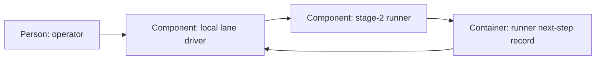

# Design — `advance-verb`

## Alternatives

- A separate local lane driver consumes the runner's instruction: one additional entry point, with the runner retaining its model-call safeguards.
- A runner verb drives the lane: fewer entry points, but adds lane coordination to the existing runner.

Chosen: the separate driver, as the maintainer decided in `decisions.md` Q-2; the decision pull request makes the architecture effective.

## Interfaces

The operator invokes `scripts/lanes.py advance` with an optional change. The driver reads the local lanes file and the runner's authoritative next-step record, validates the instruction, and invokes `scripts/stage2.py` with the named verb and change. The runner retains locks, checks, commits and pushes; the driver reports stops. The exact record location and hand-step signal must follow the landed `ladder-next-step` contract, rather than being invented here.

## Data model

The driver owns the lanes-file parser and its local format. It reads the runner's existing record and writes no lifecycle fields; any lane log reports stops rather than becoming a second decision source. The central step limit defaults to two.

## ADR draft

The maintainer chose an amendment to `docs/adr/0021-review-swarms-until-clean.md` and no new ADR (`decisions.md` Q-4). The amendment must permit the separate driver to start the named step without changing the runner's existing stops. A new ADR draft conflicts with that recorded decision and the runner's instruction to create exactly one new ADR draft; this needs resolution before this design is final.

## Architecture delta

**Added**

- The driver reads local lane membership and consumes the runner's next-step instruction.

**Changed**

- The separate driver can start the named runner step within a central per-call bound.

**Removed**

- Nothing: the runner remains the next-step decider and owner of its safeguards.
