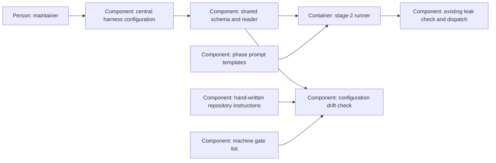

# Design — central-config

Shape the first slice of `spec.md` from `research.md` and the five answered
records in `decisions.md`. Only the writing-session setting migrates now.

## Alternatives

- **Topic files, one strict reader, explicit bindings** (chosen): YAML stays
  small; a shared typed schema owns the contract, and prompts/prose reference
  keys. Each migration must inventory its consumers and remove old authority.
- **Keep independent readers behind a common directory:** smaller initial
  moves, but validation still differs by topic and duplicated defaults survive.
- **Generate documentation and store prompt text in the configuration:** less
  hand-editing, but contradicts the maintainer's values-only and hand-written
  prose answers. Rejected by Q-1 and Q-3, not offered as a new decision.

The chosen mechanism is a proposal until the decision pull request merges;
the recorded maintainer direction is not reopened.

## Interfaces

- **Files → reader:** `scripts/harness_config.py::load(root)` reads
  `config/harness/*.yaml` from the supplied worktree, rejects unknown topics,
  and returns an immutable validated snapshot. No global cache, search of
  sibling repositories, environment overlay or fallback defaults.
- **Schema → reader/checker:** strict frozen Pydantic models in that same
  module are the one schema; the already pinned dependency is sufficient.
  `HarnessConfig` initially requires only `lanes: LaneSettings`; both forbid
  extra fields. The file-to-topic mapping is part of this shared contract.
  Safe YAML parsing also rejects duplicate keys and merge keys before typing.
- **Templates → runner:** `{{ harness.lanes.writing_sessions_per_repository }}`
  is a reserved text substitution, not Jinja evaluation. An unknown or malformed
  `{{ harness.` token refuses. Literal insertion supports owned scalar values;
  list formatting waits for an actual list consumer. `work_prompt` renders the
  implement template using one snapshot before the existing `checked_prompt`
  path checks the exact outgoing text. Configuration bytes join the existing
  prompt-input snapshot so an attempt cannot redefine its own inputs.
- **Prose → checker:** `<!-- harness-config: lanes.writing_sessions_per_repository -->2<!-- /harness-config -->`
  marks the existing default count in `AGENTS.md`. The checker owns the
  expected path/key occurrence inventory, so deleting the marker cannot waive
  it. It compares normalized scalar text and refuses unknown/malformed markers.
- **Checker → gates:** `scripts/check_harness_config.py --check` validates
  the files, required bindings and duplicate declarations; exit 0 is measured
  agreement, exit 1 is drift, exit 3 is unreadable evidence. Runner consumers
  translate configuration errors into their existing refusal before dispatch.
  The gate list stays at its current path and generates the hosted wiring.

## Data model

`config/harness/lanes.yaml`, edited through a pull request, initially contains
only `writing_sessions_per_repository: 2`. The schema requires a strict integer
greater than zero; no schema default repeats the value. No document metadata,
prompt body, credential or reserved empty topic is stored beside it.

The binding inventory in the reader module contains paths and key references,
never setting values: the `AGENTS.md` marker, the implement-prompt placeholder,
and canonical/uppercase names scanned for numeric assignments in live Python.
The check scans `scripts/`, `tools/` Python and registered prompt/prose sites;
test fixtures and historical documents are outside duplicate-value scanning.
Tests intentionally use independent expected values and fault fixtures.

The same schema gains required typed topics only when their consumers migrate:

1. Skeleton and writing-session value, this slice.
2. Models/routes and the endpoint register; existing endpoint/data-class,
   terms, access-policy and leak checks retain their semantics.
3. Review seating and round/routing values, coordinated with the neighbouring
   review-loop change (`plans/changes/review-loop-deep-a/spec.md`).
4. Limits, including the existing swarm limits, followed by watchdog,
   heartbeat, size and metrics/decision-rule settings as their consumers land.
5. Gates last: move the list and change its reservation and CI readers in a
   separate decision pull request, retaining the single-list invariant.

Old paths are removed only in their migration's pull request after all live
readers switch. Temporary adapters may delegate but may not copy values.
The parent task stays open until the ordered migrations are complete.

## ADR draft

Exactly one new draft, `docs/adr/0026-one-central-harness-configuration.md`,
uses `templates/adr.md`. It records the maintainer's five answers, the staged
rollout and preserved admission/governance boundaries. No existing ADR is
amended and no ADR answer record is written; merge is the acceptance.

## Architecture delta

**Added**

- Central values, shared validation, text binding and a measured drift check.

**Changed**

- The implement prompt reads the writing-session value; its documented default
  becomes a checked literal. This adds no session scheduler or enforcement.
- Local/hosted verification runs the new check through the existing gate list.

**Removed**

- Independent authority of the session-limit literal in `AGENTS.md` only;
  its readable display remains. No existing configuration file is removed yet.
