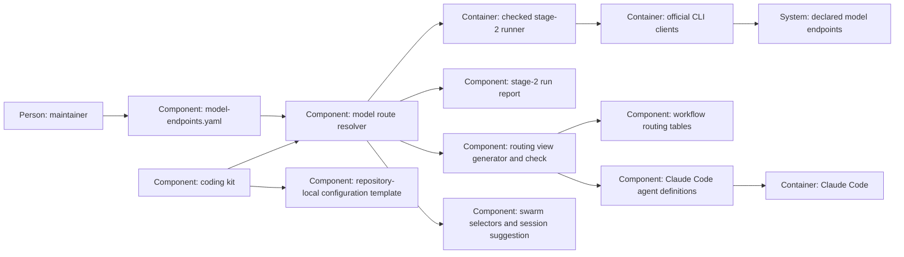

# Design — central-models

This shapes the shared selection authority requested in Q-1 to Q-5, within
the contracts of [spec.md](spec.md). The repository evidence and additional
reader/kit findings are in [research.md](research.md).

## Alternatives

- **Read the setting at the consumer boundary.** One resolver validates and
  returns selections to runner verbs, reporting and adapters; a generator
  materializes the tables and native agent fields. A source edit takes effect
  in the next invocation, and generated drift is caught before merge. It
  requires consumers to pass their repository root and resolved selection.
- **Generate runnable selection constants.** Generate a Python module beside
  the tables and agents. Import sites change less, but running a stale module
  uses a stale selection, and reporting another revision needs a second reader.

Chosen: read at the consumer boundary, because it gives every invocation and
revision the same authority without another executable copy. Native agent
files are necessarily materialized: the workflow documents that a new session
reads their frontmatter. The choice is proposed until the decision PR merges.

## Interfaces

- **Setting to reader:** `scripts/model_routes.py` loads a supplied root's
  `model-endpoints.yaml`, using the strict duplicate-key loader already exposed
  by `check_adr_answers.py`. Immutable selections carry `endpoint`, `model`,
  `effort`, `display` and their role; ladder queries return ordered selections.
  There is no import-time read, cached global route or built-in model fallback.
- **Reader to clients:** the runner chooses a binding by verb, then passes
  its resolved selection explicitly through preflight, audit and the matching
  launcher. Dispatch uses endpoint transport/capabilities, not equality with
  the removed `CODEX` or `GLM` tuples. Codex receives the selection's effort,
  Claude Code receives `--effort` when specified, and Pi receives configured
  thinking with its existing documented clamp. The supported transport set
  remains the existing one; adding a provider or transport is separate work.
- **Reader to humans and harnesses:** the read-only CLI offers `--route NAME`,
  `--agent NAME`, `--ladder NAME` and `--session-default`, with JSON selections
  and no client launch. Session suggestions include explicit runner arguments;
  the session verb still requires `--model`. An optional session `--effort`
  carries a suggested effort when set, without overriding an explicit model.
- **Setting to generator:** `scripts/render_model_routes.py` replaces exactly
  one marked table in each of workflow sections 3 and 4 and only the generated
  `model`/optional `effort` fields of each agent. `--write` is deterministic;
  `--check` writes nothing, checks configuration, markers, agent bindings and
  prompt/instruction role references, and returns 1 for drift/invalid content
  or 3 when input cannot be measured. The gate is declared once in
  `decisions/gates.yaml`; the CI is regenerated from that declaration.
- **Revision to reporting:** `stage2_runs.Source` supplies the declaration
  text at the requested revision to the same parser. Today's Python imports
  never supply yesterday's route values; counting old audit formats stays
  separate from checking current bindings.
- **Kit to target:** the portable resolver, runner, generator and dependencies
  travel together. The template offers role/effort defaults with unset model
  bindings and empty endpoint approvals. Targets must supply their own
  selections and approvals; the kit neither launches nor grants clearance.

## Data model

Extend the existing declaration to `schema_version: 2`; keep the current
`datenklassen`, `endpunkte` and `ausgeschlossen` meanings and values. Add these
English-keyed sections, edited only by the repository's maintainer:

| Section | Fields and meaning |
|---|---|
| `models` | Stable profile key to `{endpoint, model, display}`; every exact identifier must occur in that endpoint's permission list. Shared profiles let one model edit move several roles. |
| `routes` | Stable role key to `{model: profile, effort: value-or-null}`; an optional `fallback` and `stage1` reference another role. A role can instead name `ladder`, or explicitly declare `model: null` when deterministic. |
| `agents` | `default: role` and optional `overrides: {agent-name: role}` for all seven native definitions; unknown agent names are errors. |
| `ladders` | Name to a list of `{model: profile, effort: value-or-null}` in execution order; an empty swarm list is explicitly unconfigured. |
| `session_default` | Role reference for a suggestion on a supported interactive transport. |

Required workflow roles cover runner explore, draft, implement, spec review,
repair, final review, review loop and probe; the manual interview, draft,
review and commit roles; the agent default and session suggestion; and explicit
deterministic verify/release roles. Phases 2, 2b and 3 share `draft` and its
manual counterpart. The job prompt without a fixed model names an explicit
job-configured reference instead of creating a model binding.

Fallback references choose models, not retry policy: draft, implement and
repair still take primary, primary, fallback after post-check failures;
explore has only its explicit Stage-1 route. `draft.stage1` describes the
existing manual route and does not enable `draft --stage2-off`. Validation
rejects missing bindings, cycles, unknown profiles, duplicate keys, invalid
types, unsupported transport/role combinations and invalid effort values.
`null` effort means omit the effort override; it is distinct from an absent
required `effort` field. Endpoint clearance is checked for the content being
handled, with the runner's existing framework-only contract intact.

Seed the current live selections without changing their values: shared author
profile for draft/repair/final review, reserve author for draft fallback,
light and worker profiles for Stage 1, a strong reader/manual author, and a
separate older agent-worker profile. The `review-loop` ladder copies the three
current Go members in their current order and requested effort. The
`research-swarm` and `review-swarm` lists begin empty; future membership is not
inferred from approval-list contents. The session suggestion uses the already
permitted author profile with unspecified effort, preserving the client's
present default until the setting deliberately assigns one.

The generator owns just table blocks and native selection fields, with a
generated marker identifying the central source. Agent names, descriptions,
tools and bodies are preserved byte for byte. Prompt references and workflow
row mappings identify roles and phase semantics; they contain no model values
and are validated for completeness, so a vanished reader cannot turn a test
green by finding nothing.

`templates/model-endpoints.yaml` is a non-executable starting template: the
same role names and effort defaults, unset profile selections and no approved
endpoints. It is intentionally not valid for launching; configuring it is a
target repository's work. No registry, secrets or user-global setting is added.

## ADR draft

Exactly one new draft is [ADR 0018](../../../docs/adr/0018-models-fill-configured-workflow-roles.md),
in the form of `templates/adr.md`. It amends the concrete selection authority
of ADRs 0007, 0011, 0016 and 0017, retaining their role, evidence, freshness,
retry and safety contracts. Implementation adds dated amendment notices to
those four records and preserves their historical text. No D- or O-number's
contract changes, so the decision-continuity map is not edited.

## Architecture delta

**Added**

- Shared resolver, central role bindings, independent named ladders and
  non-launching selection queries.
- Generator/check relationships to workflow tables and native agent fields,
  plus a portable unconfigured template.

**Changed**

- Runner and report resolve their own repository/revision rather than import
  model tuples; transport adapters receive explicit selections.
- Documentation and agents consume role bindings, and the kit carries the
  mechanism while each repository owns its approvals and selections.

**Removed**

- Model/effort constants, model-dependent kit test identifiers, guessed display
  resolution and permission-list ordering as a routing authority.
