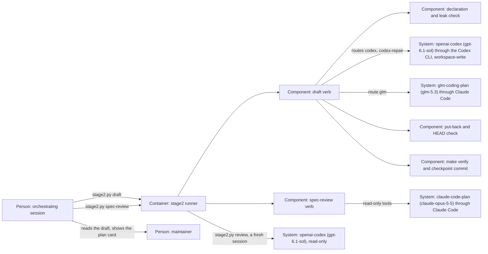

# Design — `codex-drafts`

How the runner is shaped for the `draft` verb and the Opus spec review of
`spec.md`, written from `spec.md`, `research.md` and `decisions.md`. Phase 2b
runs because the class is `feature` and the ADR question is proposed "yes".
What Q-3 to Q-5 fixed — a writing runner verb with `implement`'s guards, the
four checks of a draft, the chain Codex, Codex repair, GLM 5.3 — is not
weighed again.

## Alternatives

Four choices shape the change.

**How many calls one attempt makes.**

- **One call writes spec, design and plan.** Consequences: the drafter holds
  the research, the spec it wrote and the plan in one context, so the plan's
  ledger meets the spec's criteria; one attempt is one Codex call against the
  subscription's limit; the 2a review comes after the whole draft, which is
  what Q-4 presupposes ("reads the whole draft before the review").
- **Three calls, one per phase.** Consequences: each call carries one phase
  prompt, but three calls per attempt triple the limit Codex spends, a failed
  plan call leaves a spec without a plan, and the put-back and `make verify`
  would run three times.

**Who runs the Opus spec review.**

- **The `spec-review` verb, through Claude Code headless** — the launch
  `run_work_model` already makes for explore and the Sonnet fallback, with
  read-only tools. Consequences: the prompt is the 2a prompt in full and
  nothing else, whatever the orchestrating session read while checking the
  draft; the rows land in the runner's form, which `scripts/stage2_runs.py`
  counts; it runs unattended. About twenty tests that drive `spec-review`
  through a Codex stand-in move to a Claude stand-in.
- **The orchestrating session, as a sub-agent on the Claude path of
  `prompts/02a-spec-review.md`.** Consequences: no runner code and no test
  churn, but the sub-agent's prompt is whatever the orchestrator writes after
  reading the draft, rows are typed by hand, and nothing runs without that
  session.

**Who works the 2a rows in.**

- **A second `draft` run, by the drafting model.** Consequences: the author
  works the rows in, as `prompts/02-spec.md` says; no Claude tokens; Codex
  judges rows against its own spec, the cost Q-1 accepted.
- **The orchestrating session.** Consequences: an independent hand on the
  rows, but Claude tokens for the spec, the design and the plan once more —
  against the purpose of the change.

**What `make verify` may leave red.**

- **Nothing but this change's own missing ADR answer**, read from the
  `adr-answers` section of the run's output. Consequences: a feature can be
  drafted unattended; the commit lands with one known red gate, and the
  orchestrating session records the maintainer's answer afterwards.
- **Nothing.** Consequences: every feature draft fails three attempts, since
  no drafter may write the answer.
- **A gate that skips a pending answer.** Consequences: a change of the gate
  and of `decisions/gates.yaml`, a governance act for a runner's convenience.

Chosen: one call per attempt, `spec-review` through Claude Code, a second
`draft` for the 2a rows, and the one tolerated red gate — because each keeps
the drafting off Claude tokens while the review reads a fixed prompt. The
choices are a proposal; the merge of the pull request decides them.

## Interfaces

- **Command line** — `python3 scripts/stage2.py draft <change>`: exit 0 after
  its one commit, 1 when every attempt failed or `HEAD` moved, 2 when it
  refused, the reason on standard error. `spec-review <change>` keeps its
  name and exit codes.
- **Runner → Codex** (`codex exec`, worktree as directory, empty standard
  input, the allow-list environment) — the prompt as the last argument; the
  flags of criterion 1; Codex writes files inside its sandbox and its final
  message to the answer file, which the runner requires and does not keep.
- **Runner → Claude Code against Z.ai** (the GLM attempt) — the launch of
  `implement`'s Flash attempts with `glm-5.3`: the prompt file, the tools
  `Read,Grep,Glob,Edit,Write`, the GLM key in its environment only.
- **Runner → Claude Code against Anthropic** (the spec review) —
  `claude-opus-5-5`, effort `xhigh`, tools `Read,Grep,Glob`, the maintainer's
  own sign-in, no key from the secrets file.
- **Runner → git** — the baseline, the put-back of paths outside what a draft
  may write, the `HEAD` check, one commit as `stage2-runner`.
- **Runner → `make verify`** — run as `implement` runs it; the `adr-answers`
  section of its standard output is read for criterion 13.
- **Orchestrating session → runner** — between the two `draft` runs the
  orchestrating session reads the draft, records the ADR answer the
  maintainer stated (`scripts/harness.py decide adr`), commits, runs
  `spec-review`, settles every `[AMBIGUITY]` with the maintainer, and commits
  again; after the second run it shows the plan card unchanged.

## Data model

Nothing new is stored; four records gain entries.

- **`findings.md`** — per draft attempt an audit line with the verb `draft`
  and the route `codex`, `codex-repair` or `glm`; a quoted block for a failed
  attempt; a quoted line naming each path put back; one line saying the ADR
  answer is owed when criterion 13 applied. The spec review's block is
  headed `## Phase 2a — Opus 5.5, <date>`, its rows' Reviewer is `Opus`, and
  it has no session line. A header the spec review creates names
  `claude-code`.
- **The 2a rows' Status cell** — the second `draft` run writes `in spec` or
  `rejected — <reason>`, as `prompts/02-spec.md` asks of the author.
- **The change folder** — `spec.md`, `design.md` when due and `plan.md`, as
  the three prompts and the templates shape them; `plan.md` opens with the
  card and carries `## Time used`.
- **git history** — one commit `docs(<change>): draft spec and plan — route
  <route>`, author `stage2-runner <stage2-runner@invalid>`, per passing draft
  run.

## ADR draft

[`docs/adr/0016-codex-drafts-and-opus-reviews-the-spec.md`](../../../docs/adr/0016-codex-drafts-and-opus-reviews-the-spec.md),
in the form of `templates/adr.md`, travels in this change's pull request,
which makes it a decision pull request. It amends ADR 0007 (decision 2, what
goes to Codex and to GLM; decision 4, the reads now joined by an unattended
Codex that writes) and ADR 0011 (decision 2, the spec review and the resume),
and takes effect when the maintainer merges it (ADR 0008). The number is 0016
because the open branches `feat/adr-owning-change` and `feat/stage2-repair`
hold 0014 and 0015.

## Architecture delta

**Added**

- The `draft` verb of the stage2 runner, with its routes to `openai-codex`
  (workspace-write) and to `glm-coding-plan` on `glm-5.3`.
- The put-back of paths outside the change folder (and of `decisions.md`),
  the `HEAD` check, and the reading of the `adr-answers` section of
  `make verify`.
- The edge from the runner to `claude-code-plan` on `claude-opus-5-5` for the
  spec review.

**Changed**

- `spec-review` starts Opus 5.5 through Claude Code instead of Codex.
- `review` starts a fresh Codex session for every change whose 2a ran on
  Opus; it still resumes a recorded Codex 2a session.
- The routing of `docs/WORKFLOW.md` §3 and §4, `AGENTS.md`, the three
  endpoint remarks and the phase prompts' Model lines.

**Removed**

- The Codex spec review (phase 2a) and the phase-6 resume of a 2a session
  for changes reviewed after this one.
