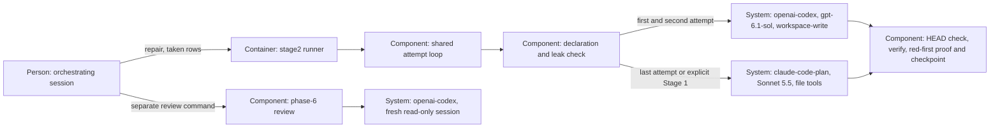

# Design — `codex-repairs`

The existing repair verb changes its transport while retaining the evidence
and checkpoint boundary ([spec.md](spec.md), [research.md](research.md),
[decisions.md](decisions.md)). The interview's model and fallback choices are
settled; the alternatives below concern the shape of the implementation.

## Alternatives

- **Dispatch Codex within the shared attempt loop.** Both writing verbs retain
  one preparation, verification, diagnostic and checkpoint path. Only repair
  supplies Codex routes; implement retains its Flash routes. A dispatch bug
  could affect implement, so its existing tests remain part of verification.
- **Give repair a separate Codex loop.** The existing implement loop stays
  isolated, but repair duplicates status restoration, red-first evidence,
  derived-file preparation and checkpoint ordering, making later fixes liable
  to differ between writers.

Chosen: transport dispatch in `run_attempts`, because it carries the existing
repair protections to Codex without duplicating them. This is a proposal for
the change's pull request. Dispatch uses `endpoint == CODEX`; the drafting
loop remains separate because its failed-call continuation differs from
repair's deliberately stopping behavior.

## Interfaces

- **Orchestrator → runner:** the existing `repair <change>` command, statuses,
  exit codes and `--stage2-off <reason>` interface stay. Completed post-run
  failures advance through Codex, Codex, Sonnet; call failures and leak blocks
  stop. The orchestrator decides the rows and separately starts the re-check.
- **Runner → Codex CLI:** call `run_codex(..., writable=True)` without resume,
  consume the answer-file text and discard the repair thread id. Use its
  existing environment allow-list and writing configuration; no GLM key is
  read. The repair prompt permits tests and `make verify`, prohibits commits,
  git commands that change the repository and edits to findings, and asks for
  a measured time entry and one fixed line per taken row. These are
  instructions, not a claim that Codex has no command tools.
- **Runner → Claude Code:** the existing Sonnet 5.5 transport with file tools
  only, no Z.ai credential, at effort `medium`. The explicit Stage-1 route
  records the caller's reason; the post-check fallback records its cause.
- **Runner → git and checks:** before any Codex-call restoration or post-run
  operation, compare HEAD to the invocation baseline and stop if it moved.
  With unchanged HEAD, retain failed-call restoration and the existing
  preparation, formatting, `make verify`, time check, answer check, red-first
  proof, finding-status write, checkpoint and private-record write ordering.
- **Runner → phase-6 reviewer:** the repair starts no review. A later `review`
  after an earlier `## Phase 6` block in `findings.md` starts a fresh read-only
  Codex session without resume, even if a historical Codex phase-2a session
  exists; loop marks still resume that new verdict's thread only after the
  verdict. The first phase-6 review retains its historical phase-2a
  compatibility when no earlier `## Phase 6` block exists.

## Data model

No record schema is added. Audit lines retain verb, attempt, route, endpoint,
model, optional reason and leak-check counts; their routes become `codex`,
`codex-repair` and `stage-1`. The existing run-count parser already accepts
the Codex endpoint. Historical GLM lines remain readable; the obsolete comment
that GLM currently routes repair is corrected without changing that parser.

The plan's route block and measured-time section, quoted failed-attempt
blocks, fixed-status forms and loop-record fields stay as they are. Repair
threads are not stored as reviewer sessions. An earlier `## Phase 6` block in
`findings.md` selects a fresh re-check regardless of the rows' Status, with
no new metadata or answer file. The supersession marker on ADR 0015 is added
in phase 4; this drafting call writes only the new ADR file.

## ADR draft

[ADR 0017 — Codex repairs the taken findings](../../../docs/adr/0017-codex-repairs-taken-findings.md)
is the one new draft, in the form of `templates/adr.md`. It supersedes ADR
0015, restates its retained repair contract and explicitly permits the same
model to repair phase-6 findings when a fresh session re-checks them. The
maintainer's five interview answers choose the direction; acceptance remains
the merge, with no ADR answer recorded here. No D- or O-number changes, so
the continuity map does not move.

## Architecture delta

**Added**

- Codex transport dispatch in the shared attempt loop and its moved-HEAD stop.
- A fresh-session override for re-checking repaired phase-6 rows.

**Changed**

- Repair's first two attempts go to `openai-codex`; Sonnet remains last.
- Current doctrine records the same-model exception and configured writing
  access; the runner does not measure Codex's sandbox or confine its reads.

**Removed**

- The repair edge to `glm-coding-plan` and its GLM credential requirement.
- The blanket same-model prohibition for repairs; review calls stay read-only.
