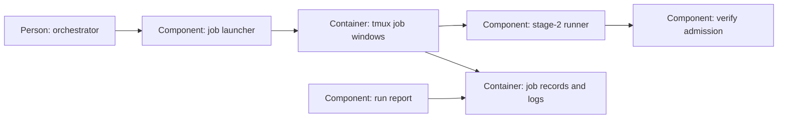

# Design — detached-job-launcher

## Alternatives

- A tmux window per job with a durable record: observable across sessions, with tmux as a prerequisite.
- An independent process session: fewer dependencies, but live observation and lifetime management require separate facilities.

Chosen: tmux and durable records, as the maintainer chose in `decisions.md` Q-2 and Q-4; merge of the decision pull request gives it effect.

## Interfaces

- Caller → `scripts/jobs.py`: start accepts an argument vector and working directory, list reads records, stop identifies one job; arguments must retain their boundaries.
- Launcher → tmux: one unique window hosts a wrapper and the command; the wrapper owns terminal result publication after the launcher exits.
- Wrapper → state store: a unique record and log persist under `${XDG_STATE_HOME:-~/.local/state}/coding-harness/jobs/`; report reads them without writing lane state.
- Command → verification: verification enters the existing `verify_lock` path itself; the launcher neither pre-acquires nor bypasses the admission.
- Kit → destination: launcher and its imports travel as mechanisms; tmux remains a host prerequisite.

## Data model

One JSON record per generated job ID stores the argument vector, working directory, window identity, start time, end time, exit code and log path. The launcher creates it before launch; the wrapper atomically publishes completion. A missing completion is not proof of success: list reconciles it with the actual window and reports an unknown outcome if the window disappeared. The log captures both output streams. Distinct IDs and atomic replacement prevent simultaneous jobs from overwriting one another.

## ADR draft

The proposed decision is `docs/adr/0026-detached-job-launcher.md`; its acceptance is the merge, not this draft.

## Architecture delta

**Added**

- Launcher, per-job tmux window and durable job records and logs.

**Changed**

- The report also reads job state; detached runner commands retain the existing verify admission.

**Removed**

- The restriction on headless jobs in the two earlier night-run scopes, once the decision is merged.
