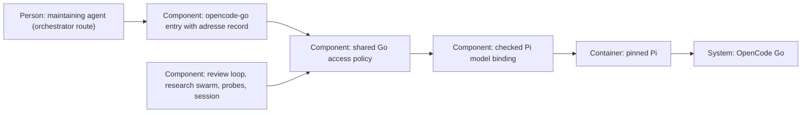

# Design — go-access-point

How the system is shaped for what `spec.md` describes, written from
`spec.md`, `research.md` and the five answered records of `decisions.md`,
inspected at `b126fce7` on 2026-10-31. What the spec fixes is not decided
again here.

## Alternatives

- **One imported policy module with thin Pi adapters.** A new
  `scripts/stage2_go.py` reads the address record from the provider entry
  and assesses definitions; every launcher imports it. Consequences: one
  rule everywhere, the research refusal dissolves, and the review loop
  gains the check DL-B-8 asks for — at the price of migrating every
  launcher, including the interactive session, and of the review loop
  starting to refuse rows it accepts today.
- **One policy command returning JSON.** The same rule, but launched as a
  subprocess per assessment, so callers in other languages could share it.
  Consequences: process startup and a second failure mode on every
  assessment; no current caller needs it — every admission caller is
  Python, and the one JavaScript bridge checks catalog sources, not model
  addresses.
- **A research-only allow-list.** Widen `pi_reason` to a second literal
  path. Consequences: the swarm runs again within one function, but two
  truths remain and DL-B-8 stays open — it fails Q-1's all-paths answer.
- **A warn-only interim.** Compare and warn, refuse nothing. Consequences:
  no standstill, but a foreign host still receives content — it fails
  Q-2's refusal answer.

Chosen: the imported policy module, because all runner admission callers
are Python and the record already has a home — the provider entry. The
choice is a proposal; the merge of the pull request decides it.

## Interfaces

- **Provider entry → policy:** one strict loader reads the `adresse` part
  of the uniquely named `opencode-go` entry, rejects duplicate YAML keys,
  duplicate endpoint entries, unknown address fields and bases not on the
  admitted host, and returns an immutable policy. When this fails, Go
  admission fails with a diagnostic;
  no code literal and no cached snapshot supplies a policy. The policy is
  read again at dispatch, not only at preparation.
  The existing `endpoint_entry` uses `yaml.safe_load`, which loses
  duplicate-key evidence; assessment therefore loads the original YAML
  with a duplicate-rejecting loader rather than validating its result.
- **Model definition → policy:** `assess(policy, model, definition)`
  returns an explicit effective definition and an optional move notice, or
  a refusal with a model-specific, sanitised reason. Its URL parser
  requires HTTPS, the exact admitted host and the default port, forbids
  userinfo, query, fragment and parser-confusing characters, and
  normalises only the comparison, never the catalog's target. An absent
  base takes that wire API's recorded default; an invalid explicit base is
  never repaired by fallback; an unknown explicit API may keep a valid
  explicit base where the caller's own API rules permit it, but receives
  no invented default.
- **Policy → selectors and overlays:** selectors exclude refused rows
  locally; overlay writers install only assessed Go definitions. A
  selected but refused id must fail even if Pi ships the same id. Raw
  `models-store.json` and saved catalog evidence stay unchanged, and
  non-Go definitions keep their existing treatment.
- **Overlay → pinned Pi:** the actual selected provider, id, API and base
  are resolved offline through the seam `check_overlay` already exercises
  — fake empty credentials, network forbidden — and compared with the
  assessed definition. The interactive launch binds its checked initial
  model through the pinned Pi's model-registry and provider registration
  API in the session policy extension. A binding that cannot be proven
  against the real installed Pi refuses the preparation; throwing from
  Pi's `before_provider_request` hook is no guard, because the emitter
  catches handler exceptions and continues (`research.md`, drafting gap
  checks, 2026-10-31).
- **Callers → send boundary:** `dispatch_go` requires concrete effective
  destination evidence and re-checks it under current policy immediately
  before its send callback; no optional unchecked Go send form remains.
  Prepared overlays, old receipts, replacements and retries all pass this
  guard, while model terms and discovered-free admission keep their
  present independent checks.
- **Interactive adapter → Pi:** the initial model is resolved and assessed
  offline without reading ambient credentials; only its allow-listed
  effective definition is copied into the session's private launch data.
  Pi keeps its ordinary login; the runner neither relocates nor copies
  credentials.
- **Assessment → audit:** move notices and refusals surface in the
  preparation reports, loop notes, research audit and session launch
  evidence that already exist, showing parsed safe components, never raw
  credential-bearing URLs. An invalid record stops Go admission; a bad
  candidate never stops unrelated valid candidates.

## Data model

The `opencode-go` entry of the held `model-endpoints.yaml` gains one
address part, in the file's own German-keyed style. This example derives
from the research's 2026-10-31 reading; it is not a fresh documentation
reading by this drafter and is not yet the production declaration:

```yaml
    adresse:
      host: opencode.ai
      apis:
        openai-completions:
          basis: "https://opencode.ai/inference/go/openai/v1"
          quelle: "endpoints table of the Go page, https://opencode.ai/docs/go"
          gelesen: "2026-10-31"
```

Only the measured wire API, `openai-completions`, is mapped. A wire API
without an entry has no recorded default: a definition resolving to it
and omitting its base is refused, never guessed at. Another API is added
when it is measured and its address read from the Go page.

`host` is the admitted host and admits nothing else: every `basis` must be
an HTTPS URL on exactly that host, default port, no credentials, query or
fragment. `apis` is keyed by Pi wire API; each value carries `basis`,
`quelle` and a quoted ISO `gelesen`, dated per reading as `modelle_terms`
already dates its values. A mapping supplies a default address, not
permission to use an unmeasured API. No model id, permission, price, terms
record or credential belongs here, and runtime selection never writes it:
same-host path maintenance is an agent edit of this entry — a change whose
plan assigns the `model-endpoints.yaml` edit to the orchestrator, the
workflow's route for held paths — recording the Go page as source and the
actual reading date. The documented paths the Haiku research read on
2026-10-31 (`/inference/go/openai/v1` for chat and responses,
`/inference/go/anthropic/v1` for messages) are evidence for the initial
values (the chat path only is recorded; the responses and messages
paths stay unrecorded until measured), not the reading itself: the orchestrator reads the Go page before
writing them. A catalog path such as `/inference/go/v1` still runs, with
its notice, and is never rewritten to a recorded base.

## ADR draft

The single draft is
`docs/adr/0024-one-access-policy-for-opencode-go.md`, already created by
this change before `b126fce7`; do not allocate a second number. It follows
`templates/adr.md` and records one policy for every Go launch, same-host
continuation with notice, foreign-host refusal, and the address part on
the provider entry maintained by the orchestrator. The maintainer chose
the ADR in Q-4 and the storage route in Q-5; all five interview answers
and the recorded "yes" ADR answer exist as of 2026-10-31.

It supplements the transport and research boundaries of ADR 0011 and ADR
0020, amends no numbered decision and supersedes no ADR. Its direction
is recorded, but the decision takes effect only when the maintainer merges
the decision pull request. Phase-4 runner attempts never edit this held
path; the orchestrator owns any bootstrap adjustment after the accepted
attempt.

## Architecture delta



**Added**

- One address part on the provider entry and one shared policy assessment
  with offline resolution and session binding adapters.

**Changed**

- Every Go launcher supplies a checked explicit effective target; the
  record, not a selector literal or an arbitrary catalog host, governs it.
- Same-host path moves stay usable and leave visible audit evidence.

**Removed**

- The research-only exact-path rule, the research launcher's private
  default base, and the review loop's unchecked destination crossing.
  Catalog retrieval, terms ownership and interactive authentication stay
  as they are.
