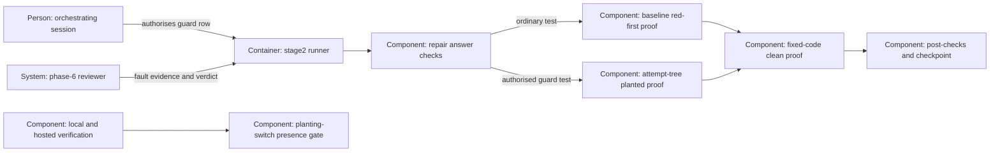

# Design — guard-test

The feature adds a second repair proof to ADR 0017's runner. The five
maintainer answers fix the switch, authorisation, mandatory semantic review,
repair-only scope and retained planting branch; these are not alternatives.

## Alternatives

- **Run both proofs on the attempt's tree using the fixed-code harness.**
  Reuses its private probe, environment construction, tree/ref snapshots,
  pinned interpreter and time limit; failures name the proof leg. No new
  checkout lifecycle, but shared execution must preserve the ordinary green
  proof's default behaviour.
- **Create a temporary checkout containing the attempt's code and tests.**
  Separates execution from the working tree, but copying only tests would
  silently return to baseline proof, while copying the whole attempt and
  providing its runtime expands restoration and cleanup obligations.

Chosen: reuse the attempt-tree harness, with an internal planted mode and an
unchanged default clean mode. This is a reversible implementation proposal.
The runner never creates a mutation; only the named test plants it (Q-1).

## Interfaces

- **Orchestrator → repair:** the existing Status cell gains
  `taken — guard test — <reason>`. Require that complete unquoted form with
  a nonempty reason before accepting a guard answer; `repair_targets` still
  selects taken rows by its existing prefix.
- **Repair model → runner:** add
  `<ID>: fixed — guard test — tests/<path>::<function>` to both repair
  formats, preserving exact identifiers, duplicate/conflicting-claim rules,
  path validation and the existing non-guard forms.
- **Runner → named test:** extract the named function's source and require
  the literal `STAGE2_PLANT_FAULT` there; this is presence, not semantics.
  The planted launch explicitly adds `STAGE2_PLANT_FAULT=1` to its own
  allow-listed environment and uses the red classifier; the clean launch
  omits it and uses the all-pass classifier. A caller's value supplies
  neither launch. Each leg has its own token/report and preserves the
  existing probe/tool/tree/ref/timeout/scrubbing checks.
- **Phase-6 reviewer → runner:** allow lines
  `Guard evidence: tests/<path>::<function> — fault: <description> — catches without switch: <yes|no and reason>`
  beside six-cell findings or `No finding.`. A phase-6-specific answer
  instruction replaces, rather than contradicts, `ANSWER_FORMAT` for this
  call only. Validate the verdict after separating these lines; require
  an actual verdict, retain the evidence verbatim before the verdict marker,
  and preserve rejection of other malformed no-finding answers. Spec review
  and loop reviewers keep their existing formats.
- **Code/diff → phase-6 reviewer:** the prompt requires inspection of every
  added/changed guard test from test source and the implementation diff,
  never from unreleased loop statuses. Semantic evidence may accompany a
  finding; a conditional failure without a real fault is a BLOCKER.
- **Verification environment → gate:**
  `python3 scripts/check_guard_test_environment.py` exits nonzero when the
  variable exists, regardless of value, otherwise 0. Register a blocking
  `guard-test-environment` gate in job `verify`, placement `both`; generated
  CI uses the same command. No credential or environment dump is needed.

## Data model

- Existing finding rows retain their columns. Successful guard repairs
  store `fixed — guard test — <test>` in Status and
  `yes — guard test — <test>` in `Broke a test` where that mark is stored.
  Released/phase-6 statuses precede the checkpoint; private record updates
  follow it, as today. Failed attempts gain no successful status or mark.
- Per-invocation probe records remain ephemeral schema 1; no extra field,
  migration or persistent switch state is needed.
- Phase-6 evidence is text in the verdict block, distinct from finding rows;
  it does not become a repair target or expose private loop rows.
- The gate entry is maintainer-owned. The coordinating session carries
  required protected wording and generated-file updates outside model
  attempts; implementation never relaxes `RUNNER_HELD` or provenance checks.

## ADR draft

Proposed amendment:
`docs/adr/0023-guard-proof-for-test-only-repairs.md`, numbered after 0022,
the highest ADR in the tree at `9987eaca` on 2026-10-29. It records only the
guard-proof addendum settled by Q-1–Q-5, leaving ADR 0017's routing and other
decisions intact. The feature's formal ADR answer remains unrecorded;
acceptance requires the maintainer's merge.

## Architecture delta

**Added**

- Authorised guard dispatch, planted attempt-tree execution and the
  verification gate; a phase-6 evidence-line allowance.

**Changed**

- Repair status vocabulary and proof marks; phase 6 must explain every
  added/changed guard test's fault before loop release.

**Removed**

- None; ordinary baseline proof, clean proof and review independence remain.
