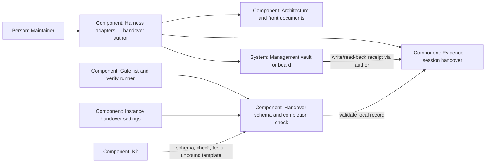

# Design — handover-currency

This extends the existing handover schema and authoring procedure to meet
[`spec.md`](spec.md), using the four maintainer answers without deciding them
again. The author checks meaning; the gate checks that the required evidence
was recorded. Neither the gate nor the kit copies private vault contents.

## Alternatives

- **A readable check record held by the handover schema.** The author records
  document findings and a management-update receipt in the handover. A gate
  validates that record against the repository's configured targets. This
  works with a vault or later board, keeps CI independent of either, and owes
  an honest author and review of the evidence.
- **A writer command that checks documents and updates the vault itself.**
  This could reduce missed steps, but needs a content judgment mechanism,
  private access and knowledge of each destination's note format. It adds an
  integration to maintain and still cannot infer the truth of arbitrary prose.

Chosen: the readable record, because it meets the requested section and gate
while leaving the status update with the already-authorized handover author.
The choice is a proposal; the PR merge adopts the rule.

## Interfaces

- Author → repository: the author reads configured documents and writes one
  `Documentation currency` section per new session record, with a fenced YAML
  record. A stale claim names its correction or follow-up bead.
- Author → management view: the author refreshes the existing project status
  block, reads it back, then records its locator, time and repository source.
  The view is a projection; Beads remains the task tracker. The existing daily
  reconciliation neither replaces nor triggers this handover-time obligation.
- Gate runner → schema: `python3 scripts/check_handover_currency.py` uses the
  schema's configuration and body-record validators. It returns 0 for complete
  records, 1 for findings and 3 when configuration, corpus or history cannot be
  measured. Findings name the file and session segment. No external lookup is
  performed; an external locator is evidence data, not a filesystem operand.
- Kit → instance: schema, command, tests and an unbound configuration template
  travel. `decisions/handover-check.yaml` stays local, like the existing
  adoption record. The instance binds its own targets and pre-adoption commit.

## Data model

- `decisions/handover-check.yaml`: strict YAML, `schema_version: 1`,
  `handover_dir`, `adoption_ref` (a full commit id) and nonempty `targets`.
  Each target has a unique `id`, `kind: file|tree|management` and `locator`.
  File/tree locators stay inside the repository; management locators are
  descriptions of the existing registered views. At least one management
  target is required. Coding Harness binds architecture, agents, roadmap,
  readme and management; the last locator names the existing registration and
  project note from decisions Q-1, without assuming the unread note's fields.
- The author-written body record has `schema_version: 1`, `checked_at` (ISO
  date-time with timezone), `source_ref` (the inspected repository commit) and
  `checks`, one group per configured target id. Each group's nonempty
  `documents` lists the inspected paths/locators individually with
  `status: current|stale` and nonempty `detail`. Historical documents describe
  their historical scope. A correction adds
  `action: {kind: corrected, evidence: <PR-relative path and explanation>}`;
  remaining stale claims need
  `action: {kind: follow-up, bead: <id>, detail: <work to do>}`.
- Every management group additionally has
  `update: {status: done, updated_at: <date-time>, source_path: <repository document>,
  source_ref: <commit>, evidence: <write/read-back description>}`.
  A draft may record an inability in `detail` with `status: incomplete`;
  neither an incomplete document nor update satisfies completion. The schema
  rejects duplicate ids/keys, unknown versions, empty values and placeholders.
- The gate validates group membership, statuses and evidence shape; it never
  judges prose, reads the board or compares historical inventories with current
  trees. The author discovers every architecture document and registered note
  at the record's cut-off; the live review compares that inventory with reality.

Adoption uses one fixed pre-rule commit recorded by the instance. The gate
reads that commit's handover paths and bodies. A body present there and unchanged
today needs no new section; ordinary `updated:` stamps in its header do not
make it a new session. Its body must remain a prefix when a session appends.
The appended suffix needs a check. A path absent from the snapshot is new,
whatever its name or `created:` date says. On new files and appended suffixes,
split session segments at unfenced level-two `Addendum` headings (both the
existing dated form and the skill's dash form); each nonempty segment needs
exactly one check section. A check may be a level-two section or a level-three
section within an addendum. Examples and fenced addendum headings are not
records. The immutable return-channel findings block cannot carry the section.
Missing snapshot history is unmeasured, never an empty legacy set. Historical
frontmatter and channel validation continue to run through their current tests.

A management receipt cites an existing commit and source document containing
the reported repository status, for example the committed change plan or
roadmap. Commit any substantive source corrections through ordinary green
verification first, within the same handover PR, then refresh/read back the
view and write the complete handover with its receipt. Publishing that handover
does not need another refresh when its reported status is unchanged; no receipt
predicts its own commit hash. If substantive status changes afterwards, refresh
the view again before completion. Earlier session records stay unchanged.

## ADR draft

None — the feature proposes "no" because it extends the existing schema,
gate runner and authoring step without a new subsystem or a breaking migration;
the maintainer's ADR answer is still owed, and no answer file is written here.

## Architecture delta

The existing Evidence, Harness adapters and Kit responsibilities retain their
names; the schema gains a body-record check and the gate runner invokes it.

**Added**

- A body-record validator, its command and a blocking verify gate.
- Repository-owned target bindings and an adoption snapshot, plus a portable
  unbound configuration template.
- An author-written receipt connecting the management projection to the
  repository evidence; the gate has no connection to the external system.

**Changed**

- The handover template and authoring instructions require the document check
  and management refresh; prospective session records carry their evidence.
- The kit includes the new check and template while instance bindings stay home.

**Removed**

- None; legacy bodies, frontmatter and the return-channel contract remain.
