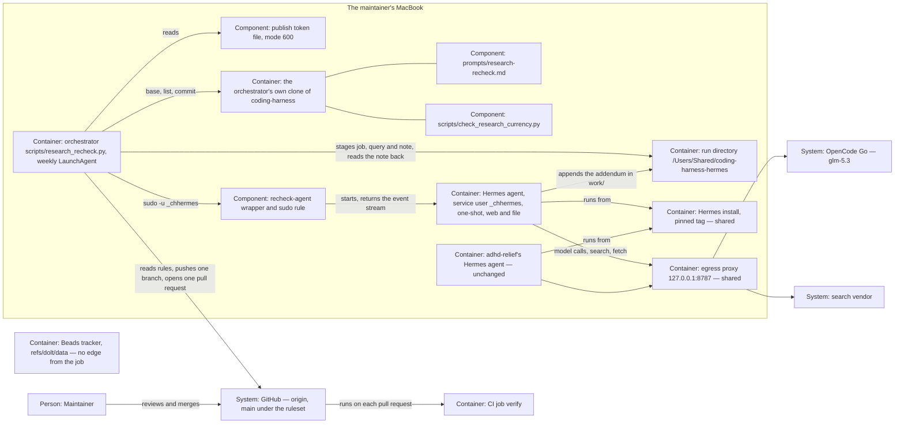

# Design — `hermes-runner`

How the system is shaped for the change that `spec.md` describes, written
from `spec.md`, `research.md` (section 13 included) and `decisions.md`.
What the spec fixes is not decided again here; what it leaves open is
decided here. Phase 2b runs because the class is `architectural` (decision
D-14). The form follows `templates/design.md` of the unmerged branch
`docs/template-bundle` (`855eeb6`); the architecture delta follows ADR
0009.

## Alternatives

Who starts the weekly run, how the agent's work reaches GitHub, and how two
operating-system users hand files to each other:

- **(a) One orchestrator run as the maintainer, Hermes one-shot through a
  sudo rule.** A weekly LaunchAgent of the maintainer runs
  `scripts/research_recheck.py run`: it stages the note, runs
  `sudo -n -u _chhermes <installed wrapper> <run dir>`, reads the agent's
  event stream from the wrapper's standard output, checks the diff and
  publishes. Consequences: the three steps are one process in one order, so
  a sleeping laptop delays the run but cannot reorder it; one record per
  run; the wall time is bounded by the orchestrator; no gateway is running
  between runs. Owed: a sudo rule on the laptop that lets the maintainer
  run one root-owned wrapper as the service user — a privilege reduction,
  but a file in `/etc/sudoers.d/`. The spike's S-3 and S-6 prove adhd-
  relief's gateway, not this path; the Coding Harness part has to prove
  the one-shot path itself (S-2 already uses one-shot runs).
- **(b) Hermes's gateway and its cron under the service user.** A
  LaunchDaemon keeps the gateway running; a `hermes cron` job runs the
  agent; the maintainer's prepare and publish jobs run at fixed offsets
  before and after it. Consequences: the path adhd-relief's spike proves
  (S-3, S-6); but three schedules must agree across a sleeping laptop,
  the result files are mode 600 and the service user's (`research.md`
  4.4), so the publish job needs a reader running as that user, and an
  always-on process with a messaging surface runs for a job of minutes a
  week.
- **(c) A launchd chain without sudo.** Three jobs linked by queue
  directories: the maintainer's prepare job fills an inbox, a LaunchDaemon
  of the service user runs the agent when the inbox is not empty, and the
  maintainer's publish job runs when the outbox fills. Consequences: no
  sudo rule; but three jobs, three logs, and a half-finished run is spread
  over two users' directories with no single record of what happened.
- **(d) No unattended runner: the prompt by hand in Claude Code.** The
  assessment's option A. Consequences: nothing to install and a first-party
  model; but the job runs only when someone remembers, and the maintainer
  chose Hermes (decisions, given). It stays the by-hand path the
  runner-neutral prompt allows.

Chosen: **(a)**, because one process in one order removes the timing and
hand-over questions of (b) and (c), keeps the wall-time cap and the record
in fixed code the maintainer owns, and starts no always-on process. The
choice is a proposal; the merge of the ADR's pull request decides it.

## Interfaces

1. **The list → the orchestrator.** The orchestrator runs
   `python3 scripts/check_research_currency.py --format json` in its clone
   at the base and reads `schema_version` (must be 1) and `notes[0]`
   (`path`, `problem`). Promised by pull request #73's spec, "What part 2
   may rely on".
2. **The orchestrator → the agent step.** The command
   `sudo -n -u _chhermes /usr/local/libexec/coding-harness/recheck-agent
   <run dir>` (overridable with `--agent-command` for tests). The wrapper
   refuses a run directory outside
   `/Users/Shared/coding-harness-hermes/runs/`, sets `HOME`,
   `HERMES_HOME=/Users/_chhermes/.hermes`,
   `HERMES_WRITE_SAFE_ROOT=<run dir>/work` and a fixed `PATH`, changes into
   `work/`, and runs `hermes chat --oneshot --query-file
   <run dir>/in/query.md --toolsets web,file --ignore-rules --format
   stream-json --max-turns 60 --source tool`. Its standard output is the
   event stream
   (`system`, `text`, `tool_use`, `tool_result`, `result`); its exit code is
   Hermes's (0, 1, 130). Two caps bound the wall time: the wrapper runs
   Hermes under an alarm of its own (`perl -e 'alarm shift; exec @ARGV'
   2700 …`, 45 minutes), because the maintainer's process may not signal a
   process of the service user; the orchestrator, after 50 minutes,
   terminates the process group it started — `sudo`, which relays the
   signal. The orchestrator never starts the agent a second time in a run.
3. **The job prompt's contract** (runner-neutral). In: one note path and the
   run date, given by the runner in a closing block `## Inputs of this run`
   of the query. Out: the addendum appended to the note and the two header
   dates (spec, "Terms"), or no change and a failure stated in the answer.
   The answer ends with one line of counts: holds, overtaken, new, not
   read.
4. **The orchestrator → GitHub,** with the publish token only: `git fetch`
   and `git ls-remote` over HTTPS (the remote's branch list), `git push
   origin HEAD:refs/heads/research-recheck/<note stem>-<run date>` — one
   refspec, never `--force`, never `--mirror` or `--all`; `gh api
   repos/<repo>/rules/branches/main` (GET); `gh pr create --base main
   --head <branch> --title … --body-file …`. The token travels in
   `GH_TOKEN` and in a git `http.extraheader` set through
   `GIT_CONFIG_COUNT`/`GIT_CONFIG_KEY_n`/`GIT_CONFIG_VALUE_n`, with
   `credential.helper` empty and `core.hooksPath=/dev/null`, so neither the
   maintainer's own GitHub login nor a repository hook takes part.
5. **The orchestrator → the maintainer.** The run record and the event
   stream under `~/Library/Logs/coding-harness/research-recheck/<run id>/`,
   a copy of the record as `last-run.json` beside them, and — with
   `--notify`, which the LaunchAgent passes — one macOS notification when a
   run ends `failed`. The pull request is the success signal.
6. **Hermes → the shared egress proxy → the vendors.** `model.base_url`
   `http://127.0.0.1:8787/go/v1` → OpenCode Go; `FIRECRAWL_API_URL`
   `http://127.0.0.1:8787/fc` → the search vendor. Keys in the service
   user's `.env`. The proxy is adhd-relief's (today its stub, which logs
   and forwards and checks nothing).
7. **The re-check pull request → CI and the maintainer.** An ordinary pull
   request: `verify` runs on it like on any other, and the ruleset makes it
   a required check before any merge.

## Data model

| Record | Where | Written by | Fields or content |
| --- | --- | --- | --- |
| Job file `job.json` | `<run dir>/in/` | orchestrator | `schema_version` (1), `run_id` (`YYYY-MM-DDTHHMMSS`), `run_date`, `base` (40 hex), `note` (repository path), `selected_by` (`notes[0]` or `named`) |
| Query `query.md` | `<run dir>/in/` | orchestrator | `prompts/research-recheck.md` at the base, then `## Inputs of this run` with the note's absolute path in `work/` and the run date |
| The note's copy | `<run dir>/work/<file>` | orchestrator, then the agent | the note at the base; the agent appends the addendum and sets the two dates |
| Event stream `events.jsonl` | the log directory | orchestrator, from the wrapper's output | Hermes's `stream-json`, unchanged |
| Run record `record.json` | the log directory | orchestrator | `schema_version` (1), `run_id`, `run_date`, `outcome`, `step` (`prepare`, `agent`, `check`, `publish`, `done`), `reason`, `note`, `base`, `branch`, `pr_url`, `agent_exit_code`, `tokens` (`input`, `output`, `total`), `tools` (count by name), `duration_s`, `dry_run` |
| The addendum | the note, in the pull request | the agent | spec, "Terms" |
| Endpoint `opencode-go` | `model-endpoints.yaml` | slice 2 | `name`, `betreiber`, `residenz: anbieter-erklaert`, `abrechnung: abonnement`, `darf_sehen: [framework]`, `modelle: [glm-5.3]`, `bemerkung` |
| The profile | `tools/hermes/` | slice 5 | `config.yaml`, `env.example`, `recheck-agent.sh`, `sudoers`, `ai.coding-harness.research-recheck.plist`, `README.md` |

Ownership and modes on the laptop (the runbook's, slice 5): the service user
`_chhermes` has its own primary group `_chhermes` and is not in `staff`, so
it cannot enter the maintainer's home (`research.md` 13); the maintainer is
added to `_chhermes`. `runs/<run id>/in/` is the maintainer's, mode 2750;
`runs/<run id>/work/` is the maintainer's, group-writable, mode 2770 — the
only place the agent's file tools may write. The installed `config.yaml`
and `.env` belong to the maintainer, readable by the group, writable by no
one else (adhd-relief's S-4). The token file is
`~/.config/coding-harness/publish-token`, mode 600, in a directory of mode
700. The orchestrator works in a clone of its own,
`~/Library/Application Support/coding-harness-recheck/clone`, never in a
checkout where people or sessions work.

The branch is `research-recheck/<note stem>-<run date>`; the commit message
is `docs(research): re-check <note stem> (<run date>)` with a body naming
the base, the runner (`hermes-agent <tag>`) and the model (`glm-5.3,
opencode-go`); the pull request's title is the commit's subject.

## ADR draft

The text below becomes `docs/adr/0010-hermes-first-unattended-writing-agent.md`
in slice 3's decision pull request, with its headings raised by one level
and the header below between `---` lines.

```yaml
title: "ADR 0010 — Hermes is the first unattended writing agent: it writes one file, and a script the maintainer owns publishes it"
category: adr
status: accepted
created: <the day slice 3 is opened>
last_reviewed: <same>
updated: <same>
owner: framework-architect
provenance: human-decided
produced_by: {kind: llm-session, name: claude-code, version: "<same>"}
review: {status: pending, approved_by: null, approved_at: null}
tags: [adr, hermes, runner, unattended]
```

### ADR 0010 — Hermes is the first unattended writing agent: it writes one file, and a script the maintainer owns publishes it

* Status: accepted by the merge of the pull request that carries this file.
  Until that merge, the pull request's state is the decision's state: open
  is proposed, closed is rejected. Amends decision D-7 (Omnigent adoption)
  of the 2026-09-16 interview in its M3 clause; supersedes no ADR.
* Review: direction chosen by the maintainer on 2026-10-05 ("Ich würde
  gerne Hermes forcieren, lege die Grundlage dafür"), with the six answers
  in `plans/changes/hermes-runner/decisions.md` · the acceptance is the
  merge commit and is written nowhere else, so the header's `review` stays
  empty (ADR 0008) · Decider: maintainer · prepared by a Claude Code
  session
* Date: the day the pull request is opened · takes effect on merge

#### Context

* **Research ages unnoticed.** Notes under `docs/research/` cite tools that
  change monthly; an age list exists (pull request #73), and nothing
  re-checks a note (bead coding-harness-pu9).
* **The maintainer chose Hermes Agent as the runner** for this repository's
  recurring jobs, against the assessment's "Not Hermes, not now" (pull
  request #72), on 2026-10-05.
* **Hermes can run with only web and file tools** (tag `v2026.9.21`,
  read 2026-10-05): a one-shot run takes `--toolsets web,file`,
  `--ignore-rules` keeps `AGENTS.md`, `SOUL.md`, memory and skills out,
  `HERMES_WRITE_SAFE_ROOT` refuses writes outside one directory, and
  memory, background review, curator and title generation switch off by
  configuration. What the agent can read is bounded by the operating
  system, not by Hermes.
* **A credential that can push a branch can merge.** A fine-grained token
  needs `contents: write` to push, and the same permission merges a pull
  request through the API; it can also push `refs/dolt/data` (GitHub's
  permission data, read 2026-10-05).
* **`main` had no protection** — no ruleset, no branch protection (measured
  2026-10-05) — while the target says "Branch protection is the security
  boundary …; harness policies, hooks and sandboxes reduce blast radius and
  are never the boundary" (`docs/architecture/target-architecture.md`,
  section 7). Agents and the maintainer act as one GitHub account (ADR
  0008), so no rule can tell them apart.
* **M3 is not reached.** D-7's path says "M3 qualifies unattended
  operation", and the implementation plan asks M3 to "prove total budgets,
  process-group cancellation, approval timeout, restart, remote checkpoint
  recovery and complete tracker restore" and to rehearse a night run before
  routine use (`docs/architecture/2026-09-17-implementation-plan.md`, "W2
  and M3"). Those proofs are written for unattended runs of changes, with
  code and tracker writes.
* **The leak check exists only on pull request #60's branch** and needs a
  change folder the job does not have. The maintainer decided on
  2026-10-05 that the scheduled job may run before it, without a check
  (decisions Q5).
* **Two Hermes agents will share this laptop**: adhd-relief's personal one
  and this job. The maintainer chose two service users sharing only the
  pinned install and the egress proxy (decisions Q3).

#### Decision Drivers

* The agent that reads the open web holds no shell and no credential that
  can write the repository.
* The job never writes the tracker, never merges, approves or force-pushes,
  and never pushes `main`.
* GitHub, not the harness, is the boundary around `main`.
* The prompt stays runner-neutral: the same job runs by hand in Claude
  Code.
* A run is bounded, and a failed run is visible and leaves nothing to
  clean up.
* Nothing of adhd-relief's agent is shared beyond the install and the
  proxy.

#### Considered Options

* **(a) Hermes with a trust split.** The agent writes one file; a script
  the maintainer owns checks it and publishes; the ruleset on `main` is the
  backstop. Builds a script, a profile and a sudo rule; needs one
  afternoon at the laptop to prove the guards.
* **(b) Not now.** The prompt runs by hand in Claude Code; no runner.
  Nothing to install or secure; the job runs only when someone remembers.
* **(c) Hermes publishes itself** with a token and its bundled GitHub
  skill. The fewest parts; but an agent steered by any page it reads would
  hold a credential that merges and pushes the tracker ref.
* **(d) Wait for M3.** Safe by the plan's measure; the job waits for proofs
  designed for overnight change runs, months away.

#### Decision

Chosen option: "(a) Hermes with a trust split", because it is the only
option in which the job runs unattended while the part that reads the web
holds nothing that can write the repository.

* **Runner.** Hermes Agent, one-shot (`hermes chat --oneshot`), started
  once a week by `scripts/research_recheck.py` through a sudo rule as its
  own service user `_chhermes`. No gateway, no Hermes cron, no messaging
  platform for this job. The configuration is `tools/hermes/`.
* **Trust split.**
  * *The Hermes agent* has the toolsets `web` and `file` and nothing else —
    no shell, no code execution, no delegation; memory, background review,
    curator and title generation are off and no rules file is loaded. It
    writes only its run's work directory, holds the model key and the
    search key and never a GitHub credential, and stops after 60 tool
    iterations or 45 minutes (50 minutes at the orchestrator's side).
  * *The orchestrator* `scripts/research_recheck.py` is fixed code the
    maintainer runs. It stages the note, checks the agent's tool calls and
    the diff (only the one note; only the two header dates and one
    appended addendum), and holds the publish token — a fine-grained token
    for this repository only, `contents: write` and `pull_requests:
    write`, in a file the service user cannot read. It pushes one branch
    and opens one pull request. It never merges, approves, force-pushes,
    pushes `main`, touches `refs/dolt/data` or calls the tracker; its tests
    hold that.
  * *The maintainer* owns the token, the configuration and the install,
    reviews the addendum — the only check of its content — and merges, or
    asks an agent to (ADR 0008).
* **Backstop.** A ruleset on `main`: a pull request is required (no
  approval), the status check `verify` must pass, force pushes are blocked,
  deletion is restricted, nobody can bypass. The orchestrator publishes
  only while all four rules are in place. What the ruleset cannot do: tell
  the token from the maintainer, stop the token from merging a pull request
  whose `verify` is green, or protect `refs/dolt/data`; there the
  orchestrator's code is the only guard.
* **M3.** The re-check is not an M3 run, and it starts before M3 with
  stand-ins for M3's proofs at its size: *budgets* — one run a week, 60
  tool iterations, 45 minutes, no second start after the model was called;
  *cancellation* — the orchestrator ends the agent's process group;
  *approval timeout* — none can occur, the agent asks nothing
  (`single_query_mode: deny`); *restart and checkpoint recovery* — a failed
  run leaves nothing to resume, and the next starts fresh from
  `origin/main`; *tracker restore* — the job never touches the tracker;
  *morning review* — the maintainer's review of the pull request. **D-7 is
  amended in one clause:** "M3 qualifies unattended operation" becomes "M3
  qualifies unattended runs of the seven-phase workflow; a recurring job
  outside the phases is admitted by an ADR of its own, as ADR 0010 admits
  the research re-check". Unattended change runs still wait for M3.
* **Model.** GLM-5.3 on OpenCode Go (endpoint `opencode-go` in
  `model-endpoints.yaml`), with the service user's own key, through the
  proxy shared with adhd-relief.
* **No leak check before the job's foreign calls.** For this job, the
  repository departs from "a leak check before every session on a foreign
  endpoint" (`model-endpoints.yaml`, `docs/WORKFLOW.md` section 4): house
  rule 6 is checked when the pull request is reviewed, after the text has
  left (the maintainer, 2026-10-05).
* **Activation.** The weekly job is loaded only when adhd-relief's spike
  S-2 to S-6, §7 and S-7 and the Coding Harness part are green
  (`tools/hermes/README.md`, "Spike results"), `python3
  scripts/research_recheck.py check-ruleset` exits 0, and pull request #73
  is merged.
* **Scope.** This ADR admits one job. A second recurring job needs an ADR
  of its own.

#### Consequences

* **The maintainer owes** the ruleset, one afternoon for the spike and the
  install, a token renewal every 366 days, and a re-run of S-2, S-4 and
  the Coding Harness part after every change of the shared Hermes tag.
* **Every merge into `main` waits for a green `verify`,** for agents and
  the maintainer alike. A red or hanging CI blocks every merge until it is
  fixed or the owner switches the ruleset off.
* **Repository text goes to two outside vendors unchecked each week:** the
  note and the prompt to OpenCode Go (USA), the search queries to the
  search vendor.
* **Coupled to adhd-relief** through the install, the proxy and possibly
  the subscription's quota; a block by the vendor stops both agents
  (ADR-0025's fall-back serves both).
* **Lost against (c):** the agent cannot repair its own pull request; a run
  the check refuses is a week without a re-check.
* **Lost against (b):** one more runtime to keep pinned and proven.
* **LakeSwitch:** the job prompt travels with the kit, the runner does not;
  nothing changes there.

#### Validation

* `tests/test_research_recheck.py` and `tests/test_hermes_profile.py` pass in
  `make verify`, holding the orchestrator's and the profile's contracts
  (`plans/changes/hermes-runner/spec.md`).
* `python3 scripts/check_decision_continuity.py` is green with D-7 mapped to
  this ADR.
* Before the weekly job is loaded: every entry in "Spike results" is green,
  and `check-ruleset` exits 0.
* After the first three published runs, the maintainer reads their records
  (checked items, tokens, wall time) and keeps or changes the caps and the
  schedule.
* The question returns when a second recurring job is proposed, when a run
  publishes what the diff check should have refused, when the vendor blocks
  the account, or when M3 is reached.

## Architecture delta

The part of the system the change touches, as it is after the change.
Element names follow `docs/architecture/target-architecture.md` (sections 3
and 7), adhd-relief's ADR-0022 and this repository's ADRs.



**Added**

- Container: the orchestrator `scripts/research_recheck.py`, run weekly by
  the maintainer's LaunchAgent, with its own clone and the publish token.
- Container: Coding Harness's Hermes agent as service user `_chhermes`,
  one-shot, configured by `tools/hermes/config.yaml`.
- Component: the wrapper `recheck-agent` and the sudo rule that lets the
  maintainer start it as `_chhermes`.
- Container: the run directory `/Users/Shared/coding-harness-hermes/runs/`.
- Component: the job prompt `prompts/research-recheck.md`, beside the phase
  prompts.
- Relationship: orchestrator → GitHub — read the rules on `main`, push one
  branch, open one pull request.
- Relationship: Coding Harness's Hermes agent → the shared install and the
  shared egress proxy → OpenCode Go and the search vendor.
- System: OpenCode Go, declared as endpoint `opencode-go`.

**Changed**

- GitHub `main`: from unprotected to the ruleset of decisions Q4.
- `model-endpoints.yaml`: one endpoint more.
- `docs/WORKFLOW.md`: job prompts are named beside the seven phases.
- Decision D-7 (proposed by ADR 0010): M3 qualifies unattended runs of the
  seven phases; the research re-check is admitted by its own ADR.

**Removed**

- Nothing: no element or relationship goes away.
