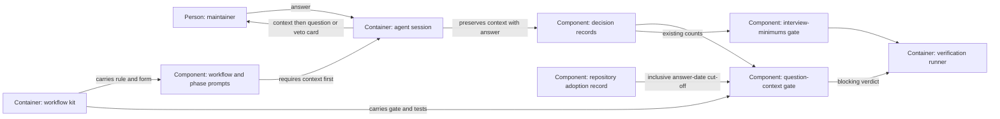

# Design — interview-context

The spec and five interview answers fix the universal rule, recorded context,
presence check and prospective cut-off. This design proposes their boundaries.

## Alternatives

- **Extend the interview-minimums gate.** One command checks both duties, but
  its class/spec-date selection would need another independent selection for
  answer dates and records without specs; coupling risks exempting new answers.
- **Add a context gate beside interview minimums.** One additional command
  owns the context duty across every answered record; counting remains intact,
  and the gate can explain precisely which answer lacks its context.

Chosen: the separate `question-context` gate, because answer applicability
differs from the existing class duty. This is a proposal until merge.

## Interfaces

- Agent → maintainer: five context parts precede options or the existing plan
  card; actual questions stand last on their own line. Keep the MADR goal,
  options, recommendation, "ok" effect and loss for decision questions. Translate
  the context labels for German conversation; explain identifiers on first use.
- Agent → decision artifact: preserve the presented context, faithfully in
  English, as one `context: |` literal text block in each subject answered
  Q-record. Record the actual recording day in the existing dated decision
  statement; a late answer does not inherit the question's earlier `asked` day.
- Decision files → gate: inspect actual Q-blocks in live and archived change
  directories, including folders without a spec. Ignore fenced examples,
  indented context content, skip records and open questions. Inspect every
  answered occurrence, including duplicate question ids; context cannot be
  borrowed from another block. Existing minimum counting is unchanged.
- Repository adoption record → gate: call `adoption.adopted_on(root,
  "question-context")`; compare each answer's recording day inclusively. Do
  not use the interview gate's spec-date exemption or a built-in calendar date.
- Gate → verification: `python3 scripts/check_question_context.py` exits 0
  for measured success, 1 for missing/empty/non-text context, and 3 for evidence
  it cannot read; diagnostics identify the file, question id and remedy where
  available. Collect findings across files; any not-measured finding takes
  exit precedence over context failures. `--root DIR` supports independent
  fixtures and kit instances. The gate writes no record or adoption date.
- Kit → instance: the existing workflow/prompts prefixes carry the rule and
  form; two explicit mechanism entries carry the gate and tests. The adoption
  day remains local. `AGENTS.md` remains inventory: the portable workflow must
  state that the rule covers all agents and conversation without that file.

## Data model

The record keeps `asked`, `answer`, `answered_by`, `status` and its dated MADR
statement. The agent adds a `context` scalar; no new date field is introduced:

```text
context: |
  Topic: The verification of answered decision records.
  Intention: Make a missing explanation visible before merging new answers.
  Today: The gate counts answers without keeping their presented context.
  Repository change: The workflow gains a recorded explanation and a check.
  Architecture change: A context gate reads decision records alongside
    the existing interview-counting gate.
```

This is a demonstration value, never a backfill of the interview's real
questions. Parse the context field within its Q-block, treating indented lines
as its value, not fields or headings. Accept non-blank scalar text; reject an
empty literal block, null or collection value and ambiguous duplicate fields.
Extract exactly one date ending the top-level decision paragraph beginning
`In the context of`, joining its wrapped lines before matching the suffix;
the current fifth answer wraps its dash and date onto separate lines.
Date-like text inside context, fields or examples cannot date the answer.
Missing, impossible or multiple decision dates are not measured. Parse the
context scalar on its own, rather than treating the Markdown record as YAML;
unquoted null, boolean, numeric or collection values are not text.
Presence is mechanical; matching the shown meaning and the form is reviewed.

The maintainer confirms `adopted.question-context` in
`decisions/adoption.yaml` through the decision PR. Prepare the intended merge
day, align it with the actual merge day if the merge is delayed, and rerun CI;
after adoption it is not advanced to exempt later answers. If this change's
answers fall on that day, their original presented context must be recovered
by the orchestrator before the check can pass; no agent may fabricate it.

## ADR draft

The one draft is `docs/adr/0018-every-question-carries-its-context.md`, in
`templates/adr.md` form, proposed by the feature's header. It records Q-1 to
Q-5, the fixed form and the presence-only limit. The maintainer's merge
confirms it; no ADR answer or approval is written by this drafting call.

## Architecture delta



**Added**

- A context gate and its relationships to records, local adoption and
  verification.
- A stored context value per subject answered record and portable tests.

**Changed**

- Agent instructions cover every question with the same context form, including
  conversation, ambiguity presentation and the preface to an unchanged plan card.
- The kit carries the general rule and presence check without profile configuration.

**Removed**

- The interview-only placement of the context duty and its free sentence form;
  the fixed form replaces it. No existing counting component is removed.
