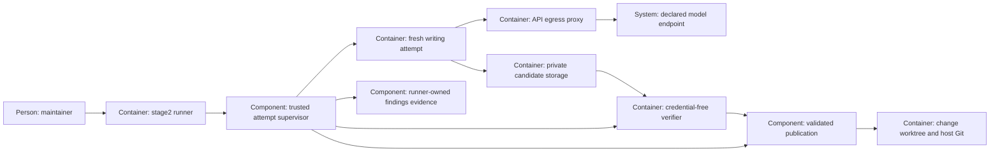

# Design — isolated-attempts

The four writing verbs share a trusted attempt supervisor. It passes a private
candidate to a fresh model container, checks the result in a separate container
and returns only validated files. The five interview answers define the scope;
the choices below implement them without changing routing.

## Alternatives

- **A writable copy mounted from a host temporary directory.** Simple to
  inspect and share with a verifier, but host paths remain writable mounts,
  cleanup must traverse model-controlled topology, and a broad parent mount
  can expose the host. It needs a second set of confinement assumptions.
- **Private runtime volumes with validated export and host publication.**
  The model has no host-directory mount, and failed volumes are disposable;
  the price is an export validator, a publication journal and an interactive
  return path instead of immediate edits in the host worktree.

Chosen: private runtime volumes with validated export, because removing host
paths from the model's namespace closes the restoration class rather than
adding checks to each mutable input. This architecture is proposed until merge.
Podman is already the maintainer's chosen default, not a choice reopened here.

## Interfaces

- **Runner to supervisor.** Both `run_attempts` and the separate `draft` loop
  submit verb, endpoint, exact prompt, run baseline and existing verb checks.
  The host checks the declaration and leak verdict against all repository
  payload bytes immediately before launch. Each retry starts from the same
  baseline; diagnostics and trusted route metadata are separate inputs.
- **Supervisor to runtime.** `STAGE2_CONTAINER_PROGRAM` selects `podman`
  by default, `docker` or Apple `container`, including an explicit executable
  path with that basename. Use argument vectors, not shell interpolation.
  Adapters translate operations, rather than assume interchangeable flags:
  create private volumes/network, launch, stop, export and remove. Refuse
  unknown programs and unsupported capabilities; never substitute a backend.
- **Repository to attempt.** Build an explicit input manifest from trusted
  baseline files. Draft gets change inputs, phase prompts/templates, governance
  and the runner/test sources needed to design its plan; implementation,
  repair and session get the repository material needed for their code and
  gates. Omit host ignored state, `.beads/`, host launch directories and
  credential/configuration homes. Pass only the fresh tracker render when
  required for checks, obtained through `scripts/bead_render.py` and scanned
  as outgoing material. Never pass the live database or its connection.
- **Git to attempt.** Construct a self-contained repository with only the
  history/refs required for baseline and `origin/main` checks, without local
  clone links, alternates, source configuration, hooks or credential helpers.
  The worker's private `.git` mount is read-only. The verifier reconstructs
  its own writable metadata from that trusted snapshot and stages the candidate
  in its private index; model-authored Git metadata is never exported or used
  by the host. No mount points at the actual repository Git directory.
- **Authentication to official CLI.** A host-side selector exports only the
  selected login into a temporary secret or in-memory environment input.
  Keys and subscription logins keep their existing billing/client route.
  Container homes are fresh; no host sign-in directory, caller token set,
  keychain or agent socket is mounted. Qualify the official clients' minimum
  login format in phase 4. If a subscription requires renewal outside its API,
  the maintainer renews the host login before retrying; the attempt neither
  opens sign-in sites nor silently changes to a token-billed integration.
- **Attempt to selected API.** A trusted egress proxy joins a private attempt
  network and an outbound network; the model joins only the private network.
  Only exact API-host HTTPS destinations on port 443 are accepted, with
  canonical host and TLS-name validation. Deny wildcards, IP destinations,
  mismatched or uninspectable TLS names, local/private destinations, redirects
  to other hosts and arbitrary tunnelling. The model has no direct DNS,
  IPv4/IPv6 outbound path or published host port. Proxy environment settings
  are convenience, not enforcement. Runtime/engine sockets and privileged
  networking are never exposed. If an adapter cannot establish and measure
  this arrangement, it refuses the call.
- **Candidate to verifier.** Stop the writer before inspecting/exporting its
  result. Use a fresh verifier with no model login and network disabled for
  derived preparation, ruff, `make verify`, time validation and red-first
  repair proof. These operations are supervised by baseline runner code;
  candidate repository code may execute only inside the verifier. Red-first
  Git copies and tracker reads remain private too. No model container shares
  its authentication home with the verifier.
- **Verifier to host.** Export only a typed, relative file delta with content
  hashes and explicit deletions. Validate the complete changed topology,
  including parents, and reject links, hard links, traversal, duplicates,
  special files and file-to-directory replacement. Do not extract an
  untrusted archive onto the host or run candidate-controlled export code
  there. Apply the draft's existing path/one-ADR rule before publication.
  Credential scrubbing/scanning covers outputs and diagnostics before host
  storage and after verification; copied authentication never belongs to the
  exported tree.
- **Publication to host Git.** Hold the invocation's publication lock and
  compare HEAD, worktree/index state and permitted evidence to the expected
  baseline. Materialise validated bytes without following links; journal
  overwritten bytes and index state. On failure, undo only writes still
  matching this invocation's publication, preserving intervening user work
  and unrelated refs. Automatic verbs then make their existing single
  checkpoint; session leaves a verified, uncommitted delta. Host Git uses
  trusted configuration with hooks and candidate-triggered external filters
  disabled, so checkpointing does not execute imported repository code.
- **Terminal to session supervisor.** Preserve macOS interactive Codex/Pi,
  selected model, handover, context rules and Pi policy loading. Dispatch a
  trusted supervisor which owns the attached container's whole lifetime;
  it captures exit, verifies and publishes on normal completion. Dispatch
  acceptance remains separate from CLI/verification success. Cancellation or
  failure discards the candidate. No host prompt or credential is embedded
  in the Terminal command; it carries only an opaque invocation identifier.

Run both container roles as a non-root user without extra capabilities,
privilege escalation, devices or host sockets, with a read-only system image
and only the specified private writable volumes/temporary filesystems.
Image/tool installation is explicit setup from pinned inputs, never a
network-enabled repair inside an attempt. The verifier's Python/toolchain
matches `requirements-ci.txt`; ordinary model execution still uses the
official CLI and existing discovery restrictions.

## Data model

- **Runtime lock** (`tools/stage2/runtime.lock.yaml`): schema version,
  immutable base/image identities, official CLI/package versions and hashes,
  Python/toolchain identity and supported adapter capability profiles.
  Phase 4 writes measured pins; this draft invents no image digest.
- **Endpoint API profile** (`model-endpoints.yaml`): exact `api_hosts` on
  the four used endpoint entries, alongside their existing authorization.
  Qualify Codex/Claude subscription traffic with official clients before
  enabling a profile; the known GLM/OpenCode addresses in current source do
  not prove the other clients' network needs. No guessed host or broad
  suffix is an approval. Absence means refusal, not unrestricted networking.
- **Invocation state** (private runner state, not a committed artifact):
  invocation ID, verb/endpoint, baseline commit and file/index hashes,
  input/image/policy hashes, resource IDs, phase, owned publication journal
  and scrubbed diagnostics. No login value is persisted in this record.
  Resources have a random invocation label; cleanup acts only on recorded
  IDs whose ownership still matches. Interrupted publication is reconciled
  against its recorded bytes before reuse, never by a global reset or prune.
- **Boundary qualification report** (runner-owned private state): platform,
  runtime version, image digest, API-policy hash, production-launch profile
  and the results of each mandatory live probe. Reuse only with those exact
  identities; a changed runtime/profile/image requires new qualification.
  A report is not an exemption from fresh containers or per-call leak checks.
- **Candidate result** (temporary): baseline identity, relative paths,
  regular-file bytes/modes/hashes, deletions, model-changed path list and
  separately measured runner-derived path list. The trusted export reads
  stopped volumes; a model cannot certify its own manifest or verdict.
- **Existing evidence** (`findings.md`, and on successful phase-4 work
  `plan.md`): retain audit syntax, quoted failure diagnostics, row-status
  forms, route reasons and measured time. The host evidence writer merges
  validated draft review dispositions with its own intact audit; repair
  statuses are written only after the established proof checks. Failed
  candidate statuses and route/time edits are discarded with the volume.

All per-attempt secrets/resources are removed on controlled exits. A killed
supervisor or host outage is reconciled on the next invocation; the report
must say cleanup is pending rather than claim nothing remains.

## ADR draft

The sole new draft is [ADR 0018](../../../docs/adr/0018-isolated-writing-attempts.md),
in the form of `templates/adr.md`; it amends writing-call confinement and
failed-attempt carry-over without superseding whole routing ADRs or changing
a D-/O-number. This architectural change records no ADR-question answer.

## Architecture delta

**Added**

- A shared supervisor, runtime adapters, private candidate storage, API-only
  proxy, separate verifier, publication journal and live qualification path.
- Validated candidate-to-host publication and per-invocation recovery.

**Changed**

- Both automatic attempt loops and interactive dispatch use the supervisor;
  retry state is baseline plus diagnostics, instead of the failed tree.
- Derived writes occur privately and join only a successful publication;
  the host retains failure evidence without the leftovers absorbed in Q-4.
- The selected official CLI receives one login in a fresh home; subscription
  routing and the selected model stay as before.

**Removed**

- Direct writing-model access to host worktree/Git/home and recovery through
  model-mutated host input paths.
- Host execution of candidate preparation, formatting, gates and proofs, and
  failed candidate carry-over between attempts.
