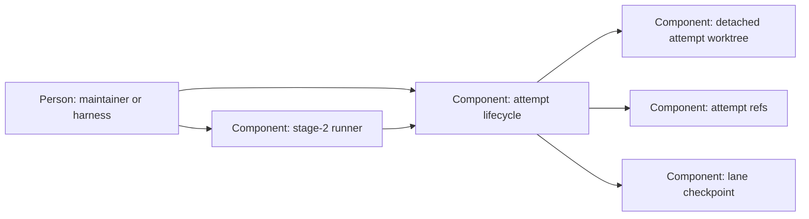

# Design — isolated-attempts

## Alternatives

- Linked detached worktrees: cheap local attempts, with shared Git state and explicit protection of lane inputs and tools.
- Containers: stronger isolation of network and foreign reads, but a heavier runtime and macOS setup.

Chosen: worktrees, as the maintainer decided in Q-1 and Q-10; containers remain a later layer.

## Interfaces

The runner passes its module and attempt context to `scripts/stage2_attempts.py`; its command-line entry offers other harnesses the same leak, scope and lifecycle protections. The lifecycle returns an accepted result or a recorded failed state to the lane; the runner alone applies a checkpoint after verifying the lane HEAD.

## Data model

Attempt worktrees live under `${XDG_STATE_HOME:-~/.local/state}/coding-harness/attempts/`, named with session and attempt identity. Failed states are Git refs under `refs/stage2/attempts/<change>/`; post-merge cleanup owns deletion. The lane's Python environment and Pi are linked read-only and both are checksummed before and after each attempt. Findings record route switches and reasons.

## ADR draft

The proposed decision is `docs/adr/0026-isolated-attempts.md`; it partially supersedes ADR 0017 decision 2 upon merge.

## Architecture delta

**Added**
- A protected, reusable attempt lifecycle and its direct entry; detached worktrees and retained refs.

**Changed**
- Implement, repair, draft and review use the lifecycle; isolation is enabled in stages.
- Post-merge cleanup removes the merged change's refs.

**Removed**
- Separate attempt paths for the covered verbs; unconditional stop on a writing call failure.
