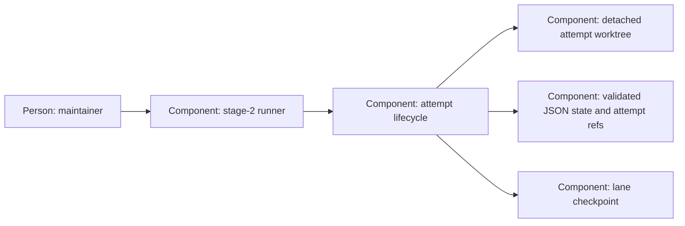

# Design — isolated-writing-attempts

## Alternatives

- Detached linked worktrees isolate changes cheaply but share Git and tool state, requiring checks and recovery.
- Containers also restrict network and foreign reads but add a heavier runtime and macOS setup.

Chosen: detached worktrees, as decided in Q-1 and Q-10; containers remain a later layer.

## Interfaces

The stage-2 runner passes its module and an attempt-specific context to the shared lifecycle. The lifecycle returns a checkpoint or failed state; the runner owns model policy, leak checks and records. No new public CLI is included.

## Data model

Worktrees reside beneath `${XDG_STATE_HOME:-~/.local/state}/coding-harness/attempts/`, with invocation and attempt identities. Code writes and validates JSON schemas for attempt records, process locks and the saved-state index; invalid state is not trusted. Failed states remain under `refs/stage2/attempts/<change>/`. Linked Python and Pi environments are checksummed; changes reject the attempt and trigger recovery. Lane records are exempt from the lane snapshot and are committed with the landing or by the orchestrator.

## ADR draft

`docs/adr/0026-isolated-writing-attempts.md` proposes the writing-only decision and partially supersedes ADR 0017 decision 2.

## Architecture delta

**Added**

- A shared lifecycle, attempt worktrees and validated state.

**Changed**

- Writing verbs use one lifecycle; repair is isolated first, then draft and implement.
- Failed writing calls may continue through declared fallback routes.

**Removed**

- Separate model-attempt paths for the writing verbs.
