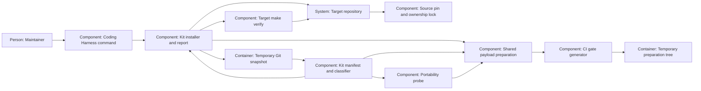

# Design — kit-install

The shape for the revised `spec.md`, from `research.md`, the six maintainer
answers and all three rounds of phase-2a rulings in `decisions.md`, through
2026-10-14. Updates are deferred by Q-6; this design contains no update
algorithm or pending-pin model.

## Alternatives

- **Acquire the requested Git snapshot in an owned temporary repository.**
  Local sources and URLs yield committed paths, bytes and modes without
  changing source or target refs. Git and, for remote sources, connectivity
  are prerequisites; dirty source files never become payload.
- **Consume a prepared release bundle.** Installation could avoid Git
  transport and work offline, but a builder and bundle/provenance format
  would have to ship first. That delays this change behind release work.

Chosen: temporary Git acquisition, because it supplies the already chosen
source pin without making a release builder a prerequisite. The choice is a
proposal confirmed by the decision PR's merge.

For implementation, moving classification into a new imported library would
create another traveling prerequisite during the runner's unstaged checks.
Keep classification and shared payload preparation in the existing
`probe.py`, and let `install.py` consume them. The probe must not import the
new installer: it prepares the same initialized payload without invoking
target verification, then commits its own disposable measurement tree.
Committed fixture snapshots explicitly contain every new installer/recipe
asset; they do not depend on the source index already staging those files.
For the probe's pending-tree survey, materialize a source candidate snapshot
in an owned temporary repository from tracked working files plus untracked
files classified as traveling kit/recipe assets. Resolve its commit for the
shared initializer; never stage or commit in the source checkout. This keeps
the probe's payload complete during the runner's unstaged checks, while
actual install/report still read only their requested committed snapshots.

## Interfaces

**Maintainer → Coding Harness command.** Preserve `decide adr` and add:

```text
python3 scripts/harness.py kit install --target DIR --ref REV [--source LOCATION]
python3 scripts/harness.py kit report --target DIR --ref REV [--source LOCATION] [--target-ref REV]
```

Default source is the command's repository. A local source must have an
`origin` URL; use that URL as identity while reading the requested commit
from the local repository. For a URL source, that URL is identity. Never
substitute an absolute checkout path in the lock; refuse missing identity or
embedded secret credentials. Both verbs require `--ref`; report defaults
`--target-ref` to `HEAD`. Reporting does not interpret a target lock to select
or migrate its source. Future handling of another source URL belongs to update.

**Command → source Git objects.** Resolve the requested revision once to a
full commit and read the manifest, tree entries, modes and blob bytes there.
Acquire/fetch in an owned temporary repository only, with argument arrays
and option-safe revision handling; neither checkout supplies a fetch cache.
Local dirty bytes are ignored. Validate the complete source classification
and recipe references before any target write. No existing instance is
selected implicitly.

**Manifest → install or reference payload.** Both verbs require schema 2 at
the selected source commit; missing, older or other schemas fail with that
commit and schema named, never a fallback to the command's own role map.
The kit manifest, not the independent export manifest, selects the payload.
Install uses exact committed
kit bytes, retained or initialized templates, derived CI and empty scaffold
placeholders. Report compares the same-path source originals of all three
published roles, with labels that make template and derived differences
expected target ownership. It reads the target's selected commit with exact
Git tree names; it does not stat working-tree paths or run the target's
potentially incompatible gate schema to compute comparison bytes.

**Command → target working tree.** Require the target root and the freshness
allowlist in the spec: exactly root `README.md`, `LICENSE`, `.gitignore` and
`.gitattributes`, using a readable HEAD plus a nonempty set of index paths.
A committed target with no tracked file is refused before any write,
with the remedy to commit a `README.md`.
Untracked content is preserved unless it conflicts with a destination.
Preflight every file and ancestor, including initial recipe and scaffold
paths: refuse escapes, Git metadata, symlinks, submodules, type collisions
and filesystem aliases that would fold different destinations. Any existing
non-template destination, including a lock, CI file or `.gitkeep`, is a
refusal. Only regular existing templates are retained.

Prepare the payload and run the selected version's CI generator in a temporary
preparation tree containing the chosen target gate bytes. Invalid retained
gates refuse before application. Keep a journal of created files/directories,
check destinations again before creating them, set Git executable bits and
publish the lock last. An I/O error in file creation/write, chmod, mkdir or
lock publication removes this batch and leaves pre-existing content intact.
There is no replacement/deletion/update path. One writer per target and an
uninterrupted process are the operating assumptions.

**Command → target verifier.** After complete application, invoke the literal
argument array `["make", "verify"]` once with target cwd. Remove `BEAD_RENDER`
and `PYTHON` from the child environment, and remove every PATH directory
inside the command repository, including its `.venv/bin`. Resolve PATH
entries against the caller's cwd when filtering. The runtime is the target's
available `.venv/bin/python3`, otherwise the first `python3` on that cleaned
PATH; a source-first PATH must not supply the verifier. Preserve
stdout/stderr and distinguish an application
error from a verifier failure. A verifier failure returns nonzero and retains
the payload and pin. The installer never stages or commits; a retained target
verifier can have its own behavior, so tests of installer Git preservation
use a verifier that makes no Git mutations.

**Command → report.** Print origin identity, source/target full commits,
requested revisions, sorted reference rows and totals. Row identity includes
exact path, role, owner and missing/identical/different state (bytes and mode).
Derived rows say reference only; no scaffold directory is mistaken for a
committed source file. Exit 0 means a complete readable comparison even with
differences, or an install with green verification. Exit 2 means refusal,
unmeasured state, application failure or verifier failure with the reason.
An unreadable Git object is not a missing path. Report creates no target file
and changes no target Git metadata.

## Data model

**Kit manifest, schema 2.** Retain `rollen`, `rules`, `prefix`, `rolle`,
`reason` and `geruest_ordner`; longest segment-aware prefix wins. Extend
`nach_rolle()` and probe reporting for `template` and `derived`. Keep schema-1
classification readable for existing callers; install/report require schema
2, including for reports against historical commits. Reject unsupported
schemas, unknown roles, conflicting duplicates,
unclassified committed paths, unsafe recipe paths and destination collisions.
Consolidate the current duplicate CI rule into one derived declaration.

- `mechanismus`: same-path committed bytes/mode; includes the installer and
  starter recipe assets under `scripts/kit/bootstrap/`.
- `template`: exactly the five spec destinations. Gates and Makefile use an
  exact-rule `initial_source` pointing respectively to
  `scripts/kit/bootstrap/gates.yaml` and `scripts/kit/bootstrap/Makefile`.
  Ruff, the decision PR template and the dependency lock use their committed
  source-original bytes. A retained template is never reinitialized.
- `derived`: exactly `.github/workflows/ci.yml`, with generator
  `scripts/ci_gates.py` and input `decisions/gates.yaml`; never copied.
- `bestand`: not installed, including the lock, root provenance and all agent,
  endpoint and tracker settings. Override the existing `.claude/agents/`
  mechanism rule with inventory. Add exact inventory rules for
  `harness.lock.yaml` and `LICENSE`; the other three allowed root names are
  already classified. The source `pyproject.toml` stays inventory.
- `geruest_ordner`: create each declared folder and an empty, kit-owned
  `.gitkeep`; never copy that folder's source contents.

**Bootstrap configuration.** The Makefile offers `verify` via
`bash scripts/verify_all.sh` and opt-in `venv` via the hash-checked
`requirements-ci.txt`. Installation itself installs no packages. The starting
gates use schema 2 and `tools.python: ["3.12"]`, with exactly these blocking
`verify` gates at `placement: both`:

| ID | Command |
|---|---|
| pytest | `python3 scripts/kit/probe.py --portable-tests` |
| ruff-check | `python3 -m ruff check scripts/ tests/` |
| ruff-format | `python3 -m ruff format --check scripts/ tests/` |
| adr-answers | `python3 scripts/check_adr_answers.py` |
| criterion-ledger | `python3 scripts/check_criterion_ledger.py` |
| gate-schema | `python3 scripts/ci_gates.py --check-schema` |
| ci-drift | `python3 scripts/ci_gates.py --check-ci` |

Pytest retains the floor flag. The portable mode runs all installed `tests/`
and converts the selected version's one `REIST_NICHT` case map to exact pytest
node IDs for deselection; no separately maintained exclusion list exists.
Source inventory gates, missing provenance/adoption records, external ruleset
inspection, tracker prerequisites and another nested probe are not starter
gates. Existing templates retain their own gates and can fail verification.

The probe initializes its own disposable tree with the same payload
preparation as install: unchanged kit bytes, gate/Makefile starters,
source-original bytes for the other three templates, CI derived from starter gates,
scaffold placeholders and a complete lock. It does not run the installer or
target verifier; it commits the payload and measures pytest as before.
Its initially empty directory is a preparation tree, not an eligible install
target; the nonempty tracked-set check runs after the probe commits.
Report alone keeps source-original same-path template/derived references.

Generic gate/schema/CI tests use complete fixture declarations for optional
tracker, history, drift and writer-only gates; fixtures exercise the real
generator. Source-stock and source-policy cases use only the case-specific
lock predicate listed in the plan, so they skip in an installed or probe tree
and still run in the source, even when a source prerequisite is broken.
This includes `test_every_tracked_file_has_a_role`: it checks this
repository's tracked set, not an instance's own files. The source retains
the `bestand` rules for the lock and `LICENSE`; installed instances never
need to edit the kit-owned manifest to classify their own tracked files.
The two manifest policies remain independent: test that the legacy
mechanism/inventory partition cannot derive export verdicts or vice versa;
new ownership roles are checked explicitly, not required to span multiple
export verdicts despite the single derived file.

Audit every added or changed skip against the plan's cases and permitted
predicates. Remove green, skipped or disappeared exemptions only after
measurement and reduce the cap with the count; never add exceptions to make
bootstrap pass. Installer regression tests stay source inventory so target
verification cannot recursively install another target. A real-install
fixture tracks all four allowed root names and provides its own runtime and
dependencies; after proving untracked verification it commits the payload
itself and runs actual target verification again under the same environment
rule: remove inherited `PYTHON` and `BEAD_RENDER`, strip command-repository
PATH entries, and use the target runtime. Plant those overrides and a source
interpreter first on PATH for both runs, and record the verifier environment
and interpreter to make any inherited runtime fail the proof.

**Target lock, schema 1.** `source: {url, commit}` stores origin identity and
the full resolved pin. `files` is keyed by exact target-relative path. A
record holds `role`, `owner` (`kit` or `target`), `source_path` or `generated_by`,
`installed` and an installed `baseline: {sha256, git_mode}`. Retained templates
have `installed: false`, `baseline: null` and an observed hash/mode; ownership
is still target. Derived records name the generator and input hash, with
actual output hash/mode and target ownership. Scaffold records use kit
ownership, a null source path, `generated_by: scaffold`, and the empty-file
baseline. The lock itself is metadata, not a recursively hashed payload file.
There is no pending commit, partial-update state or ownership-transfer rule.
The installer alone writes this lock; report needs no lock.

## ADR draft

The single MADR draft remains
`docs/adr/0018-pinned-kit-install-and-update.md`, reserved in `decisions.md`.
It is new relative to this change's merge base even though the first draft
already committed it; the runner permits redrafting that one file. It records
install, report, pin and target ownership, retains Q-2/Q-3 as direction for
the separate update change, and claims no update implementation or test
completion in this PR. The decision PR's merge accepts the proposal; this
call writes no maintainer answer or approval.

## Architecture delta



**Added**

- Kit install/report dispatch, shared initialized-payload preparation,
  temporary snapshot/preparation boundaries and
  the target's source pin and ownership record.
- Template/derived classification and the two verification starter assets.

**Changed**

- The Coding Harness command exposes delivery and comparison alongside
  `decide adr`; the probe measures the initialized install payload, including
  its lock, and the committed target remains verifiable.
- CI generation also supplies the target from its own gate configuration;
  the target retains configuration ownership and review/merge responsibility.

**Removed**

- The kit manifest's kit ownership of initial configuration, copied CI,
  root provenance and source agent definitions; source files stay in place.
