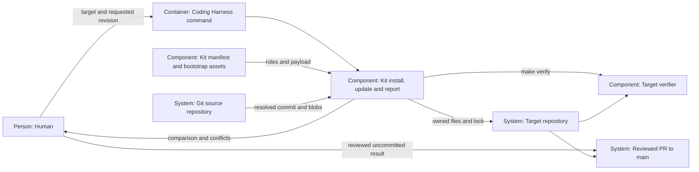

# Design — kit-install

The system shape for `spec.md`, using the evidence in `research.md` and the
five maintainer answers in `decisions.md`. The pinned-version, template and
no-commit choices are settled; the implementation arrangements below remain
revisable proposals.

## Alternatives

- **Acquire the requested snapshot in a temporary Git repository.** Local
  repositories and remote URLs use the same revision resolution and committed
  object reads. A target needs Git and, for a remote, network access, but
  neither its metadata nor the source checkout's refs need to change.
- **Read an already prepared release bundle.** Installation needs no Git
  transport and can be offline; a builder must first define and publish the
  bundle and its provenance. That couples this change to the future release
  builder before either has shipped.

Chosen: temporary acquisition of an explicitly requested Git revision. It
meets the pinned-source decision without making the release builder a
prerequisite. A future bundle adapter can supply the same payload records.

For conflicted updates, refusing the whole update would keep one uniform pin
but stall unchanged files; applying safe paths with per-file baselines lets
those files progress and keeps the edited path intact. Choose the latter to
honor Q-2's stop for that file. These choices are proposals confirmed by the
decision PR's merge.

## Interfaces

**Maintainer → Coding Harness command.** Add these invocations, keeping
`decide adr` unchanged:

```text
python3 scripts/harness.py kit install --target DIR --ref REV [--source LOCATION]
python3 scripts/harness.py kit update --target DIR --ref REV
python3 scripts/harness.py kit report --target DIR --ref REV [--source LOCATION]
```

Install and an unpinned report default to the command's repository as source.
Update and a pinned report use the lock's source location. An explicit source
on a pinned report is a comparison only, not a source migration. For a local
source, use its origin URL when available, otherwise its absolute repository
path; no endpoint, credentials or tracker bytes enter the lock. `--ref` is
required; branches and tags are resolved once to the full commit. Report
requires a readable target HEAD so its cut-off is real; install may bootstrap
an unborn Git target, whose absence of HEAD is stated explicitly.
The owner selects install for first workflow adoption and report for an
existing implementation; the command does not infer semantic freshness from
missing same-path files or choose a real instance automatically.

**Command → source Git.** Acquire the requested ref into an owned temporary
repository, with local-source acquisition insulated from its working tree.
Read the manifest, tracked tree, blob bytes and modes at that exact commit.
Fetches happen only in the temporary repository. Subprocess arguments are
arrays, revision options cannot be injected, and failed acquisition is a
refusal before target application. No source checkout or target gitdir is
used as a fetch cache.

**Source manifest → payload.** A shared reader supplies path classification
and published records to the command; `probe.py` retains its public helper
names through wrappers. Installation follows the kit's role map. The
independent legacy export policy keeps answering its separate migration
question and is not consulted or rewritten.

**Command → target working tree.** Resolve the explicitly selected target
root, validate every destination and existing ancestor, and compute the full
action list before writing. Existing templates are retained; an unpinned kit
destination is an install refusal. Plan update actions from each installed
baseline: replace unchanged files, add absent new files, delete unchanged
retired files, or report conflicts. File bytes and executable bits determine
identity; local deletion and type changes are edits too.

Template ownership is permanent for the recorded path. Retain its ownership
entry after upstream removal so later reintroduction cannot acquire it. A
mechanism/template ownership transition is a conflict, with no transfer.
Templates newly introduced after first install are reported for manual
adoption and recorded as target-owned with null baselines; update never
initializes them automatically.
Directories containing unrelated target files are never removed.

Stage replacement bytes outside the target, recheck the observed target
states immediately before application, and journal originals during the
write batch. Publish the lock atomically with the batch. On a handled write
failure, restore this batch's files, modes, lock and newly created empty
directories; do not claim crash recovery or simultaneous-writer isolation.
Stop if a path changes between observation and application. One writer per
target remains the operating assumption.

**Command → target verifier.** After a completed application, including a
partial update, run the literal argument array `["make", "verify"]` with
`cwd=target`; preserve its output and explain a missing command or nonzero
exit. Never stage or commit the result. Verification failure leaves the
applied payload and truthful lock for review; it is distinct from write
failure. Existing target verification code runs with the caller's ordinary
environment and may have its own effects; the installer makes no Git
mutation of its own.

**Command → report.** Print the source location/full commit, target commit,
requested revision, sorted destination records and totals. Records distinguish
kit drift, target-owned template differences, missing paths, update conflicts
and safe actions. Plain-text output is sufficient; report does not execute
target code or write a report file there. Unreadable state is an error,
not `missing`. Exit 0 means a completed successful operation or readable
comparison; exit 2 means refusal, conflict, application or verification
failure, with the underlying reason shown.

## Data model

**Kit manifest.** Keep `rollen`, `rules`, `prefix`, `rolle`, `reason` and
`geruest_ordner`; use schema version 2 for the additive publishing fields
and `template` role. Longest segment-aware prefix wins, as today. Identical
duplicate rules can be normalized; conflicting duplicates, unsafe paths,
unknown roles and unclassified source files refuse publication. The shared
classifier can still read schema 1 for existing callers; installation requires
schema 2's explicit initial-template contract.
Classify `harness.lock.yaml` as target inventory, never a deliverable from
another repository's source snapshot.

- `mechanismus`: source-relative destination, exact committed bytes/mode,
  update-owned after recording the initial baseline.
- `template`: source-relative destination by default; an exact-file rule may
  name `initial_source`, a committed bootstrap asset for the first write.
  `initial_generator: ci-gates` is the sole alternative, mutually exclusive
  with `initial_source`; it initializes a missing CI workflow from the chosen
  target gate list with the existing CI generator.
- `bestand`: never published. Scaffold directories carry no source contents;
  create a target-owned `.gitkeep` only when needed to preserve an empty
  initial directory in Git. Update never removes scaffold directories.

Make the three paths named in Q-3 templates. The root provenance map, agent
entry point, Makefile, project/dependency declarations and generated CI
workflow are also first-install templates because the target owns their
configuration. Their source originals stay intact. New bootstrap assets
under `scripts/kit/bootstrap/` are mechanism: they are the versioned recipe
inputs, distinct from the target's initialized files.

The bootstrap supplies a generic entry point linking to `docs/WORKFLOW.md`,
a provenance map without source inventory, a generic Python project file,
and a Makefile whose verify recipe delegates to `scripts/verify_all.sh` and
whose venv recipe uses the hash-checked dependency lock. Copy the committed
dependency lock only on first installation when absent; retain existing
dependency files. Supply Python 3.12 and three starter gates: the portable
test command below, `gate-schema`, and `ci-drift`, using the existing gate
schema and one list. No tracker or history-dependent gate is silently marked
green or installed as mandatory before that instance has its own setup.

```text
python3 -m pytest tests/test_gate_record.py tests/test_check_adr_answers.py tests/test_check_criterion_ledger.py tests/test_adoption.py -q
```

Generate an absent `.github/workflows/ci.yml` from the selected gate contents,
including preserved existing gates. Run the selected snapshot's generator
in an isolated preparation tree and capture stdout; validate schema first,
then stage the output. Existing CI is a retained template, never regenerated
by install or update. Runtime/package installation remains an owner action;
the installer calls verification and reports missing dependencies.

**Target lock (`harness.lock.yaml`).** The command is its only automatic
writer. Schema version 1 holds:

- `source.repository`: transport location, without embedded credentials;
  `source.commit`: the last completely applied source commit, or null until
  an initial application completes.
- `files`: destination → `{role, source_path, applied_commit, sha256, mode}`.
  The digest covers installed bytes; mode is the Git executable/nonexecutable
  mode. Initialized templates record their starting bytes; retained templates
  have target ownership and null installation-baseline fields. They never
  become overwrite candidates because they lack a baseline.
- `scaffolds`: directory paths introduced by installation.
- `pending`: null after complete application; otherwise `{commit, conflicts}`
  identifies the incomplete requested version and its blocked destinations.

After partial update, safe files have new individual baselines, conflicted
files keep their old ones, and `source.commit` stays at the previous completed
pin. Retry compares the actual file with its own baseline, not merely with
that global pin. Removing a safe retired kit file removes its ownership
entry; template entries remain. A pin records applied provenance, not proof
that target verification passed. A verification failure is reported even
when the applied source pin is complete.

**Portability survey.** Keep the existing probe's source-file survey separate
from actual fresh-target initialization: copy the source originals of both
traveling roles into the throwaway survey tree. Bootstrap substitutions and
the target gate list are proved by installer integration tests. Preserve the
probe's failed-case and orphan checks; remove only exemptions measured as
newly passing, with evidence, and never raise its cap to accommodate a broken
installer. This separation avoids claiming that the survey ran `make verify`
in an initialized instance when it still runs its existing pytest survey.

## ADR draft

The one draft is [ADR 0017 — pinned kit install and update](../../../docs/adr/0017-pinned-kit-install-and-update.md),
in the form of `templates/adr.md`. It records Q-1 through Q-5: fresh targets
first, reports for existing instances, commit pins, first-install template
ownership and verified changes left uncommitted. It amends no D-/O-number or
earlier ADR. Its acceptance is the maintainer's merge; the drafting call
neither records an ADR answer nor writes an approval.

## Architecture delta

Names retain the existing target's Human, Git and Reviewed PR to main; the
Coding Harness command and kit extend its existing process-delivery boundary.



**Added**

- Kit application/report component and its immutable Git-source boundary.
- Target lock, per-file ownership baselines and initial bootstrap assets.
- Human-readable comparison and conflict evidence without target mutation.

**Changed**

- The command gains the kit verbs alongside `decide adr`.
- Kit classification gains first-install templates and one shared reader.
- Initial target verification comes from its own gate list and Makefile.

**Removed**

- The assumption that shared-name configuration is update-owned mechanism.
- No existing command, gate, export decision or instance is removed.
