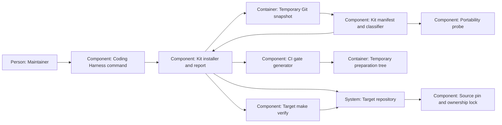

# Design — kit-install

The shape for the revised `spec.md`, from `research.md`, the six maintainer
answers and the phase-2a rulings in `decisions.md`. Updates are deferred by
Q-6; this design contains no update algorithm or pending-pin model.

## Alternatives

- **Acquire the requested Git snapshot in an owned temporary repository.**
  Local sources and URLs yield committed paths, bytes and modes without
  changing source or target refs. Git and, for remote sources, connectivity
  are prerequisites; dirty source files never become payload.
- **Consume a prepared release bundle.** Installation could avoid Git
  transport and work offline, but a builder and bundle/provenance format
  would have to ship first. That delays this change behind release work.

Chosen: temporary Git acquisition, because it supplies the already chosen
source pin without making a release builder a prerequisite. The choice is a
proposal confirmed by the decision PR's merge.

For implementation, moving classification into a new imported library would
create another traveling prerequisite during the runner's unstaged checks.
Keep the classifier in the existing `probe.py`, extend its role handling,
and let `install.py` consume it. This preserves the probe's public helpers
and avoids coupling this change to the separate untracked-file repair.

## Interfaces

**Maintainer → Coding Harness command.** Preserve `decide adr` and add:

```text
python3 scripts/harness.py kit install --target DIR --ref REV [--source LOCATION]
python3 scripts/harness.py kit report --target DIR --ref REV [--source LOCATION] [--target-ref REV]
```

Default source is the command's repository. A local source must have an
`origin` URL; use that URL as identity while reading the requested commit
from the local repository. For a URL source, that URL is identity. Never
substitute an absolute checkout path in the lock; refuse missing identity or
embedded secret credentials. Both verbs require `--ref`; report defaults
`--target-ref` to `HEAD`. Reporting does not interpret a target lock to select
or migrate its source. Future handling of another source URL belongs to update.

**Command → source Git objects.** Resolve the requested revision once to a
full commit and read the manifest, tree entries, modes and blob bytes there.
Acquire/fetch in an owned temporary repository only, with argument arrays
and option-safe revision handling; neither checkout supplies a fetch cache.
Local dirty bytes are ignored. Validate the complete source classification
and recipe references before any target write. No existing instance is
selected implicitly.

**Manifest → install or reference payload.** The kit manifest, not the
independent export manifest, selects the payload. Install uses exact committed
kit bytes, retained or initialized templates, derived CI and empty scaffold
placeholders. Report compares the same-path source originals of all three
published roles, with labels that make template and derived differences
expected target ownership. It reads the target's selected commit with exact
Git tree names; it does not stat working-tree paths or run the target's
potentially incompatible gate schema to compute comparison bytes.

**Command → target working tree.** Require the target root and the freshness
allowlist in the spec, using a readable HEAD plus the index's tracked paths.
Untracked content is preserved unless it conflicts with a destination.
Preflight every file and ancestor, including initial recipe and scaffold
paths: refuse escapes, Git metadata, symlinks, submodules, type collisions
and filesystem aliases that would fold different destinations. Any existing
non-template destination, including a lock, CI file or `.gitkeep`, is a
refusal. Only regular existing templates are retained.

Prepare the payload and run the selected version's CI generator in a temporary
preparation tree containing the chosen target gate bytes. Invalid retained
gates refuse before application. Keep a journal of created files/directories,
check destinations again before creating them, set Git executable bits and
publish the lock last. An I/O error in file creation/write, chmod, mkdir or
lock publication removes this batch and leaves pre-existing content intact.
There is no replacement/deletion/update path. One writer per target and an
uninterrupted process are the operating assumptions.

**Command → target verifier.** After complete application, invoke the literal
argument array `["make", "verify"]` once with target cwd. Remove `BEAD_RENDER`
and `PYTHON` from the child environment; the target runner selects its own
available interpreter. Preserve stdout/stderr and distinguish an application
error from a verifier failure. A verifier failure returns nonzero and retains
the payload and pin. The installer never stages or commits; a retained target
verifier can have its own behavior, so tests of installer Git preservation
use a verifier that makes no Git mutations.

**Command → report.** Print origin identity, source/target full commits,
requested revisions, sorted reference rows and totals. Row identity includes
exact path, role, owner and missing/identical/different state (bytes and mode).
Derived rows say reference only; no scaffold directory is mistaken for a
committed source file. Exit 0 means a complete readable comparison even with
differences, or an install with green verification. Exit 2 means refusal,
unmeasured state, application failure or verifier failure with the reason.
An unreadable Git object is not a missing path. Report creates no target file
and changes no target Git metadata.

## Data model

**Kit manifest, schema 2.** Retain `rollen`, `rules`, `prefix`, `rolle`,
`reason` and `geruest_ordner`; longest segment-aware prefix wins. Extend
`nach_rolle()` and probe reporting for `template` and `derived`. Keep schema-1
classification readable for existing callers; install/report require schema
2. Reject unsupported schemas, unknown roles, conflicting duplicates,
unclassified committed paths, unsafe recipe paths and destination collisions.
Consolidate the current duplicate CI rule into one derived declaration.

- `mechanismus`: same-path committed bytes/mode; includes the installer and
  starter recipe assets under `scripts/kit/bootstrap/`.
- `template`: exactly the five spec destinations. Gates and Makefile use an
  exact-rule `initial_source` pointing respectively to
  `scripts/kit/bootstrap/gates.yaml` and `scripts/kit/bootstrap/Makefile`.
  Ruff, the decision PR template and the dependency lock use their committed
  source-original bytes. A retained template is never reinitialized.
- `derived`: exactly `.github/workflows/ci.yml`, with generator
  `scripts/ci_gates.py` and input `decisions/gates.yaml`; never copied.
- `bestand`: not installed, including the lock, root provenance and all agent,
  endpoint and tracker settings. Override the existing `.claude/agents/`
  mechanism rule with inventory. The source `pyproject.toml` stays inventory.
- `geruest_ordner`: create each declared folder and an empty, kit-owned
  `.gitkeep`; never copy that folder's source contents.

**Bootstrap configuration.** The Makefile offers `verify` via
`bash scripts/verify_all.sh` and opt-in `venv` via the hash-checked
`requirements-ci.txt`. Installation itself installs no packages. The starting
gates use schema 2 and `tools.python: ["3.12"]`, with exactly these blocking
`verify` gates at `placement: both`:

| ID | Command |
|---|---|
| pytest | `python3 scripts/kit/probe.py --portable-tests` |
| ruff-check | `python3 -m ruff check scripts/ tests/` |
| ruff-format | `python3 -m ruff format --check scripts/ tests/` |
| adr-answers | `python3 scripts/check_adr_answers.py` |
| criterion-ledger | `python3 scripts/check_criterion_ledger.py` |
| gate-schema | `python3 scripts/ci_gates.py --check-schema` |
| ci-drift | `python3 scripts/ci_gates.py --check-ci` |

Pytest retains the floor flag. The portable mode runs all installed `tests/`
and converts the selected version's one `REIST_NICHT` case map to exact pytest
node IDs for deselection; no separately maintained exclusion list exists.
Source inventory gates, missing provenance/adoption records, external ruleset
inspection, tracker prerequisites and another nested probe are not starter
gates. Existing templates retain their own gates and can fail verification.

The probe differs from install: its survey copies source-original template
bytes, then generates CI from its copied source gate list. Source policy tests
that depend on excluded agent definitions or a full source gate list must
keep their source assertions and use fixtures or an explicit foreign-tree
skip, as existing traveling tests do. Remove obsolete exceptions only after
measurement and reduce the cap with the count; never add exceptions to make
bootstrap pass. Installer regression tests stay source inventory so target
verification cannot recursively install another target.

**Target lock, schema 1.** `source: {url, commit}` stores origin identity and
the full resolved pin. `files` is keyed by exact target-relative path. A
record holds `role`, `owner` (`kit` or `target`), `source_path` or `generated_by`,
`installed` and an installed `baseline: {sha256, git_mode}`. Retained templates
have `installed: false`, `baseline: null` and an observed hash/mode; ownership
is still target. Derived records name the generator and input hash, with
actual output hash/mode and target ownership. Scaffold records use kit
ownership, a null source path, `generated_by: scaffold`, and the empty-file
baseline. The lock itself is metadata, not a recursively hashed payload file.
There is no pending commit, partial-update state or ownership-transfer rule.
The installer alone writes this lock; report needs no lock.

## ADR draft

The single MADR draft remains
`docs/adr/0018-pinned-kit-install-and-update.md`, reserved in `decisions.md`.
It is new relative to this change's merge base even though the first draft
already committed it; the runner permits redrafting that one file. It records
install, report, pin and target ownership, retains Q-2/Q-3 as direction for
the separate update change, and claims no update implementation or test
completion in this PR. The decision PR's merge accepts the proposal; this
call writes no maintainer answer or approval.

## Architecture delta



**Added**

- Kit install/report dispatch, temporary snapshot/preparation boundaries and
  the target's source pin and ownership record.
- Template/derived classification and the two verification starter assets.

**Changed**

- The Coding Harness command exposes delivery and comparison alongside
  `decide adr`; the probe carries templates and derives its workflow.
- CI generation also supplies the target from its own gate configuration;
  the target retains configuration ownership and review/merge responsibility.

**Removed**

- The kit manifest's kit ownership of initial configuration, copied CI,
  root provenance and source agent definitions; source files stay in place.
