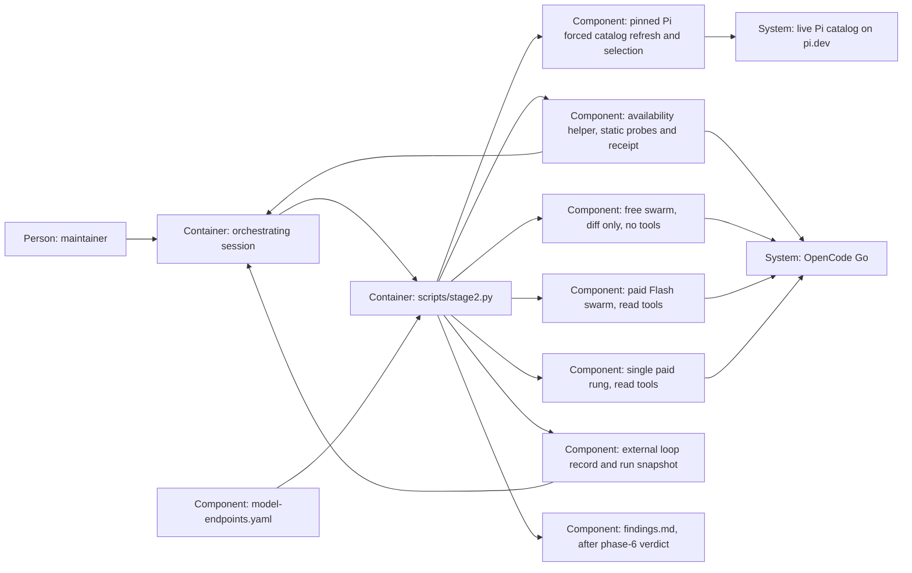

# Design — `loop-until-clean`

This feature keeps the existing stage-2 runner and external loop record.
It implements the spec through Q-16, including forced live refresh,
configurable admission and actual reachability preparation. The Q-16
amendment below replaces the historical manual Flash membership on new runs. All choices below
are proposals until merge.

## Alternatives

- **One process, concurrent child calls, one record writer (chosen).**
  `review-loop` drives one round; a thread executor starts independent Pi
  subprocesses. The parent merges responses in discovery/configuration order
  after completion. Operations keep the existing CLI and one editable table;
  the parent must serialize audit and record writes.
- **Independent member processes with individual result files.** Members
  could be resumed independently, but cleanup, locking, partial-result
  recovery and release need a new persistent protocol. It meets the same
  round structure with more state and operational work.

Chosen: the single record writer, because the parallelism concerns model
calls, not tracker or repository writers. Neither a higher cap nor repeating
MiMo Pro meets the decisions; those are not implementation alternatives.

## Interfaces

- **Runner → pinned Pi discovery.** Force `tools/pi/pi update models`, then
  use `tools/pi/pi --list-models` in the
  same isolated configuration/environment as reviewer calls, with discovery
  loaders disabled and the Go credential supplied only in the environment.
  Parse its table by header columns, not JSON or fuzzy model matching;
  select the configured provider and suffix plus included ids present in
  that provider's catalog, then remove exclusions and deduplicate in catalog
  order. Exclusions override both suffix matches and includes. Nonzero exit,
  timeout of either command, warning indicating broken configuration,
  malformed output or no members refuses before any review call; never
  list/use an older cache after a failed refresh. Record UTC date/time, Pi
  version, source `pi.dev`, rule, provider catalog and selected ids.
  Recheck on each fresh run, including a retry that completed no round;
  later rounds resume the snapshot rather than rediscover midway.
- **Discovery freshness boundary.** The source reading recorded in the
  final decisions addendum (2026-10-16, after `a0d5bc8`) found Pi's remote
  catalog on `pi.dev`, a four-hour default cache and a forced refresh through
  `update models`. Use that existing command, not a new catalog client.
  The maintainer retained this live intermediary instead of Go's own
  endpoint; actual free billing remains unmeasured.
- **Runner → endpoint declaration.** Keep `modelle` as the ordered paid
  list; add English `flash_swarm` for its first three members and
  `free_stage: {provider: opencode-go, id_suffix: "-free", include: [], exclude: [], input: implementation-diff}`.
  Each include/exclude item is `{id, date, reason}`; validate nonempty ids,
  ISO dates and reasons, and reject malformed rules before calls. Read all
  provider/match/exception values from YAML; no free id or suffix literal
  belongs in the runner. The provider must be the declared Go endpoint,
  so a configuration edit cannot route this exception to Zen.
  Free admission also requires membership of this invocation's discovery
  snapshot and free-purpose input confinement. It is never a global suffix
  bypass in `declaration_problem`; paid/session paths still require an
  explicit model entry. Endpoint framework/residency checks still apply.
  Editing the rule is an ordinary configuration PR; an active run retains
  its snapshot, so edits apply to the next fresh run.
- **Runner → reviewer subprocess.** Free calls use `--no-tools`, no
  `--tools`, no context/resource loaders, a scratch cwd and a standalone
  free-review prompt built from static output instructions plus the filtered
  implementation diff. Do not append `READ_REQUEST`, the change's spec,
  paths to plans, repository location or the paid prompt's read instructions.
  The paid Flash swarm and single rounds keep today's isolated Pi launch,
  worktree cwd, loop prompt, complete diff and `read,grep,find,ls`.
- **Runner → checks/audit.** Before each member call run the declaration
  and leak checks and write its existing stage-2 audit line in the parent;
  a leak BLOCK aborts the round without fallback. Only after every member
  clears preflight are child calls dispatched concurrently. Each gets a
  distinct scratch home, agent directory, prompt and current timeout.
- **Runner → orchestrator.** One call completes at most one round. The
  orchestrator decides its merged rows, performs one repair batch, and
  requires `make verify` green before the next round. A clean stop names its
  round; brake or exhaustion names the maintainer and unresolved work.
  Failed ids and skipped paid terms go to the handover through findings.

## Data model

- **Endpoint configuration:** `modelle` is a set (Q-13): `deepseek-v4.1-flash`,
  `mimo-v2.6-flash`, `longcat-2.0`, `glm-5.3-flash`, `qwen3.8-flash`,
  `gpt-6-luna`, `claude-haiku-5-5`, `minimax-m3` (replacing `minimax-m2.7`,
  Q-11) and `mimo-v2.6-pro`, ordered by the declared `anfragen_5h`, subject
  to dated eligible terms. Store only eligible paid entries; record skipped
  requested ids and reasons in the remark/findings. `flash_swarm` is the
  eligible intersection with the first three; reject other overlap, duplicate
  ids or inconsistent membership. The remark declares the free class's
  accepted unread terms and discovery's live intermediary/billing limits.
  Store the editable provider/suffix and dated, reasoned include/exclude
  lists in `free_stage`, initially with empty exception lists. Do not invent terms,
  prices, region claims or supported ids during drafting.
- **Run snapshot:** runner-owned metadata in the existing external loop
  record captures the successful forced refresh/listing, timestamp, source,
  Pi version, selection rule, catalog, free members, paid stages, terms skips and
  consumed stage identifiers. Persist it with the first completed round;
  configuration edits cannot change an in-flight run's stage mapping.
  If all Flash candidates are ineligible, record the skipped stage and move
  to the first eligible single rung without counting a fictitious round.
- **Round block:** one `## Round <n> — <comma-joined-members>, <date>` heading,
  existing nine-column rows, globally unique `L<n>-<k>` ids and per-row
  Reviewer. Keep original member responses, failures and their provenance;
  no semantic deduplication. A validated no-finding answer succeeds;
  malformed finding output fails that member instead of becoming clean.
- **Stops:** first hold all undecided/evidence-incomplete rows; then inspect
  the last completed round for clean, the last two for the fix-r brake,
  and the remaining snapshot stages for exhaustion. `fixed` counts as taken
  in all checks. No failure-only attempt increments rounds or consumes a stage.
- **Release:** retain existing `Rounds run:` counts, released rows and the
  snapshot/stage metadata through the existing kept-lines channel before
  deleting the external record. Admission reconstructs the complete ordered
  round history across all releases and the current record, including clean
  rounds with no rows; quoted reviewer text never becomes control metadata.
  Preserve the verdict-before-release rule and existing parser columns.

## ADR draft

The single proposed record is
[`docs/adr/0021-review-swarms-until-clean.md`](../../../docs/adr/0021-review-swarms-until-clean.md),
updated in place from the prior unmerged draft using `templates/adr.md`.
It amends ADR 0011 decisions 3 and 8 and ADR 0017 decision 6 without editing
those files. The existing ADR answer names 0021; no answer is written here.
There is no second embedded copy of the record to drift.

## Architecture delta

**Added**

- Live discovery and configurable free admission, plus the two parallel
  swarms with one writer.
- Run membership/stage snapshot and mechanical repair-brake refusal.

**Changed**

- Each invocation admits a stage from the snapshot until clean or escalation;
  paid terms eligibility and the configured stages bound the run.
- Release preserves membership, stage position and admission history.

**Removed**

- `MAX_ROUNDS`, unconditional round 2 and the special round-3 admission rule.

## Q-16 amendment — availability preparation, 2026-10-17

For fresh availability-enabled runs, this amendment supersedes the manual
Flash membership and direct-discovery start described above. The existing
snapshot reader and consumed-stage rules continue unchanged.

1. `stage2.py prepare-loop <change>` calls the bounded helper in
   `scripts/stage2_availability.py`. The helper delegates every provider call
   to the runner, using static input, scratch directories, no tools and a
   60-second timeout. Discovery remains a forced Pi catalog refresh.
2. Filter the admitted pool by fresh catalog membership, timed exclusions,
   known cost and successful actual probes. Free admission remains the
   existing Go-only class exception. Fill up to three cheap paid positions
   dynamically and put the remaining paid models on the ladder.
3. Print a timestamped availability report and write an external atomic
   `availability.json` receipt. It contains the selected state, failures,
   skips, input/configuration hashes, worktree identity and report id.
   Do not store credentials, raw model answers or code in it.
4. The orchestrator reports the selection in the main conversation before
   invoking `review-loop --availability-reported <id>`. Validate the receipt
   and its 900-second freshness before launching any review. This explicitly
   checks caller acknowledgment; it cannot inspect the conversation UI.
5. The first completed round persists that selection through the existing
   Loop state/release path. Later rounds keep it. A fresh preparation is
   refused for a run with history, including an exhausted snapshot.
6. An absent configuration rule retains legacy-declaration compatibility.
   This repository enables the rule; its dedicated integration tests assert
   that production binding. Structural runner extraction stays a separate
   task; no repair, phase-6 or provider routing changes are included.
