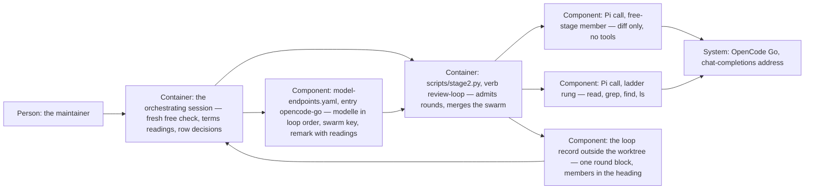

# Design — `loop-until-clean`

How the system is shaped for the change that `spec.md` describes, written from
`spec.md`, `research.md` and `decisions.md` (Q-1 to Q-8). What the spec fixes
is not decided again here. The class is `feature` and its spec proposes "yes"
to the ADR question, so this phase runs and carries the ADR draft
(`prompts/02b-design.md`, decision D-14).

## Alternatives

The stops, the ladder and the swarm's members are the maintainer's; what this
design weighs is how the loop is driven to a clean round and where the fresh
free list lives.

- **Rounds until clean, admitted by the runner (chosen).** Each `review-loop`
  call is admitted by three checks in order — the previous round left a taken
  row, no two consecutive fix-r rounds stand, a rung remains — and a clean
  round is the loop's success state. Consequences: the runner stays the one
  gate between a round and a call; the stops are testable refusals with
  messages a handover can quote; nobody has to count rounds by hand.
- **A higher numeric cap.** `MAX_ROUNDS = 9` is a one-line change and every
  existing test survives with new numbers. Consequences: the night-run problem
  returns at another number, a clean round still does not end the loop, and
  the bead's "until one finds nothing" stays unmet.
- **The last rung repeated until clean.** No bound to maintain beyond the
  ladder; Q-6 rejected it — a model that has already reviewed reviews again,
  with no fresh eyes and no spend bound.
- **A swarm in every round.** Maximum independence per round. Consequences:
  the Go plan's monthly limits are spent many times faster, and rounds
  correlate within a repeated swarm; Q-5 chose one model per round from
  round 2 on.
- **Where the fresh free list lives.** (a) The entry's free-stage list,
  updated by the orchestrator's check before the stage runs (chosen): the yaml
  stays what the runner calls, the runner stays offline, the declaration gate
  is untouched, and the check is doctrine with its date in the remark.
  (b) The runner fetches the vendor's list per run: the check would be
  mechanical, but the runner gains a network call it cannot test offline and
  a path around the declaration gate. (c) A per-run flag naming the swarm:
  unaudited and gameable — a model would reach the diff without ever standing
  in the repository.

Chosen: rounds until clean admitted by the runner, with the free list in the
entry — because both of the maintainer's frames ("check the free list before
each run", "each new model is declared") hold without weakening a standing
guard. The choice is a proposal; the merge of the pull request decides it.

## Interfaces

Five boundaries carry something across in this change.

- **Runner → Pi → OpenCode Go.** Two shapes now. A free-stage member: the
  same isolated launch as today (fresh configuration directory, scratch home,
  every loader off, the pinned version, `--thinking max`,
  `OPENCODE_API_KEY` in the environment) but with `--no-tools`, a prompt of
  the loop text and the diff only, and the model as `opencode-go/<id>`. A
  ladder round: today's argv unchanged, `--tools read,grep,find,ls` included.
  Promised by the runner: one call per member in parallel for round 1, one
  call per ladder round; a member whose call fails is named, not retried
  silently.
- **Runner → `model-endpoints.yaml`.** The entry's `modelle` lists every
  model the loop may call, in loop order — the free stage's members first,
  then the ladder; the new `swarm` key names the free stage's members. The
  declaration check keeps reading `modelle` (so the `session` verb and the
  probe keep their meaning); the ladder for rounds 2 and later is `modelle`'s
  order after the `swarm` members. Reordering stays a one-line pull request.
- **Runner → the loop record.** One round block per round as today; a
  free-stage round's heading joins its members comma-separated without spaces
  (`## Round 1 — deepseek-v4.1-flash,mimo-v2.6-flash,longcat-2.0, <date>`),
  so `ROUND_HEADING` reads it unchanged; rows keep the nine cells, the
  Reviewer cell carrying the row's member.
- **Orchestrator → OpenCode Go's pages, outside the runner.** The fresh free
  check before every free stage, and the data-terms reading (retention,
  training) before a new rung is declared; both recorded with their dates in
  the entry's remark, both named in the loop's doctrine.
- **Runner → secrets file and `findings.md`.** Unchanged: the key at call
  time into the child's environment only; one audit line per model call, so a
  swarm round leaves one line per member.

## Data model

- **`model-endpoints.yaml`, entry `opencode-go`** — `modelle` grows to the
  loop's models in the maintainer's order (Q-1), the new English key `swarm`
  names the free stage (the file's German keys are untouched; a new identifier
  is English), and the `bemerkung` is rewritten: prices and monthly limits per
  new model, the privacy-table reading per new model with its date, the
  free stage's unread-terms acceptance, the fresh-check rule with its date,
  and the DeepSeek ZDR note refreshed past 2026-10-31.
- **Runner constants and functions** — `MAX_ROUNDS` removed; `review_loop`
  gains the free-stage round (parallel calls, merged rows, the failed-member
  note), the clean-round refusal, the ladder-end report and the fix-r brake;
  `taken_in_round` keeps its rule for every round number and its docstring
  citation moves to ADR 0017 decision 6 as amended by ADR 0021; `ladder()`
  returns the ordered `modelle`; a new `free_stage(root)` reads the `swarm`
  key; the declaration check reads `modelle` as today; `probe` walks
  `modelle`; the module docstring and help state the new rule.
- **The loop record** — round headings as above; `Rounds run:` lines and
  `rounds_run` unchanged; no new column.
- **No schema change elsewhere** — the handover field `review_rounds`
  ("rounds until clean") already fits; `scripts/stage2_runs.py` is checked in
  phase 4 and changes at most a comment.

## ADR draft

The text below is `docs/adr/0021-review-swarms-until-clean.md` in this
change's decision pull request, written by this phase, with its headings
lowered two levels here. `0018` was the first free number on 2026-10-14; it went to ADR 0018 (every question carries its context, PR #148), 0019 to the pinned Pi (PR #149) and 0020 is claimed by the research swarm, so this record is 0021 (2026-10-16).

### ADR 0021 — The review loop runs until a clean round: a free swarm first, then the ladder

* Status: accepted by the merge of the pull request that carries this file.
  Until that merge, the pull request's state is the decision's state: open
  is proposed, closed is rejected. Amends ADR 0011 (decisions 3 and 8) and
  ADR 0017 (decision 6); supersedes no ADR. Amends no D- or O-number.
* Review: the maintainer chose the direction on 2026-10-14 in the answers
  recorded as Q-1 to Q-8 in `plans/changes/loop-until-clean/decisions.md` ·
  Decider: maintainer · prepared by GLM 5.3 through the stage-2 runner.
* Date: 2026-10-14 · takes effect on merge.

#### Context

* **The three-round cap did not survive contact.** ADR 0011 decision 3 set
  "The loop runs at most three rounds", and ADR 0017 decision 6 kept it. On
  the first night run the loop wanted a fourth round and the runner refused
  it (`docs/journal/handover/2026-10-12-night-run-first-rehearsal.md`, §4),
  and the roadmap carries the bead: "review rounds until one finds nothing"
  (ROADMAP.md, Now 3).
* **A clean round today extends the loop instead of ending it.** Rounds 1 and
  2 both run unconditionally, and two rounds without a taken finding stop the
  loop with a refusal — the opposite of the goal (`scripts/stage2.py`,
  `review_loop`; ADR 0011 decision 3).
* **The maintainer rebuilt the loop's shape on 2026-10-14** (Q-1 to Q-8): a
  swarm of the models OpenCode Go currently offers free reviews first, in
  parallel, reading only the implementation; then one model per round walks a
  named nine-model ladder across providers; the loop ends on a clean round,
  on two repair-fed rounds, or at the ladder's end — whichever comes first.
* **What OpenCode Go is and may do stands in ADR 0011 and the entry.** The
  address, Pi as the pinned launcher, the isolation per call, the key's path
  and the accepted residual risks are measured and recorded there
  (`model-endpoints.yaml`, entry `opencode-go`, remark with the readings of
  2026-10-07 and 2026-10-08). Six of the nine named models are not yet
  declared; Q-7 sends each to the entry only with its data terms read.

#### Decision Drivers

* A round that finds nothing taken is the only proven end of reviewing; a
  fixed round count is not.
* Every round deserves fresh eyes: no model reviews twice while rungs remain.
* No provider keeps or trains on framework content — except the free stage,
  which sees the implementation's diff alone and may run on unread terms.
* The loop stays bounded per change, both in calls and in spend.
* Repairs feeding the reviews is an escalation to the maintainer, not more
  rounds.

#### Considered Options

* **Rounds until clean on a free swarm plus a named ladder** — chosen (Q-1,
  Q-2, Q-5, Q-6, Q-8): fresh eyes in every round, cheap views first, a bound
  that is data.
* **A higher numeric cap** — keeps a refusable, testable budget; but the
  night-run problem returns at another number and "until one finds nothing"
  stays unmet.
* **The last rung repeated until clean** — always fresh findings from a model
  that has already reviewed; unbounded spend on one model; rejected in Q-6.
* **A swarm in every round** — the most independent views; but the Go plan's
  monthly limits and same-model correlation argue for one model per round
  from round 2 (Q-5).
* **Free models with the ladder's read tools** — richer findings from the
  swarm; but "only the implementation's code is read" would rest on a
  request, and Pi confines nothing (ADR 0011 decision 4), so the free stage
  would send unread-terms models everything its tools reach. Chosen against:
  the free stage gets the diff and no tools.

#### Decision

Chosen option: "Rounds until clean on a free swarm plus a named ladder",
because it meets the maintainer's eight answers without weakening a standing
guard of the runner.

1. **The loop ends on a clean round, at any round number.** A round is clean
   when it leaves no row whose Status begins `taken` or `fixed` — a round
   whose findings were all rejected is clean (Q-2), and a round that wrote no
   row is clean. Every round after the first starts only when the previous
   round left a taken or fixed row. This amends ADR 0011 decision 3's
   "Rounds 1 and 2 both run" and "The loop runs at most three rounds", and
   generalizes its round-3 condition.
2. **Round 1 is the free swarm.** Every model of the entry's free-stage list
   reviews in parallel, each in the isolated Pi call of ADR 0011 decision 6,
   and their findings merge into one round — one heading, one id series, each
   row carrying its model (Q-5). The free stage's calls carry the change's
   diff and the loop prompt and no repository read tools: the maintainer's
   condition "only the implementation's code is read" (Q-8) holds as a lock,
   not a request. Unread data terms are accepted for the free stage alone,
   because only the diff reaches it.
3. **The fresh free check belongs to the orchestrator, and the entry is what
   the runner calls.** Before the free stage runs, the models OpenCode Go
   currently offers free are checked and the entry's free-stage list brought
   up to date; the check's date stands in the entry's remark (Q-8). A free
   model the entry does not declare is named and not called — the declaration
   gate of ADR 0011 and the runner stands before every call, so the vendor's
   list of the day never overrides the repository's.
4. **From round 2 on, one rung of the named ladder per round.** The order is
   the maintainer's of Q-1 after its first three: `glm-5.3-flash`,
   `qwen3.8-flash`, `gpt-6-luna`, `claude-haiku-5.5`, `minimax-m2.7`,
   `mimo-v2.6-pro` — the yaml is the truth and no doctrine text repeats it.
   Each model not yet declared enters the entry with its data terms read —
   retention and training, with the reading's date; a model whose terms show
   retention or training, or cannot be read, is skipped on the ladder and
   named in the handover (Q-7). The ladder rounds keep the read tools and
   their accepted unconfined reach of ADR 0011 decision 4.
5. **The ladder is the bound.** When the last rung's round still leaves a
   taken row, the loop stops and reports to the maintainer; the last rung is
   not repeated, and a rung the address refuses stops the run — no second
   address, no substituted model (Q-6; ADR 0011 decision 7 stands).
6. **The fix-r brake stays and becomes the runner's refusal.** Two
   consecutive rounds that each left a taken row, all of Origin `fix-r`, stop
   the loop and go to the maintainer, at any round number and before the
   ladder ends (Q-3). A row repaired to `fixed` still counts as taken for the
   next round and the run count — the first half of ADR 0017 decision 6
   stands; its "the maximum stays three rounds" is amended by this record.
7. **The terms and cost frame is restated for the longer loop.** ADR 0011
   decision 8's "the loop makes at most three calls per change" is replaced:
   per change at most one call per free-stage member and one per ladder rung,
   with the rungs' prices and monthly limits standing in the entry's remark —
   the Go plan's limits are the budget's guard, and a skipped rung shortens
   the loop.

#### Consequences

* The loop spends more per change: a swarm round plus up to six ladder rounds
  against the former three rounds. The Go plan's per-model monthly limits,
  named in the entry, are what bounds a month; nothing else does.
* The free stage sees the diff and nothing around it — the context
  ADR 0011's "a round without tools" option named as the cost of confinement
  is deliberately paid there and only there; the ladder rounds keep it.
* The orchestrator owes two steps the runner cannot take: the fresh free
  check before every free stage, and the terms reading before any new rung is
  declared. Both are stated in the loop's doctrine; a skipped model is named
  in the handover.
* Eight files' round texts change with this record
  (`AGENTS.md`, `docs/WORKFLOW.md`, three phase prompts,
  `templates/findings.md`, the runner's docstring, the entry's remark), and
  the doctrine tests that pin "at most three rounds" move with them.
  ADR 0011's and ADR 0017's bodies stand as history; a reader of either alone
  must follow this record for the round budget.
* `make verify` green after each repair and the undecided-row hold are
  unchanged; the release order — verdict before rows enter `findings.md` —
  is unchanged.

#### Validation

* The criterion ledger in `plans/changes/loop-until-clean/plan.md` names the
  clean stop, the swarm round and its diff-only calls, the brake, the
  ladder's end, the terms readings and the doctrine agreement, each with the
  fault that turns it red.
* `.venv/bin/python -m pytest tests/test_stage2.py
  tests/test_stage2_runs.py tests/test_model_endpoints.py -q` and
  `make verify` pass once the maintainer's stated ADR answer is recorded.
* The compatibility probe's commits, one call per newly declared id with its
  first answer line, stand in the pull request body; this change's own review
  loop is the first live run of the record.

## Architecture delta

The stage-2 review loop and what feeds it, as it is after this change:

**Added**

- The free stage: parallel no-tools reviewer calls over the implementation's
  diff, one merged round.
- The `swarm` key of the `opencode-go` entry, and the orchestrator's fresh
  free check in front of every free stage.
- The runner's fix-r brake and ladder-end report as round-admission
  refusals.

**Changed**

- Round admission: a taken row in the previous round admits the next, a clean
  round ends the loop, and the ladder (now up to nine models in the entry)
  replaces `MAX_ROUNDS` as the bound.
- The ladder's membership and order in `model-endpoints.yaml`, each new rung
  declared with its data terms read.
- The loop record's round heading (members comma-joined) and the round texts
  of eight files.

**Removed**

- `MAX_ROUNDS` and the three-round cap; the unconditional round 2; the
  round-3-only condition in its three-round form.
