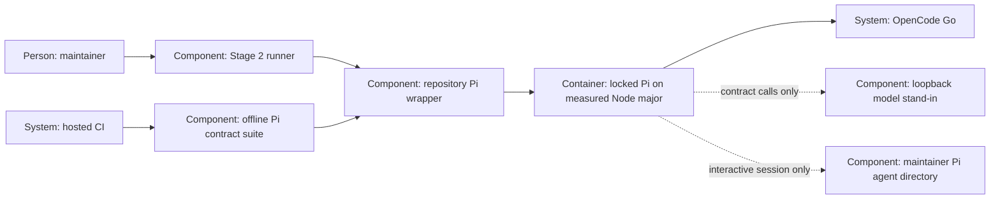

# Design — pi-pin

The feature keeps the runner's trust boundaries and authentication paths but
owns its launcher and measures the real program. Inputs: `spec.md`, `research.md`
and the maintainer's six answers in `decisions.md`.

## Alternatives

The interview already chose a repository install over global/versioned installs
(Q-2) and CI contracts over manual measurements (Q-1); these are not reopened.
Within that choice:

- **Direct local launch behind one wrapper, with manifest-derived expectations.**
  Python checks the wrapper's reported version; the wrapper checks the installed
  package against the manifest before executing the local CLI with Node.
  Operations maintain one dependency pin plus its generated lock.
- **A separate VERSION file and a wrapper that invokes `npx`.** A short wrapper,
  but another version value can drift, and missing packages can trigger downloads
  at launch unless explicitly disabled; operation and audit become harder.

Chosen: direct local launch with one source for each pin. This is the proposed
implementation of the answered repository-install decision; merge adopts the ADR.

## Interfaces

- Runner → absolute `tools/pi/pi` derived from the runner's repository root,
  never the caller's cwd or PATH. Keep `require_pi()`'s bounded, keyless scratch
  version check; derive `PI_VERSION` from the manifest for existing consumers.
  Reviewer/probe calls and session confirmation/Terminal argv use the same path.
- Wrapper → Node → installed CLI: resolve the wrapper's own directory, read the
  manifest pin and `.node-version`, check Node's major and the installed Pi's
  version, then `exec` the local package's declared bin target with arguments,
  cwd, environment and exit code preserved. Never use a global `pi` or `npx`.
- Installer → npm registry: `npm ci --ignore-scripts` in `tools/pi/`, no credentials
  or user auth copied there; a failed install returns failure. Launch never installs.
- CI generator → workflow: add exact Node setup using `.node-version` and the
  common installer before pytest in each job that runs the suite. Regenerate
  `.github/workflows/ci.yml`; retain the existing Python matrix and gate commands.
- Real Pi → contract server: synthetic key, scratch HOME/agent/project, fixed
  local responses, bounded subprocesses and test-only denial of non-loopback
  network destinations. Native provider defaults are checked independently of
  the loopback `models.json` override; no test fetches catalog updates.
- Session → user agent directory remains unchanged: wrapper performs no
  authentication read; actual interactive Pi still uses the user's own sign-in.

## Data model

- `tools/pi/package.json`: private npm project, one exact dependency
  `@earendil-works/pi-coding-agent` (initial candidate 1.2.0), maintained by PR.
- `tools/pi/package-lock.json`: npm-generated dependency graph with registry
  integrity values, committed with the manifest; never manually invented.
- `tools/pi/.node-version`: exact CI runtime (candidate 26.9.0); wrapper and
  installer derive major 26. No second Node-major configuration field.
- `tools/pi/node_modules/`: ignored, rebuildable installation, never credentials.
- Tests create temporary server transcripts, policy copies, trap files and
  synthetic configuration. No captured private auth or hosted model answers.
- Existing findings/decision records retain their formats; no database is added.

## ADR draft

Exactly one draft is in
`docs/adr/0019-repository-pinned-pi-and-contract-tests.md`, in the form of
`templates/adr.md`. It amends ADR 0011 decision 6 and ADR 0012's version and
launcher assumptions; existing ADRs remain unchanged. Its header follows the
merge-effective convention, not an agent's declaration that it is already adopted.
It amends no D-/O-number, so continuity mappings do not move.

## Architecture delta

**Added**

- Repository-owned Pi wrapper/install/lock and measured Node declaration.
- Offline real-Pi tests, loopback stand-in and CI provisioning relationship.

**Changed**

- Every runner Pi launch resolves the wrapper; compatibility evidence comes
  from the contract suite rather than a manual measurement alone.

**Removed**

- The runner's dependency on global Pi lookup and a duplicated literal Pi pin.
- No endpoint is removed or added; Zen exists only as an offline test subject.
