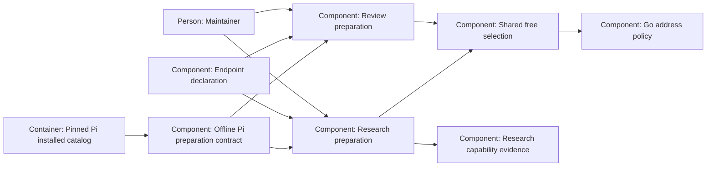

# Design — research-free-paid

Shape for `spec.md`, based on `research.md` and the three answered records in
`decisions.md`. All implementation below is proposed, not yet built or tested.

## Alternatives

- **Patch research alone.** Quickly drops paid ids, but leaves common rules
  duplicated and requires another coordinated repair after a policy change.
  Rejected by the maintainer's shared-selection answer (`decisions.md#Q-1`).
- **Shared deterministic selector with caller adapters.** One component owns
  common membership and reasons; review and research retain their catalog
  evidence, policy formats, capability needs and reporting. Migration and
  parity tests cost more once, while future common rules have one home.
- **Unify discovery, probes and all preparation state.** Removes more adapters,
  but couples toolless reviews to public-research capabilities and rewrites
  receipt/probe protocols beyond the answered scope.

Chosen proposal: shared deterministic selector with caller adapters, matching
the maintainer's choice without changing either caller's data boundary.

## Interfaces

`scripts/stage2_free.py` is a new internal Python component, importing
`stage2_go`, never `stage2` or either caller. It performs no I/O, network call,
catalog refresh, probe or credential lookup.

- Inputs: normalized provider/id/definition rows; fresh id set; normalized
  suffix/include/exclude policy with explicit additive or restrictive include
  mode; paid ids from `modelle`; applicable global exclusion reasons; the
  loaded `stage2_go.AddressPolicy`; optional caller eligibility reasons.
- Output: selected ids, per-candidate refusal reasons and address notices.
  The selector deduplicates ids, requires a plain model id and fresh provider
  membership, applies hard vetoes before inclusion, and delegates destination
  assessment to `stage2_go.assess`. No host/base literal is copied here.
- One common per-id admission helper owns paid membership and hard model
  vetoes; both the selector and existing call-boundary adapters use it.
  Launchers retain frozen-membership, role, data-class and destination checks.
  Current declaration data is supplied at admission, not trusted from a receipt.

Review's adapter translates `free_stage.id_suffix` and dated include/exclude
records, supplies framework exclusions, and keeps catalog order. Replace the
membership decisions in `select_free`/`free_drops`/`discover_free` with thin
delegation; wrappers may remain for compatibility but may not retain another
policy implementation. Address activation checks remain defense at launch.

Research's adapter translates `online_free.suffix` and string lists, supplies
public-web exclusions and Pi/capability rejection evidence, and sorts output.
`select_research_catalog` receives the admission data it currently lacks.
Research keeps its raw-source parser, identity ambiguity failures, capability
checks and explicit-include error contract. Its parser keeps structural field
checks, but destination permission moves to the shared selector's Go
assessment rather than remaining a second host/base rule. A hard-vetoed id is never admitted
by an include; an explicitly requested ineligible researcher still receives
the existing preflight refusal. Default-policy paid collisions are candidate
drops, not whole-preparation errors.

`prepare_research` consumes that result before probing. Its report and receipt
carry the paid-drop reason, using existing catalog candidate evidence rather
than inventing a second classification. `N` counts only reachable selected
free members. Review preserves its existing dropped-id report.

The real-Pi contract reads the installed package's provider data using the
existing `provider_data`/mandatory-install helpers. A local source fixture
serves that exact catalog as the fresh response to the production catalog
adapters; capability evidence and probe successes are synthetic and labelled.
Run both production preparations, including declaration checks, selection,
reporting and receipt construction, in scratch roots with a copy of the
current endpoint declaration. Fix test time for terms evidence; do not fix a
failure by changing model admissions, policies or selected ids in the copy.
Model transports are replaced at the probe-response seam, not by replacing
preparation, admission, catalog parsing or selection. Every unexpected model
dispatch fails. Child Node processes retain the existing network guard,
scratch HOME/agent directories and synthetic credentials; Python external
network calls are denied as well. Assert complete preparation receipts and
absence of paid/free collisions. Fault injection separately makes each
production preparation fail to prove the contract observes both paths.

## Data model

No new persisted schema or configuration. The internal normalized selection
request/result is ephemeral; the caller owns loading data and preserving raw
catalog evidence. Existing review `dropped` and research catalog `candidates`
carry the paid reason; research reporting exposes it. Existing receipt
bindings, versions, paths and frozen selection semantics are preserved.

## ADR draft

None — the feature proposes "no": the existing model and destination contracts
are consolidated internally, without new admission or governance authority.
No maintainer ADR answer has been recorded by this draft.

## Architecture delta

**Added**

- Shared free-selection component and a contract exercising both preparations
  from the real installed catalog.

**Changed**

- Review and research delegate common membership and model vetoes to the
  shared component; research reports paid candidates as dropped before probes.

**Removed**

- Independent common free-membership rule implementations in the two callers.
