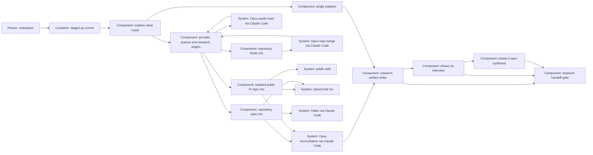

# Design — research-swarm

Proposed shape for [spec.md](spec.md), based on the amended interview Q-7–Q-9.
This replaces the earlier six-topic/free-stage design; the merge decides it.

## Alternatives

- **One runner with provider queues and stage barriers** (chosen): one input
  state, common briefs and an auditable public/private boundary; cancellation
  and concurrent output accounting become runner responsibilities.
- **Separate finder, research and judge commands:** independently inspectable
  steps, but operators must bind intermediate results to the same state and
  enforce per-provider limits across commands; more recovery state to govern.
- **A sequential runner with the same roles:** retains comparisons and context
  isolation, but cannot meet Q-7's selected concurrent execution.

Choose the first because existing explore remains the entry point and one
owner can enforce provider limits, source provenance and publication rules.

## Interfaces

**Caller → router.** Keep `stage2.py explore <change>` and explore-only
`--class`; all stated research/spec/argument classes must agree. Invalid YAML,
empty/unknown class and conflicts exit 2 before any call. No spec or plan is
required when research or the argument supplies a valid class. Explicit
`--stage2-off [REASON]` keeps single Haiku 5.5 and its route record; bounded
and spike keep single GLM Flash. Other verbs keep their contracts.

**Declaration → roles.** Replace `research_swarm`'s `free_endpoint`,
`free_roster`, `free_focuses`, `topic6_free` and `flash_pair` with role lists:
`repository_agents` and `online_agents`, each a list of `{endpoint, model}`;
`finder_agents` equals the repository trio; `finder_merge`, `topic_author`
and `judge` each declare endpoint/model/effort. Resolve the actual declaration
for every call, rather than validating it then using a hardcoded tuple.
Repository/finder roles use DeepSeek Flash and MiMo Flash on `opencode-go`
and Haiku 5.5 on `claude-code-plan`; online roles use DeepSeek Flash, MiMo
Flash and Qwen 3.8 Flash on `opencode-go`. Add Qwen under a separate
`research_modelle` list on that endpoint; leave its `modelle` review ladder
unchanged. Model resolution accepts the union for declared research purposes
only. Remove the unused `opencode-free` endpoint and free billing support
introduced by this change; keep `public-web` as a role data class. No model
inventory grants permission and no free transport is attempted. Unknown
Qwen terms/residency are not invented: online receives public data only;
framework roles retain their existing permission/residency requirements.

**Finder → map.** Freeze the private brief and tracked worktree bytes plus
bounded read-only git history before dispatch. Three fresh finder contexts
receive the same packet and locator template; Opus 5.5 (`xhigh`) merges
four lists: code/functions, rules/ADRs, tests/gates, neighbours. Entries name
path, symbol/section, reason and originating finder. Header-given neighbours
are immutable inputs; additional paths carry `suggested` status. Validate
paths against this worktree and the frozen state. No target design, silent
class change or neighbour acceptance happens at this locator stage.

**Map → topic contexts.** Expand the fixed topic contract in spec into
checked-in repository/public prompts, one topic per invocation. Each topic
has the same brief, all three perspectives and report template for its
three models; hash the task payload separately from transport envelopes so
different CLI wrappers cannot conceal a different brief. Give repository
peers the same map, private input and topic-scoped evidence. Buffer all peer
reports until the research stage ends, including at failure; no readable
research append exposes a peer answer mid-stage. Finder output is the only
model-produced shared input before topic research. History is collected by
the runner because read-only Pi tools cannot execute git; no tracker command
is delegated. Tracker-backed history not already in the worktree is marked
not read. The accepted paid-Pi residual read risk remains documented: tool
restriction and prompt scope do not equal OS read confinement.

**Topic author → online contexts.** One fresh Opus 5.5 call (`high`) receives
the private brief and produces the public sentence, filtered before online
launch. An online prompt is built only from that sentence, fixed topic 9/10/11
questions, identical perspectives, template and public sources. Never embed
`work_prompt`, AGENTS, map, change name, neighbours or repository reports.
Online relation-to-neighbours explicitly says not assessable. Local slot
ids, run ids and repository paths stay in runner-owned bookkeeping, outside
the transmitted payload. Fresh scratch cwd/home/agent directory and generic
copied extension paths disable discovery, sessions, ambient extensions,
skills and local tools. Allow only `public_search,public_fetch`, with the
extension gate as a second layer and a minimal environment containing runtime
settings and that transport's credential, not user identity/private paths.
The same online brief is sent independently to all three Go models.

Public tools keep pinned Pi 1.1.0's measured-to-date interface:
`execute(toolCallId, params, signal, onUpdate, ctx)`, JSON-schema parameters,
and `{content, details}` results. Qualification against the actual binary
is still owed. Search returns decoded destination URLs; fetch admits HTTPS
public destinations only, validates every DNS answer/redirect, pins the
validated address and family, refuses credentials/private addresses/local
files, and records actual page receipts. Requested and final redirect URLs
both bind to the same receipt. A report with no successful page retrieval
fails its slot. Pages and reports are untrusted evidence, never instructions.

**Queue → invocation.** One provider-wide semaphore for all Go roles, one for
Claude; maximum four each, not four per topic/endpoint alias. Stages are
finder trio → Opus merge → Opus public sentence → 33 topic calls → Opus
judge. Within each stage dispatch ready slots concurrently. Freeze exact
prompts; serialize declaration validation, exact-prompt leak check and audit
immediately at dispatch under a lock. Before gating and again before launch,
check cancellation/deadline. On security refusal set a global stop, cancel
queued work and stop/reap active children; no already-started call is described
as unstarted. Preserve its available partial output. No worker writes research:
workers return immutable results to the writer, which appends serialized audit
lines and flushes buffered reports at barriers or abort. Each slot has one
identity and one terminal outcome even on timeout/cancellation.

39 invocations maximum: finder 3 + merge 1 + sentence 1 + repository 24 +
online 9 + judge 1 (Q-7–Q-9, 2026-10-15). Deadlines: sentence 5 minutes,
finder/researcher/map merge 10 each, judge 15, whole run 150. Queue wait counts
against the total, not a child's running allowance; launch takes the lesser
remaining role/run allowance. Recheck after a long leak scan. No retries,
recursive delegation, unbounded subprocess or zero-timeout launch.

**Reports → judge.** Validate the fixed report template and claims before a
fresh Opus 5.5 (`xhigh`) reconciles topics 1–11 with the map, original reports
and receipts. Validation retains malformed/failed output as partial evidence;
it cannot label it a complete contribution. Check local symbols/sections in
frozen bytes, public citations against successful fetch receipts, and source
identity in every judgement. Judge output separates supported facts,
assumptions, applicability, gaps, disagreements and human decisions. Per-model
scores contain counts and claim-id lists for supported/refuted/unique/off-brief;
unique means a supported contribution absent from peers, not an unsupported
minority claim. No composite ranking or model-specific angles follow.

**Research → interview → spec.** Publish an explicit obligation inventory
covering all raw `[DECISION]` items and unresolved disagreements; topic-3
class mismatches and topic-5 contradictions are always included. A judge may
link duplicates to one interview item while preserving every source claim.
Phase 1a adds `research_items:` and `research_claims:` lists to the relevant
Q-record, preserving its context, actual answer and answered-by fields.
Questions can exceed the unchanged class minimum. `[GAP]` remains research
work and `[DETAIL]` remains a reasoned agent choice; neither waives a human
obligation. Phase 2 carries confirmed neighbours to the spec header and adds
`*Basis:*` claim ids and/or Q-record ids per acceptance criterion. This
redraft uses its existing interview answers as bases; no generated v2 report
is fabricated for it.

**Handoff gate → verification.** New `check_research_handoff.py` reads the v2
manifests/reports and their explicit item and claim references without tracker,
model or network calls. It independently derives required ids from all raw
reports and the judge's disagreements, checks inventory coverage, answered
maintainer Q-records, neighbour parity and criterion bases. A new completed
v2 run awaiting phase 1a is research-complete but verification-red. An
incomplete run cannot support a passing handoff. Every v2 run in live or
archived folders remains checked; older evidence without this schema is
explicitly exempt, not retroactively fabricated. Findings exit 1, unreadable
or ambiguous inputs exit 3, measured valid input exits 0; no applicable v2
run is a reported measured exemption. Register blocking/both placement in the
one gate list and regenerate CI. The kit carries checker and fixture-based
tests because the gate travels, without carrying this repository's corpus.
Semantic fidelity remains a review duty; presence checking cannot prove it.

## Data model

Only the runner persists exploration output, append-only inside `research.md`:

| Record | Required fields |
|---|---|
| Run manifest | schema `research-swarm/v2`, opaque run id, UTC date, HEAD, frozen-byte digest, class/source, expected 39 slot identities, budgets, given neighbours, status |
| Map | four locator lists, source refs, finder provenance, suggested-neighbour status, missing/unread categories |
| Slot | role/topic/endpoint/model, task-payload hash, individual leak audit, start/end/elapsed/outcome, report or partial output, source receipts |
| Claim | run/topic/model-scoped id and local id, statement, evidence, kind, confidence/basis; at most seven per topic report |
| Topic report | claims, counter-evidence, not read, neighbour relation, questions with classification and source ids |
| Reconciliation | all topic sections, supported/refuted/unique/off-brief claim lists and counts, comparisons, disagreements, gaps, required interview items |
| Handoff | item id, originating claim ids, reason (`decision`, `disagreement`, `class`, `neighbour`), neighbour confirmations/rejections and reasons |

Use fenced JSON blocks under stable headings as the machine-readable records;
prose may explain them but is not a second source of ids. Claim ids combine
run, topic, model seat and local id; endpoint-qualified seat ids avoid collisions.
Q-record link fields and spec `*Basis:*` lines reference these exact ids.
References to Q-records include the change-relative decisions path and Q-id;
the checker resolves them inside the owning change, also after archival.
`neighbours:` is a unique YAML list of repository-relative `spec.md` paths;
this redraft names the read interview-context and Haiku neighbours. Relative
paths must stay inside the worktree; missing sources are unread, never absent.

Freeze tracked bytes and relevant untracked change inputs; pre-existing
research is a frozen prefix. Ignore only runner appends and its own `updated:`
restamp, including across midnight. A changed frozen input invalidates complete
publication; retain outputs and failure state. Reports remain available for
citation even when their producer failed. Scratch files are cleaned after
collecting partial stdout/stderr/receipts; scrub every used secret before any
persistence/diagnostic. No cache, extra database or resumable runtime is added.

## ADR draft

The sole new draft is [ADR 0020 — Phase 1 research swarm](../../../docs/adr/0020-phase-1-research-swarm.md),
numbered after the highest file present at baseline `6e80ded` (0018).
It amends phase-1 routing under ADR 0007 and research purpose under ADR 0011,
without superseding those whole ADRs or amending numbered D/O decisions.
Only the maintainer's merge accepts it; no answer or approval is recorded here.

## Architecture delta

**Added**

- Finder trio, Opus map merge, provider queues, claim evaluation and handoff gate.
- Declared online trio including Qwen, same-brief report contract and neighbours.

**Changed**

- Larger changes move from six pairs to eight repository and three online topics.
- Research obligations and evidence are checked through interview and spec.

**Removed**

- The unused free endpoint, discovery and fixed free/Flash assignments from
  the earlier unmerged slice; the existing small-change route stays available.
