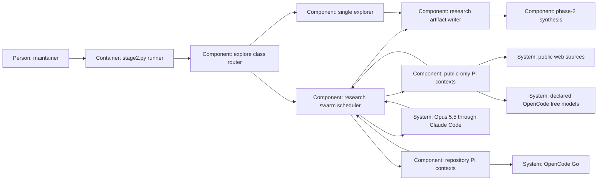

# Design — research-swarm

This proposed shape implements [`spec.md`](spec.md), using Q-1 to Q-5 of
[`decisions.md`](decisions.md). The older research proposal supplies evidence
requirements, not authority for its superseded team or judge assignment.

## Alternatives

- **A runner that separates public and repository research** (chosen).
  Public researchers cannot receive the private packet; two Flash contexts
  cover local topics, and a fresh Opus context reconciles them. The runner
  owns the stages and durable output; qualifying the public tools costs work.
- **An interactive orchestrator handing out the same separated roles.**
  It can meet the six-topic contract, but every operator must reproduce the
  context boundary, order, audit trail and failure accounting by hand.
- **Independent research commands plus a separate judge command.** It can
  retain the same boundaries, but leaves more intermediate state and allows
  a judge to mix contributions from different input states unless a manifest
  guards every command.

Chosen: one runner-controlled sequence with a separate public packet, because
it makes Q-3's boundary checkable and keeps the existing explore entry point.
The merge decides this proposal. A shared repository-reading Pi invocation
for free and paid roles cannot meet the spec and is not an alternative.

## Interfaces

**Caller to phase-1 router.** Keep `python3 scripts/stage2.py explore <change>`.
Add explore-only `--class spike|bounded|feature|architectural`; resolve it
against `spec.md` and `research.md` headers, requiring agreement wherever a
class is stated. A present invalid header refuses; an explicit argument does
not cure it. Before a spec, an explicit class is enough. With Stage 2 on,
missing/conflicting input exits 2. `--stage2-off [REASON]` keeps today's Haiku
path without this new prerequisite. Other verbs reject the new argument.

**Runner to declaration.** `opencode-go.modelle` remains the review ladder.
A separate `research_swarm` block selects the two declared Flash ids and
the public-topic assignment; it cannot change review ordering. Add a
`public-web` data class and an `opencode-free` declaration containing only
that permission and the three free ids, with billing `free` and residency
`nicht-erklaert`. This is a declaration name, not an asserted Pi provider id.
Qualification must establish its actual provider and service address before
enabling calls. The public check accepts only this explicit role and class;
the existing framework check retains its default and residency requirement.

**Runner to free Pi contexts.** Use pinned Pi 1.1.0 with a fresh scratch
working directory, home and agent directory; no repository context, built-in
file/shell tools, sessions, retries, MCP, skills, prompt discovery or themes.
Load only the runner-owned research-tools extension; never the session policy
or ambient extensions. Copy that extension and the public prompt to generic
scratch paths, so repository paths cannot enter discovery metadata. The prompt
uses fixed generic questions, not
`work_prompt`, `AGENTS.md`, a change brief or a sanitized repository summary.
Its environment carries only required runtime settings and the credential
for its qualified OpenCode transport; user identity, private paths and other
endpoint credentials are not inherited into model context.

The extension exposes only public search and page retrieval, records source
receipts, and rejects non-HTTPS, local files, authenticated requests and
private destinations, including redirects and DNS results. It must connect
to the validated destination rather than resolve a checked host again.
Pages and reports are data, never executable instructions. It uses no paid
search API or new credential. The public HTTP search route and Pi event/tool
protocol are qualification gaps, not claims of available support; failure
produces an incomplete run rather than simulated web evidence.

**Runner to Flash contexts.** Eleven separate read-only Pi calls use the
declared OpenCode Go transport and existing credential handling, with
discovery disabled. The runner supplies the change's private brief, rules,
architecture, adjacent-spec pointers and bounded git-history evidence.
Each topic's peers receive the same frozen input packet and public reports,
never each other's private report. Keep private report text in the runner's
buffer until the Flash stage ends; during that stage only audit identities
and outcomes are appended to the research file. Flush the reports on stage
completion or failure, before judging. Their file tools remain bounded by the
existing read request; the accepted paid-Pi residual read risk is stated,
not mistaken for the free-context isolation guarantee.

| Topic | First contribution | Independent comparison |
|---|---|---|
| 1 Code today | DeepSeek Flash: current code and reuse | MiMo Flash: boundaries and callers |
| 2 Rules and decisions | DeepSeek Flash: applicable rules and ADRs | MiMo Flash: overall architecture and nearby specs |
| 3 History | DeepSeek Flash: change history and rationale | MiMo Flash: reversals, supersession and stale assumptions |
| 4 Tests and gates | DeepSeek Flash: existing tests and gates | MiMo Flash: counterexamples and missing checks |
| 5 Risks and edge cases | DeepSeek Flash: failure paths | MiMo Flash: boundary violations and recovery cases |
| 6 Outside world and neighbours | hy4-preview: generic public practices | DeepSeek Flash: applicability, architecture and adjacent-spec fit |

The initial public focuses are code/testing practice for LongCat,
governance/history practice for Space Bunny, and risk/integration practice
for HY4. All are generic public questions; reports can support several
topics. Membership and assignments are validated from the declaration,
including topic 6's free seat; no model is silently skipped or substituted.

**Runner to judge and phase 2.** After the free stage and Flash stage, one
fresh official Claude Code call runs Opus 5.5 at `xhigh`. Read-only file
tools verify local citations; the runner supplies retrieved public excerpts,
retrieval receipts and the original contributions, including failed-slot
markers. Declaration and exact-prompt leak check also precede this call.
The judge returns six structured topic sections; no session is resumed.
The runner validates topic coverage and source references and renders the
result into `research.md`. Phase 2 still reads research plus decisions.

## Data model

- **Input record**, runner-owned: opaque run id, UTC date, HEAD, routing
  class and source, and a digest of the frozen relevant working-tree inputs.
  Runner-generated audit/appended research is excluded from that digest;
  changes to other inputs invalidate publication and yield an incomplete run.
  This is provenance, not a resumable cache or a claim that HEAD describes
  uncommitted content.
- **Contribution**, runner-owned: role/topic/model/endpoint, outcome,
  individual audit, elapsed time, typed observations, source references and
  unresolved questions. Public and private packets have different types;
  private-to-public conversion is absent. Freeze each report before judging.
- **Source receipt**, tool/runner-owned: public URL/title/retrieval date and
  excerpt/locator, or repository path/symbol/input-state reference. The
  runner validates local paths and state and checks public citations against
  actual retrieval receipts, not model assertions of a successful fetch.
- **Research output**, written only by the runner: append one dated run
  block containing status, budget, contribution/audit records, source
  receipts and compact supporting reports, then the judge's six-topic
  reconciliation and handoff summary. Existing research stays. Successful
  and failed records are retained; credentials are scrubbed before writing.
- **Judge section**: topic id, supported facts, practice/applicability
  comparison, architecture/adjacent-spec fit where relevant, source refs,
  disagreement, gaps, human questions and likely affected files. These are
  research fields, not accepted spec criteria, ADR answers or review rows.

No persistent store besides `research.md` is added. Scratch configuration,
public receipts and process transcripts are collected by the runner and
removed on completion. Record unavailable usage as unknown, not zero.

Non-security participant failures are recorded and the remaining scheduled
roles continue within the same budget; the judge can summarize partial
evidence but the run exits 1. A missing declaration or leak BLOCK refuses
with exit 2 and no subsequent call; record the blocked slot and reason without
claiming a clean audit for it. A total deadline stops dispatch and
records unfinished slots, without forcing a judge call past the deadline.

## ADR draft

The sole draft is
[`docs/adr/0018-phase-1-research-swarm.md`](../../../docs/adr/0018-phase-1-research-swarm.md),
in the form of `templates/adr.md`. It amends phase-1 routing under ADR 0007
and the permitted research purpose under ADR 0011, supersedes neither whole
ADR, and leaves numbered D/O decisions and their continuity map unchanged.
The maintainer's merge decides; no ADR answer or approval is written here.

## Architecture delta

**Added**

- A research swarm scheduler, public-only Pi contexts and public-web tools.
- A public-only endpoint declaration and independent research-role roster.
- A Flash pair and an Opus research-reconciliation boundary.

**Changed**

- Explore dispatches by an explicit early class; the runner appends several
  sourced contributions and a reconciliation instead of one report for larger changes.

**Removed**

- The universal single-explorer route for feature and architectural changes;
  that route remains for bounded/spike work and the explicit Stage-1 fallback.
