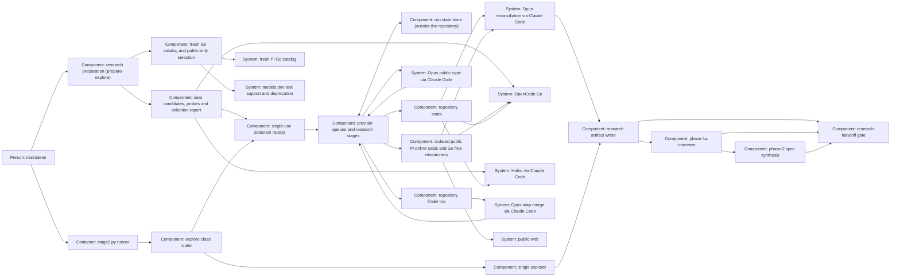

# Design — research-swarm

Proposed shape for [spec.md](spec.md), based on the amended interview Q-7–Q-14 and recorded phase-2a rulings S-1–S-52.
This replaces the earlier six-topic/free-stage design; the merge decides it.

## Alternatives

- **One runner with provider queues and stage barriers:** one input state,
  common briefs and an auditable public/private boundary; cancellation and
  concurrent output accounting become runner responsibilities.
- **Separate finder, research and judge commands:** independently inspectable
  steps, but operators must bind intermediate results to the same state and
  enforce per-provider limits across commands; more recovery state to govern.
- **A sequential runner with the same roles:** retains comparisons and context
  isolation, but cannot meet Q-7's selected concurrent execution.

Chosen: one runner with provider queues and stage barriers, because existing
explore remains the entry point and one owner can enforce provider limits,
source provenance and publication rules.

## Interfaces

**Caller → router.** Keep `stage2.py explore <change>` and explore-only
`--class`; without `--stage2-off`, all stated research/spec/argument classes
must agree. Invalid YAML, empty/unknown class and conflicts exit 2 before any call. Validate given
neighbours as unique repository-relative spec paths present in frozen bytes:
`plans/changes/<name>/spec.md` (one segment other than `archive`),
`plans/changes/archive/<YYYY-MM-DD-name>/spec.md`, or
`plans/specs/<capability>/spec.md`. This change's own spec and all other forms,
including `templates/spec.md`, refuse with exit 2 before models.
For swarm classes research.md must explicitly carry a list-valued
`neighbours:` key; an empty list is valid, a missing/null/non-list key or
invalid entry exits 2 before models with a message to add `neighbours: []`
or a spec list. No spec or plan is
required when research or the argument supplies a valid class. Explicit
`--stage2-off [REASON]` skips class derivation and all class/neighbour header
checks, keeps single Haiku 5.5 and records route/model/reason. Combining it
with `--class` exits 2 before any call with a message that class has no effect
on that route. Bounded and spike without fallback keep single GLM Flash.
Other verbs keep their contracts.

**Declaration → seats.** Replace `research_swarm`'s `free_endpoint`,
`free_roster`, `free_focuses`, `topic6_free` and `flash_pair` with six seats
(Q-12, Q-14): `repository_seats` and `online_seats`, each exactly three
preferred `{endpoint, model}` pairs and no fallback list. The finders use
the repository seats' selections; `finder_merge`, `topic_author` and `judge`
each declare endpoint/model/effort and stay Opus 5.5. Beside them,
`availability_preflight: {max_age_seconds: 900, exclude_until: [],
measured_wire_apis: [openai-completions]}` has the review swarm's field
names and validation for the first two, without its `flash_size`. Resolve
each call from the run's frozen selection, never from a hardcoded tuple.
Proposed preferred models, the Q-7/Q-9 members, so nothing changes while
they are reachable:

| Seat | Preferred model |
|---|---|
| repository 1 | `opencode-go/deepseek-v4.1-flash` |
| repository 2 | `opencode-go/mimo-v2.6-flash` |
| repository 3 | `claude-code-plan/claude-haiku-5-5` |
| online 1 | `opencode-go/deepseek-v4.1-flash` |
| online 2 | `opencode-go/mimo-v2.6-flash` |
| online 3 | `opencode-go/qwen3.8-flash` |

Substitutes are not declared (Q-14). They come from the substitute pool:
every admitted Go model of the fresh catalog, cheapest first. With #157's
`modelle_terms` as read on 2026-10-17, the pool order by `anfragen_5h`
would be LongCat 2.0 (11,400), GLM 5.3 Flash (6,320) and MiMo Pro (3,250),
after DeepSeek Flash and MiMo Flash, which are preferred elsewhere. All
five use `openai-completions` in Pi's shipped catalog; their models.dev
tool support was not read for this draft. Those
are the three fallbacks the maintainer named, now in cost order and no
longer fixed; a newly admitted model joins them by itself. Qwen 3.8 Flash
carries a skip mark and uses `anthropic-messages` in Pi's catalog, so until
its route is measured the third online seat takes a substitute. A
`modelle_terms` record alone admits a Go model for research; it need not
stand in `modelle`, so the review ladder never changes. Model resolution
accepts `modelle` plus admitted terms records for declared research purposes
only.
Remove the unused Zen `opencode-free` endpoint, its fixed roster/focuses
and endpoint-level free billing category; keep `public-web` as a role data
class. Add `research_swarm.online_free: {provider: opencode-go,
suffix: "-free", include: [], exclude: []}` as an explicit dynamic permission
for online research only. No catalog entry grants framework permission.
Unknown Qwen/free-model terms or residency are not invented: all online seats
receive public data only; framework roles retain existing requirements.

**Runner → Pi runtime.** Version checks, catalog access and repository/public
model launches use the same repository-pinned runtime; model launches resolve
through `stage2.PI_WRAPPER`, never a bare `pi` from PATH. The catalog helper
imports that install explicitly. Unit fixtures inject a distinct wrapper
stand-in for all model launch paths and trap bare-Pi escapes; actual-runtime
catalog and isolation checks retain the real wrapper and pin. A restricted
test PATH must not accidentally execute the production wrapper. This repairs
the observed fixture mismatch without widening production discovery or tools.

**Catalog → frozen seats.** The Node helper is the pinned-runtime transport
bridge: it retains raw Pi/models.dev bodies, source digests/outcomes and the
fresh model store. Python validates duplicate identities and the two-source
intersection before building the planned seats. Neither component launches a
model during this preflight; the later dispatcher consumes its checked result.
Before any swarm model call, a bounded helper
using the repository's pinned Pi runtime refreshes only `opencode-go` with
network allowed and force enabled in fresh scratch configuration. Do not
update Pi, install a client, read user caches or invoke Zen. Pi 1.2.0's
`ModelRuntime.refresh` returns errors and abort state; a CLI listing alone
cannot prove freshness. Its remote catalog wrapper normally caches four
hours and merges shipped models with a remote overlay. Therefore obtain the
successful fresh provider snapshot as well as runtime availability; never
reintroduce a removed free id from the shipped baseline. Validate unique
identities, provider and declared Go transport origin.
Eligibility uses the freshly fetched overlay, not the merged effective list.
Classify every preferred Go model and every paid Go model of the overlay
there (Q-12, Q-14): a text-input chat entry with the Go origin and an `api`
listed in `measured_wire_apis` is catalog-admitted. An absent,
baseline-only, non-chat or malformed typed entry is skipped with its reason
and raw value, and so is one with another `api` (`wire-api-not-measured`).
None of these is probed. Pinned Pi 1.2.0's shipped Go catalog, read
2026-10-18, has 20 `openai-completions` entries at `/zen/go/v1`, 5
`anthropic-messages` entries at `/zen/go` and 6 `openai-responses` entries
at `/zen/go/v1`. The existing standalone helper's `fixed_ids` hard failure becomes
this per-model outcome. For preferred models this check consults no
models.dev metadata; pool models also need models.dev `tool_call: true`
without `status: deprecated`, read from the same document as the free
models. Claude Code models are outside it.
In pinned Pi 1.2.0, `isModelType(model, "chat")` treats absent `type` as chat,
and `input` must include `text` (`pi-ai/dist/types.d.ts`, read 2026-10-16).
The typed chat interface has no dedicated tool-support field. Q-11 replaces
raw-Pi capability qualification with a credential-free GET of
`https://models.dev/api.json`, taking exact identities from
`opencode-go.models`. The object key is the candidate identity, matched
exactly to Pi, and its `id` must be present and equal to that key. A fresh-Pi
text-chat id ending `-free` is eligible only when that entry has boolean
`tool_call: true` and status other than
`deprecated`. Pi `compat.supportsAdditionalTools` and
`supportsMidConvoToolAdditions` are not capability evidence. Keep the two
sources separate: models.dev cannot introduce an id absent from fresh Pi.
Record exclusions as `baseline-only`, `not-chat`, `pi-malformed`, `metadata-missing`,
`metadata-malformed`, `no-tool-support`, `deprecated`, or
`capability-unavailable`, with the source field/value. Document-level faults
are request failure/timeout, non-200 HTTP, invalid JSON/non-object root,
absent/non-object `opencode-go` or its `models`, and duplicate claimed ids
under that models object. Duplicate identity means either a repeated raw
JSON key there or the same `id` under different keys. Parse with duplicate-key
reporting; either fault excludes all free candidates as capability-unavailable
with reason `duplicate-id`. These document-level faults alone exclude all.
Otherwise inspect only each candidate: absent entry
is metadata-missing; non-object entry, present non-boolean tool_call,
present non-string status or a missing/different entry id is
metadata-malformed with raw value recorded, including an absent-id marker.
Absent or false tool_call is
no-tool-support; deprecated status is deprecated. Ignore other providers'
entries; a malformed candidate never excludes a valid peer. Keep the 39 required slots and
record N=0, distinct from a measured eligible-empty result. A failed Pi
refresh instead exits 1 before all models. Neither case uses stale metadata.
The maintainer's 2026-10-17 source observations in Q-11 are dated evidence,
not a hardcoded list. No additional model probe fits the budget.
Untrusted catalog metadata cannot redirect an invocation to a new endpoint.
A missing shard, failed/timed-out refresh, Pi-rejected response, unparseable
body, repeated overlay id (raw repeated key or one id under two entries), or
unconfirmed stale-only response exits 1 before any model call, keeping
diagnostics. Otherwise validate entries separately: malformed typed input/type
on a -free candidate yields pi-malformed with raw value and never excludes
a valid peer or blocks required slots. A malformed Go seat candidate is
skipped the same way; other entries are inspected only for repeated ids. Pi itself rejecting an entry is a response-level
failure, not a per-candidate exclusion.

Select exact `-free` ids, apply include (empty means all) then exclude;
exclude wins. Invalid policy or role permission exits 2. Every explicit
include must occur in the fresh eligible snapshot, otherwise exit 1 before any
model call, even if excluded. Sort
selected identities after rejecting duplicate overlay entries; never merge
two catalog entries. Freeze `N`, expected slots and budget.
A valid empty snapshot/filtered set is recorded as measured `N=0`, retaining
the online seats; models.dev failure is recorded separately as
capability-unavailable N=0. An explicit include remains mandatory and exits 1
if ineligible, including when capability metadata is unavailable. Pi refresh
failure never becomes either kind of zero selection. Record successful
zero, exclusions and missing includes explicitly, never infer availability
from a cached roster. Defaults add every eligible model; no arbitrary count
cap silently drops seats. Runtime removals fail their best-effort slots, without
roster
mutation or substitution; these are named to the judge but do not by themselves
make the run incomplete. The 39 required contributions alone are required. All
selected free seats use the same isolated Pi
public path, tool allow-list and receipt validation as the online seats.

The two-source preflight is metadata work, not a model invocation. It runs in
preparation, before the run's 150 minutes: start both reads together with one
60-second deadline. Abort unfinished reads at the deadline without retry.
Unfinished/failed Pi exits 1 regardless of models.dev. If Pi succeeded but
models.dev is unfinished, record capability-unavailable/timeout and N=0,
keeping all required slots unless an explicit include is unmet. A models.dev
timeout alone neither extends preflight nor aborts required work. Keep a minimal environment; only Pi receives the Go credential where
required. The models.dev request receives no credential and sends only the
fixed public URL; its failure cannot prevent collection of a valid Pi result. No private packet,
repository path or change identity goes to the catalog service. Record Pi
version, source URL/provider, retrieval time, response digest/freshness proof,
raw Pi ids, models.dev source/time/digest or failure, exact capability/status
fields, eligible ids, policy and selected/excluded ids with reasons. An offline fixture must
prove forced network refresh and failure handling against real pinned Pi,
including its static-catalog union and non-throwing error behavior.

**Preparation → selection → receipt (Q-12, Q-14).** A swarm run takes two steps,
the form of the review swarm's `prepare-loop` and `review-loop
--availability-reported` (pull request #157 at `0c03ec0`):

1. `stage2.py prepare-explore <change> [--class CLASS]` deletes any earlier
   receipt, validates class, neighbours, seat lists and the availability
   rule (exit 2), and runs the two-source catalog read above. A Pi failure
   exits 1 before any probe.
2. It admits Go models. A model needs a `modelle_terms` record that passes
   #157's `terms_problem` (the check its ladder uses), a positive cost value
   from `request_value`, no `-free` suffix, and the fresh-overlay
   classification above. A `claude-code-plan` preferred model needs its
   endpoint entry. Repository seats also need `framework` on the endpoint,
   and online seats need `opencode-go`. The substitute pool is every
   admitted Go model with models.dev tool support, ordered by #157's
   `ordered_models`: `anfragen_5h` descending, ties by id. A timed
   exclusion matches the review swarm's way, by `model_prefix` on the id or
   its last path segment, while `until` lies ahead; an excluded model is
   never probed.
3. It handles the repository trio, then the online trio. Within a trio it
   first probes each seat's preferred model in seat order, unless it is
   unadmitted or excluded. A reachable preferred model fills its seat.
   Then each seat still empty, in seat order, walks the pool, skipping
   models already selected in the trio or known unreachable. It probes the
   first model not yet probed and takes the first reachable one, marked
   "substitute for <seat>". Each distinct model is probed at most once per
   preparation, and a result is shared across seats and trios. A Go probe
   is the review swarm's: pinned Pi wrapper,
   `--no-tools`, scratch working directory, home and agent directory,
   discovery off, the fixed text "Availability probe only. Reply with OK. Do
   not review code or request tools.", 60 seconds, after declaration check,
   exact-prompt leak check and audit. A Claude Code probe sends the same
   text through `claude -p` with `--tools ""`, `--restricted`,
   `--safe-mode`, `--strict-mcp-config`, `--permission-prompts none` and no
   session persistence. Go free models and Opus roles are not probed.
4. Any unfilled seat: print the report with `seat-unavailable` and every
   model's reason, write no receipt, exit 1. Otherwise print the report
   (UTC check time; per seat the selection, preferred or "substitute for
   <seat>"; the pool in cost order; per model selected, skipped with reason,
   excluded until, unreachable with scrubbed error, or not probed; overlay
   models without terms named as unread; the free selection) and seal `{version: 1, binding, state}`
   with `report_id` = SHA-256 over its canonical JSON. Write it atomically
   to `record_dir(change)/research-availability.json` and print "Report
   this selection in the main conversation, then run explore <change>
   --availability-reported <id>". The binding is the resolved worktree root,
   change, digest of `model-endpoints.yaml`, resolved class and given
   neighbours. Probe audit lines stay in the state directory beside the
   receipt and enter the run manifest on consumption; preparation writes
   nothing in the worktree.
5. `explore <change> --availability-reported <id>` for a swarm class
   re-derives class and neighbours, loads the receipt, checks version, id
   (recomputed and equal to the argument), binding, timezone-aware time
   and age ≤ `max_age_seconds`, then deletes the receipt before any model
   call. Any fault refuses with exit 2. The run uses the receipt's catalog
   record, free selection and seat selection; it never refreshes or probes
   again, swaps a seat or retries.

Placement (one implementation, spec criterion 50): with #157 on
`origin/main`, the rule validation, timed-exclusion test, tool-free Go probe
and receipt seal/verify of `scripts/stage2_availability.py` become shared
functions. `prepare`/`consume` of the review swarm call them unchanged in
behaviour; `prepare_research`/`consume_research` call them too. Without
#157 on main, the same file name holds the shared functions and the research
entry points, written to #157's contract; the pull request that merges
second resolves the add/add conflict to one copy and runs both test files.
Selection itself (seats, pool, double-fill) stays research-only, because
the review ladder has no seats. The admission check and the cost order
reuse #157's `terms_problem`, `request_value` and `ordered_models` from
`scripts/stage2.py`, under the same placement rule as the availability
helpers.

**Finder → map.** The pure Python helper stage2_research_map.py validates
the exact union and derives neighbours from supplied frozen sources, with
no model or file operation. Four-list JSON uses explicit unread markers:
finder not_read reasons become merge not_read origin/reason lists, so
empty or partially unread categories retain every source. Locator entries
carry exact path/reference and reason or merged origins. Freeze HEAD and copies/digests of every tracked file and every
untracked non-ignored file under the change folder before dispatch. Copies live in run scratch outside the repository;
a failed copy exits 1 before model calls. Keep them until publication or abort,
then delete them. Persist HEAD, the full digest and per-path digests of
untracked change inputs, never a whole-file snapshot in research or briefs. The private brief is the frozen research header/body
and decisions/spec when present, with bead id only (tracker text not read).
All three finders and the topic author get this same brief. Repository seats
embed identical AGENTS.md; disable runtime instruction auto-loading for every
seat so transport discovery cannot introduce a different initial context. Three
fresh finder contexts
receive the same packet and locator template; Opus 5.5 (`xhigh`) merges
four lists: code/functions, rules/ADRs, tests/gates, neighbours. The merge runs
with no tools and must return exactly the union of finder keys: category plus
exact path::symbol/section. Deduplicate each key, retaining all source finder
ids and all their reasons. Added, dropped or duplicate keys fail the merge,
exit 1, and dispatch no later stage. The runner resolves each entry against
scratch frozen bytes; unresolved entries remain marked unresolved, granting
no mapped topic scope and not failing the finder. After union validation the
runner inserts every header-given neighbour as given; that status overrides
suggested for the same path. Resolve a neighbour-category artifact inside
any of the three permitted active/archive/living-spec folder kinds to that
folder's frozen `spec.md` if present, merging all keys into one suggested
packet neighbour. Own-change entries are `self`: no neighbour, relation or
gap. Other resolved entries outside those forms or without a spec stay
`no-spec`, with a comparison gap and no topic-5 relation. Unresolved entries
grant no neighbour status. Compare topic 5's packet and the manifest with an
independent fixture derivation from the resolved map plus given header;
misclassifying a spec-backed design entry as a gap must fail. No target
design, silent
class change or neighbour acceptance happens at this locator stage.

**Map → topic contexts.** Expand the fixed topic contract in spec into
checked-in repository/public prompts, one topic per invocation. Each topic
has the same brief, all three perspectives and report template for every
seat (the three repository seats, or the three online seats plus `N` Go free models).
Hash the task payload separately from transport envelopes so different CLI
wrappers cannot conceal a different brief. Give repository
peers the same map, private input and topic-scoped evidence. Buffer all peer
reports until the research stage ends, including at failure; no readable
research append exposes a peer answer mid-stage. Finder output is the only
model-produced shared input before topic research. After map merge, before
topic dispatch, the runner collects history read-only against frozen HEAD:
at most ten most recent commits reaching each resolved mapped path. Store
full hash, UTC author date, subject, body capped at 4,000 Unicode characters
with truncation flag, and touched mapped paths; mark older history not read.
Only topic 6 receives this identical packet on all three seats. A full hash
resolves only when present there; attach its commit record as evidence.
Reachability alone, PR numbers and bead ids confer no evidence status;
repository rationale files still resolve by path::section. No network or
tracker is read. History-collection failure blocks every topic and ends
incomplete with exit 1. Topic 5 always runs all three required seats. When
its packet has no given or suggested neighbour (only self/no-spec or none),
mark the identical packet "no packet neighbour". Each valid report must have
`neighbour_relations: []` and an empty-packet `not read` entry; only here waive
the one-evidence-backed-claim floor. Any claims still receive validation and
scoring. With a neighbour, the normal floor applies. The neighbour comparison
records "no neighbour given or found" as a gap.
The accepted paid-Pi residual read risk remains documented: tool
restriction and prompt scope do not equal OS read confinement.

**Topic author → online contexts.** One fresh Opus 5.5 call (`high`) receives
the private brief and produces the public sentence, filtered before online
launch. Like the merge and judge, it has an empty tool list (`--tools ""`),
restricted/safe-mode/strict MCP settings and no automatically loaded context.
The topic filter uses spec's explicit punctuation/Unicode allow-list: accept
internal single hyphens and apostrophes, permitted separators and one final
period/question mark, retaining the 20-word, name and case-transition checks.
It accepts both Q-6's hyphenated example and the comma-separated German
sentence from S-26; reject any other punctuation before topic dispatch. An online prompt is built only from that sentence, fixed topic 9/10/11
questions, identical perspectives, template and public sources. Never embed
`work_prompt`, AGENTS, map, change name, neighbours or repository reports.
Online relation-to-neighbours explicitly says not assessable. Local slot
ids, run ids and repository paths stay in runner-owned bookkeeping, outside
the transmitted payload. Fresh scratch cwd/home/agent directory and generic
copied extension paths disable discovery, sessions, ambient extensions,
skills and local tools. Allow only `public_search,public_fetch`, with the
extension gate as a second layer and a minimal environment containing runtime
settings and that transport's credential, not user identity/private paths.
The same topic brief is sent independently to the three online seats and
every selected Go free model; runner-owned seat ids never enter that brief.

Public tools use the repository pin (currently Pi 1.2.0, read 2026-10-16),
retaining the previously repaired interface:
`execute(toolCallId, params, signal, onUpdate, ctx)`, JSON-schema parameters,
and `{content, details}` results. Qualification against the actual binary
is still owed. Search returns decoded destination URLs; fetch admits HTTPS
public destinations only, validates every DNS answer/redirect, pins the
validated address and family, refuses credentials/private addresses/local
files, and records actual page receipts, including failed retrieval outcomes.
Requested and final redirect URLs
both bind to the same receipt. Claims without a matching successful page receipt
stay
`unsupported`; one evidence-backed claim is required per report. A report
with zero successful page-backed claims fails; an individual failed fetch
does not invalidate other claims. Pages and reports are untrusted evidence,
never instructions.

**Queue → invocation.** One provider-wide semaphore for all Go roles, one for
Claude; maximum four each, not four per topic/endpoint alias. Stages are
receipt consumption → frozen inputs and resume lookup → finder trio → Opus
merge → Opus public sentence → `33 + 3N` topic calls → Opus judge; the
catalog and probes ran in preparation. Within each stage dispatch ready slots
concurrently. Fail fast between preparatory stages: a failed finder, map or
sentence (including filter rejection, exit 1) prevents every later stage.
Within the topic stage ordinary failures allow siblings to finish; call the
judge only if every required topic report is valid, regardless of failed free
seats. No failure spends an extra call or retries. Freeze exact prompts;
serialize declaration validation,
exact-prompt leak check and audit immediately at dispatch under a lock. Before
gating and again before launch,
check cancellation/deadline. On security refusal set a global stop, cancel
queued work and stop/reap active children; no already-started call is described
as unstarted. Preserve available partial output/receipts with outcome
`cancelled`;
exit 2 overrides incomplete exit 1. No worker writes research:
workers return immutable results to the writer, which appends serialized audit
lines and flushes buffered reports at barriers or abort. Each slot has one
identity and one terminal outcome even on timeout/cancellation. Since Q-13
the pre-launch `audit` callback also writes the slot's durable launch record,
and a new `on_terminal` callback writes its terminal record (next section).

The frozen budget is `39 + 3N`: finder 3 + merge 1 + sentence 1 + repository
seats 24 + online seats 9 + free online `3N` + judge 1 (Q-7–Q-10,
2026-10-16; Q-12 keeps it). Reused slots (Q-13) fill their places without a
call. Preparation (catalog 60 seconds, each probe 60 seconds) comes before
the run and counts neither as invocations nor against its time. Deadlines:
sentence 5 minutes, finder/researcher/map merge 10 each, judge 15, whole run
150. Queue wait counts
against the total, not a child's allowance. Reserve 15 minutes for the judge.
Dispatch all required topic slots before free seats: repository 1–8, online
seats 9–11, topic then declared seat order; free slots follow by topic then
sorted id. Topic launch uses the lesser of its role limit and positive
remaining run time minus the reserve. Unlaunched slots are
`not-started-deadline`; they invalidate completion only when required. Recheck
after a long leak scan. No retries,
recursive delegation, unbounded subprocess or zero-timeout launch.

**Slot results → state store → resume (Q-13).** A new pure-ish module
`scripts/stage2_research_store.py` owns `record_dir(change)/research/`, the
runner-owned state directory beside the review loop record
(`${XDG_STATE_HOME:-~/.local/state}/coding-harness/stage2/<change>/`). The
runner refuses a store inside the real home directory that Claude research
processes inherit (Q-15, criterion 52): without `XDG_STATE_HOME` pointing
outside that home, a research run stops with exit 1 and a message naming it.

- *Layout.* One directory per run, named by its random 128-bit run id;
  directories 0700, files 0600. Per run: `run.json` (run id, change, start
  UTC, consumed receipt id, frozen per-path digests, research append digest
  and length once published, end state), and per slot `<slot>.launch.json`
  and `<slot>.result.json`. A record is scrubbed of every used credential,
  written to a temporary name, flushed with `fsync`, renamed into place,
  and the directory is flushed. A reader ignores temporary names and refuses
  a record that fails to parse or lacks its own SHA-256 field; such a slot
  counts as interrupted, never as finished.
- *Dispatcher hook.* `dispatch(..., on_terminal=...)` calls the callback
  once per slot, in the thread that set the outcome and before that thread
  takes its next slot. That covers launched slots and those cancelled or
  not started. The existing `audit` callback, called under the gate lock
  just before launch, writes the launch record. A raising callback sets
  stop, as a security refusal does, but without the security flag. Queued
  slots are cancelled, running children are stopped and reaped with their
  output kept in memory, and the runner ends incomplete with exit 1,
  `state-store-unwritable`. The dispatcher stays free of storage and model
  knowledge.
- *Lock.* The runner takes `fcntl.flock(LOCK_EX | LOCK_NB)` on
  `research/.lock` before freezing inputs and holds it to the end. A held
  lock refuses with exit 2; the OS drops it when the process dies.
- *Resume lookup.* After freezing inputs and before the finders, under the
  lock and before any model call, the runner reads the latest stored run
  (latest start time) and nothing older. It is no source if it recorded a
  `refused` slot (named, criterion 56) or was published complete (the store
  is cleared after a complete publication). Its binding matches when every
  current per-path digest equals the stored one. The exception is
  `research.md`: its current bytes, with the stored append tail of the given
  length and digest removed and the `updated:` line normalised as the
  snapshot module's `_without_updated` does, must hash to the stored frozen
  digest. HEAD is not compared. A mismatch names the changed paths and
  reuses nothing.
- *Per slot.* When a stage's slots are planned and their exact prompts
  frozen, a slot is reused when the source holds a `result` record with the
  same stage, topic, seat index, endpoint, model and prompt SHA-256 and
  outcome `ok`, and its report passes this run's validation. Reused slots
  are not passed to `dispatch`. The runner copies their records into the
  new run's directory with `reused_from` and the original times, and merges
  them into the stage's results. Every stored result not reused is named
  with its reason: binding, prompt, model, outcome, validation or refused
  source. Source slots with a launch record and no result are listed as
  interrupted. Later stages see reused reports only at the same barrier as
  launched ones.
- *Isolation.* No store path, run id or stored result enters a model's
  prompt, argv, environment or working directory before its barrier.
  Repository seats keep the worktree as working directory, and probes and
  online seats have no file tools. A seat that deliberately reads an
  absolute path elsewhere is the residual paid-Pi read risk recorded below,
  now covering the store too.
- *Snapshot.* `stage2_research_snapshot.py` already yields per-path
  digests and the exact runner-owned append exemption. The binding reuses
  them, adding one function that compares against stored digests instead
  of live copies, because the earlier run's copies are gone.

**Reports → judge.** Validate the fixed report template and claims before a
fresh Opus 5.5 (`xhigh`) reconciles topics 1–11 with the map, original reports
and receipts. All three Opus roles launch without tools; the judge sees only
its listed packet. A claim is valid only if every citation resolves locally
or has a successful page receipt online; any failure makes the whole claim
unsupported with no excerpt, disposition or criterion Basis. For each valid
claim, join its resolved frozen
symbol/section text, topic-6 packet commit records or successful receipt
excerpts in citation order and cap the combined text at 4,000 Unicode
characters per claim, with source identities and an explicit truncated
boolean. Persist these bounded excerpts with reports, never entire frozen
files as snapshots. Supported means the attached evidence supports the
statement and no evidence-backed peer claim contradicts it; review checks
this meaning. Validation retains malformed/failed output as partial evidence;
it cannot label it a complete contribution. Check local symbols/sections in
frozen bytes, public citations against successful fetch receipts, and source
identity in every judgement. The pure Python helper `scripts/stage2_research_refs.py` resolves references
from supplied frozen bytes and assembles the shared per-claim excerpt cap;
it performs no file access or model operation. Map and report validation
consume the same helper. Resolve `path::X` by frozen file type:
Markdown uses one scan for headings, uniqueness, excerpt ends and criterion
items: skip first-line --- front matter through its next --- line; exclude
fences opened by at least three backticks/tildes indented at most three
spaces, closed by the same character at least as long, or ending at EOF.
ATX headings outside these blocks have at most three leading spaces, one to
six # marks, then space/tab/end. Strip opening marks, optional closing # run
and outer whitespace, retaining inline formatting and case. Setext and HTML
forms are unrecognised. Require exactly one matching heading; excerpt ends
before the next same/higher scanned heading or EOF. `criterion <n>` selects the
numbered item under the one `## Acceptance criteria` heading, through before
the next item/heading. Python uses AST def/async def/class or module-level
assignment targets, with dotted nested definitions; excerpt is that node's
lines. YAML uses a safe duplicate-reporting loader; JSON reports duplicate
keys and rejects NaN/infinity. Split the path at every dot; segments must
exactly match string keys in mappings, never list indices or literal dotted
keys (cite their nearest citable parent). Convert dates/timestamps to ISO
8601 text; binary, sets, non-finite values or non-string keys anywhere in the
value make it unsupported. Canonical JSON uses sorted keys, unescaped
non-ASCII, two-space indentation, comma and colon-space separators, and no
trailing newline, before the per-claim cap.
Duplicate matching headings/criterion items/definitions/keys are unsupported. Other files use
a whole-word match, excerpt from its first matching line to EOF before the
per-claim cap. Unparseable or missing references stay unsupported. Use this
same resolver for map scope and claims, replacing `symbol_problem`'s earlier
substring/word-parts check. Template violations fail a slot. A bad reference
marks the whole claim `unsupported`, retains it without an excerpt or
disposition, and prevents any criterion Basis;
only absence of all evidence-backed claims fails an otherwise valid report,
except the specified empty-neighbour topic-5 report.

Reports use one closed JSON object with claims, counter_evidence, not_read,
neighbour_relation and questions; topic 3/5 add their assessment/relations.
Confidence and basis are nonempty text. Question classifications retain
their literal bracketed markers; only the runner supplies global identities.
Endpoint and model components are percent-encoded separately and joined
by one colon to avoid slash/colon/percent collisions in the seat namespace.
The common report prompt documents the same schema. These standalone
contracts do not yet replace the legacy report parser or activate dispatch.

Judge output separates supported facts,
assumptions, applicability, gaps, disagreements and human decisions. Per-model
scores contain counts and global claim-id lists for supported, refuted,
off-brief and unresolved (one disposition per valid claim, off-brief takes
precedence), plus unsupported and the separate unique subset of supported
claims absent from peers. Unresolved disagreement lists both opposing ids
and evidence; judge schema permits no answer field. Reconciliation requires
public-practice, architecture and neighbour comparison sections and gaps.
Phase 6 assesses prose meaning, off-brief scope and faithful dissent; schema
validation does not claim semantic authority. Include every selected online-seat/free
seat in scoring and named
missing outcomes; increasing `N` never silently drops a report from the judge.
One fixed whole-packet limit `J` counts Unicode characters, including the
judge instructions, map, reports, receipts and attached excerpts. In phase 4
derive J from the context capacity documented or reported by pinned Claude
Code for Opus 5.5, minus a fixed output reserve; record the numeric limit,
capacity, reserve, conservative conversion, source and read-on date before
enabling dispatch. The 2026-10-18 implementation records documented
1,000,000-token context, 128,000 output reserve, 72,000 transport reserve
and a conservative estimate of four tokens per Unicode character, deriving
J = 200,000. The conversion/reserve are agent estimates, not measured
tokenizer or account-capacity guarantees; dated sources and limits are in
[the capacity note](../../../docs/research/2026-10-18-research-judge-capacity.md).
The standalone helper retains every report/outcome and derives score counts
from exclusive valid-claim dispositions. Dispatch and full reconciliation
integration remain pending. Measure the assembled packet before the judge: `size > J` makes no
judge call, retains every report/excerpt and ends incomplete exit 1 as
`judge-packet-over-limit`; `size == J` permits the normal single call.
Never shorten beyond the per-claim cap to fit, lower N or add a judge call.
No composite ranking or model-specific angles follow.

**Research → interview → spec.** Publish an explicit obligation inventory
covering every accepted raw report's `[DECISION]` question, including claims
scored refuted or off-brief, plus unresolved judge disagreements. Topic-3
`class_assessment` differing from the declaration derives a runner-owned
obligation even when the judge omits it. Topic-5 contradictions and proposed
removal of a given neighbour are also obligations derived from topic 5's
neighbour_relations, exactly one path/relation/nonempty local claims list per
packet neighbour. Missing, duplicate or extra paths and dangling/empty claim
links fail the template. Every contradicts entry, and unrelated entry for a
given path, creates an obligation without consulting the judge. The runner
also computes suggested statuses using only relations backed by at least one
runner-valid listed claim: three counting related/contradicts means confirmed;
three counting unrelated means rejected; every other case, including fewer
than three counting relations, is split and derives a neighbour DECISION item
of kind split. Every contradicts and unrelated-given relation still derives
its human item even with only unsupported claims. Judge dispositions never
affect this runner-only calculation. Given stays given; Opus cannot set/change
any status. A split path is excluded from the required header until a
structured maintainer keep. Structured judge findings can add obligations but
cannot remove any. Topic 6's `volatile` and
`governance` fields hold proposals only; missing governance fails the template.
A judge may
link duplicates to one interview item while preserving every source claim.
Phase 1a adds `research_items:` and `research_claims:` lists to the relevant
Q-record, preserving its context, actual answer and answered-by fields.
Neighbour answers also carry `research_neighbours: {keep: [], drop: [], add:
[]}` populated only from the stated answer; the gate never reads intent from
answer prose. Questions can exceed the unchanged class minimum. `[GAP]` remains research
work and `[DETAIL]` remains a reasoned agent choice; neither waives a human
obligation. Phase 2 sets the spec neighbour header exactly to paths confirmed
or given in any complete run, plus research_neighbours keep/add paths from
maintainer-answered Q-records, minus their drop paths. A neighbour item closes
only when that record links the item and names its path in keep/drop; no
field leaves it open. Add needs no item link, so a new drafting discovery can
be added explicitly without fabricating a source item; otherwise it needs
confirmation in a new complete run. Review checks that the structured field
faithfully records the actual answer. Phase 2 adds
`*Basis:*` claim ids and/or Q-record ids per acceptance criterion. This
redraft uses its existing interview answers as bases; no generated v2 report
is fabricated for it.

**Handoff gate → verification.** New `check_research_handoff.py` reads the v2
manifests/reports and their explicit item and claim references without tracker,
model or network calls. It independently derives required ids from all raw
reports and the judge's disagreements, checks inventory coverage, answered
maintainer Q-records, neighbour parity and criterion bases. Complete v2 runs
alone supply phase 1a/2 and carry obligations. Before
spec.md exists, list valid pending items with exit 0; once it exists, missing
answers exit 1. A spec with v2 runs but none complete exits 1. Incomplete-run
claims cannot support criterion bases. Every direct claim named in a Basis
must be supported, even in a mixed list with supported ids: unsupported,
refuted, off-brief or unresolved fails with exit 1. Such claims can instead
be linked through research_claims on a maintainer-answered Q-record used as
the criterion's basis. Neighbour parity uses the union over every complete
run, recomputing suggested statuses from the three topic-5 relations,
never the judge's verdict: count only relations with a runner-valid listed
claim and make fewer than three counting relations split. Do not filter
contradicts or unrelated-given human items by evidence validity. Apply
answered Q-record research_neighbours keep
and add as inclusion, drop as omission. Closing any neighbour item requires
both research_items linking it and keep/drop naming its path, including a
split. An add needs a maintainer answer but no item link. Check all field
paths against the three spec forms without requiring current existence;
invalid form exits 1 so later archival does not break historical answers.
A path in two lists of one record or incompatible inclusion/drop directives
across answered records exits 3; never pick the latest prose answer.
Independently derive a neighbour DECISION item when complete runs confirm and reject the
same path, or a later complete run's given list omits an earlier given path.
Link both runs, the path and available source claims; the earlier given
manifest is the source when no claim exists. Keep the path required until a
linked maintainer answer names it in research_neighbours.drop, whether
given or confirmed. Without that
answer the open item exits 1 once a spec exists, even when the header keeps
the path. A keep answer requires inclusion, a drop answer requires omission.
Every complete run in live/archive folders keeps its obligations across
later runs; a Q-record may link several runs. Malformed evidence remains exit 3 even pre-spec. Every v2 record is
parsed, but incomplete runs carry no handoff obligations; older evidence without
this schema is
explicitly exempt, not retroactively fabricated. Findings exit 1, unreadable
or ambiguous inputs exit 3, measured valid input exits 0; no applicable v2
run is a reported measured exemption. Register blocking/both placement in the
one gate list and regenerate CI. The kit carries checker and fixture-based
tests because the gate travels, without carrying this repository's corpus.
Semantic fidelity remains a review duty; presence checking cannot prove it.

## Data model

Only the runner persists exploration output, append-only inside `research.md`:

| Record | Required fields |
|---|---|
| Run manifest | schema `research-swarm/v2`, opaque run id, UTC date, HEAD, full frozen-byte digest, per-path digests of untracked non-ignored change inputs (copies only in transient run scratch), class/source, exactly `39 + 3N` expected slot identities with required flag, budgets, given neighbours, judge packet size and fixed character limit with capacity/output-reserve/conversion/source/date, consumed selection receipt id and check time with per-seat selection marked preferred or substitute, the pool in cost order, every model's outcome/reason and probe audit lines, resume source run id or the reason none was used, reused and interrupted slots, status/reason |
| Catalog selection | pinned Pi version, Pi provider/source/UTC/digest/freshness, models.dev source/UTC/digest or failure, exact tool_call/status evidence per id, eligible ids, include/exclude, selected ids and `N`, measured-empty versus capability-unavailable outcome, exclusions/reasons or Pi failure, each Go seat candidate's catalog outcome; taken in preparation and carried by the receipt |
| Selection receipt | outside the worktree, single-use: version, binding (root, change, endpoint-configuration digest, class, given neighbours), UTC check time, catalog selection, per-seat selection marked preferred or substitute, the substitute pool in cost order with each model's cost value, per-model outcome (selected, skipped/reason, excluded until, unreachable/scrubbed error, not probed), probe audit lines, `report_id` |
| State-store record | outside the worktree: run record (run id, change, start, receipt id, frozen per-path digests, own research-append digest/length, end state) and per-slot launch and result records (slot identity, seat, endpoint/model, prompt SHA-256, leak audit, UTC start/end, outcome, scrubbed report or partial output, receipts, record digest; `reused_from` with original times when copied) |
| Map | four locator lists keyed by category and exact ref, all finder origins/reasons, resolved/unresolved mark, artifact-to-spec neighbour mapping with retained keys, no-spec mark/gap or self mark without gap, runner-inserted given neighbours and suggestions in the three permitted folder forms, missing/unread categories |
| Topic-6 history | frozen HEAD, per mapped path up to ten commits with full hash, UTC author date, subject, body capped at 4,000 characters and truncation flag, touched mapped paths, older-history not-read marker |
| Slot | role/topic/seat/endpoint/model, task-payload hash, individual leak audit, start/end/elapsed/outcome, report or partial output, source receipts, reused-from run with original start/end when reused |
| Claim | global `<run>/<topic>/<seat>/<C1–C7>` id, endpoint/model seat, statement, evidence, kind, confidence/basis, valid/unsupported, resolved excerpts joined in citation order and capped at 4,000 characters per claim with truncation flags; topic 6 packet commit evidence, volatile and required governance when true |
| Topic report | claims, counter-evidence, not read, neighbour relation; local Q1… questions with classification and nonempty local claims list; topic 3 class_assessment with class and claims; topic 5 neighbour_relations with path, relation and local claims |
| Reconciliation | all topic sections and three comparisons, exclusive valid-claim dispositions, unique supported subset, unsupported claims, per-model counts/ids, disagreements/opposing ids, gaps, interview items; no answer field |
| Handoff | run-local H-<n>, originating global question/claim ids, reason (`decision`, `disagreement`, `class`, `neighbour`), runner-derived given/confirmed/rejected/split statuses, three source relations and reasons, neighbour kind including split; cross-run neighbour items additionally identify path, both complete run ids and source manifests/claims |

Use fenced JSON blocks under stable headings as the machine-readable records;
prose may explain them but is not a second source of ids. Claim ids combine
run, topic, model seat and local id; endpoint-qualified seat ids avoid
collisions.
Q-record link fields and spec `*Basis:*` lines reference these exact ids.
Q-record bases use `decisions.md#Q-<id>` inside the owning change; the
checker resolves them there, also after archival. Q-record `research_items`
use `<run>/H-<n>` and `research_claims` use the global claim ids; source
question ids use the same global namespace as claims, with local Q ids.
Q-record `research_neighbours` holds optional keep/drop/add path lists; item
closure requires item link plus path in keep/drop, while add requires no
item. The gate computes parity from these fields and checks contradictions
without interpreting answer text. `neighbours:` is a unique YAML list of repository-relative `spec.md` paths;
this redraft names the read interview-context and Haiku neighbours. Relative
paths must stay inside the worktree; invalid given sources refuse preflight;
failed later reads are named gaps and
do not alone invalidate completion. Suggestions stay separate from given paths.

Freeze HEAD, all tracked bytes and all untracked non-ignored change-folder
files; pre-existing
research is a frozen prefix. Ignore only runner appends and its own `updated:`
restamp, including across midnight. A changed HEAD/digest invalidates complete
publication with exit 1 and named changed paths; retain outputs and failure
state. Reports remain available for
citation even when their producer failed. Scratch files are cleaned after
collecting partial stdout/stderr/receipts and publication or abort, deleting
the frozen copies too; scrub every used secret before any
persistence/diagnostic. No cache or extra database is added; the only
resumable state is the Q-13 state store, outside the repository.

The standalone frozen-state helper keeps copies in an owner-only temporary
directory outside the repository and exposes only digests in its manifest.
Its read path refuses symbolic links in files or parent directories and
non-regular source reads. Publication compares the complete tracked and
non-ignored untracked change-input sets, HEAD and current bytes. A research
append/restamp is exempt only when the runner supplies the exact bytes it
wrote, preserving the original body; an arbitrary matching prefix cannot
hide foreign appends. Context exit or preparation failure removes copies.
This foundation is separate from amended dispatcher integration, which is
still pending; it does not qualify isolation or complete research handoff.

## ADR draft

The sole new draft is [ADR 0020 — Phase 1 research
swarm](../../../docs/adr/0020-phase-1-research-swarm.md),
the only ADR added relative to `origin/main` at `6146fde` (read 2026-10-16).
ADR 0019 is the merged Pi-pin decision; retain 0020 rather than create a
second research-swarm ADR.
It amends phase-1 routing under ADR 0007 and research purpose under ADR 0011,
without superseding those whole ADRs or amending numbered D/O decisions.
Only the maintainer's merge accepts it; no answer or approval is recorded here.

## Architecture delta

**Added**

- Finder trio, Opus map merge, provider queues, claim evaluation and handoff
gate.
- Six seats, each with one preferred model and a live substitute from the
  admitted Go models, cheapest first (Q-12, Q-14). A tool-free reachability
  preparation produces a reported single-use receipt, shared with the
  review swarm's availability preparation.
- A runner-owned state store that keeps every finished slot at once and lets
  a later run with the same inputs reuse it (Q-13).
- Two-source live-selected Go free seats, same-brief report contract and
  neighbours.

**Changed**

- Larger changes move from six pairs to eight repository and three online
topics.
- Research obligations and evidence are checked through interview and spec.
- Catalog refresh moves from the run into its preparation; the run consumes
  the frozen result.

**Removed**

- The unused Zen free endpoint, fixed free roster/focuses, free/Flash pair
  assignments and the fixed repository and online trios with their
  `fixed-model-unavailable` stop; the existing small-change route stays
  available.
