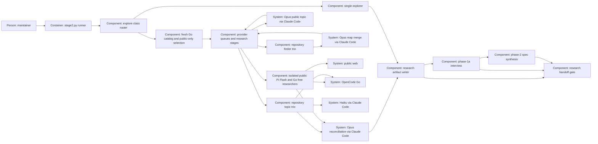

# Design — research-swarm

Proposed shape for [spec.md](spec.md), based on the amended interview Q-7–Q-10.
This replaces the earlier six-topic/free-stage design; the merge decides it.

## Alternatives

- **One runner with provider queues and stage barriers:** one input state,
  common briefs and an auditable public/private boundary; cancellation and
  concurrent output accounting become runner responsibilities.
- **Separate finder, research and judge commands:** independently inspectable
  steps, but operators must bind intermediate results to the same state and
  enforce per-provider limits across commands; more recovery state to govern.
- **A sequential runner with the same roles:** retains comparisons and context
  isolation, but cannot meet Q-7's selected concurrent execution.

Chosen: one runner with provider queues and stage barriers, because existing
explore remains the entry point and one owner can enforce provider limits,
source provenance and publication rules.

## Interfaces

**Caller → router.** Keep `stage2.py explore <change>` and explore-only
`--class`; all stated research/spec/argument classes must agree. Invalid YAML,
empty/unknown class and conflicts exit 2 before any call. Validate given
neighbours as unique repository-relative spec paths present in frozen bytes;
invalid entries exit 2 before models. No spec or plan is
required when research or the argument supplies a valid class. Explicit
`--stage2-off [REASON]` keeps single Haiku 5.5 and its route record; bounded
and spike keep single GLM Flash. Other verbs keep their contracts.

**Declaration → roles.** Replace `research_swarm`'s `free_endpoint`,
`free_roster`, `free_focuses`, `topic6_free` and `flash_pair` with role lists:
`repository_agents` and fixed `online_agents`, each a list of `{endpoint,
model}`;
`finder_agents` equals the repository trio; `finder_merge`, `topic_author`
and `judge` each declare endpoint/model/effort. Resolve the actual declaration
for every call, rather than validating it then using a hardcoded tuple.
Repository/finder roles use DeepSeek Flash and MiMo Flash on `opencode-go`
and Haiku 5.5 on `claude-code-plan`; online roles use DeepSeek Flash, MiMo
Flash and Qwen 3.8 Flash on `opencode-go`. Add Qwen under a separate
`research_modelle` list on that endpoint; leave its `modelle` review ladder
unchanged. Model resolution accepts the union for declared research purposes
only. Remove the unused Zen `opencode-free` endpoint, its fixed roster/focuses
and endpoint-level free billing category; keep `public-web` as a role data
class. Add `research_swarm.online_free: {provider: opencode-go,
suffix: "-free", include: [], exclude: []}` as an explicit dynamic permission
for online research only. No catalog entry grants framework permission.
Unknown Qwen/free-model terms or residency are not invented: all online seats
receive public data only; framework roles retain existing requirements.

**Runner → Pi runtime.** Version checks, catalog access and repository/public
model launches use the same repository-pinned runtime; model launches resolve
through `stage2.PI_WRAPPER`, never a bare `pi` from PATH. The catalog helper
imports that install explicitly. Unit fixtures inject a distinct wrapper
stand-in for all model launch paths and trap bare-Pi escapes; actual-runtime
catalog and isolation checks retain the real wrapper and pin. A restricted
test PATH must not accidentally execute the production wrapper. This repairs
the observed fixture mismatch without widening production discovery or tools.

**Catalog → frozen seats.** Before any swarm model call, a bounded helper
using the repository's pinned Pi runtime refreshes only `opencode-go` with
network allowed and force enabled in fresh scratch configuration. Do not
update Pi, install a client, read user caches or invoke Zen. Pi 1.2.0's
`ModelRuntime.refresh` returns errors and abort state; a CLI listing alone
cannot prove freshness. Its remote catalog wrapper normally caches four
hours and merges shipped models with a remote overlay. Therefore obtain the
successful fresh provider snapshot as well as runtime availability; never
reintroduce a removed free id from the shipped baseline. Validate unique
identities, provider and declared Go transport origin.
Eligibility uses the freshly fetched overlay, not the merged effective list.
In pinned Pi 1.2.0, `isModelType(model, "chat")` treats absent `type` as chat,
and `input` must include `text` (`pi-ai/dist/types.d.ts`, read 2026-10-16).
The read typed chat interface exposes no dedicated tool-support boolean:
do not invent one or equate chat with tool support. Inspect raw catalog
capability metadata and retain its source field/value as proof of explicit
tool support; missing/negative proof excludes the id as `no-tool-support`.
Non-chat/text entries are `not-chat`; baseline-only ids are `baseline-only`.
Phase 4 qualifies any raw capability mapping against real pinned Pi and
records the exact field; until then no tool-capable free availability is
claimed. Eligibility fixtures must cover absent and false support as well
as a positive catalog capability. No extra model probe fits this budget.
Untrusted catalog metadata cannot redirect an invocation to a new endpoint.
A missing shard, failed refresh, malformed result, ambiguous duplicate or
unconfirmed stale-only response fails before model dispatch (exit 1).

Select exact `-free` ids, apply include (empty means all) then exclude;
exclude wins. Invalid policy or role permission exits 2. Every explicit
include must occur in the fresh eligible snapshot, otherwise exit 1 before any
model call, even if excluded. Sort
and deduplicate selected identities; freeze `N`, expected slots and budget.
A valid empty snapshot/filtered set is recorded as measured `N=0`, retaining
the fixed Flash trio; it is different from refresh failure. Record successful
zero, exclusions and missing includes explicitly, never infer availability
from a cached roster. Defaults add every eligible model; no arbitrary count
cap silently drops seats. Runtime removals fail their best-effort slots, without
roster
mutation or substitution; these are named to the judge but do not by themselves
make the run incomplete. The 39 fixed contributions alone are required. All
selected free seats use the same isolated Pi
public path, tool allow-list and receipt validation as the fixed online trio.

The preflight is a metadata operation, not a model invocation; it has a
60-second timeout inside the total 150 minutes, no runner retry, a minimal
environment and only the Go credential where required. No private packet,
repository path or change identity goes to the catalog service. Record Pi
version, source URL/provider, retrieval time, response digest/freshness proof,
raw eligible ids, policy and selected/excluded ids. An offline fixture must
prove forced network refresh and failure handling against real pinned Pi,
including its static-catalog union and non-throwing error behavior.

**Finder → map.** Freeze HEAD and copies/digests of every tracked file and every
untracked non-ignored file under the change folder, plus bounded read-only git
history before dispatch. The private brief is the frozen research header/body
and decisions/spec when present, with bead id only (tracker text not read).
All three finders and the topic author get this same brief. Repository seats
embed identical AGENTS.md; disable runtime instruction auto-loading for every
seat so transport discovery cannot introduce a different initial context. Three
fresh finder contexts
receive the same packet and locator template; Opus 5.5 (`xhigh`) merges
four lists: code/functions, rules/ADRs, tests/gates, neighbours. Entries name
path, symbol/section, reason and originating finder. Header-given neighbours
are retained inputs (a later linked maintainer answer alone can drop one);
additional paths carry `suggested` status. Validate
paths against this worktree and the frozen state. No target design, silent
class change or neighbour acceptance happens at this locator stage.

**Map → topic contexts.** Expand the fixed topic contract in spec into
checked-in repository/public prompts, one topic per invocation. Each topic
has the same brief, all three perspectives and report template for every
seat (three repository models or three Flash plus `N` Go free online models).
Hash the task payload separately from transport envelopes so different CLI
wrappers cannot conceal a different brief. Give repository
peers the same map, private input and topic-scoped evidence. Buffer all peer
reports until the research stage ends, including at failure; no readable
research append exposes a peer answer mid-stage. Finder output is the only
model-produced shared input before topic research. History is collected by
the runner because read-only Pi tools cannot execute git; no tracker command
is delegated. Tracker-backed history not already in the worktree is marked
not read. The accepted paid-Pi residual read risk remains documented: tool
restriction and prompt scope do not equal OS read confinement.

**Topic author → online contexts.** One fresh Opus 5.5 call (`high`) receives
the private brief and produces the public sentence, filtered before online
launch. An online prompt is built only from that sentence, fixed topic 9/10/11
questions, identical perspectives, template and public sources. Never embed
`work_prompt`, AGENTS, map, change name, neighbours or repository reports.
Online relation-to-neighbours explicitly says not assessable. Local slot
ids, run ids and repository paths stay in runner-owned bookkeeping, outside
the transmitted payload. Fresh scratch cwd/home/agent directory and generic
copied extension paths disable discovery, sessions, ambient extensions,
skills and local tools. Allow only `public_search,public_fetch`, with the
extension gate as a second layer and a minimal environment containing runtime
settings and that transport's credential, not user identity/private paths.
The same topic brief is sent independently to all three Flash models and
every selected Go free model; runner-owned seat ids never enter that brief.

Public tools use the repository pin (currently Pi 1.2.0, read 2026-10-16),
retaining the previously repaired interface:
`execute(toolCallId, params, signal, onUpdate, ctx)`, JSON-schema parameters,
and `{content, details}` results. Qualification against the actual binary
is still owed. Search returns decoded destination URLs; fetch admits HTTPS
public destinations only, validates every DNS answer/redirect, pins the
validated address and family, refuses credentials/private addresses/local
files, and records actual page receipts, including failed retrieval outcomes.
Requested and final redirect URLs
both bind to the same receipt. Claims without a matching successful page receipt
stay
`unsupported`; one evidence-backed claim is required per report. A report
with zero successful page-backed claims fails; an individual failed fetch
does not invalidate other claims. Pages and reports are untrusted evidence,
never instructions.

**Queue → invocation.** One provider-wide semaphore for all Go roles, one for
Claude; maximum four each, not four per topic/endpoint alias. Stages are
catalog preflight → finder trio → Opus merge → Opus public sentence →
`33 + 3N` topic calls → Opus judge. Within each stage dispatch ready slots
concurrently. Fail fast between preparatory stages: a failed finder, map or
sentence (including filter rejection, exit 1) prevents every later stage.
Within the topic stage ordinary failures allow siblings to finish; call the
judge only if every required topic report is valid, regardless of failed free
seats. No failure spends an extra call or retries. Freeze exact prompts;
serialize declaration validation,
exact-prompt leak check and audit immediately at dispatch under a lock. Before
gating and again before launch,
check cancellation/deadline. On security refusal set a global stop, cancel
queued work and stop/reap active children; no already-started call is described
as unstarted. Preserve available partial output/receipts with outcome
`cancelled`;
exit 2 overrides incomplete exit 1. No worker writes research:
workers return immutable results to the writer, which appends serialized audit
lines and flushes buffered reports at barriers or abort. Each slot has one
identity and one terminal outcome even on timeout/cancellation.

The frozen budget is `39 + 3N`: finder 3 + merge 1 + sentence 1 + repository
24 + Flash online 9 + free online `3N` + judge 1 (Q-7–Q-10, 2026-10-16).
Catalog preflight takes at most 60 seconds within the run. Deadlines:
sentence 5 minutes, finder/researcher/map merge 10 each, judge 15, whole run
150. Queue wait counts
against the total, not a child's allowance. Reserve 15 minutes for the judge.
Dispatch all required topic slots before free seats: repository 1–8, Flash
online 9–11, topic then declared seat order; free slots follow by topic then
sorted id. Topic launch uses the lesser of its role limit and positive
remaining run time minus the reserve. Unlaunched slots are
`not-started-deadline`; they invalidate completion only when required. Recheck
after a long leak scan. No retries,
recursive delegation, unbounded subprocess or zero-timeout launch.

**Reports → judge.** Validate the fixed report template and claims before a
fresh Opus 5.5 (`xhigh`) reconciles topics 1–11 with the map, original reports
and receipts. Validation retains malformed/failed output as partial evidence;
it cannot label it a complete contribution. Check local symbols/sections in
frozen bytes, public citations against successful fetch receipts, and source
identity in every judgement. Template violations fail a slot. A bad reference
marks that claim `unsupported`, retains it, and prevents a supported score;
only absence of all evidence-backed claims fails an otherwise valid report.
Judge output separates supported facts,
assumptions, applicability, gaps, disagreements and human decisions. Per-model
scores contain counts and global claim-id lists for supported, refuted,
off-brief and unresolved (one disposition per valid claim, off-brief takes
precedence), plus unsupported and the separate unique subset of supported
claims absent from peers. Unresolved disagreement lists both opposing ids
and evidence; judge schema permits no answer field. Reconciliation requires
public-practice, architecture and neighbour comparison sections and gaps.
Phase 6 assesses prose meaning, off-brief scope and faithful dissent; schema
validation does not claim semantic authority. Include every selected Flash/free
seat in scoring and named
missing outcomes; increasing `N` never silently drops a report from the judge.
If reports exceed the actual context capacity, retain them and mark the run
incomplete rather than truncating evidence or adding undeclared judge calls.
No composite ranking or model-specific angles follow.

**Research → interview → spec.** Publish an explicit obligation inventory
covering every accepted raw report's `[DECISION]` question, including claims
scored refuted or off-brief, plus unresolved judge disagreements. Topic-3
`class_assessment` differing from the declaration derives a runner-owned
obligation even when the judge omits it. Topic-5 contradictions and proposed
removal of a given neighbour are also obligations. Topic 6's `volatile` and
`governance` fields hold proposals only; missing governance fails the template.
A judge may
link duplicates to one interview item while preserving every source claim.
Phase 1a adds `research_items:` and `research_claims:` lists to the relevant
Q-record, preserving its context, actual answer and answered-by fields.
Questions can exceed the unchanged class minimum. `[GAP]` remains research
work and `[DETAIL]` remains a reasoned agent choice; neither waives a human
obligation. Phase 2 carries confirmed and given neighbours to the spec header,
except
given paths dropped by an answered maintainer item, and adds
`*Basis:*` claim ids and/or Q-record ids per acceptance criterion. This
redraft uses its existing interview answers as bases; no generated v2 report
is fabricated for it.

**Handoff gate → verification.** New `check_research_handoff.py` reads the v2
manifests/reports and their explicit item and claim references without tracker,
model or network calls. It independently derives required ids from all raw
reports and the judge's disagreements, checks inventory coverage, answered
maintainer Q-records, neighbour parity and criterion bases. Complete v2 runs
alone supply phase 1a/2 and carry obligations. Before
spec.md exists, list valid pending items with exit 0; once it exists, missing
answers exit 1. A spec with v2 runs but none complete exits 1. Incomplete-run
claims cannot support criterion bases. Every complete run in live/archive
folders keeps its obligations across later runs; a Q-record may link several
runs. Malformed evidence remains exit 3 even pre-spec. Every v2 record is
parsed, but incomplete runs carry no handoff obligations; older evidence without
this schema is
explicitly exempt, not retroactively fabricated. Findings exit 1, unreadable
or ambiguous inputs exit 3, measured valid input exits 0; no applicable v2
run is a reported measured exemption. Register blocking/both placement in the
one gate list and regenerate CI. The kit carries checker and fixture-based
tests because the gate travels, without carrying this repository's corpus.
Semantic fidelity remains a review duty; presence checking cannot prove it.

## Data model

Only the runner persists exploration output, append-only inside `research.md`:

| Record | Required fields |
|---|---|
| Run manifest | schema `research-swarm/v2`, opaque run id, UTC date, HEAD, digest/copies of tracked files and untracked non-ignored change-folder files, class/source, exactly `39 + 3N` expected slot identities with required flag, budgets, given neighbours, status |
| Catalog selection | pinned Pi version, provider/source, UTC retrieval time, response digest/freshness outcome, eligible ids, include/exclude, selected ids and `N`, exclusions/reasons or failure |
| Map | four locator lists, source refs, finder provenance, suggested-neighbour status, missing/unread categories |
| Slot | role/topic/endpoint/model, task-payload hash, individual leak audit, start/end/elapsed/outcome, report or partial output, source receipts |
| Claim | global `<run>/<topic>/<seat>/<C1–C7>` id, endpoint/model seat, statement, evidence, kind, confidence/basis, valid/unsupported; topic 6 volatile and required governance when true |
| Topic report | claims, counter-evidence, not read, neighbour relation; local Q1… questions with classification and nonempty local claims list; topic 3 class_assessment with class and claims |
| Reconciliation | all topic sections and three comparisons, exclusive valid-claim dispositions, unique supported subset, unsupported claims, per-model counts/ids, disagreements/opposing ids, gaps, interview items; no answer field |
| Handoff | run-local H-<n>, originating global question/claim ids, reason (`decision`, `disagreement`, `class`, `neighbour`), neighbour confirmations/rejections and reasons |

Use fenced JSON blocks under stable headings as the machine-readable records;
prose may explain them but is not a second source of ids. Claim ids combine
run, topic, model seat and local id; endpoint-qualified seat ids avoid
collisions.
Q-record link fields and spec `*Basis:*` lines reference these exact ids.
Q-record bases use `decisions.md#Q-<id>` inside the owning change; the
checker resolves them there, also after archival. Q-record `research_items`
use `<run>/H-<n>` and `research_claims` use the global claim ids; source
question ids use the same global namespace as claims, with local Q ids.
`neighbours:` is a unique YAML list of repository-relative `spec.md` paths;
this redraft names the read interview-context and Haiku neighbours. Relative
paths must stay inside the worktree; invalid given sources refuse preflight;
failed later reads are named gaps and
do not alone invalidate completion. Suggestions stay separate from given paths.

Freeze HEAD, all tracked bytes and all untracked non-ignored change-folder
files; pre-existing
research is a frozen prefix. Ignore only runner appends and its own `updated:`
restamp, including across midnight. A changed HEAD/digest invalidates complete
publication with exit 1 and named changed paths; retain outputs and failure
state. Reports remain available for
citation even when their producer failed. Scratch files are cleaned after
collecting partial stdout/stderr/receipts; scrub every used secret before any
persistence/diagnostic. No cache, extra database or resumable runtime is added.

## ADR draft

The sole new draft is [ADR 0020 — Phase 1 research
swarm](../../../docs/adr/0020-phase-1-research-swarm.md),
the only ADR added relative to `origin/main` at `6146fde` (read 2026-10-16).
ADR 0019 is the merged Pi-pin decision; retain 0020 rather than create a
second research-swarm ADR.
It amends phase-1 routing under ADR 0007 and research purpose under ADR 0011,
without superseding those whole ADRs or amending numbered D/O decisions.
Only the maintainer's merge accepts it; no answer or approval is recorded here.

## Architecture delta

**Added**

- Finder trio, Opus map merge, provider queues, claim evaluation and handoff
gate.
- Declared online Flash trio plus live-selected Go free seats, same-brief
  report contract and neighbours.

**Changed**

- Larger changes move from six pairs to eight repository and three online
topics.
- Research obligations and evidence are checked through interview and spec.

**Removed**

- The unused Zen free endpoint, fixed free roster/focuses and free/Flash
  pair assignments; the existing small-change route stays available.
