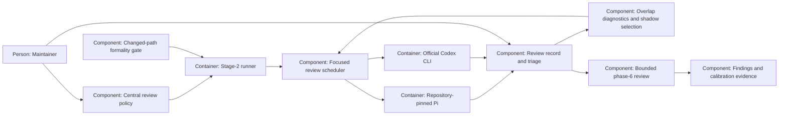

# Design — review-fewer-rounds

Shape the focused-review experiment in `spec.md` from the twelve answered
records and the dated research. The question list remains a proposal, as
the spec's open decision says; this file records no approval.

## Alternatives

- **Extend the runner with more inline branches:** reuses current scheduling
  but mixes the old ladder, new policy, statistics and review budget in an
  already large module, making the central declaration harder to enforce.
- **A policy adapter and a focused-review component behind existing commands:**
  keeps leak/admission/launch/release paths, isolates new state and calculations,
  and permits offline fault tests; owes explicit legacy/new dispatch.
- **A separate review service:** isolates scheduling but adds another lifecycle,
  credentials boundary and operational service for a repository-local job.

Chosen: the policy adapter and focused-review component. This is a proposal
until merge. Existing `prepare-loop`, `review-loop`, `repair` and `review`
remain the entry points; new runs dispatch by a versioned snapshot, not by
guessing from current model names. Old snapshots continue through the old
path until completed or explicitly restarted, never converted into captures.

## Interfaces

- **Central configuration → policy adapter:** consume a `review_loop` section
  in the one central declaration, provisionally `model-endpoints.yaml`.
  The central configuration work (`coding-harness-twvx`) must land first;
  if its canonical location differs, reconcile these artifacts before phase 4.
  Do not add a second file, local override or fallback constant. The adapter
  extends that work's reader/validation contract, not its ownership.
- **Preparation → maintainer → runner:** retain the existing reported,
  input-bound availability receipt. Add the exact lens/seat mapping, model
  evidence dates, lineage and policy digest. Probe declared candidates only;
  missing required seats prevent admission rather than selecting an undeclared
  substitute. A stale or differently configured receipt is refused.
- **Runner → reviewer:** build lens-specific scenario questions from approved
  configuration, spec/plan and a frozen implementation revision. Paid Go calls
  keep existing repository read tools; Codex uses the official CLI's read-only
  route with `gpt-6.1-terra`/`medium`, independent of draft/repair/phase-6 routing.
  No reviewer sees another answer. Calls may execute concurrently within a
  round; no repair runs until required answers have been collected.
- **Reviewer → orchestrator → statistics:** preserve original six-cell rows
  and seat identities, then add triage/grouping metadata rather than changing
  the existing row-table width. Unresolved or ambiguous grouping blocks the
  affected statistics and next action; the estimator does not judge defects.
- **Checks → runner/CI:** one changed-path formalities command runs the new
  checks plus Markdownlint on eligible changed Markdown. Existing all-stock
  Markdownlint remains report-only; existing blocking gates are not relaxed.
  New blocking gate definitions and generated CI belong to the orchestrator.
- **Loop → final review:** after second-round triage and one required final
  repair, use the existing fresh-full-verification guard, verdict-before-release
  order and fresh read-only re-check. A persistent budget gates substantive
  phase-6 launches; row-marking calls do not spend that budget.

## Data model

The orchestrator writes the central policy, only after the maintainer's
question-list answer is recorded. Proposed fields are:

| Record | Fields and owner |
|---|---|
| Policy | Schema version; lens IDs, defect-class questions and approval reference; ordered rounds and lens membership; seat endpoint/model/family/effort; dated precision evidence and cost evidence; trigger `singleton_share`; mode `shadow`; candidate threshold `0.5` and comparison `>` marked provisional; live approval reference absent; phase-6 maximum reviews `2`. Orchestrator, through central configuration. |
| Run snapshot | Run ID, policy version/digest and resolved policy, implementation family, preparation receipt, round input HEAD/diff digests, scheduled lens/seat keys, launched/completed/failed state, completed-round state. Runner, atomically under existing record lock. |
| Triage map | Raw row ID → accepted defect ID or rejected reason, primary defect lens, reporting seat/lens, origin, severity, mechanism key and disposition. Orchestrator, validated by runner. |
| Lens observation | Run/round/lens/input digest, S, f1/f2/f3, singleton share, jackknife total/remaining/completeness, Chao total/remaining/completeness or undefined reason, candidate decision, actual scheduled decision and shadow mode. Runner after triage. |
| Budget | Run ID, launch reservations and results, substantive phase-6 count, configured maximum, unresolved rows and stop proposal; survives external-record release in findings. Runner. |
| Calibration | Per-seat calls, status, duration, provider-reported token counts or unavailable reason, unique accepted yield; repair/verification cycles, execution and lock-wait duration; round-2 new accepted defect IDs/severities. Runner and orchestrator triage. |

Initial proposed seats for each lens are `deepseek-v4.1-flash`,
`mimo-v2.6-flash`, and `gpt-6.1-terra`/`medium`; the spec records the dated
evidence and its limits. Declarations must admit Terra before any call; adding
that loop model does not replace the current Sol route for other phases.
Validate unique lens/seat IDs, endpoint references, model families and distinct
models, question approval, finite round order/count, threshold range [0,1],
declared comparison, integral positive review budget, known keys and duplicate
YAML keys. A live mode without a maintainer-stated calibrated rule is invalid.
The initial sample is shadow; zero accepted defects yield an undefined share,
not a fabricated zero. No default enables live mode.

Two reports describe one defect only when the same faulty mechanism and
trigger violate the same intended invariant and a mechanism correction would
resolve both. A shared file, symptom word or severity is insufficient. Keep
one canonical accepted defect and every raw source row. The primary lens
supports reporting; captures for a lens count only its own seats that actually
reported the defect, never imported votes from other lenses. A repeat from one
seat counts once. An incidental outside-lens BLOCKER stays in the union.

For each complete, triaged three-seat lens: S=f1+f2+f3; share=f1/S when S>0;
jackknife total=S+2*f1/3; Chao total=S+f1*f1/(2*f2) only when f2>0.
Remaining is total−S; completeness is S/total when total>0. Undefined
denominators carry reasons. Store diagnostics and the candidate comparison,
but shadow scheduling always selects every lens. In future approved live
mode, undefined/incomplete evidence cannot authorize skipping a lens.

Round 2 uses the same frozen seating on the post-repair revision and may
report anywhere in this change; no third round follows under the initial
policy. All accepted MAJOR/BLOCKERs and required MINORs enter one final repair;
style cannot create that repair. The orchestrator handles any authorized
outside-change follow-up, never a reviewer or a foreign repair attempt.

Persist successful seat outputs as they arrive. Retrying a failed seat uses
the same revision; if the input changed, refuse the attempted resume and report
why. Reserve a phase-6 budget slot before launching its substantive reviewer;
a timeout or crash does not silently refund it. A reservation of unknown
outcome is reported, not replayed. Marking the existing verdict's loop rows
does not count as a new review. Lost or conflicting budget state refuses.

Use the existing external loop record plus a versioned sidecar block, released
unchanged into `findings.md` after the verdict; do not create a new service or
change table parsing for historical records. Append calibration JSONL to
`docs/research/review-fewer-rounds-calibration.jsonl` through an explicit local
report command. Re-export by run ID replaces that run's records atomically,
without duplicate samples; the command never scans outside repository inputs
supplied by the orchestrator. At 10–20 complete changes it reports observed
round-2 misses for candidate stopping rules, without editing configuration.

## ADR draft

The one MADR-form draft is
`docs/adr/0026-focused-review-with-a-shadow-period.md`, numbered after 0025
at baseline `d23f416c`. It amends ADR 0021 and ADR 0017 without changing a
D-/O-number or an existing ADR body; no continuity-map amendment is required.
Its pending approval and merge-effective status are explicit. There is no
second embedded or separately numbered draft.

## Architecture delta

**Added**

- Focused scheduling, explicit captures, diagnostics and calibration evidence.
- Changed-path checks and a persistent phase-6 launch budget.

**Changed**

- New review runs consume the central policy and use independent mixed-endpoint
  trios rather than the successive free/Flash/ladder sequence.
- Triage controls accepted-defect identities and final repair disposition.

**Removed**

- The until-clean/ladder stop rule for new-policy runs; legacy snapshots keep
  their existing interpretation. No provider, security guard or service is removed.
