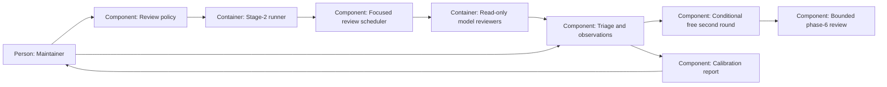

# Design — review-fewer-rounds

This proposal implements the spec and the superseding answers through Q-30.
The existing branch-local ADR 0027 still describes the older policy; the
orchestrator must reconcile it before the decision PR is ready.

## Alternatives

- Extend the existing runner through a versioned policy adapter and focused
  scheduler: reuses the admission, leak check and lifecycle, but needs explicit
  dispatch between legacy snapshots and new runs.
- A separate review service: separates scheduling but adds a service lifecycle
  and credential boundary for a repository-local operation.

Chosen: the adapter and scheduler, because the existing commands remain the
single entry points and legacy snapshots keep their existing interpretation.
The merge of the decision PR decides this proposal.

## Interfaces

- The orchestrator maintains the validated `review_loop` section in the
  existing central `model-endpoints.yaml` (Q-16); preparation consumes it and
  reports the policy-bound availability receipt, fixed seat, eligible pool,
  random draw and seed. The pool is constrained by admission, reachability,
  distinct IDs and the implementer-family rule. Missing eligible seats pause.
- The runner invokes independent read-only reviewers through its existing
  admission and per-call leak checks. Every seat receives all diff chunks on
  the same revision; coverage is recorded. The initial policy uses two seats
  per lens, including bounded changes; text-only skips phase 4b. Failures use
  the declared eligible substitute list and preserve successful results.
- The orchestrator triages the union and records group identities, origin,
  lens, severity, mechanism and disposition; the runner computes diagnostics
  from that evidence. Any incidental out-of-lens row remains actionable when accepted,
  but does not pollute any lens observation.
- Eligible full changes have one independent free second round in shadow,
  except after a nonempty accepted MINOR-only first round whose required
  repairs are complete. Initial free seating draws three distinct families
  with a recorded seed from the reachable pool, excluding Codex.
  A bounded change goes from the first round and repair to phase 6.
- Phase 6 enforces a durable launch budget, a recorded night exception and the
  repair-specific maintainer authorizations. The total exception budget is
  unresolved in the spec and blocks implementation of this boundary. Failed
  or unknown launches cannot release reservations or reset the count.
- Markdownlint blocks only errors on lines written relative to the merge base
  with main; local and hosted callers use the same rule. Artifact formalities
  use their existing or planned checks without claiming semantic proof.

## Data model

- Policy: version, lenses/questions and source, round order, seat rules, fixed
  model and dated precision citation, challenger pool, substitutes, families,
  finding cap, early-end rule, diagnostics, shadow/live mode, threshold and
  phase-6 limits. The orchestrator edits this single validated declaration.
- Run: policy snapshot, change class, implementation revision and model
  family, availability receipt, each draw/seed, seat attempts, chunk coverage,
  successful outputs and failures. The runner persists it under the existing
  run lock and refuses mismatched resume input.
- Triage: raw row and source seat, accepted/rejected disposition, canonical
  defect and mechanism IDs, separately recorded mechanism, trigger and invariant,
  reporting and primary lenses, and repair origin.
  The orchestrator assigns these; the runner does not pretend to decide
  semantic identity. The record is released to `findings.md` after verdict.
- Observation: per-lens f1, f2, S, singleton share, seat-count-aware jackknife and
  Chao where defined; per-model/per-lens accepted share and call/verify
  measurements. The runner labels unavailable values and preserves failed
  attempts. It uses the observed number of seats, never a three-seat formula
  for a two-seat run.
- Calibration: the orchestrator attributes free-round accepted defects as
  pre-existing, repair-introduced or unknown, retaining source rows. Export
  by run ID without duplicate samples; compare signals and documented
  candidate thresholds at ten eligible complete changes without automatically
  selecting a winner. A later maintainer-recorded decision and report must be
  resolvable before a live setting is admitted.
- Budget: durable reserved launches, results, mechanism IDs and repair
  revisions; the maintainer's exact authorization is stored in findings.
  Release, crash, missing data or retry cannot refund or replay authorization.

## ADR draft

`docs/adr/0027-focused-review-with-a-shadow-period.md` is already the one
ADR added by this branch relative to its local `origin/main` reference. It
must be reconciled with Q-16–Q-30 by the orchestrator: this draft attempt is
restricted to the change folder and one *new* ADR file, and 0027 is already
tracked. Creating 0028 here would leave two ADR additions for one decision.
The existing ADR is not evidence that the current proposal is approved.

## Architecture delta

**Added**

- Seeded challenger selection, triage provenance and calibration reporting.

**Changed**

- New runs use central policy and bounded review; legacy runs keep their
  frozen prior settings under the existing two-round house rule.

**Removed**

- Until-clean ladder scheduling for new-policy runs only.
