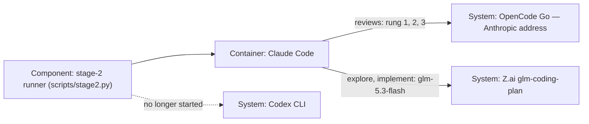

# Design — `stage2-mimo`

How the system is shaped for the change `spec.md` describes, written from
`spec.md`, `research.md` (sections E to K) and `decisions.md`. What the spec
fixes is not decided again here. The class is `feature` and the maintainer
answered "yes" to the ADR question, so this phase carries the ADR draft
(prompts/02b-design.md, decision D-14).

## Alternatives

- **Reviews through OpenCode Go in a ladder, launched by Claude Code on the
  Anthropic address (chosen).** One new endpoint entry holds the three model
  ids in order; the runner's three review verbs all launch `claude` with the
  address pinned; round *n* reads `modelle[n-1]`.
  Consequences: one vendor and one launch path for every review; reordering
  the ladder is a one-line pull request that touches `model-endpoints.yaml`
  and nothing else; the Codex CLI leaves the runner and its thread resume
  goes with it, so phase 6 resumes a Claude Code session instead; the
  address's acceptance of the three ids is unproven until the phase-4 probe,
  and a refusal stops the run rather than being worked around (spec,
  criterion 17).
- **Keep Codex and GLM, and add OpenCode Go as a third reviewer beside
  them.** Consequences: three vendors and two launch paths (a CLI and
  Claude Code), the ladder cannot be one list because two of the reviewers
  are not on the new entry, and ADR 0007's decision 2 would stand unchanged
  — no ADR needed. The maintainer's decision of 2026-10-07 ("every stage-2
  review through OpenCode Go") is not met by it, and criterion 8 ("no verb
  of the runner starts the Codex CLI") refutes it outright.
- **OpenCode's own CLI as the launcher.** Consequences: symmetric with
  today's Codex CLI — a binary, an ask rule, a resumable thread — but the
  Go page documents Claude Code as the way in, and an own integration
  raises the subscription-coverage question that `model-endpoints.yaml`
  already records for Z.ai: only through a vendor-supported tool is the
  plan's terms question closed.

Chosen: the first, because the maintainer's decision names the destination
and Claude Code is the launcher the vendor documents (research §F, §G), and
because a single path is what criteria 8 to 13 can be tested against — one
argv shape, one environment, one place the key passes through.

## Interfaces

Four boundaries carry something across in this change.

- **Runner → Claude Code → OpenCode Go (Anthropic address).** Two sides:
  `scripts/stage2.py` and the `claude` binary the tree pins. Passed: the
  phase prompt, the rung's id as the model, and the address as
  `ANTHROPIC_BASE_URL` (`https://opencode.ai/zen/go/v1/messages`). Promised:
  exactly the settings `review-loop` pins today (tools `Read,Grep,Glob`, a
  fresh empty `CLAUDE_CONFIG_DIR`, `--restricted`, `--strict-mcp-config`,
  permission mode `dontAsk`, `--output-format`, `--no-session-persistence`
  and the runner's allow-listed environment), a session id on standard
  output, an exit of 0 and a non-empty answer inside 30 minutes.
  With it goes the record of who answered: today `run_codex` returns a Codex
  thread id and `spec-review` writes `Reviewer session: codex <id>`; after
  the change the session id comes from Claude Code and the line names the
  rung instead of a fixed word (spec, criterion 9), so `SESSION_LINE`
  becomes a pattern that reads the rung, not a literal.
- **Runner → `model-endpoints.yaml`.** Two sides: the runner's
  `declaration_problem` and the declared entry. Passed: the endpoint name
  and the model id. Promised: an entry that exists, carries
  `darf_sehen: [framework]`, declares a residency and lists the model id —
  without it no call starts (spec, criterion 10). This is where the ladder
  lives: the order of `modelle` is the only thing a reordering changes.
- **Runner → secrets file.** Two sides: `read_secret` at call time and the
  child process's environment. Passed: the OpenCode Go key as
  `ANTHROPIC_AUTH_TOKEN` and `ANTHROPIC_API_KEY` only. Promised: never in
  an argument, never in what the runner prints, never in `findings.md` or
  the loop record (spec, criteria 11 and 12), and no key of another endpoint
  in the same environment (criterion 13).
- **Runner → the two record places.** Two sides: `findings.md` inside the
  worktree and the loop record at `$XDG_STATE_HOME/coding-harness/stage2/
  <change>/loop.md` (falling back to `~/.local/state/...`), outside the
  worktree and outside the git directory. Passed: the call line, the
  session line, `## Round <n> — <rung>, <date>` headings, rows numbered
  `L<n>-<k>` with the rung in the `Reviewer` cell. Promised: a failed round
  writes nothing (criterion 14), a red leak check writes nothing and exits 2
  (criterion 16), and the verdict is written before anything is released
  (criterion 19).

## Data model

- **`model-endpoints.yaml` gains one entry, `opencode-go`**, written by this
  change and read by the runner before each call: `name`, `betreiber:
  "OpenCode (Operator Anomaly Innovations, Inc.)"`, `residenz:
  anbieter-erklaert` (the answer of 2026-10-07), `abrechnung: abonnement`,
  `darf_sehen: [framework]`, `modelle` in ladder order — `deepseek-v4.1-flash`,
  `mimo-v2.6-flash`, `mimo-v2.6-pro` — and a `bemerkung` that names the
  Anthropic address, Claude Code as the launcher, the OpenAI address as a
  measurement and not a path, and the residency note (the Go page gives no
  region; `opencode.ai/privacy` returned 404 on 2026-10-07; the Zen page
  states US and EU for its models). Two existing `bemerkung`s change: the
  `openai-codex` entry no longer claims the spec review and the review, and
  `glm-coding-plan` no longer claims the review loop (spec, criterion 3).
- **Two constants change shape.** `MAX_ROUNDS` goes from 2 to 3, and the 30
  minutes of criterion 15 become one named constant (a timeout applied to
  every reviewer call). The refusal text names the count that actually ran.
- **The round heading and the reviewer cell become data.** `ROUND_HEADING`
  today matches the literal `## Round <n> — GLM,`; it must match the rung
  the round called, because criterion 18 names the heading after the model
  and criterion 19 carries that model into the released row. `answer_block`
  already takes the reviewer as an argument, so the row's `Reviewer` cell
  needs no new field.
- **The producer line becomes `claude-code`.** Line 529 of the runner picks
  `codex` when the endpoint is the Codex tuple; after the change no review
  call is a Codex call, so the branch goes and the producer is
  `claude-code` (research §E, criterion 8's consequence).
- **`decisions/answers/stage2-mimo/adr.yaml` is re-recorded at phase 7**,
  from the maintainer's own words: its present reason still describes the
  superseded Xiaomi wording, and only the maintainer's sentence may stand
  there (house rule 8).

## ADR draft

The text below becomes `docs/adr/0011-stage-2-reviews-through-opencode-go.md`
in this change's decision pull request, with its headings raised by one level
and the header below between `---` lines. `0011` is the first free number on
2026-10-07; phase 7 renumbers it if a lower number has been taken meanwhile.

```yaml
title: "ADR 0011 — Reviews run through OpenCode Go, and ADR 0007's reviewer list is amended"
category: adr
status: accepted
created: <the day the pull request is opened>
last_reviewed: <same>
updated: <same>
owner: framework-architect
provenance: human-decided
produced_by: {kind: llm-session, name: opencode, version: "<same>"}
review: {status: pending, approved_by: null, approved_at: null}
tags: [adr, stage-2, opencode-go, reviews]
```

### ADR 0011 — Reviews run through OpenCode Go, and ADR 0007's reviewer list is amended

* Status: accepted by the merge of the pull request that carries this file.
  Until that merge, the pull request's state is the decision's state: open
  is proposed, closed is rejected. Amends ADR 0007 (decisions 2 and 3);
  supersedes no ADR. Decision D-13 stands as ADR 0007 set it — no criterion
  of D-13 changes here.
* Review: the decisions the maintainer stated on 2026-10-07 in a Claude Code
  session (bead coding-harness-ymx: every stage-2 review through OpenCode
  Go; round 2 on `mimo-v2.6-flash`; the entry declares `anbieter-erklaert`;
  the compatibility probe runs in phase 4 before the merge) · the acceptance
  is the merge commit and is written nowhere else, so the header's `review`
  stays empty (ADR 0008) · Decider: maintainer · prepared by an opencode
  session
* Date: 2026-10-07 · takes effect on merge

#### Context

* **ADR 0007** (accepted by the merge of pull request #60) sets where
  framework content may flow: to `openai-codex` through the official Codex
  CLI, and to `glm-coding-plan` through Claude Code — "Nothing else goes,
  and nowhere else". It gives the reviews to Codex and GLM: the spec review
  and the review to Codex, the loop between implementation and phase 6 to
  GLM, and, since 2026-10-06, exploration and implementation to GLM 5.3
  Flash.
* **The maintainer decided otherwise on 2026-10-07** (bead
  coding-harness-ymx): every stage-2 review — 2a, 4b and 6 — runs on
  OpenCode Go, with a fixed ladder of three models for the loop's rounds and
  a fixed model for the spec review and the review. Without this record the
  runner's declaration of `opencode-go` would run against ADR 0007's
  decision 2, which is a decision nobody made.
* **What OpenCode Go is** (research §E to §K, read 2026-10-07): OpenCode
  (Operator Anomaly Innovations, Inc.) sells OpenCode Go by subscription
  with a Go key; the vendor documents Claude Code as the way in and says no
  custom-header wrapper is needed for it; three model ids are served —
  `deepseek-v4.1-flash`, `mimo-v2.6-flash`, `mimo-v2.6-pro`. The Go page
  lists them under `https://opencode.ai/zen/go/v1/chat/completions` only,
  while the Anthropic-compatible address
  `https://opencode.ai/zen/go/v1/messages` is the one Claude Code needs —
  whether it accepts the three ids is measured, not assumed (below).
* **The class does not change.** What may be sent stays the `framework`
  class of `model-endpoints.yaml`: rules, templates, process, tests.
  Customer code and customer rows go to neither endpoint, and the leak check
  before every call is what blocks them (unchanged from ADR 0007).

#### Decision

1. **Framework content may also go to `opencode-go`** — through Claude Code,
   which the vendor lists as a supported tool, with the three ids below.
   Reviews only: the spec review (2a), the review loop (4b) and the review
   (6). The sentence of ADR 0007 decision 2 that closes with "Nothing else
   goes, and nowhere else" now closes with Codex, Z.ai's GLM and OpenCode
   Go; nothing else goes, and nowhere else. Customer code and rows go to
   none of the three.
2. **The reviewer roles move.** The spec review and the review leave Codex,
   the loop leaves GLM, and Codex and GLM remain declared endpoints for what
   still routes to them — explore and implement stay on GLM 5.3 Flash, and
   `openai-codex` keeps what nothing in this repository routes to any more
   until a later change retires it. The Codex CLI is started by no verb of
   the runner afterwards.
3. **The ladder is data, not code.** Round *n* of the loop calls
   `modelle[n-1]` of the `opencode-go` entry: round 1
   `deepseek-v4.1-flash`, round 2 `mimo-v2.6-flash`, round 3
   `mimo-v2.6-pro`. Rounds 1 and 2 both run, each still held by an undecided
   row; round 3 starts only when round 2 wrote at least one row whose status
   begins `taken`. The loop runs at most three rounds. Reordering the list is
   a one-line pull request that touches `model-endpoints.yaml` and nothing
   else.
4. **The unconfined reads accepted for ADR 0007's reviewers extend to the
   rungs.** The prompts ask the model to read nothing outside the worktree
   and the repository's git directory — a request, not a lock — and the
   maintainer accepted that residual risk for reviewers on 2026-09-30.
   It reaches the three rungs by this record.
5. **The key stays in the runner.** It is read from the secrets file at call
   time, reaches the call only in its environment as `ANTHROPIC_AUTH_TOKEN`
   and `ANTHROPIC_API_KEY`, never appears in an argument, and an OpenCode Go
   call carries no other endpoint's key.
6. **The address is measured before anything builds on it.** Three calls, one
   per rung, run through the runner in phase 4 of the change that carries
   this record — declaration and leak check in front of each, as one special
   run whose commits are named in the pull request body. That is the only
   content leaving before the merge, and the maintainer accepted it on
   2026-10-07. If the address refuses an id, the run stops and reports it:
   no second address, no second design, no substituted model.

#### Options considered

* **Keep Codex and GLM (chosen against).** Three vendors and two launch
  paths would stay, the ladder could not be one list, and the maintainer's
  decision would not be met; criterion 8's "no verb of the runner starts the
  Codex CLI" refutes it outright.
* **OpenCode's own CLI as the launcher.** Symmetric with today's Codex CLI —
  a binary, an ask rule, a resumable thread — but the vendor documents
  Claude Code, and an own integration reopens the subscription-coverage
  question `model-endpoints.yaml` records for Z.ai.
* **The OpenAI address instead of the Anthropic one.** The vendor lists it
  too; it is kept as a remark and measured, never as a path, because a
  fallback is what criterion 17 forbids.
* **Reviewer per phase written as code.** A model id as a literal in
  `scripts/stage2.py` would make every reordering a code change with tests
  to match — the opposite of what the decision asks for.

#### Consequences

* **Nothing leaves before the merge except the probe.** The three probe calls
  of phase 4 are the only foreign calls of the change, and the maintainer
  accepted them explicitly on 2026-10-07; every other call is a stage-2 run
  after the merge. Until then `main` routes as ADR 0007 says: spec review and
  review on Codex, the loop on GLM, exploration and implementation on GLM 5.3
  Flash, and this change's own review runs on Opus 5.5.
* **A rule, not proof, at two places.** The address accepting the three ids
  is measured once, in phase 4; a refusal found later stops that run
  (criterion 17) instead of opening a second design. And which model a round
  calls is held by a test that reorders a fixture's list — a review of the
  list itself is what keeps a wrong order from shipping.
* **The continuity chain stops at ADR 0007.** This record amends ADR 0007,
  not decision D-13: D-13's criteria (three measured stage-2 runs,
  lakeswitch-ai's disclosure decision, a green leak check in every run, a
  declared endpoint with its residency) are untouched here, and the endpoint
  list is ADR 0007's text. The map in `scripts/check_decision_continuity.py`
  therefore gains nothing, and the D-13 row of the target document says the
  same thing it said. This is a `[DETAIL]` of this design; the reason is in
  this sentence's first half and is reversible.
* **Data use and terms.** The Go key sits in the secrets file and reaches the
  child process's environment only. The entry declares `anbieter-erklaert`
  because the Go page gives no region, `opencode.ai/privacy` returned 404 on
  2026-10-07 and the vendor's Zen page states US and EU for its models — the
  provider explains the residency, and the measurement stays open as a
  `[GAP]` of `spec.md`.
* **The runner's shape.** `run_codex` and the Codex tuple leave; the ask rule
  on a directly typed `codex` and `.claude/settings.json` stay as they are —
  a non-goal of this change and the subject of bead coding-harness-amp.
* **The resume changes with the launcher.** Phase 6 resumes a Claude Code
  session id instead of a Codex thread; a session that cannot be resumed
  starts a fresh one and says so in `findings.md` (criterion 9).

#### Validation

* `python3 -m pytest tests/test_stage2.py tests/test_model_endpoints.py -q`
  green: the runner launches `claude` with the address, the rung and effort
  `max` and the settings of criterion 8; no recorded argv holds `codex`; the
  ladder round *n* → `modelle[n-1]` holds in a reordered fixture; three
  rounds are the limit and round 3 only after a taken row; the 30-minute
  limit is one constant and a stand-in that outlasts it is stopped; the key
  is in no argv, no print and no record; a red leak check exits 2 with
  nothing written.
* `make verify` green, and `scripts/touch_map.py origin/main HEAD` naming no
  protected area: `docs/adr/` gains only this file, `scripts/leakcheck.py`,
  `scripts/harness.py`, `scripts/touch_map.py`,
  `scripts/check_decision_continuity.py`, `scripts/new_change.py`,
  `docs/architecture/`, `ROADMAP.md`, `.claude/settings.json` and
  `model-endpoints.yaml`'s German keys are untouched.
* The three probe commits named in the pull request body, each with its
  rung's id and the answer's first line.

## Architecture delta



**Added**

- The endpoint `opencode-go` with its three ordered rungs, its operator,
  billing, residency and `darf_sehen: [framework]` (`model-endpoints.yaml`).
- The review call's Anthropic address and the one 30-minute constant in the
  runner.
- Round 3 of the loop and the condition that starts it (a `taken` row of
  round 2).
- ADR 0011, drafted here and carried into the decision pull request.

**Changed**

- `spec-review`, `review-loop` and `review` launch Claude Code on the
  Anthropic address instead of the Codex CLI and the GLM launch; the
  producer line of the record reads `claude-code`.
- `MAX_ROUNDS` 2 → 3; the round heading, the `Reviewer` cell and the session
  line name the rung and its id instead of the literals `GLM` and `codex`.
- The session phase 6 resumes: a Claude Code session id, not a Codex thread.
- The `bemerkung`s of `openai-codex` and `glm-coding-plan`, which stop
  claiming the reviewer phases.
- The routing the doctrine describes: `docs/WORKFLOW.md` §4,
  `prompts/02a-spec-review.md`, `prompts/04b-review-loop.md`,
  `prompts/06-review.md` and `AGENTS.md`'s stage-2 paragraph.

**Removed**

- `run_codex()`, the Codex tuple and the `codex` branch of the producer
  line: no verb of the runner starts the Codex CLI any more.
- The literal `GLM` in the round heading and in the released rows, and the
  fixed reviewer word of the session line.
