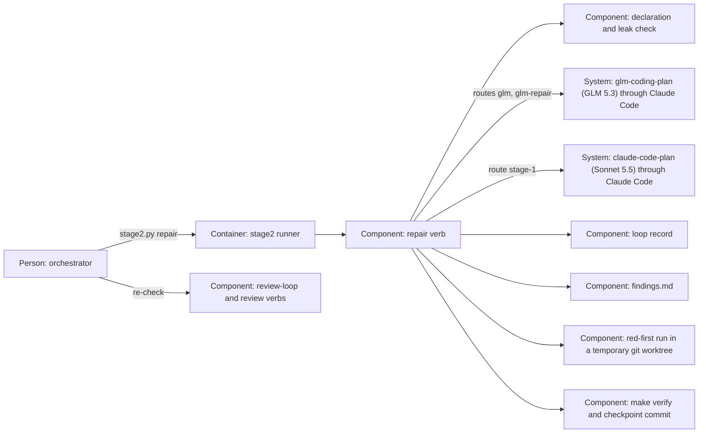

# Design — `stage2-repair`

How the runner is shaped for the repair verb of `spec.md`, written from
`spec.md`, `research.md` and `decisions.md`. Phase 2b runs because the class is
`feature` and the maintainer answered "yes" to the ADR question (Q-4).

## Alternatives

Three choices shape the change.

**Where the verb lives.**

- **A verb `repair` beside `implement` in `scripts/stage2.py`**, sharing
  implement's guards through its existing helpers (`preflight`,
  `begin_work_call`, `run_work_model`, `remove_changed_credential`,
  `worktree_tree`, `attempt_files`, `verify_attempt`, `restore_baseline`,
  `quote_block`, `checkpoint`). Consequences: one place for every guard, so a
  later fix to one reaches both verbs; `checkpoint` and the route block take
  the verb's words as a parameter; the runner file grows by one verb.
- **A mode of `implement`** (`implement --findings`). Consequences: no new
  verb, but one verb with two contracts — the plan as baseline, or the taken
  rows — two commit messages and two answer forms; the doctrine's "implement"
  would mean two things.
- **A script of its own.** Consequences: a second entry point for foreign
  calls, against "the runner is the only way" (`docs/WORKFLOW.md` §4), and
  the guards copied or imported across files.

Chosen: the verb beside `implement`, because the guards stay in one place and
the runner stays the only way in.

**How "red first" is shown.**

- **A temporary git worktree at the baseline**, its `tests/` replaced by the
  worktree's `tests/` after the attempt, the named test run alone by pytest.
  Consequences: the test meets the old code inside a real git checkout, so a
  test that calls git behaves as it does in the suite; one pytest start per
  code row; the runner must remove the worktree and its admin entry on every
  path.
- **An export by `git archive`.** Consequences: nothing to remove in the git
  directory, but the copy is no git checkout: a test that calls git fails for
  that reason alone and reads as red first when it is not.
- **The model's word.** Consequences: no run at all, but the model has no
  command tool, so nobody would have seen the test fail; Q-5's rule would be
  a sentence again.

Chosen: the temporary git worktree, because only a real checkout of the old
code makes a failure mean "the finding was there".

**Who writes the Status.**

- **The runner, from the model's fixed lines.** Consequences: the record
  outside the worktree can be written; each line is checked before anything
  is written; the statuses of `findings.md` enter the checkpoint commit.
- **The model, with its file tools.** Consequences: the record lies outside
  what `--restricted` file tools reach, so loop rows could not be marked
  before the release; nothing would check a Status against the repair.

Chosen: the runner. The choices are a proposal; the merge of the pull request
decides them.

## Interfaces

- **Command line** — the orchestrator calls `python3 scripts/stage2.py repair
  <change> [--stage2-off [REASON]]`; the runner promises exit 0 after its one
  checkpoint commit, 1 when a call or the post-run checks failed, 2 when it
  refused, the reason on standard error.
- **Runner → model** (Claude Code, against Z.ai on the GLM routes, against
  Anthropic on `stage-1`) — the runner passes one prompt file: the full
  `prompts/04-implement.md`, the rules of `AGENTS.md`, the repair block (the
  rows, the form of a fixed line, the red-first rule), the accepted `spec.md`
  and `plan.md`, the baseline commit, the earlier attempts' diagnostics, and
  the read request last. The model edits files with `Read,Grep,Glob,Edit,Write`
  and answers with one fixed line per taken row.
- **Runner → git** — a temporary worktree at the baseline, outside the
  repository's worktree, removed with its admin entry after the red-first runs;
  the one checkpoint commit.
- **Runner → pytest** — in the temporary worktree, one run per named test,
  with the interpreter `make verify` would choose (the checkout's
  `.venv/bin/python3` when it exists, else the runner's own), the runner's
  allow-list environment and a time limit; exit 1 or 2 is red first.
- **`scripts/stage2_runs.py` → `findings.md`** — reads a released row whose
  Status begins `fixed` as taken.

## Data model

Nothing new is stored; four existing records gain words.

- **Status cell** of a loop row (the record, a released block) and of a
  phase-6 row (`findings.md`). The orchestrator writes `taken — <reason>`,
  `taken — not a test — <reason>` or `rejected — <reason>`; the runner writes
  `fixed — tests/<path>::<function>` or `fixed — not a test — <reason>` after
  a passing attempt. No other cell is written by the verb.
- **`findings.md`** — one audit line per attempt with the verb `repair`, a
  failed attempt's quoted block below its line, the fixed statuses.
- **`plan.md`** — on route `stage-1`, a block `## Runner route — <date>` with
  `Stage-1 route: repair · model claude-sonnet-5-5 · reason: <reason>.` before
  `## Time used`; the model adds its measured line below that heading.
- **git history** — one commit `fix(<change>): repair taken findings <IDs>`,
  author `stage2-runner <stage2-runner@invalid>`, as implement's checkpoint.

## ADR draft

`docs/adr/0015-glm-5-3-repairs-taken-findings.md`, in the form of
`templates/adr.md`, travels in this change's pull request, which makes it a
decision pull request. It amends ADR 0011's decisions 2 and 3 — the repair
joins what routes to GLM, and a fixed row counts for round 3 — records that no
reviewer repairs its own findings, and takes effect when the maintainer merges
it (ADR 0008). The number is 0015 because the open branch
`feat/adr-owning-change` holds 0014.

## Architecture delta

**Added**

- The `repair` verb of the stage2 runner, with its route to `glm-coding-plan`
  on `glm-5.3` and its Sonnet 5.5 fallback on `claude-code-plan`.
- The red-first run: a temporary git worktree at the baseline and one pytest
  run per named test.
- The Status words `taken — not a test — <reason>` and `fixed — …`, and the
  orchestrator's `taken`/`rejected` on a phase-6 finding.

**Changed**

- `review-loop`, `review` and `release-loop` read a fixed loop row as decided
  when its `Broke a test` is filled, and round 3 counts it as taken.
- `scripts/stage2_runs.py` counts a fixed loop row as taken.
- The `glm-coding-plan` entry's remark names the repair verb.

**Removed**

- The Claude Sonnet sub-agent as the repairer of taken findings: a way of
  working, not code, so nothing is deleted.
