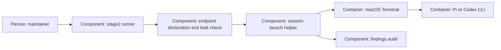

# Design — stage2-session

The revised `spec.md`, `research.md` and answered `decisions.md` are the
contract. Codex prepared design/plan under the explicit budget takeover.
Since 2026-10-09 the OpenCode Go path launches Pi instead of the OpenCode CLI
(decisions Q-1 to Q-6); the plan for that move is
`docs/research/2026-10-09-session-verb-on-pi-plan.md`.

## Alternatives

- Launch the TUI in the runner's terminal: fewer parts, but takes the
  maintainer out of the orchestrating session and keeps the runner attached.
- Dispatch a safely quoted command to macOS Terminal: the runner returns
  after acceptance, the maintainer works independently, and the audit says
  exactly that. Later startup errors stay visible in the new window.

Chosen: Terminal dispatch, as requested. No program-start handshake is added:
the maintainer accepted that boundary in F-2. A helper handles mechanics while
`stage2.py` remains the sole public model-launch entry.

## Interfaces

- Public CLI: `stage2.py session <change> --model <id> [--handover <path>]`.
  No stage-2-off bypass. Canonical worktree/cwd checked against git's common
  directory; attached branch required. Unsupported platforms refuse.
- Declaration: `openai-codex` uses its exact listed model via Codex;
  `opencode-go/<model>` requires endpoint `opencode-go` to list the bare
  `<model>` in `modelle` (as ADR 0011 declares it) and selects Pi (Q-5); Pi
  gets the full ID. No aliases, suffix guessing or reviewer ordering.
- Shared preflight: the helper receives the invoking runner module explicitly
  and uses its `preflight`, `checked_prompt`, `foreign_env`, findings helpers
  and exception types, avoiding duplicated classes under `__main__`.
- Pi: `require_pi` first (exactly 1.1.0, else refuse before dispatch). The
  runner writes one policy extension into a fresh private directory under
  `.stage2-sessions/` and starts Pi with `--no-extensions` and `-e <that
  file>` (discovery off, exactly one extension), `--offline`, `--no-approve`
  and `--model <full id>`. The extension's `tool_call` handler blocks `read`,
  `grep`, `find`, `ls`, `edit` and `write` on a path outside the worktree
  and blocks writes to its own file, `.stage2-sessions/` and `.pi/` (Q-3);
  it asks through the UI before a `bash` call that matches a dangerous
  pattern (Q-2, as Pi's shipped `permission-gate.ts` does) and blocks that
  call when no UI exists; a failing handler blocks the call. Pi has no
  sub-agent and no web-fetch tool, so there is nothing to deny for them.
- Read-back: the runner confirms that the extension *loaded* (its flag shows
  in `pi --help` with discovery off; Q-1). Behaviour is held by handler tests
  run without Pi and without a model. Whether the handlers act inside a live
  Pi is not checked at launch; this is the weaker guarantee the maintainer
  chose knowingly. A second prompt scan precedes GUI dispatch.
- Sign-in: Pi reads `<agent dir>/auth.json`, default `~/.pi/agent`, which the
  maintainer fills with `/login` (Q-6). The runner reads nothing from it,
  hands over no key and sets no `PI_CODING_AGENT_DIR`; the environment
  allow-list must carry what Pi needs to find that directory, which package 7
  measures on the Mac.
- Terminal: fixed AppleScript source receives the shell command as argv data;
  `cd`, `env -i` variables and CLI arguments are separately shell-quoted.
  No caller tokens/model overrides. Codex uses workspace-write, on-request
  approval and `--no-daemon`; Pi takes the full handover text as its
  positional prompt after the options, Codex after `--`. Bound prompt/command
  arguments.

## Data model

One audit line per attempt in `findings.md`: date, session verb, requested
model, endpoint, handover source, real file/commit/rule counts, attempt ID and
status. Persist `pending` before dispatch; replace only that status with
`accepted`/`failed`, preserving prior findings. If the final update is
unwritable, return failure and retain pending evidence, never claim to undo
an already accepted terminal command.

Only a fresh private policy subdirectory under gitignored `.stage2-sessions/`
is created. Refuse a symlink/outside runtime root; failure cleans only the
created private directory. Accepted dispatch retains policy for the new CLI
to load; it contains no prompt or credentials. The runner cannot observe the
session's end, so it never removes an accepted directory; the maintainer may
delete `.stage2-sessions/` once no session runs. No project/global config is
replaced.

## ADR draft

`adr-0007-session-amendment.md` follows the MADR sections of `templates/adr.md`.
It extends runner-only launches to sessions and names start-only coverage,
dispatch evidence and confinement limits, and since 2026-10-09 the move of
the interactive OpenCode Go launcher from the OpenCode CLI to Pi (one
decision, Q-4). It changes no reviewer selection.
Per the takeover request, the protected `docs/adr/` remains untouched; no agent
records an accepted ADR on the maintainer's behalf.

## Architecture delta

**Added**

- Checked interactive dispatch, a loaded-extension check and attempt audit.
- Runner-owned worktree policy extension (Pi).

**Changed**

- Runner-only access extends to interactive launch snapshots; no continuous scan.

**Removed**

- None: existing phase calls remain intact.
