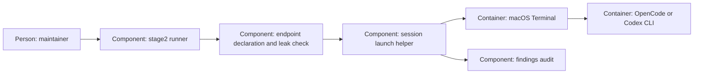

# Design — stage2-session

The revised `spec.md`, `research.md` and answered `decisions.md` are the
contract. Codex prepares design/plan under the explicit budget takeover.

## Alternatives

- Launch the TUI in the runner's terminal: fewer parts, but takes the
  maintainer out of the orchestrating session and keeps the runner attached.
- Dispatch a safely quoted command to macOS Terminal: the runner returns
  after acceptance, the maintainer works independently, and the audit says
  exactly that. Later startup errors stay visible in the new window.

Chosen: Terminal dispatch, as requested. No program-start handshake is added:
the maintainer accepted that boundary in F-2. A helper handles mechanics while
`stage2.py` remains the sole public model-launch entry.

## Interfaces

- Public CLI: `stage2.py session <change> --model <id> [--handover <path>]`.
  No stage-2-off bypass. Canonical worktree/cwd checked against git's common
  directory; attached branch required. Unsupported platforms refuse.
- Declaration: `openai-codex` uses its exact listed model via Codex;
  `opencode-go/<model>` requires endpoint `opencode-go` to list the bare
  `<model>` in `modelle` (as the reviewer change declares it); the CLI gets
  the full ID. No aliases, suffix guessing or reviewer ordering. Go remains
  disabled in production until its separate declaration lands.
- Shared preflight: the helper receives the invoking runner module explicitly
  and uses its `preflight`, `checked_prompt`, `foreign_env`, findings helpers
  and exception types, avoiding duplicated classes under `__main__`.
- OpenCode: fresh worktree policy file and matching inline configuration
  pin a dedicated primary agent/model, deny external directories/subagents,
  ask before Bash and disable external plugins (`--pure`). Inspect effective
  `debug agent` output without printing it or invoking diagnostic tools.
  Add explicit denials for auto-inserted exceptions, recheck once, and
  refuse any unresolved override. A second prompt scan precedes GUI dispatch.
- Terminal: fixed AppleScript source receives the shell command as argv data;
  `cd`, `env -i` variables and CLI arguments are separately shell-quoted.
  No caller tokens/model overrides. Codex uses workspace-write, on-request
  approval and `--no-daemon`; OpenCode uses the checked primary agent and
  full handover text as `--prompt=<text>`; Codex takes it after `--`. Bound prompt/command arguments.

## Data model

One audit line per attempt in `findings.md`: date, session verb, requested
model, endpoint, handover source, real file/commit/rule counts, attempt ID and
status. Persist `pending` before dispatch; replace only that status with
`accepted`/`failed`, preserving prior findings. If the final update is
unwritable, return failure and retain pending evidence, never claim to undo
an already accepted terminal command.

Only a fresh private policy subdirectory under gitignored `.stage2-sessions/`
is created. Refuse a symlink/outside runtime root; failure cleans only the
created private directory. Accepted dispatch retains policy for the new CLI
to load; it contains no prompt or credentials. The runner cannot observe the
session's end, so it never removes an accepted directory; the maintainer may
delete `.stage2-sessions/` once no session runs. No project/global config is
replaced.

## ADR draft

`adr-0007-session-amendment.md` follows the MADR sections of `templates/adr.md`.
It extends runner-only launches to sessions and names start-only coverage,
dispatch evidence and confinement limits. It changes no reviewer selection.
Per the takeover request, the protected `docs/adr/` remains untouched; no agent
records an accepted ADR on the maintainer's behalf.

## Architecture delta

**Added**

- Checked interactive dispatch, effective-policy diagnostics and attempt audit.
- Runner-owned worktree policy files.

**Changed**

- Runner-only access extends to interactive launch snapshots; no continuous scan.

**Removed**

- None: existing phase calls remain intact.
